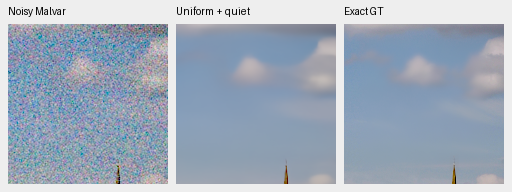
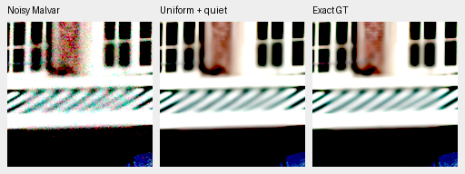

# Separate corrections for quiet regions and weak detail

The [paired-head input replay](paired-feedback-paths.md) slightly
improves the fine-detail tradeoff by smoothing the Bayer
innovation. Scaling any of its single-frame corrections still
raises exact-flat error above Corpus 100k at every positive
strength on the original 64 photos. This follow-up adds a
separate quiet-region correction to the same output.

## Region-specific delivery

The quiet path takes the native 5×5 high-pass of the parent's
luminance. It subtracts a fraction of that field where the
larger green-phase support window is weak. A 17×17 native
maximum propagates the texture support around edges before
computing the smoothing weight. The correction excludes the
same clipped neighborhood as the fine head. The tested weights
are 0.05 and 0.15. Each is evaluated alone and in combination
with the uniform and directional innovation-based detail lifts.
The two routes use the same single noisy frame and the same
frozen Corpus 100k and paired-head EMAs. A weak-support region
can contain true fine texture, so the exact known increments
measure the cost of the quiet path.

Both independent query redraws of 96 ISO6400 photos use the
same native coordinates, targets and frozen parents as the
input replay. Each candidate's largest strength that meets
both Corpus 100k error budgets is fitted on the original
64 photos. The 32 additional photos measure the fixed
candidate at that strength. Fine-increment and exact-flat
errors concern the 1/8 to 1/3 cycles/pixel luminance band.

| Policy at its fitted strength | Aligned response difference (percentage points) | Fine-increment RMS difference (DN16) | Exact-flat RMS difference (DN16) |
| --- | ---: | ---: | ---: |
| Quiet smoothing 0.15 | −0.004 | −0.030 | −0.172 |
| Uniform detail lift and quiet smoothing 0.15 | +0.167 | +0.061 | −0.164 |
| Directional detail lift and quiet smoothing 0.15, scaled to 0.820 | +0.204 | +0.093 | −0.133 |

Differences are against Corpus 100k on the additional photos.
The quiet path alone lowers increment error with interval
[−0.058, −0.009] DN16. The uniform combination retains full
strength on the calibration photos and recovers weak detail
on the additional photos, with a small mean increase in
increment RMS whose interval is [−0.030, 0.195] DN16.
Its flat reduction has interval [−0.209, −0.122] DN16.
Directional increments have a similar uncertain increase
with more target-aligned detail. The combined routes
substantially improve the measured flat tradeoff over
the detail-only policies. Both still add draw variance.
[Complete metrics and viewing record](results/paired-flat-companion-v1/publication.json) ·
[Frozen observations and model code](results/paired-flat-companion-v1/evidence.tar.xz).

## Native exact-target crops

Both triplets show noisy Malvar, the nominal uniform detail
lift with 0.15 quiet smoothing, and the exact target. They use
native 160×160 pixels at `[48,48,160,160]` inside the original
256×256 GRBG query. Shot/read is `0.00128/6.5536e-6`, with
ADC16 black fraction 0.03, capture exposure 0.33, display
exposure ×3.0303 and contrast ×2. The paired EMA is
`02f8d5e6664bd580bafe2abeb3b8584b070b60bfadfefaff587cadd8bd643d7f`
above Corpus 100k EMA
`87b96f3c487b9edaf1c477742b6c38f2a82cc6b20a94716d51cc8cf46a17a760`.

The largest measured fine-increment improvement keeps the sky
smooth and the broad clouds recognizable. The faint wisps in
the target remain soft. Query origin `[308,208]`. Mattbuck,
CC BY-SA 3.0.
[Source photo](https://commons.wikimedia.org/wiki/File:Bedminster_railway_station_MMB_26.jpg) ·
[All methods](images/paired-flat-companion-v1/086-iso6400-independent-r0-role0-comparison.png) ·
[Exact-flat view](images/paired-flat-companion-v1/086-iso6400-independent-r0-role2-comparison.png).

The largest measured regression keeps the visible diagonal
bars and window frames. Faint detail along the bars and
brick face stays blurred. Query origin `[380,118]`. Slaunger,
CC BY-SA 4.0.
[Source photo](https://commons.wikimedia.org/wiki/File:Couple_selfie_stick_Konigssluis_Amsterdam_2016-09-13-6621.jpg) ·
[All methods](images/paired-flat-companion-v1/094-iso6400-independent-r0-role0-comparison.png).

## Standing GFX100S comparisons

All eight boards were viewed with matched 160×160 native
coordinates and the same render settings for each method.
The main scene uses DSCF3879 at nominal ISO6400 and ×4
display exposure. The cab uses DSCF3842 at ×16 with both
nominal and transferred DSCF3879 shot/read
`0.0014635776/1.0715704e-6`. DSCF3880 and DSCF3835 ISO100 AHD
and both cab camera JPEGs are qualitative references with
different exposure, aperture and some moving subjects.

| View | Native boards |
| --- | --- |
| DSCF3879 main scene | [Sky](images/paired-flat-companion-v1/main-overcast-sky-main-overcast-sky.png) · [Building](images/paired-flat-companion-v1/main-building-detail-main-building-detail.png) · [Foliage](images/paired-flat-companion-v1/main-foliage-main-foliage.png) · [Coarse fence](images/paired-flat-companion-v1/main-chain-link-fence-main-chain-link-fence.png) |
| DSCF3842 nominal | [Left](images/paired-flat-companion-v1/mesh-nominal-fine-green-mesh-left.png) · [Right](images/paired-flat-companion-v1/mesh-nominal-fine-green-mesh-right.png) |
| DSCF3842 transferred | [Left](images/paired-flat-companion-v1/mesh-profile3879-fine-green-mesh-left.png) · [Right](images/paired-flat-companion-v1/mesh-profile3879-fine-green-mesh-right.png) |

The uniform combination changes the sky by 0.190 DN16 RMS
and the coarse fence by 0.193 DN16 RMS in camera RGB. The
quiet path alone leaves the foliage and coarse fence exactly
as rendered by the parent. The coarse crossings remain visible
and the sky stays smooth. Thin building and foliage detail
stay soft. The fine cab changes by 0.99–2.97 DN16 RMS, with
incomplete small crossings and background mottle under both
noise profiles. The numeric observations and boards are from
frozen weights and this scoped ISO6400 evaluation.
[Fixed PSNR history](performance-history.md).

The [48-photo weak-edge transfer](weak-edge-distill.md#fixed-policy-transfer-to-the-weak-edge-panel)
confirms the flat-region error reduction. At ISO6400 its
positive response is accompanied by higher increment error,
especially close to the shared strong step.
