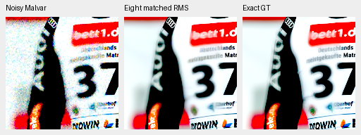
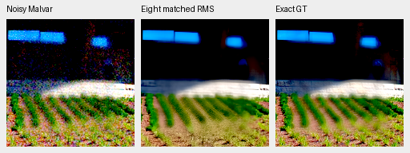

# Exact orientation averaging for paired fine detail

Eight orientations of the guarded paired luminance head make a
small improvement in the coupled ISO6400 comparison. At the same
correction strength, independent-draw error and flat error stay
near the single-orientation result. Both standing GFX families
look similar and the fine cab crossings remain incomplete.

## Matched correction strength

The [paired luminance head](paired-luminance-detail.md) and Corpus
100k EMA are frozen. The parent runs once. Each orientation
rotates or reflects the parent RGB, original Bayer samples,
variance and layout together. The inverse transform puts the
head's luminance correction back on the original sensor grid.
Averaging uses all eight exact transforms of one input and
applies the same two-window green support at the original
coordinates. The matched versions attenuate each result to
the smaller correction RMS over its complete native query.
The comparison uses the same physical observations in all arms.
[Composed checkpoints, inputs and inference policy](results/paired-head-symmetry-v1/publication.json).

Each noise draw policy has 64 held-out photos with exact
present, absent and flat cores. The largest canonical replay
difference versus the previous guarded predictions is 0.00391
DN16 in camera RGB. The evaluation took 109.20 seconds for the
saved-parent replay, output writing and scoring. The result is
scoped to ISO6400 paired detail. It supplies no full-photo or
measured-CFA history score.

| Method | Target-aligned response, coupled / independent | Fine-increment RMS, coupled / independent (DN16) | Flat RMS, coupled / independent (DN16) |
| --- | ---: | ---: | ---: |
| V120 EMA | 65.784% / 65.468% | 103.564 / 124.715 | 4.931 / 5.100 |
| Corpus 100k EMA | 66.179% / 65.840% | 102.992 / 124.547 | 4.368 / 4.589 |
| Canonical correction | 66.648% / 66.309% | 101.898 / 124.859 | 4.463 / 4.670 |
| Eight orientations | 66.647% / 66.306% | 101.897 / 124.840 | 4.454 / 4.667 |
| Canonical at matched RMS | 66.625% / 66.287% | 101.949 / 124.835 | 4.455 / 4.664 |
| Eight orientations at matched RMS | 66.647% / 66.306% | 101.897 / 124.839 | 4.453 / 4.666 |

At matched RMS, averaging raises aligned response by 0.0218
percentage points with coupled noise and 0.0188 with independent
noise. The paired source intervals are [0.0129, 0.0301] and
[0.0055, 0.0340]. Fine-increment RMS falls 0.0522 DN16 with coupled
noise and rises 0.0040 DN16 with independent noise, whose interval
is [−0.0132, 0.0205]. Both flat-error intervals span zero.
Compared with Corpus 100k, independent increment error still
rises 0.292 DN16 and flat error rises 0.077 DN16. Averaging eight
passes of the correction head leaves the original noise-sensitivity
problem. [Source metrics, intervals and frozen code](results/paired-head-symmetry-v1/evidence.tar.xz).

## Native exact-target crops

The two triplets use native 160×160 pixels at `[48,48,160,160]`
inside their original 256×256 query, with identical transform
for noisy Malvar, the matched eight-orientation output and exact
simulation GT. Both use GRBG and independently drawn ISO6400
shot/read `0.00128/6.5536e-6`, ADC16 black level 0.03, capture
exposure 0.33, display exposure ×3.0303 and contrast ×2. The
parent EMA is `87b96f3c487b9edaf1c477742b6c38f2a82cc6b20a94716d51cc8cf46a17a760`.
The correction EMA is `02f8d5e6664bd580bafe2abeb3b8584b070b60bfadfefaff587cadd8bd643d7f`.
[Source, checkpoint and image hashes](results/paired-head-symmetry-v1/publication.json).

The largest fine-increment error reduction in the matched
independent comparison is on lettering. The fine print stays
soft and light color halos remain. Query origin `[202,170]`.
Steffen Prößdorf, CC BY-SA 4.0.
[Source photo](https://commons.wikimedia.org/wiki/File:2022-03-12_Wintersport,_Skisprung-Weltcup_der_Frauen_in_Oberhof_1DX_6659_by_Stepro.jpg) ·
[All methods](images/paired-head-symmetry-v1/062-iso6400-independent-role0-comparison.png) ·
[Exact flat control](images/paired-head-symmetry-v1/062-iso6400-independent-role2-comparison.png).

The largest measured fine-increment regression is on the plant
rows. The sharp transitions and colored lights look close to
the canonical correction. Query origin `[412,328]`. Marek Mróz,
CC BY-SA 4.0.
[Source photo](https://commons.wikimedia.org/wiki/File:2022-06_Park_%C5%9Al%C4%85ski_-_Planetarium_(1).jpg) ·
[All methods](images/paired-head-symmetry-v1/006-iso6400-independent-role0-comparison.png).

## Standing GFX100S comparisons

All eight 160×160 views were inspected with the same capture,
crop, white balance, matrix and display exposure for each
method. DSCF3879 uses the nominal shot/read profile above and
×4 display exposure. DSCF3842 uses nominal and transferred
DSCF3879 conditioning at ×16. The transferred shot/read pair is
`0.0014635776/1.0715704e-6`. The independently demosaiced
ISO100 DSCF3880 and DSCF3835 frames and both cab camera JPEGs
provide qualitative references, with different exposure,
aperture and some moving subjects.

| View | Native comparisons |
| --- | --- |
| DSCF3879 main scene | [Sky](images/paired-head-symmetry-v1/main-overcast-sky-main-overcast-sky.png) · [Building](images/paired-head-symmetry-v1/main-building-detail-main-building-detail.png) · [Foliage](images/paired-head-symmetry-v1/main-foliage-main-foliage.png) · [Coarse fence](images/paired-head-symmetry-v1/main-chain-link-fence-main-chain-link-fence.png) |
| DSCF3842 nominal | [Left](images/paired-head-symmetry-v1/mesh-nominal-fine-green-mesh-left.png) · [Right](images/paired-head-symmetry-v1/mesh-nominal-fine-green-mesh-right.png) |
| DSCF3842 transferred | [Left](images/paired-head-symmetry-v1/mesh-profile3879-fine-green-mesh-left.png) · [Right](images/paired-head-symmetry-v1/mesh-profile3879-fine-green-mesh-right.png) |

The sky stays smooth and the coarse fence retains both crossing
directions. Thin building cables and leaf outlines remain soft.
The cab views retain faint diagonals and background mottle,
with the transferred prior showing more of both directions in the
right view. Averaging brings no clear new crossings. [Main GFX
review map](gfx-qualitative.md) · [Cab mesh review map](gfx-green-mesh.md).
