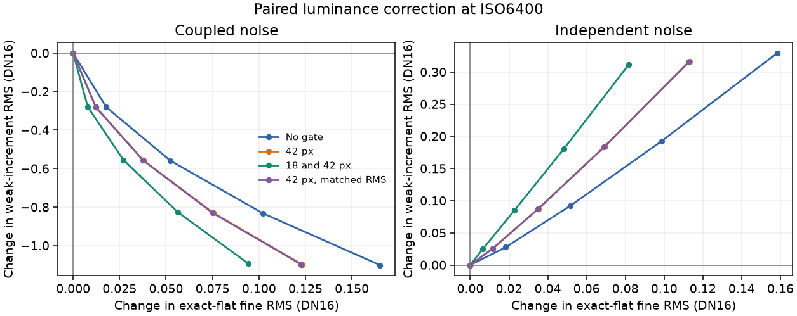
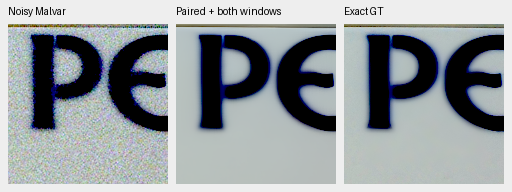
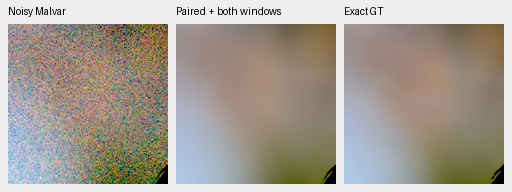

# Paired supervision for a native luminance correction

This study adds a small native correction above the frozen Corpus 100k EMA.
Two heads see identical camera observations and exact targets. One learns
the absolute fine residual. The other also learns the signed difference
between a faint detail and its matched absent-detail target. A separate
check uses agreement of the two green Bayer phases to attenuate the
correction in low-support regions. At ISO6400, the guarded paired head
recovers about 0.47 percentage points more target-aligned fine detail.
Fine-increment error falls when present and absent observations share
noise and rises when they have independent noise. The fine cab crossings
still look incomplete.

## Component and training

The head reads the measured Bayer innovation relative to its parent's
mosaic, the shot/read variance, CFA phase codes and a coarse parent
luminance guide. Four dilated residual blocks predict a fine-scale
luminance correction and its magnitude gate. The final layer starts
at zero, reproducing the frozen parent's output. The head removes a
5×5 local mean from the proposed correction and suppresses correction
within a fixed neighborhood of a near-clipped RAW sample. It delivers an
equal increment to each linear display RGB channel using the camera
matrix and white balance, before display clipping.
[Component source](../src/demosaic/paired_detail.py).

The parent is Corpus 100k EMA
`87b96f3c487b9edaf1c477742b6c38f2a82cc6b20a94716d51cc8cf46a17a760`.
Both heads start from the same weights and share the frozen CUDA IEEE
FP32 parent prediction. The executed schedule uses 1,200 updates and
2,400 distinct ordinary photos from the 90,692-photo scene training
manifest. Each field has one 256-pixel native crop and three aligned
targets, giving 7,200 examples per head. The three targets include the
same weak detail present, removed, and a constant 96×96 center with a
smooth transition into the surroundings. Of the 2,400 pairs, 1,780
share physical Poisson counts and read noise. The other 620 pairs
and all flat controls use
independent sensor noise. The recipe alternates jittered ISO400 and
ISO6400 shot/read levels and draws exposure separately. Protected GFX
scenes and the fixed photo panels remain outside this source schedule.

Both heads minimize absolute fine-residual error with the same exact-flat
penalty. Paired training adds a 0.65-weight present-minus-absent loss in
the central 96 pixels, with separate absolute supervision still active.
AdamW uses a 60-update warmup, a cosine schedule from `3e-4` to
`3e-5`, gradient limit 1 and EMA 0.995. Scoring uses the EMA weights.
The run took **1,241.59 seconds**. Both raw heads, the EMA weights
and their optimizer state share checkpoint SHA256
`02f8d5e6664bd580bafe2abeb3b8584b070b60bfadfefaff587cadd8bd643d7f`.
[Source plan and qualifications](results/paired-luminance-detail-v1/publication.json).

## Local evidence and flat controls

The external guard aligns each measured green phase to a common Bayer
cell-center grid and averages the product of two bandpassed signals.
The initial pooling window spans 42 native pixels. Its threshold uses
the 99.5th percentile on 128 independently simulated flat fields.
After observing spill near the wide guard's flat-core boundary, the
follow-up requires support in both that window and an 18-pixel
window calibrated on separate simulated flats. Both guards scale
the head's delivered correction above the frozen parent.
These measurements detect regional texture support. The correction's
direction and amplitude still come from the trained head.

The 42-pixel gate is active on 40.77% of the coupled ISO6400 exact
flat-core pixels on the held-out photos. Most of those activations
are near the textured surroundings. In the isolated central 32×32
area, activation falls to 0.95%. The shorter intersection reduces
full core activation to 10.23%, with 0.30% in the central inset.
On the matched present role, full-core activation falls from
78.84% to 66.89%. A separate matched-strength control scales the
broader gate by a single factor per complete query so its delivered
RGB correction RMS equals the shorter policy's. The scaling uses
two predicted corrections and their input-derived weights.
[Exact-core and standing support coverage](results/paired-luminance-detail-v1/local-support-coverage.json).

## Matched 64-photo results

The held-out source list, render targets, CFA, noise seeds and base
predictions come from the completed local-versus-whole-scene study.
Each 256×256 field has present, absent and exact-flat targets. Both
present/absent draw policies are evaluated at ISO400 and ISO6400. The
fine-increment metric measures the RMS error of the reconstructed
present-minus-absent difference. Signed response projects that difference
onto the target fine increment. Flat RMS measures fine-band output on
the 96×96 constant center.
[Source panel](scene-local-contrast-2400.md#completed-64-photo-comparison) ·
[Complete metrics](results/paired-luminance-detail-v1/summary.json).

| ISO6400 method | Increment RMS, coupled / independent (DN16) | Flat RMS, coupled / independent (DN16) |
| --- | ---: | ---: |
| V120 EMA | 103.56 / 124.72 | 4.930 / 5.100 |
| Corpus 100k EMA | 102.99 / 124.55 | 4.368 / 4.589 |
| 100k + absolute head | 103.80 / 124.43 | 4.591 / 4.773 |
| 100k + paired head | 101.89 / 124.88 | 4.533 / 4.747 |
| 100k + paired, 42-pixel support | 101.89 / 124.86 | 4.492 / 4.702 |
| 100k + paired, both windows | **101.90 / 124.86** | **4.463 / 4.670** |
| 100k + paired, wide support at matched correction RMS | 101.89 / 124.86 | 4.491 / 4.701 |

With both windows, the paired head raises target-aligned response by
0.469 and 0.470 percentage points for coupled and independent noise.
The corresponding source-bootstrap 95% intervals are [0.386, 0.541]
and [0.385, 0.547]. On the fainter half of the pixels, the gains are
0.295 and 0.317 points. Fine-increment RMS changes by −1.094 DN16
[−1.401, −0.812] and +0.312 DN16 [0.164, 0.466]. ISO400 has the
same split, at −1.082 and +0.386 DN16. The absolute head lowers
independent ISO6400 increment error slightly while suppressing some
target-aligned response. At ISO400 it lowers flat RMS by about
0.33 DN16 under either draw policy.

Requiring both windows lowers ISO6400 flat RMS by 0.028 and 0.031
DN16 against the matched-strength wider guard. Both source-bootstrap
intervals exclude zero. Flat RMS remains above Corpus 100k in this
comparison. The ISO6400 two-draw error product falls by 915 DN16²
with both windows, while half the squared difference between the
draw errors rises by 563 DN16². Their sum gives the mean squared
increment error across the two draw policies. The correction reduces
error shared across those draws and makes its output more sensitive
to the draw. All positive correction strengths on the sweep raise
independent-draw increment error. The two draws use different
within-pair noise coupling.
[Two-draw calculation](results/paired-luminance-detail-v1/repeat-decomposition.json) ·
[Correction-strength sweep](results/paired-luminance-detail-v1/gain-curve.json).

The numerical photo and standing-query review ran in 91.30 seconds
with saved parent predictions. This is an evaluation time, separate
from the training duration. The component study does not supply a
427-photo or measured-CFA history score. Its parent and V120 have
separate evaluations on those panels.
[PSNR history](performance-history.md).

### Noise level and Bayer coverage

A follow-up audit of the training trace found that the ISO400 examples
used GRBG and GBRG, while ISO6400 used RGGB and BGGR. There were 600
photos per observed ISO/layout combination. The held-out panel tested
all four layouts at both noise levels, with a different set of 16 photos
per layout.

At ISO6400 with independent draws, the paired head with both support
windows gains 0.424 percentage points of target-aligned response on
the two layouts seen at that noise level and 0.515 on the other two.
Fine-increment RMS increases 0.274 and 0.350 DN16 respectively.
The same direction of change appears in both groups. The layout
groups contain different source photos, so this comparison leaves
the layout effect on a fixed scene unresolved.
[Joint training coverage and subgroup intervals](results/paired-repeat-stability-v2/prior-phase-audit.json) ·
[Balanced repeat-training study](paired-repeat-stability.md).

The [orientation-average replay](paired-head-symmetry.md) applies
the existing head in eight exact orientations above the same
parent prediction. At matched correction strength, independent
pair error and flat RMS stay near the canonical correction.

## Native exact-target crops

Both triplets show noisy Malvar, the paired EMA above Corpus 100k with
both support windows, and the exact simulation target. The unresized
160×160 crops use `[48,48,160,160]` within their 256×256 fields. Their
GBRG observations use coupled ISO6400 conditioning with shot
`0.00128`, read `6.5536e-6`, a 16-bit ADC, black level 0.03 and
capture exposure 0.33. All panels use the same display exposure
×3.0303 and contrast ×2.
[Image, source and checkpoint provenance](results/paired-luminance-detail-v1/native-viewing.json).

The lettering crop has the largest fine-increment error decrease on
the fainter half under these conditions. The stroke edge changes
subtly and still shows a blue fringe. Source field origin `[174,460]`.
Fernando Losada Rodríguez, CC BY-SA 4.0.
[Source photo](https://commons.wikimedia.org/wiki/File:Calex%C3%B3n_dos_Perigos.001_-_Ribadeo.jpg) ·
[All methods](images/paired-luminance-detail-v1/027-iso6400-coupled-role0-comparison.png).

The smooth field has the largest fine-increment error increase on
the fainter half. Its broad shading and blurred edge look close to
the parent. Source field origin `[56,62]`. André Inidio da Silva,
CC BY-SA 4.0.
[Source photo](https://commons.wikimedia.org/wiki/File:Freirinha.jpg) ·
[All methods](images/paired-luminance-detail-v1/055-iso6400-coupled-role0-comparison.png).

A third viewed comparison shows the flat where the unguarded paired
head makes its largest correction. The center looks smooth and a
thin transition remains by the yellow shell. H. Zell, CC BY-SA 3.0.
[Source photo](https://commons.wikimedia.org/wiki/File:Calocochlia_festiva_02.JPG) ·
[Native flat triplet](images/paired-luminance-detail-v1/042-iso6400-coupled-role2-triplet.png) ·
[All methods](images/paired-luminance-detail-v1/042-iso6400-coupled-role2-comparison.png).

## Standing GFX100S comparisons

Eight native 160×160 comparisons were viewed with V120 EMA, Corpus 100k
EMA and the complete frozen-100k-plus-head paths. The main scene uses
DSCF3879 ISO6400 with nominal shot/read `0.00128/6.5536e-6` and ×4
display exposure. The cab uses DSCF3842 ISO6400 with the same nominal
prior and the fixed prior transferred from DSCF3879
(`0.0014635776/1.0715704e-6`), both at ×16. All methods share crop
coordinates, white balance, camera matrix and display transform in
each comparison. The independently demosaiced DSCF3880 and DSCF3835
ISO100 f/5.6 captures and the two cab camera JPEGs provide qualitative
references. Aperture, exposure and some scene content differ.
[Input, ROI, checkpoint and image hashes](results/paired-luminance-detail-v1/native-viewing.json).

| Standing view | Native comparisons |
| --- | --- |
| DSCF3879 main scene | [Sky](images/paired-luminance-detail-v1/main-overcast-sky-main-overcast-sky.png) · [Building](images/paired-luminance-detail-v1/main-building-detail-main-building-detail.png) · [Foliage](images/paired-luminance-detail-v1/main-foliage-main-foliage.png) · [Coarse fence](images/paired-luminance-detail-v1/main-chain-link-fence-main-chain-link-fence.png) |
| DSCF3842 nominal | [Left cab mesh](images/paired-luminance-detail-v1/mesh-nominal-fine-green-mesh-left.png) · [Right cab mesh](images/paired-luminance-detail-v1/mesh-nominal-fine-green-mesh-right.png) |
| DSCF3842 transferred | [Left cab mesh](images/paired-luminance-detail-v1/mesh-profile3879-fine-green-mesh-left.png) · [Right cab mesh](images/paired-luminance-detail-v1/mesh-profile3879-fine-green-mesh-right.png) |

With both support windows, the sky looks smooth and the camera-RGB
change from Corpus 100k is 0.00061 DN16 RMS. Building and foliage
change by 4.06 and 3.11 DN16 RMS. Thin cables and leaf tips remain soft.
The coarse fence retains its crossings at 0.52 DN16 RMS change. The
cab crops change by 0.03–0.40 DN16 RMS. The transferred prior retains
faint diagonals and background mottle, and the weaker crossings remain
incomplete across the four views.
[Main scene review map](gfx-qualitative.md) ·
[Fine cab mesh review map](gfx-green-mesh.md).

[Frozen training and evaluation sources](results/paired-luminance-detail-v1/evidence.tar.xz) ·
[Training execution receipt](results/paired-luminance-detail-v1/training-execution.json) ·
[Published hashes](results/paired-luminance-detail-v1/publication.json).
