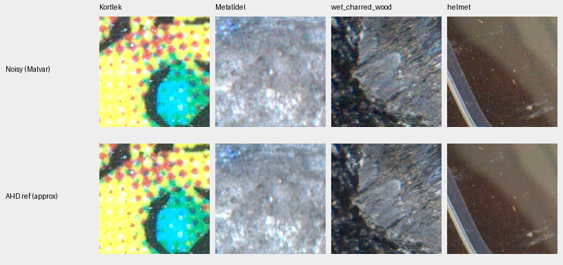
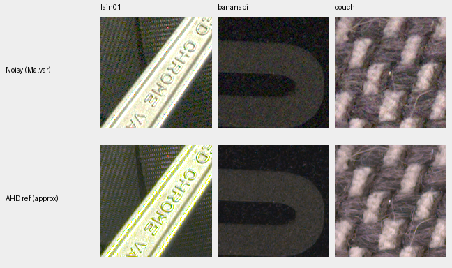
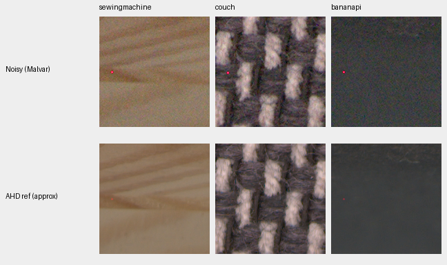

# Paired training references: isolated points and reviewed exclusions

**A training-only audit found a recurring Nikon Z6 red speck in two low-ISO
references.** A separate manifest now excludes small neighborhoods around that
point from supervision in four registered crops. All input and intensity arrays
retain their original bytes. The running Tiny/Small comparison keeps its pinned
original data; the reviewed revision is selected by the [queued V116 trial](fine-detail-data-training.md).
Its effect on trained image quality is unmeasured.

[Scan, independent checks, native images and revised-manifest receipt](results/paired-training-reference-outliers-v1.json).

## Full cached training scan

The scan covers all 64 captures / 576 native 512×512 crops from the original
32-scene paired training set. These four cameras differ from the M100/500D
development examples in the [camera-outlier report](camera-outliers.md).
Only cached SSD arrays are read; source RAW files and protected test scenes are
not opened, and no neural inference, noise draw or optimizer update occurs.

| Camera | Crops | Bright-isolation candidates | Valid for measured-CFA loss | Masked already |
| --- | ---: | ---: | ---: | ---: |
| Sony ILCE-7C | 432 | 444 | 444 | 0 |
| Nikon Z6 | 54 | 58 | 58 | 0 |
| Canon EOS 6D | 72 | 145 | 145 | 0 |
| Nikon D40 | 18 | 130 | 120 | 10 |
| Total | 576 | 777 | 767 | 10 |

Candidates occur in 63 crops / 21 scene IDs. The 767 accepted samples are
4.19 per million valid cached measured samples, counting repeated observations.
This is neither a unique-defect count nor the probability that a training draw
contains a defect. Sampling is scene-balanced and uses smaller random patches.

For each reference color, the screen requires actual measured support at the
center and all eight neighbors two pixels away. A candidate exceeds their
maximum by a ratio of 2 and by both .005 and a six-sigma margin. Sigma uses the
noisy capture's shot/read conditioning as a conservative screen; it is not a
calibrated estimate of reference noise. Registration can change CFA phase or
combine phases, so the screen uses the reference's per-channel support instead
of assuming the input CFA pattern. It does not apply the input repair's
coherent-light filter. A candidate is not automatically a bad pixel.

Independent phase-plane strided windows and sorted neighbors reproduce every
candidate membership across all 576 crops. Reported extrema and existing mask
membership also agree exactly. The screen cannot recover samples already
omitted during cache preparation because of saturation or missing support.

## Native review preserves useful fine detail

Noisy Malvar preview above independently demosaiced low-ISO AHD reference:





These seven deliberately adverse contexts include print dots, metal/wet-surface
highlights, surface specks and textile detail. They do not establish that every
selected point is a defect. Blanket masking or withholding these photographs
would discard useful fine-detail content. Some reference views retain grain,
moire or demosaicing artifacts; they are not exact RGB GT.

Selection takes up to two distinct scenes per camera by the largest accepted
candidate count, then the largest valid excess within each crop, before viewing.
All crops are native 160×160 with common +2 EV, camera WB/matrix and no resizing.
[Source hashes, ROIs, conditioning, display and pixel receipts](images/paired-reference-outliers/manifest.json).

## One fixed-coordinate artifact merits a narrow exclusion



The red speck lies at reference Bayer coordinate **[2794,3466]** in unrelated
sewing-machine, couch and electronics scenes. It is conspicuous in all six
noisy captures. Correctly inverting the registration offsets also finds it in
the low-ISO sewing-machine and electronics references. Their source hashes
are distinct. The couch reference is near its local background and is retained.
Two noisy captures of one scene share a reference; they are not independent
reference observations.

| Scene | Reference value / local median, before alignment gain | Noisy ISO1600 value / local median |
| --- | ---: | ---: |
| sewingmachine | .12291 / .04873 | .45746 / .02346 |
| couch | .02014 / .01730 | .54625 / .00989 |
| bananapi | .07551 / .01528 | .31707 / .00664 |

The higher-ISO noisy values all reach 1.07495 in the stored normalization.
Fixed coordinates across these scenes and the visible isolated red speck
support a capture/sensor artifact. The physical mechanism and sensor serial
identity are not established. One rescaled sewing-machine reference observation
does not pass the conservative screen because its noisy-input conditioning
differs; recurrence review still identifies the same reference point.

The separate revision changes only four `sensor_mask` arrays associated with
the two reviewed reference SHA256s. Each excludes a 17×17 neighborhood around
the registered point: **1,156 previously valid measured samples total**.
This also excludes intersecting coarse AHD loss blocks. Radius 8 is a conservative
training exclusion, not a measured bound on AHD's full spatial influence.
No replacement target value is invented. All other 572 crop files, every noisy
input, RGB/measured reference, count, source identity, camera transform and
conditioning remain exact. Three previously accepted isolation candidates fall
inside the exclusions; the other 764 remain eligible. No whole photograph is
removed.

The manifest remains explicitly opt-in:

```yaml
paired_manifest: /home/dllu/proj/demosaic/.cache/current-quality-20261023-v1/paired-reference-outliers-v1/work/cleaned-train32-v1/manifest.json
```

Independent checks rebuild all four masks from reference coordinates and
registration, verify all 576 case/crop records, and exercise the actual native256
reader on 14 samples, including four fully covered exclusions. Every nonmask
tensor is exact. The actual paired objective gives zero gradient to the excluded
samples, including its coarse RGB term, in a synthetic-output plumbing check.
No model output or trained improvement is claimed by that check.

## Repeat the diagnostic

Use a fresh output directory:

```bash
source scripts/env.sh
CUDA_VISIBLE_DEVICES='' OPENBLAS_NUM_THREADS=1 .venv/bin/python scripts/audit_paired_outliers.py \
  /mnt/external/demosaic/evaluation/paired-train32-prepared-v1/manifest.json \
  --output .cache/paired-reference-audit-new
```

The tool accepts training/quarantine manifests and checks crop hashes before
and after inspection. It writes counts and example coordinates; it does not
apply masks, admit data or score a network. Ten new tests cover shifted phases,
missing support, coherent lines, an independent scalar oracle, invalid settings,
existing-mask accounting and the held-out split boundary. Together with the
existing input-detector tests, all 37 targeted tests pass.

The first independent-check draft required unavailable SciPy and failed at
import before reading an input. Its source/log are preserved; the successful
NumPy-only checker adds no dependency to the training environment.

Data: Benoit Brummer and Christophe De Vleeschouwer, *Raw Natural Image Noise
Dataset (2025)*, [CC BY-SA 4.0](https://creativecommons.org/licenses/by-sa/4.0/);
see dataset `permissions.txt` for individual scene credits and CC0 grants.
Modifications: cached registration/cropping, common native previews and the
separate reviewed training-mask exclusions. Originals remain read-only.
