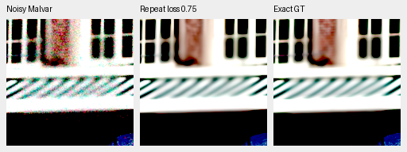
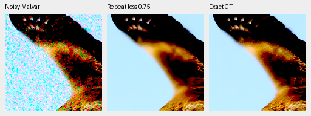

# Learning fine detail that survives independent noise

The [first paired luminance head](paired-luminance-detail.md) adds
0.47 percentage points of ISO6400 target-aligned response on 64
photos. Its increment error falls with coupled noise and rises
with independent noise. This study tests whether a single-frame
head can retain that response while reducing the part of its
error that varies across physical redraws.

## Matched training

All three heads start from the paired EMA at checkpoint
`02f8d5e6664bd580bafe2abeb3b8584b070b60bfadfefaff587cadd8bd643d7f`
above frozen Corpus 100k. Each learns the delivered luminance
correction through the same two-window Bayer support. The three
heads see the same camera observations, use the same AdamW
schedule and keep the same absolute, flat and signed-increment
supervision. Two heads also penalize differences in reconstructed
present-minus-absent detail between independent repeats, at
weights 0.25 and 0.75. Each forward pass sees one noisy observation.

The fixed schedule uses 1,200 updates on 2,400 distinct photos
additional to the first paired-head run. Each photo supplies two
independent complete draws of a present, absent and exact-flat
target triplet. Within a photo, both draws use the same coupling
law. The training set has 150 photos in each ISO, Bayer layout
and coupling cell, for 14,400 sensor observations per head.
This balances the [joint ISO and layout coverage](paired-luminance-detail.md#noise-level-and-bayer-coverage)
that the first run missed. The source manifest excludes both
standing GFX families and the fixed evaluation sources.

The raw and EMA weights are saved separately. Three qualification
updates ran on six sources outside the training schedule and
verified finite gradients, identical initial head outputs, exact
repeat targets and a frozen parent. Training completed all 1,200
updates in 4,385.56 seconds. The checkpoint holds raw and EMA
weights for the three heads and their optimizer states at SHA256
`42f8e4efb77ba5c221af557d771faae19c08e8a60a80a78bfdc86705a2a6b528`.
The evaluation uses the EMA weights and CUDA IEEE FP32.
[Frozen plan and qualification evidence](results/paired-repeat-stability-v2/preflight.json).

## Native evaluation design

The fixed evaluation includes the original 64 held-out photos and
32 additional held-out photos from the frozen photo cohort. Each
source contains a present, absent and exact-flat target at both
ISO400 and ISO6400. There are three independent complete draws
per within-pair coupling law. The original panel keeps its first
archived observation for each condition, with identical clean
targets and two new physical draws. The additional photos use
three new draws.

Fine error is measured on the 96×96 core in the 1/8 to 1/3
cycles/pixel luminance band. On each source, the mean product of
different-draw errors estimates error shared across redraws.
The sample variance estimates the draw-sensitive part. These
terms sum to the mean squared error of the three individual
predictions. The report also scores exact-flat texture, low
bands and color bias, with source-level resampling. The matched
control, original paired head, frozen Corpus 100k and V120 enter
the comparisons. Both standing GFX families have fixed native
ROIs and matched render settings. Their ISO100 captures and
cab JPEGs are qualitative references.

## Starting model on 64 photos with three redraws

Before the new heads finish training, the frozen starting EMA
was evaluated at ISO6400 on all 64 original sources with three
complete redraws per law. In the earlier [two-draw comparison](paired-luminance-detail.md#matched-64-photo-results),
the two draws used different within-pair laws. This replay holds
the law fixed when estimating the variance.

| Guarded starting head minus Corpus 100k | Coupled | Independent |
| --- | ---: | ---: |
| Target-aligned response (percentage points) | +0.459 | +0.469 |
| Fine-increment RMS (DN16) | −1.087 | +0.325 |
| Fine RMS on the present target (DN16) | −0.164 | −0.193 |
| Exact-flat fine RMS (DN16) | +0.092 | +0.087 |
| Repeat-shared fine-increment error (DN16²) | −301.1 | −295.3 |
| Fine-increment variance between draws (DN16²) | −38.7 | +404.6 |
| Mean fine-increment squared error of a single draw (DN16²) | −339.8 | +109.3 |

For independent pairs, the source-bootstrap 95% intervals are
[−402.2, −203.1] DN16² for the change in shared error and
[270.6, 563.6] DN16² for variance. The coupled variance
interval is [−59.4, −22.2] DN16². The shared-error reduction
is similar under both simulated coupling laws. A rise in draw
variance offsets it only with independent pairs. The existing
head slightly improves the fine-band fit to the single present
target under both laws, with extra variation on exact-flat
controls. Repeat-stability training tests whether it can reduce
that independent-draw cost. The table contains only the frozen
starting model and its parents.
[Metrics and source intervals](results/paired-repeat-stability-v2/start64-summary.json) ·
[Per-source inputs and frozen analysis](results/paired-repeat-stability-v2/start64-evidence.tar.xz).

On the 32 additional photos, independently drawn ISO6400
pairs reproduce the tradeoff. Aligned response rises 0.390
percentage points, shared error falls 183 DN16² and variance
rises 315 DN16². Fine-increment RMS rises 0.462 DN16 and flat
RMS rises 0.049 DN16. The change in single-present fine RMS
is +0.025 DN16 with an interval spanning zero.
[All 96 starting-model results](results/paired-repeat-stability-v2/starting-all96-summary.json) ·
[Per-source evidence](results/paired-repeat-stability-v2/starting-all96-evidence.tar.xz).

## First checkpoint at 300 updates

The first 16 original photos have an early ISO6400 numerical
check with three redraws per law. The three EMA heads share
the checkpoint `1940c84a459b5815d48e7c0b7b19dd940d682e5d663a11b4a0eedd0bf54281b1`.
Compared with the matched control, the higher repeat weight
reduces independent-draw fine-increment variance by 154.4
DN16² and raises shared error by 121.4 DN16². Fine-increment
RMS decreases 0.114 DN16 and exact-flat fine RMS decreases
0.029 DN16. Target-aligned response falls 0.203 percentage
points. In the coupled comparison, target-aligned response
falls 0.190 percentage points and increment RMS rises
0.470 DN16.

Scaling the control correction to 25.5% of its strength gives
the same pooled independent-draw response as the higher-repeat
head. Against this response-matched control, that head changes
increment RMS by +0.003 DN16 [−0.012, 0.023], flat RMS by
+0.0001 DN16 [−0.0014, 0.0026] and draw variance by +6.2 DN16²
[−5.4, 20.5]. The scalar was fitted on these same 16 sources
as a descriptive control. Most of the apparent variance gain
at this checkpoint can be reproduced by weakening the correction.
[Interim metrics and source intervals](results/paired-repeat-stability-v2/checkpoint300-summary.json) ·
[Frozen checkpoint evaluation](results/paired-repeat-stability-v2/checkpoint300-evidence.tar.xz).

## Response matching at 600 updates on separate photos

This ISO6400 replay evaluates EMA checkpoint
`4a04d60af2838ed68a6f27275d6db58cbf6c9f12fbbcf010f6d05fff9a417b4d`.
The original 64 photos set one response-matching scale per noise
law. The additional 32 photos measure the resulting tradeoff
with those scales fixed. At nominal strength, the 0.25 repeat loss
lowers independent-draw variance by 102.4 DN16² against its matched
control and loses 0.153 percentage points of aligned response.
With the higher repeat weight, the independent response
change versus the parent falls from the control's +0.271
percentage points to −0.025 on the calibration photos.
There is no positive matched-response scale for that arm.

| 0.25 repeat loss versus response-matched control on the additional 32 photos | Coupled | Independent |
| --- | ---: | ---: |
| Frozen control scale from the original 64 | 0.361 | 0.366 |
| Aligned response difference (percentage points) | −0.006 | −0.011 |
| Fine-increment RMS difference (DN16) | −0.063 | +0.018 |
| Exact-flat RMS difference (DN16) | +0.0025 | +0.0026 |
| Between-draw variance difference (DN16²) | −3.7 | +17.5 |

The independent-draw intervals are [−0.036, 0.014] percentage
points for aligned response, [−0.009, 0.058] DN16 for increment
RMS and [5.2, 32.4] DN16² for variance. Coupled increment error
falls at matched response, with interval [−0.114, −0.023] DN16.

The starting head adds 315.2 DN16² of independent-draw variance
on the additional photos. Of that, 80.9 DN16² is the correction's
own variance and 234.3 DN16² comes from twice its covariance
with the parent's fine-increment error. Under coupled noise that
covariance term is −27.7 DN16². The original correction moves
with the parent's errors on independently noisy pairs, so
suppressing only the correction's own variance leaves most
of this cost.
[600-update metrics and covariance decomposition](results/paired-repeat-stability-v2/checkpoint600-summary.json) ·
[Source-level evidence](results/paired-repeat-stability-v2/checkpoint600-evidence.tar.xz).

The [projected repeat follow-up](paired-shape-stability.md) tests a
repeat term whose value stays fixed when the starting correction
is uniformly weakened. Its eventual response matching uses
the original 64 photos to set the scales and the additional 32
to measure transfer at those scales.

## Final 1,200-update evaluation

Numerical evaluation covers all 96 photos, both noise priors,
both within-pair laws and three independent complete redraws
per law. The scored weights are the EMA heads above frozen
Corpus 100k with the two-window RAW support guard. Evaluation
took 183.44 seconds with saved parent predictions.

| ISO6400 method | Aligned response, coupled / independent | Fine-increment RMS, coupled / independent (DN16) | Flat RMS, coupled / independent (DN16) |
| --- | ---: | ---: | ---: |
| V120 EMA | 66.230% / 66.955% | 96.694 / 117.321 | 4.920 / 4.888 |
| Corpus 100k EMA | 66.623% / 67.308% | 96.043 / 116.867 | 4.397 / 4.329 |
| Starting paired EMA | 67.068% / 67.756% | 95.049 / 117.238 | 4.474 / 4.403 |
| Matched ordinary control | 66.835% / 67.519% | 95.506 / 116.983 | 4.430 / 4.361 |
| Repeat loss 0.25 | 66.627% / 67.311% | 95.882 / 116.861 | 4.407 / 4.339 |
| Repeat loss 0.75 | 66.047% / 66.726% | 96.815 / 116.647 | 4.459 / 4.391 |

The 0.25 endpoint returns independent response and increment
error close to Corpus 100k. The 0.75 endpoint lowers independent
increment error by 0.220 DN16 and variance by 293 DN16² against
Corpus 100k. It also loses 0.582 percentage points of aligned
response and adds 0.062 DN16 of exact-flat error. At ISO400
the same endpoint lowers independent increment RMS by 0.205
DN16, lowers flat RMS by 0.061 DN16 and loses 0.418 percentage
points of aligned response. The ordinary control has higher
response than either repeat loss at both noise levels.

### Separate calibration and transfer at the endpoint

The original 64 photos set the scalar matches. On the additional
32 ISO6400 photos at nominal strength, the 0.25 head reduces
independent variance by 116.9 DN16² versus ordinary control
and loses 0.189 percentage points of aligned response.
At equal calibration response, the ordinary control needs
only 3.21% of its nominal strength. On the 32 independent
holdouts the 0.25 head then adds 27.6 DN16² of variance
[8.5, 52.1] and changes increment error by +0.010 DN16
[−0.039, 0.077]. Matching exact-flat error instead changes
increment RMS by −0.056 DN16 [−0.097, −0.024] and loses
0.103 percentage points of response.
The 0.75 correction has negative added response on the
calibration photos, leaving no positive same-response match
to the ordinary control.

These results preserve the early finding that the variance
penalty tends to lower the correction's recovered response.
The complete score includes both nominal and matched
strength comparisons. The fixed broad PSNR panels measure
the full-model checkpoints separately.
[Endpoint checkpoint, scores and source hashes](results/paired-repeat-stability-v2/endpoint-summary.json) ·
[Source-level archive and strength sweep](results/paired-repeat-stability-v2/endpoint-evidence.tar.xz) ·
[PSNR history](performance-history.md).

## Native exact-target crops

These triplets show noisy Malvar, the 0.75 EMA result, and
exact GT. Each native 160×160 crop uses `[48,48,160,160]`
inside the saved 256×256 independent ISO6400 query. The
shot/read pair is `0.00128/6.5536e-6`, with ADC16 black
fraction 0.03, capture exposure 0.33, display exposure ×3.0303
and contrast ×2. The EMA checkpoint is bound above and in the
publication receipt.

The largest independent fine-increment error reduction
versus ordinary control is on the Amsterdam source. Strong
windows and bars remain visible, with softer low-contrast
detail. Query origin `[380,118]`, GRBG. Slaunger, CC BY-SA 4.0.
[Source photo](https://commons.wikimedia.org/wiki/File:Couple_selfie_stick_Konigssluis_Amsterdam_2016-09-13-6621.jpg) ·
[All methods](images/paired-repeat-stability-v2/094-iso6400-independent-r0-role0-comparison.png) ·
[Flat comparison](images/paired-repeat-stability-v2/094-iso6400-independent-r0-role2-comparison.png).

The largest regression is on the bird edge. The sky stays
clean and the feather detail remains soft. Query origin
`[228,102]`, GBRG. Tisha Mukherjee, CC BY-SA 4.0.
[Source photo](https://commons.wikimedia.org/wiki/File:Black_Kite_in_Baruipur_October_2025_by_Tisha_Mukherjee_01.jpg) ·
[All methods](images/paired-repeat-stability-v2/067-iso6400-independent-r0-role0-comparison.png).

## Standing GFX100S comparisons

All eight native 160×160 boards were viewed. The main
DSCF3879 crops use the nominal ISO6400 profile and ×4
display exposure. DSCF3842 uses ×16, the nominal profile,
and transferred DSCF3879 shot/read
`0.0014635776/1.0715704e-6`. The DSCF3880 and DSCF3835
ISO100 AHD and the two cab camera JPEGs provide qualitative
references. Aperture, exposure and moving subjects differ.

| View | Native comparisons |
| --- | --- |
| DSCF3879 main scene | [Sky](images/paired-repeat-stability-v2/main-overcast-sky-main-overcast-sky.png) · [Building](images/paired-repeat-stability-v2/main-building-detail-main-building-detail.png) · [Foliage](images/paired-repeat-stability-v2/main-foliage-main-foliage.png) · [Coarse fence](images/paired-repeat-stability-v2/main-chain-link-fence-main-chain-link-fence.png) |
| DSCF3842 nominal | [Left](images/paired-repeat-stability-v2/mesh-nominal-fine-green-mesh-left.png) · [Right](images/paired-repeat-stability-v2/mesh-nominal-fine-green-mesh-right.png) |
| DSCF3842 transferred | [Left](images/paired-repeat-stability-v2/mesh-profile3879-fine-green-mesh-left.png) · [Right](images/paired-repeat-stability-v2/mesh-profile3879-fine-green-mesh-right.png) |

The strong-repeat head changes the sky by 0.0018 DN16 RMS.
The sky stays smooth and the coarse fence keeps its crossing
directions. Thin wires and fine foliage stay soft. Changes
in the cab range from 0.182 to 0.986 DN16 RMS in camera RGB,
with incomplete fine crossings and remaining background mottle.
[Main GFX map](gfx-qualitative.md) ·
[Cab mesh map](gfx-green-mesh.md).
