# Paired response: V160 final quality

V160 pair supervision substantially strengthens learned weak-mesh response,
with a visible noise cost. Mean response rises **81.75% raw /
95.73% EMA versus V143**, reaching **4.00% /
4.31% of exact constructed target amplitude**. Against the fresh
matched ordinary heads, response rises 84.62% / 94.77%.
This is a stronger learned-detail starting point than the retained V156–V159
heads. Existing periodic `detail` still has higher mean mesh response.

Actual blank RMS rises **3.25% / 4.69% versus V143**. Quiet-region
RMS rises **8.46–11.36%**, and all 32 quiet inputs worsen against
their matched ordinary endpoint. Each paired endpoint is worse than V143 on
31 of those 32 inputs. Native amplified crops show extra fine colored grain;
broad mottling persists. Full native512 noisy-flat RMS rises
**1.48–2.83%**. Raw is worse on 47/48 flat inputs and EMA on all 48.
Mean coarse block error can improve while total/spatial errors worsen.

The **ordinary new-data control** has a separate useful strength: native512
full flat RMS falls **0.42–0.53% versus V143**, with all
48 inputs improving in full and coarse error at both endpoints. Its quiet mean
instead rises 0.76–1.58%; 18/32 raw and 17/32 EMA inputs regress.
The largest quiet increase is 0.370174/0.387438 DN16. V158 retains stronger quiet
accuracy, V159 a smaller quiet cost, and V157 the larger standalone coarse gain.
The ordinary control changes the full data recipe versus those older studies.

In the standing real views, some existing partial cab-mesh strands gain a
little contrast, especially under the nearby profile. Crossings remain soft;
there is no convincing complete new fine lattice. Sky looks broadly smooth at
ordinary display, while exact flat/quiet controls expose the added texture.
Building edges and foliage remain soft. Bird, butterfly, grass and wood views
do not show convincing broad microtexture recovery. Natural-band gains are
small and mixed against V143, and ADC-photo error remains near parent level,
well behind V150's stronger ADC result. Independent ISO100 references are
qualitative comparisons, not exact GT.

Retain pair supervision and the paired data generator for further learned-detail
work, alongside the ordinary control's flat-field strength. The next problem is
to distinguish supported fine structure from noise more effectively while
preserving the measured response. The broader fine-detail/clean-field goal
remains active.

[Final evidence and immutable sources](results/v160-paired-response-final-v1.json) · [Native pixels, source ROIs, conditioning, exposure and checkpoint hashes](images/v160-paired-response-v1/manifest-v1.json).

## Response and actual blank error

RMS values are camera-RGB DN16. Response1 means the exact constructed mesh amplitude. Blank error measures actual target error; added blank RMS measures displacement from V143.

| Method | Present full RMS | Response | Actual blank RMS | Blank spatial RMS | Added blank RMS |
| --- | ---: | ---: | ---: | ---: | ---: |
|V143|9.111243|0.02202090|5.523323|5.343113|0.00000000|
|Ordinary raw|9.084179|0.02167876|5.496869|5.318030|0.42085687|
|Ordinary EMA|9.082861|0.02212956|5.498926|5.318317|0.37827607|
|Pair response raw|9.032421|0.04002247|5.702844|5.532452|1.45472504|
|Pair response EMA|9.061365|0.04310254|5.782327|5.611326|1.69262495|
|Existing periodic detail|8.586126|0.07089755|5.523328|5.343118|0.00063557|

## Quiet neighbors and coarse fields

| Prior | Method | Whole RMS | Quiet RMS | Quiet spatial RMS |
| --- | --- | ---: | ---: | ---: |
|ISO6400|V143|27.105631|3.898845|3.268502|
|ISO6400|Ordinary raw|27.118641|3.928322|3.239359|
|ISO6400|Ordinary EMA|27.109986|3.928848|3.240701|
|ISO6400|Pair response raw|27.073388|4.278818|3.567739|
|ISO6400|Pair response EMA|27.055578|4.341703|3.658529|
|ISO12800|V143|36.747466|6.152652|5.341833|
|ISO12800|Ordinary raw|36.735357|6.250028|5.333928|
|ISO12800|Ordinary EMA|36.714992|6.242164|5.328609|
|ISO12800|Pair response raw|36.174651|6.673191|5.652459|
|ISO12800|Pair response EMA|36.065053|6.725417|5.758698|

Quiet bias is averaged per RGB channel before its Euclidean RMS. The independent pixel audit verifies total squared = spatial squared + DC squared per case; means of RMS values do not share that identity.

| Prior | Method | Quiet DC RMS DN16 |
| --- | --- | ---: |
| iso6400-prior | parent | 2.016074 |
| iso6400-prior | ordinary-raw-step1000 | 2.100363 |
| iso6400-prior | ordinary-EMA-step1000 | 2.100829 |
| iso6400-prior | paired-response-raw-step1000 | 2.221410 |
| iso6400-prior | paired-response-EMA-step1000 | 2.201768 |
| iso12800-prior | parent | 2.849060 |
| iso12800-prior | ordinary-raw-step1000 | 3.032985 |
| iso12800-prior | ordinary-EMA-step1000 | 3.021974 |
| iso12800-prior | paired-response-raw-step1000 | 3.318674 |
| iso12800-prior | paired-response-EMA-step1000 | 3.248981 |

|Flat test|V143|Ordinary raw|Ordinary EMA|Pair response raw|Pair response EMA|
| --- | ---: | ---: | ---: | ---: | ---: |
|Native512 ISO6400 full RMS|18.546808|18.465075|18.468314|18.820493|18.968767|
|Native512 ISO6400 spatial RMS|18.235130|18.147721|18.154125|18.530542|18.677087|
|Native512 ISO6400 block32 RMS|13.440561|13.416481|13.419475|13.403898|13.408983|
|Native512 ISO12800 full RMS|24.071890|23.943629|23.948961|24.530907|24.753278|
|Native512 ISO12800 spatial RMS|23.596861|23.475078|23.481066|24.099408|24.333860|
|Native512 ISO12800 block32 RMS|17.932544|17.900350|17.903880|17.878447|17.883072|
|Older native256 ISO12800 full RMS|27.233548|27.096601|27.109167|27.742641|27.983204|
|Older native256 ISO12800 spatial RMS|26.017191|25.873595|25.885498|26.564107|26.815484|
|Older native256 ISO12800 block32 RMS|19.539875|19.503713|19.507342|19.490785|19.495782|

## Natural detail and ADC controls

|Photo test|V143|Ordinary raw|Ordinary EMA|Pair response raw|Pair response EMA|
| --- | ---: | ---: | ---: | ---: | ---: |
|Retained512 faint full RMS|33.963754|33.962754|33.961091|33.977642|33.985622|
|Retained512 faint band error|0.824639|0.824841|0.824740|0.824407|0.824298|
|Retained512 faint band response|0.298560|0.296678|0.297076|0.299729|0.300718|
|Retained512 dark full RMS|29.097715|29.096273|29.095436|29.099629|29.103808|
|Retained512 dark band error|0.661447|0.661496|0.661464|0.661256|0.661227|
|Retained512 dark band response|0.531446|0.529354|0.529684|0.531047|0.531647|
|Organic384 faint full RMS|37.469061|37.482831|37.478309|37.458327|37.456232|
|Organic384 faint band error|0.924117|0.924602|0.924424|0.924291|0.924106|
|Organic384 faint band response|0.150701|0.148986|0.149393|0.151586|0.152628|
|Organic384 dark full RMS|33.685796|33.691264|33.689519|33.679874|33.679938|
|Organic384 dark band error|0.781612|0.781663|0.781640|0.781639|0.781641|
|Organic384 dark band response|0.398945|0.396995|0.397341|0.398554|0.399256|

|ADC test|V143|Ordinary raw|Ordinary EMA|Pair response raw|Pair response EMA|
| --- | ---: | ---: | ---: | ---: | ---: |
|Photo full RMS|18.149871|18.150128|18.150129|18.155182|18.155606|
|Photo band error|0.101855|0.101856|0.101857|0.101918|0.101921|
|Photo band response|0.968329|0.968325|0.968322|0.968174|0.968174|
|Sloped512 full RMS|3.771369|3.770767|3.769801|3.770121|3.768219|
|Sloped512 spatial RMS|3.397249|3.396829|3.395798|3.395495|3.393466|
|Sloped512 block32 RMS|0.574652|0.575628|0.575855|0.575040|0.575652|
|Sloped512 crop block32 RMS|0.088145|0.088151|0.088149|0.088129|0.088126|
|Sloped512 worst absolute DC|11.176981|11.168844|11.168576|11.173857|11.171162|

## Fixed native comparisons

Every cell is native 160×160; crop pixels are never resized. All RAW methods within each board share source coordinates, camera display transform, exposure and contrast. JPEG cells retain native sRGB8 without exposure/contrast changes. Both final raw/EMA endpoints of both heads are shown, with five retained V156/V157/V158/V159 columns.

The main scene is DSCF3879 ISO6400 versus DSCF3880 ISO100 f/5.6. The fine cab mesh uses DSCF3842 versus DSCF3835 and both camera JPEGs. Aperture, shutter, moving subjects and processing differ: ISO100 views are qualitative references, not exact GT. All30 real score rows stay unscored.

### Mesh and exact absence

mesh-seed2026112302-present-iso6400-prior-RGGB; ROI `[176, 176, 160, 160]`, RAW exposure 8, contrast 1.

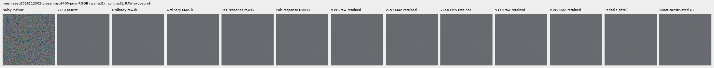

mesh-seed2026112302-present-iso6400-prior-RGGB; ROI `[176, 176, 160, 160]`, RAW exposure 8, contrast 40.

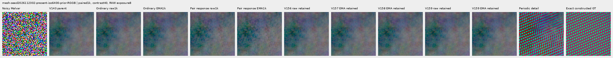

mesh-seed2026112309-present-iso6400-prior-RGGB; ROI `[176, 176, 160, 160]`, RAW exposure 8, contrast 1.

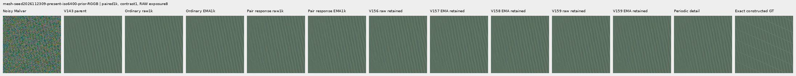

mesh-seed2026112309-present-iso6400-prior-RGGB; ROI `[176, 176, 160, 160]`, RAW exposure 8, contrast 40.

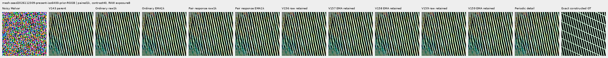

mesh-seed2026112304-absent-iso6400-prior-RGGB; ROI `[165, 0, 160, 160]`, RAW exposure 8, contrast 40.

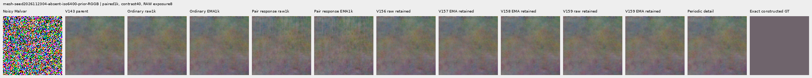

### Quiet neighbors beside edges

mixed-vertical-step-iso6400-prior-RGGB; ROI `[80, 176, 160, 160]`, RAW exposure 8, contrast 40.

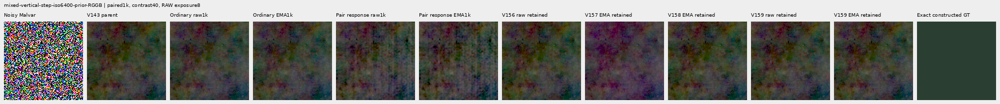

mixed-vertical-step-iso6400-prior-RGGB; ROI `[240, 176, 160, 160]`, RAW exposure 8, contrast 1.

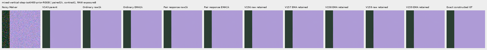

mixed-vertical-step-iso12800-prior-RGGB; ROI `[80, 176, 160, 160]`, RAW exposure 8, contrast 40.

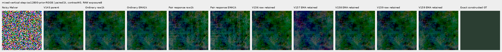

mixed-vertical-step-iso12800-prior-RGGB; ROI `[240, 176, 160, 160]`, RAW exposure 8, contrast 1.

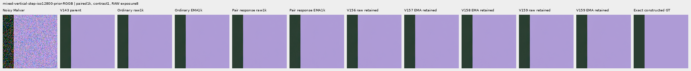

mixed-narrow-bar-iso6400-prior-RGGB; ROI `[80, 176, 160, 160]`, RAW exposure 8, contrast 40.

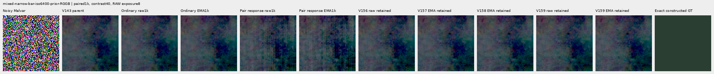

mixed-narrow-bar-iso6400-prior-RGGB; ROI `[240, 176, 160, 160]`, RAW exposure 8, contrast 1.

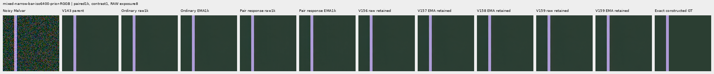

mixed-narrow-bar-iso12800-prior-RGGB; ROI `[80, 176, 160, 160]`, RAW exposure 8, contrast 40.

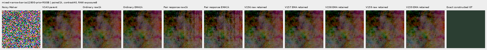

mixed-narrow-bar-iso12800-prior-RGGB; ROI `[240, 176, 160, 160]`, RAW exposure 8, contrast 1.

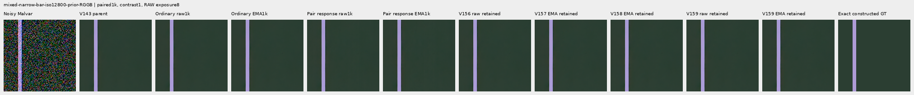

mixed-slanted-step-iso6400-prior-RGGB; ROI `[80, 176, 160, 160]`, RAW exposure 8, contrast 40.

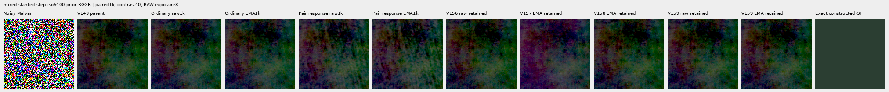

mixed-slanted-step-iso6400-prior-RGGB; ROI `[240, 176, 160, 160]`, RAW exposure 8, contrast 1.

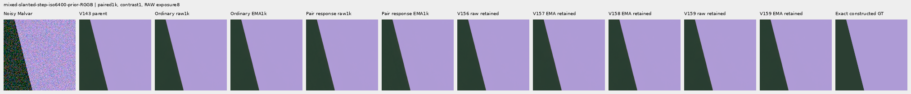

mixed-slanted-step-iso12800-prior-RGGB; ROI `[80, 176, 160, 160]`, RAW exposure 8, contrast 40.

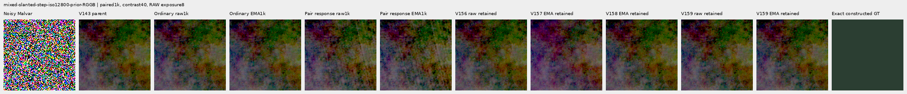

mixed-slanted-step-iso12800-prior-RGGB; ROI `[240, 176, 160, 160]`, RAW exposure 8, contrast 1.

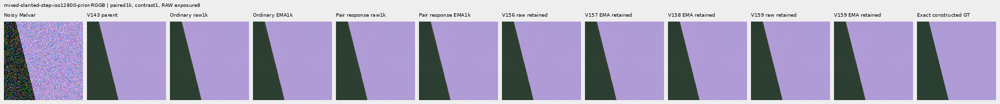

mixed-striped-patch-iso6400-prior-RGGB; ROI `[80, 176, 160, 160]`, RAW exposure 8, contrast 40.

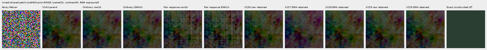

mixed-striped-patch-iso6400-prior-RGGB; ROI `[240, 176, 160, 160]`, RAW exposure 8, contrast 1.

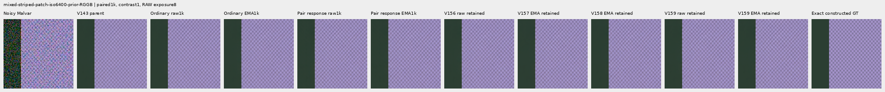

mixed-striped-patch-iso12800-prior-RGGB; ROI `[80, 176, 160, 160]`, RAW exposure 8, contrast 40.

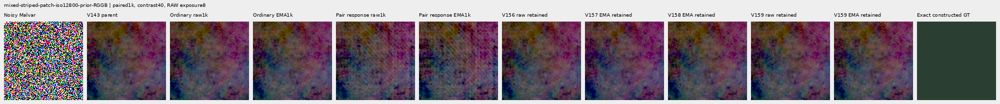

mixed-striped-patch-iso12800-prior-RGGB; ROI `[240, 176, 160, 160]`, RAW exposure 8, contrast 1.

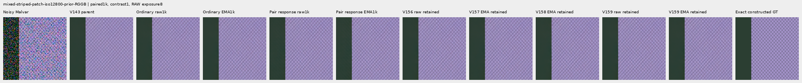

### Standalone flats and slopes

gray-l0.02-adc-only-RGGB; ROI `[48, 48, 160, 160]`, RAW exposure 4, contrast 40.

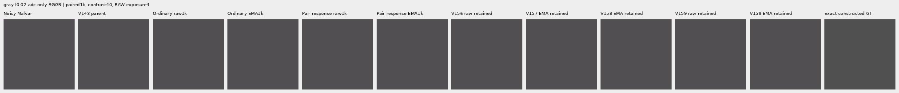

gray-l0.02-iso12800-prior-RGGB; ROI `[48, 48, 160, 160]`, RAW exposure 4, contrast 40.

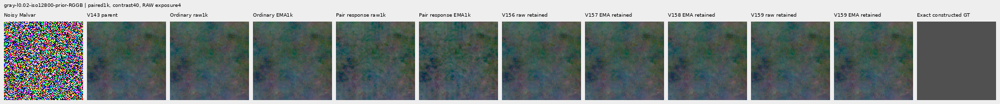

flat512-gray-l0.02-adc-only-RGGB; ROI `[176, 176, 160, 160]`, RAW exposure 4, contrast 40.

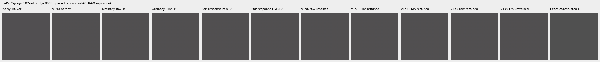

flat512-gray-l0.02-iso6400-prior-RGGB; ROI `[176, 176, 160, 160]`, RAW exposure 4, contrast 40.

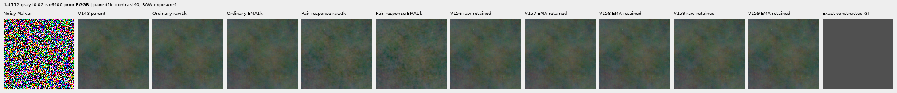

flat512-gray-l0.02-iso12800-prior-RGGB; ROI `[176, 176, 160, 160]`, RAW exposure 4, contrast 40.

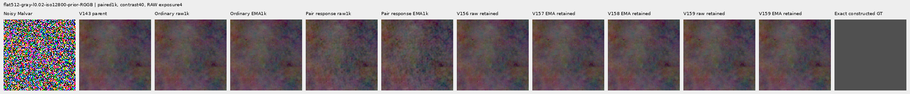

flat512-h210-s0.50-l0.02-iso6400-prior-RGGB; ROI `[176, 176, 160, 160]`, RAW exposure 4, contrast 40.

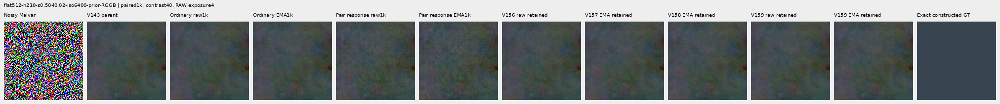

flat512-gray-l0.18-iso12800-prior-RGGB; ROI `[176, 176, 160, 160]`, RAW exposure 1, contrast 8.

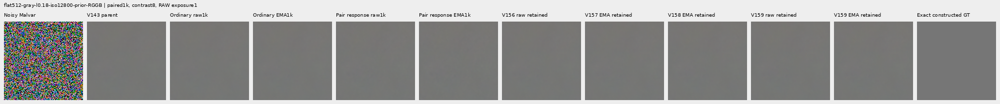

flat512-gray-l0.90-iso12800-prior-RGGB; ROI `[176, 176, 160, 160]`, RAW exposure 1, contrast 4.

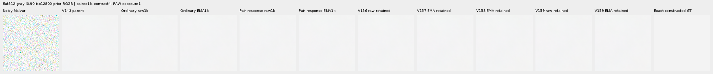

V150-control-ADC-plane0-RGGB; ROI `[176, 176, 160, 160]`, RAW exposure 45, contrast 8.

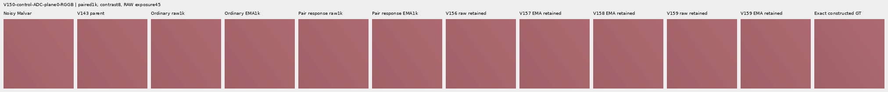

V150-control-ADC-plane1-RGGB; ROI `[176, 176, 160, 160]`, RAW exposure 9, contrast 8.

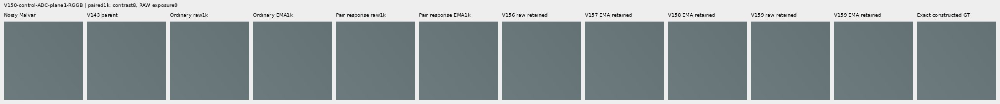

V150-control-ADC-plane2-RGGB; ROI `[176, 176, 160, 160]`, RAW exposure 1, contrast 8.

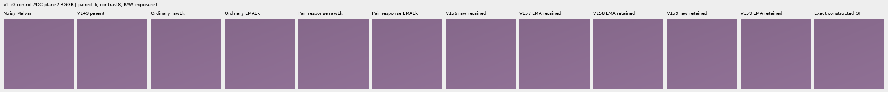

V150-control-ADC-plane3-RGGB; ROI `[176, 176, 160, 160]`, RAW exposure 0.24, contrast 8.

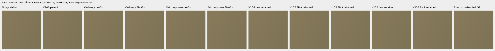

### Natural photographic detail

organic-02a76fd33b5e1414a0504f0b3f0aeb03a569b6f4-photo-faint-RGGB; ROI `[112, 112, 160, 160]`, RAW exposure 14.3883, contrast 8.

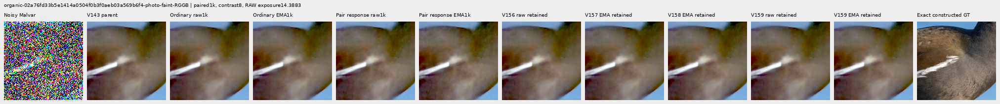

organic-dabacecd4780a1c230f8e9fce6ca1a604bdeab4c-photo-dark-RGGB; ROI `[112, 112, 160, 160]`, RAW exposure 102.758, contrast 1.

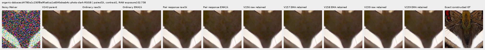

organic-6b3920bceba82d95ecf9351d47f6f94267694bd0-photo-dark-RGGB; ROI `[112, 112, 160, 160]`, RAW exposure 64.0491, contrast 1.

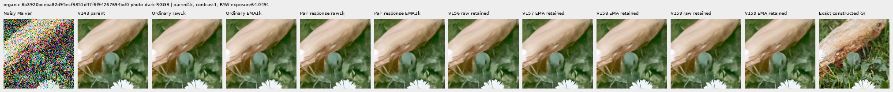

photo-3e638bbb56ed80abc88939468783e3bf9b92ee77-photo-faint-RGGB; ROI `[176, 176, 160, 160]`, RAW exposure 12.1494, contrast 8.

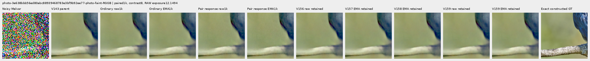

photo-3e638bbb56ed80abc88939468783e3bf9b92ee77-photo-dark-RGGB; ROI `[176, 176, 160, 160]`, RAW exposure 80.9959, contrast 1.

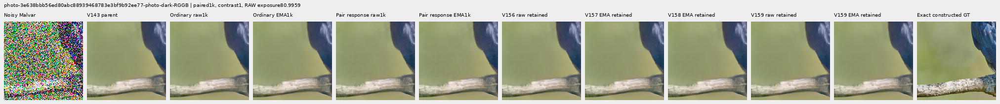

V150-control-bark-contrast0p025-adc-RGGB; ROI `[48, 48, 160, 160]`, RAW exposure 1, contrast 40.

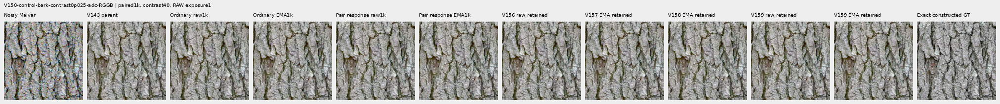

V150-control-raccoon-fur-contrast0p025-adc-RGGB; ROI `[48, 48, 160, 160]`, RAW exposure 1, contrast 40.

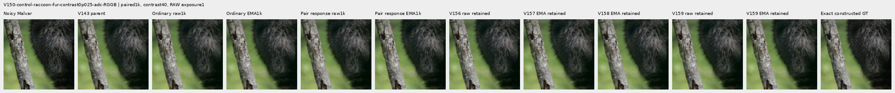

### Protected real GFX scenes

main-overcast-sky; ROI `[176, 176, 160, 160]`, RAW exposure 4, contrast 1.

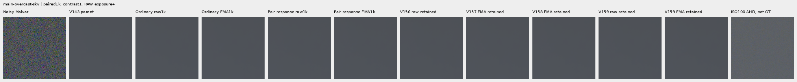

main-building-detail; ROI `[176, 176, 160, 160]`, RAW exposure 4, contrast 1.

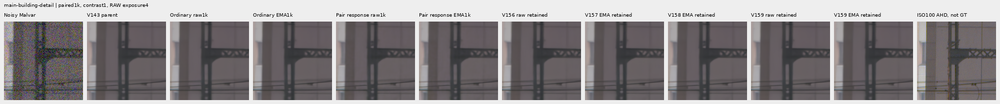

main-foliage; ROI `[176, 176, 160, 160]`, RAW exposure 4, contrast 1.

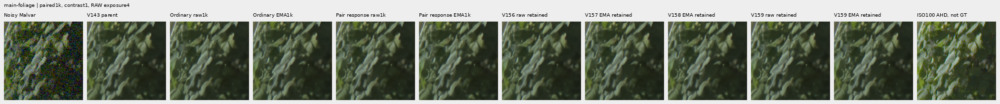

main-chain-link-fence; ROI `[176, 176, 160, 160]`, RAW exposure 4, contrast 1.

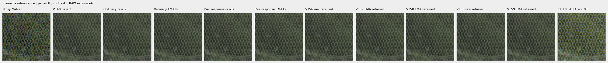

mesh-nominal; ROI `[206, 229, 160, 160]`, RAW exposure 16, contrast 1.

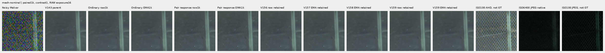

mesh-nominal; ROI `[426, 189, 160, 160]`, RAW exposure 16, contrast 1.

mesh-profile3879; ROI `[206, 229, 160, 160]`, RAW exposure 16, contrast 1.

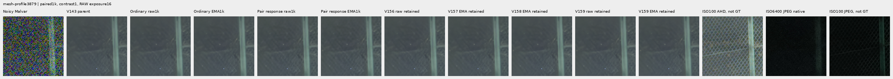

mesh-profile3879; ROI `[426, 189, 160, 160]`, RAW exposure 16, contrast 1.

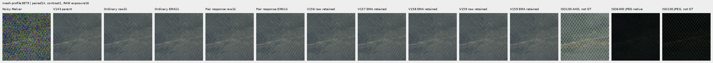

### Noisy, restored, exact constructed GT triplets

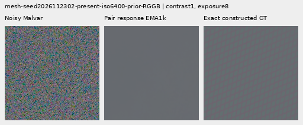

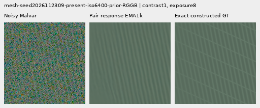

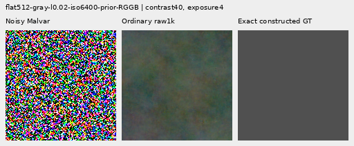

## Training, sources and validation

Two fresh identical 117,677-parameter / 45-tensor spatial-RGB heads share 1,000 fresh B4 batches. Only pair-loss weight 0 versus 1 changes between current arms. Both use V159 smooth regional-DC/local RGB regret, delivered spectral MSE .25, pixel/gradient/domain weights, AdamW, clipping and EMA. The new ordinary control differs from archived V159 in data and noise realization; retained comparisons include that change.

The cache contains 4,000 frames: 1,382 present/background pairs and 1,236 ordinary frames, based on 2,618 scene/patch instances. Its 486 photo pairs visit 268 distinct free-photo sources; 234 use reduced contrast and 245 use reviewed ROIs. Data use bin4 caches, geometry before area2 and zero optical blur. All 18 held-out photo IDs and protected captures/JPEGs/siblings remain excluded.

Pair units are the pre-ADC shot-increment RMS, floored at 16 DN16; read draws are shared. They are training proxies for RGB differences. Photo backgrounds are constructed channel means. Pair loss cancels common RGB mistakes, so ordinary/local/DC supervision remains necessary. Targets/pair fields never enter the head.

123 CPU checks pass in three suites: 118 inherited/paired, 3 corrected counter regressions and 2 batch-isolation checks. Genuine 8+2 model/EMA/Adam/RNG restoration passes; 450 parameter gradients match extracted frozen V159 loss arithmetic on the fresh control data. The first 10 complete smoke/train rows match exactly. CUDA parity covers 28 contexts / 56 calls. Four strict final CPU loads and 90 finite Adam states at 1,000 pass.

`ordinary`: 119/900 supervised batches clip; pre-clip norm median 0.163331, maximum 73.539146.

`paired-response`: 142/900 supervised batches clip; pre-clip norm median 0.279755, maximum 73.602211.

The 100 zero-gradient ADC batches advance Adam/EMA clocks. Gradient norms describe optimization pressure; they do not isolate the cause of a quality change.

The independent audit checks 40,210 scalars across 4,686 rows and 476 Decimal reductions; maximum scalar difference is5.12e-13. All 72 native images / 24 triplets were actually viewed in 18 original-detail sheets;50,764,800 RGB channels were independently checked.

Actual scientific work is 5,364 head calls (56 parity, 20 discarded smoke, 2,000 training, 3,288 review) plus 1,000 new parent and 1,000 nested DINO batch calls. Head calls evaluate 11,424 images; parent/DINO each evaluate 4,000. All 3,288 review arrays / 8.842 GiB are new and external. Original captures and `/mnt/dataz` are unused.

The first cache attempt stopped at source24 because a procedural Gaussian draw entered its sensor counter. Its original receipts/sources are preserved. Boundary counters pass bit-identical regression checks; the explicit continuation adopts all 23 completed parent batches and computes the remaining 977. The extra source24 construction remains counted: 4,004 actual source frames and 3,312 Poisson / 1,928 Gaussian sensor API calls. No successful parent forward or full training run was repeated. All 15 recorded owners are terminal.

The executed cache receipt retains a legacy 990/adopt10 prose line; its actual 977/adopt23 fields, adoption manifest and execution ledger provide the corrected scope. The study retains 60/156 GiB local/external reserves and 0.5 GiB projected margin. All 87 prior neural sources remain unchanged. Historical preparation and explicitly labeled UTC machine timestamps are preserved.

[Original preparation and input inspections](results/v160-paired-response-preparation-v1.json) · [batch isolation](results/v160-paired-batch-isolation-v1.json).

## Photographic credits

Derived native targets/crops retain the respective source licenses; transformations include linearization, area binning and exposure/contrast changes. Source IDs and ROIs are in the manifest.

| Source | Author | License |
| --- | --- | --- |
| [File:Emamzadeh Esmaeil roof.jpg](https://commons.wikimedia.org/wiki/File:Emamzadeh_Esmaeil_roof.jpg) | مانفی | [CC BY-SA 4.0](https://creativecommons.org/licenses/by-sa/4.0) |
| [File:HP-85-IMG 0439.jpg](https://commons.wikimedia.org/wiki/File:HP-85-IMG_0439.jpg) | Rama & Musée Bolo | [CC BY-SA 2.0 fr](https://creativecommons.org/licenses/by-sa/2.0/fr/deed.en) |
| [File:Spangled Drongo - AndrewMercer - DSC00966.jpg](https://commons.wikimedia.org/wiki/File:Spangled_Drongo_-_AndrewMercer_-_DSC00966.jpg) | Andrew Mercer (www.baldwhiteguy.co.nz) | [CC BY-SA 4.0](https://creativecommons.org/licenses/by-sa/4.0) |
| [File:Naxos Chora 2025-06-14 0505.jpg](https://commons.wikimedia.org/wiki/File:Naxos_Chora_2025-06-14_0505.jpg) | Tsui | [CC BY-SA 4.0](https://creativecommons.org/licenses/by-sa/4.0) |
| [File:Castelo Novo April 2015-2a.jpg](https://commons.wikimedia.org/wiki/File:Castelo_Novo_April_2015-2a.jpg) | Alvesgaspar | [CC BY-SA 4.0](https://creativecommons.org/licenses/by-sa/4.0) |
| [File:RX50 -5 ¼” dual floppy disk drive 02.jpg](https://commons.wikimedia.org/wiki/File:RX50_-5_%C2%BC%E2%80%9D_dual_floppy_disk_drive_02.jpg) | Mister rf | [CC BY-SA 4.0](https://creativecommons.org/licenses/by-sa/4.0) |
| [File:DSC00752 San Salvator Laur.jpg](https://commons.wikimedia.org/wiki/File:DSC00752_San_Salvator_Laur.jpg) | Rione Colonna | [CC BY 4.0](https://creativecommons.org/licenses/by/4.0) |
| [File:Regierungsgebäude, Vaduz.jpg](https://commons.wikimedia.org/wiki/File:Regierungsgeb%C3%A4ude,_Vaduz.jpg) | AuHaidhausen | [CC BY 4.0](https://creativecommons.org/licenses/by/4.0) |
| [File:Common moorhen (Gallinula chloropus) France.jpg](https://commons.wikimedia.org/wiki/File:Common_moorhen_(Gallinula_chloropus)_France.jpg) | Alexis Lours | [CC BY 4.0](https://creativecommons.org/licenses/by/4.0) |
| [File:Dried platanus leaves on rain puddle, Quinta das Conchas e dos Lilases, Lisbon, Portugal julesvernex2.jpg](https://commons.wikimedia.org/wiki/File:Dried_platanus_leaves_on_rain_puddle,_Quinta_das_Conchas_e_dos_Lilases,_Lisbon,_Portugal_julesvernex2.jpg) | Jules Verne Times Two | [CC BY-SA 4.0](https://creativecommons.org/licenses/by-sa/4.0) |
| [File:Close wing pudding position of Lethe visrava (Moore, 1866) - White-edged Woodbrown WLB IMG 0997.jpg](https://commons.wikimedia.org/wiki/File:Close_wing_pudding_position_of_Lethe_visrava_(Moore,_1866)_-_White-edged_Woodbrown_WLB_IMG_0997.jpg) | Thamblyok | [CC BY-SA 4.0](https://creativecommons.org/licenses/by-sa/4.0) |
| [File:Daisies near Cockspur coral tree (Erythrina crista-galli) roots, Jardim da Praça de Londres, Lisbon, Portugal julesvernex2.jpg](https://commons.wikimedia.org/wiki/File:Daisies_near_Cockspur_coral_tree_(Erythrina_crista-galli)_roots,_Jardim_da_Pra%C3%A7a_de_Londres,_Lisbon,_Portugal_julesvernex2.jpg) | Jules Verne Times Two | [CC BY-SA 4.0](https://creativecommons.org/licenses/by-sa/4.0) |
| [File:Apples on tree 2021 G1.jpg](https://commons.wikimedia.org/wiki/File:Apples_on_tree_2021_G1.jpg) | George Chernilevsky | [CC BY-SA 4.0](https://creativecommons.org/licenses/by-sa/4.0) |
| [File:Close wing Nectering of Pseudozizeeria maha (Kollar, 1844) - Pale Grass Blue WLB.jpg](https://commons.wikimedia.org/wiki/File:Close_wing_Nectering_of_Pseudozizeeria_maha_(Kollar,_1844)_-_Pale_Grass_Blue_WLB.jpg) | Anitava Roy | [CC BY-SA 4.0](https://creativecommons.org/licenses/by-sa/4.0) |
| [File:Grey heron (Ardea cinerea) head.jpg](https://commons.wikimedia.org/wiki/File:Grey_heron_(Ardea_cinerea)_head.jpg) | Alexis Lours | [CC BY 4.0](https://creativecommons.org/licenses/by/4.0) |
| [File:Openwing position of Parasarpa dudu (Westwood, -1850-) - White Commodore.jpg](https://commons.wikimedia.org/wiki/File:Openwing_position_of_Parasarpa_dudu_(Westwood,_-1850-)_-_White_Commodore.jpg) | MaheshBaruahwildlife | [CC BY-SA 4.0](https://creativecommons.org/licenses/by-sa/4.0) |
| [File:Kentucky Coffee-tree Gymnocladus dioicus 3264px.jpg](https://commons.wikimedia.org/wiki/File:Kentucky_Coffee-tree_Gymnocladus_dioicus_3264px.jpg) | Photo (c)2007 Derek Ramsey (Ram-Man) | [CC BY-SA 2.5](https://creativecommons.org/licenses/by-sa/2.5) |
| [File:Racoon clinging to a tree.JPG](https://commons.wikimedia.org/wiki/File:Racoon_clinging_to_a_tree.JPG) | Korall | [CC BY 3.0](https://creativecommons.org/licenses/by/3.0) |

## Fixed component checkpoints

- `ordinary-raw-step1000`: `2f22b4d35d2d23a61ceb8299e8547d0114f849622d46569778e0e5f88e3cbef3`.
- `ordinary-EMA-step1000`: `9d77cad8e34c45ce382bfa30cef8119f3b1f370a676ec28f5aa82f83bf74a05f`.
- `paired-response-raw-step1000`: `02748de45edfa2297d32727741107bc7c16e0c07e2b66112b6e8e62fe14df4d8`.
- `paired-response-EMA-step1000`: `2df64300595b9c6f7fc1c594c4b576a93da1c47e3cdcd74b07fc6d1b5a8c9c1d`.

The first auxiliary report builder stopped at nested ADC credit metadata before writing the document. Its [failure/source](results/v160-report-builder-failure-v1.json) are preserved; [revision2](results/v160-report-builder-v2.json) normalizes credit lookup. The original failure note mistakenly named organic metadata; ADC metadata was the actual nested case. No scientific stage was repeated.
