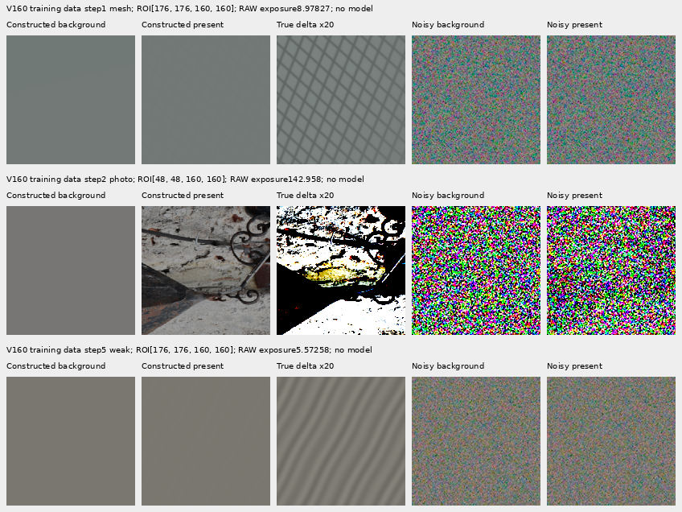
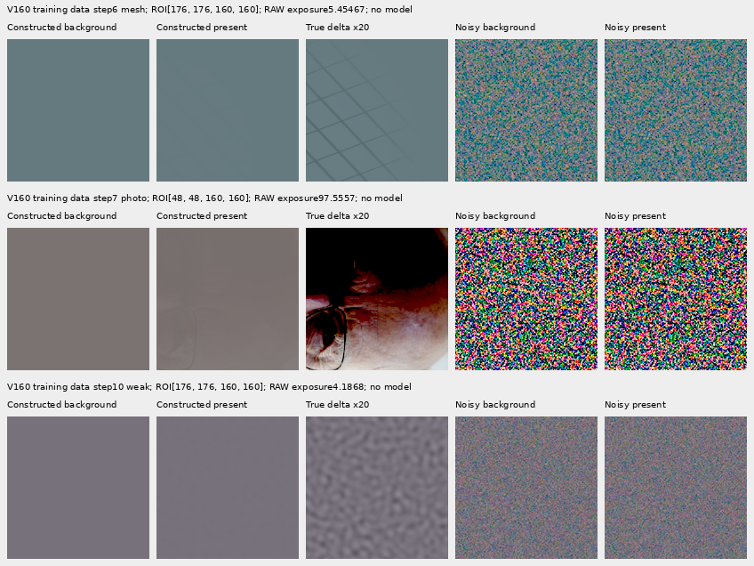

# Paired response: V160

The matched V160 trial is running; restoration quality is pending. It tests
whether explicitly learning the response to faint detail improves the
detail/quiet-field compromise left by [V159](regional-dc-transition.md).
[Immutable preparation, sources and failure history](results/v160-paired-response-preparation-v1.json).

Two fresh 117,677-parameter `LateSpatialRgbDetail` heads receive the same 1,000
new four-frame batches and frozen V143/DINO predictions. Both keep V159's
smooth regional-DC and local full-RGB regret losses. Only `paired-response`
adds weight 1 Charbonnier supervision on output-pair differences versus exact
target-pair differences; `ordinary` has weight 0. This ordinary control uses
new data, so it is not a replay of V159's training trace.

Mesh, weak-texture and photographic batches contain two aligned
present/background pairs. Camera, geometry, Bayer pattern and conditioning
match within each pair. Shared Poisson counts and read draws preserve each
member's physical sensor marginal. Increment units are
`sqrt(mean(shot * abs(clean_packed_present - clean_packed_background)))`,
floored at 16 DN16. These are training units, not calibrated restored-RGB
uncertainty. Targets and pair metadata never enter inference.

Photographic backgrounds are constructed channel means of freely licensed
training patches, not independent empty captures. Both arms also receive
ordinary flat and mixed-edge examples. A common wrong output texture cancels
from the pair difference; the ordinary, local and DC losses still matter.
The new term may increase noise sensitivity. Its effect must be measured.

The fixed schedule contains 341 mesh, 107 weak, 243 photo, 153 flat and 156
mixed batches; 100 are ADC-only with zero supervised gradient but advancing
optimizer/EMA clocks. The 691 paired batches contain 1,382 pairs. Training
uses the existing 90,782-photo hot cache, effective binning by eight and
geometry before downsampling, with zero optical blur. All 18 reviewed
held-out photo IDs and both protected GFX scenes, JPEGs and siblings remain
excluded. `/mnt/dataz` and original captures are unused.

Before launch, 118 objective/data/model tests passed. The genuine 8+2
save/restore smoke passed, with 90 finite Adam states and exact control loss
and all 45 parameter gradients against extracted frozen V159 loss statements
at ten steps: 450 tensor comparisons. All 28 CUDA parity contexts replayed
their archived outputs exactly, using 56 head calls.

Two additional [batch-isolation checks](results/v160-paired-batch-isolation-v1.json)
pass with both paths activated: changing the other batch members preserves the
first image's output bits, and its input adjoints to those members are zero.
Both training and evaluation modes are covered. These four CPU test forwards
are separate from the trial's scientific forward counts.

The first cache attempt stopped during source step 24: a procedural Gaussian
texture draw was counted as Gaussian sensor noise. Three new regression
tests separate the two at sensor API boundaries and preserve bit-identical
data. The original owners are terminal. The explicit continuation adopts all
23 completed parent batches, constructs step 24 again, and computes the
remaining 977 parent/DINO batches. No successful parent forward is repeated,
and full training had not started. Original sources, logs and failed receipts
are preserved. One scientific cache-stage failure and the extra source
construction remain in the accounting.

Both final raw/EMA endpoints will receive all 822 retained observations:
3,288 new prediction arrays. The native design fixes 48 boards and 24
noisy/restored/GT triplets, with retained V156 detail, V157 coarse, V158 quiet
and V159 compromise columns. It includes main-scene sky, building, foliage
and fence plus both fine-cab windows/priors/JPEGs. ISO100 references differ
in aperture, exposure and moving subjects; they are qualitative references,
not exact GT or scoring targets. The new study reserves 60/156 GiB local/external
plus a 0.5 GiB projected margin; prior policies and experiment bytes remain intact.

## Actual training-input inspection

These six fixed examples were actually viewed before model use. Each cell is
native 160×160 with no resizing. Columns are constructed background,
constructed present, target difference amplified 20×, noisy background and
noisy present. Four ordinary columns share each row's recorded exposure;
the amplified difference is display-only. This is training-input inspection,
not a model-performance comparison. The retained batches are adopted by the
cache without redrawing their noise. The manifest records ROIs, camera/noise,
exposures, source attribution and 2,304,000 independently checked RGB channels.

Photographic credits: [Castillo San Felipe de Barajas, Cartagena 26](https://commons.wikimedia.org/wiki/File:Castillo_San_Felipe_de_Barajas,_Cartagena_26.jpg),
Bernard Gagnon, [CC BY-SA 4.0](https://creativecommons.org/licenses/by-sa/4.0/);
[Sir Tony Hoare IMG 5125](https://commons.wikimedia.org/wiki/File:Sir_Tony_Hoare_IMG_5125.jpg),
photograph by Rama, Wikimedia Commons,
[CC BY-SA 2.0 fr](https://creativecommons.org/licenses/by-sa/2.0/fr/deed.en).
Training crops are geometrically augmented, area-binned and exposure/contrast
modified; the displayed derivatives retain their respective source licenses.
