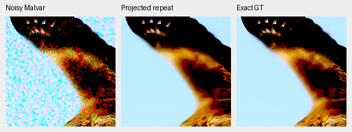
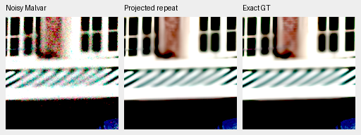

# Training repeat stability at fixed correction strength

The [early repeat-training comparison](paired-repeat-stability.md#first-checkpoint-at-300-updates)
reduced independent-draw variance while weakening the correction.
A scaled control reproduced that gain at the same target-aligned
response. This study changes how the repeat term sees delivered
detail, so it can train changes in the correction's shape without
rewarding a uniform reduction in its strength. Ordinary image
and exact-flat losses still act on the actual delivered result.

## Matched training

Three heads use the same paired EMA initialization, frozen
Corpus 100k and two-window Bayer support from the
[original luminance study](paired-luminance-detail.md). The
matched control uses absolute, flat and paired-increment
supervision. The standard repeat head also penalizes
differences between complete physical redraws. The third
head uses the same repeat weight, 0.75, with two directions
removed from the repeat term.

For a source, the predicted present-minus-absent corrections
for both draws are treated as one vector. The two directions
come from the exact clean fine-band increment and the frozen
starting head's delivered correction. Together they define
a projection. The repeat loss uses the teacher's components
along these directions and the student's remaining components.
If the student simply scales the starting correction, the
projected repeat term remains the same. Every other loss uses
the delivered student output. The inference path still
uses one noisy frame and the fixed Bayer support.

Training covers 384 updates and 768 distinct ordinary
photos, with 4,608 observations per head. The photos are
disjoint from both preceding paired-head schedules and the
96-photo evaluation. Two complete redraws per source each
contain a present, absent and exact-flat target. The
schedule uses 48 photos per ISO, Bayer layout and within-pair
coupling cell. Three qualification updates on six separate
photos verified identical initial outputs, a frozen parent
and teacher, finite gradients and the scale-invariance check.

Training finished all 384 updates in 1,924.69 seconds. The
endpoint holds raw and EMA heads plus their optimizer states,
with SHA256
`19116d4c65d8931e0a5c36f0c8bb4fec2a3f24596930ce6a2d690fd53977ec00`.
The scored inference uses EMA weights in CUDA IEEE FP32,
with a single native measurement, the frozen parent and
the unchanged two-window support. Training observations and
checkpoint lineage are bound to the run plan.
[Bound plan, source schedule and qualification](results/paired-shape-stability-v1/preflight.json) ·
[Frozen source archive](results/paired-shape-stability-v1/preflight-evidence.tar.xz).

## Evaluation

The evaluation reuses the exact 96-photo observations, three
redraws per noise setting and frozen V120 and Corpus 100k
predictions from the original repeat study. It measures
target-aligned fine response, shared and draw-dependent
error, exact-flat texture and ordinary fine error. For
each pair of heads, scalar response matching uses only the
original 64 photos. The additional 32 sources measure
transfer with the scales fixed. The response matching is
a diagnostic. Each head is also measured at its original
correction strength on every source.

## First checkpoint at 96 updates

The checkpoint EMA
`1f8b3e76b529e13ed691933cf9408604eb2c6c573e5190dbc0e036db8d26fc95`
was tested on all 96 photos at ISO6400. The first 16 also have a
separate numerical review with all three frequency bands.
For the additional 32 photos, the nominal projected head recovers
0.046 percentage points more aligned detail than the standard
repeat head with independent pairs. Its increment RMS is
0.069 DN16 higher, flat RMS is 0.012 DN16 higher and
between-draw variance is 43.5 DN16² higher.

| Independent-pair comparison on 32 additional photos | Aligned response difference (percentage points) | Fine-increment RMS difference (DN16) | Flat RMS difference (DN16) | Between-draw variance difference (DN16²) |
| --- | ---: | ---: | ---: | ---: |
| Projected versus standard repeat, calibrated to the same response | +0.001 | −0.008 | +0.0050 | −0.4 |
| Projected versus ordinary control, calibrated to the same response | −0.005 | +0.014 | −0.0014 | +6.4 |
| Projected versus ordinary control, calibrated to the same flat error | −0.005 | +0.015 | −0.0013 | +7.0 |

Each calibration uses only the original 64 photos. The scales stay
fixed for the 32 additional sources, so small response or flat
differences can remain there. Against standard repeat at calibrated
response, the independent variance interval is [−7.0, 4.6] DN16².
The same comparison lowers coupled increment RMS by 0.021 DN16,
with interval [−0.034, −0.009], and increases flat RMS by 0.005 DN16.
Compared with the ordinary control calibrated to the same response,
the independent variance difference is +6.4 DN16² [1.0, 13.4].

The projection retains some nominal response lost by standard
repeat training. Its first checkpoint still shows the independent
detail versus noise tradeoff against the ordinary control.
[Numerical results and frozen scales](results/paired-shape-stability-v1/checkpoint96-summary.json) ·
[Exact source-level evidence](results/paired-shape-stability-v1/checkpoint96-evidence.tar.xz).

## Final performance on the 96-photo panel

The completed replay scores 384 groups with three physical
redraws each, across both noise priors and both within-pair
noise laws. The numerical replay took 293.09 seconds using
saved parent predictions. The table uses the full nominal
strength for each head and all 96 photos.

| ISO6400 method | Aligned response, coupled / independent | Fine-increment RMS, coupled / independent (DN16) | Flat RMS, coupled / independent (DN16) |
| --- | ---: | ---: | ---: |
| V120 EMA | 66.230% / 66.955% | 96.694 / 117.321 | 4.920 / 4.888 |
| Corpus 100k EMA | 66.623% / 67.308% | 96.043 / 116.867 | 4.397 / 4.329 |
| Starting paired EMA | 67.068% / 67.756% | 95.049 / 117.238 | 4.474 / 4.403 |
| Ordinary control | 66.903% / 67.590% | 95.385 / 117.042 | 4.430 / 4.360 |
| Standard repeat | 66.686% / 67.371% | 95.868 / 116.893 | 4.400 / 4.331 |
| Projected repeat | 66.789% / 67.475% | 95.538 / 116.984 | 4.418 / 4.348 |

The projected endpoint retains about 0.10 percentage points
more nominal ISO6400 response than standard repeat. Its
independent increment error remains above the Corpus 100k
parent. At ISO400 it changes aligned response by about
−0.06 percentage points relative to Corpus 100k under both
draw laws. Coupled increment RMS falls 0.61 DN16 and
independent RMS rises 0.18 DN16. The ISO6400 flat lower band
changes by less than 0.001 DN16 relative to Corpus 100k
for all three trained arms. The fine changes leave the larger
flat variation in the parent.

### Matched controls on the 32 additional photos

The 64 original photos set the correction scales. The
comparison below uses the additional 32 photos at those fixed
scales. Residual differences on those photos measure transfer.

| Projected head versus ordinary control | Aligned response difference (percentage points) | Fine-increment RMS difference (DN16) | Flat RMS difference (DN16) | Draw variance difference (DN16²) |
| --- | ---: | ---: | ---: | ---: |
| Coupled, match response | −0.014 | −0.085 | +0.0027 | −5.2 |
| Independent, match response | −0.021 | +0.049 | +0.0022 | +31.4 |
| Independent, match flat error | −0.062 | +0.002 | −0.0027 | −2.1 |

Matched-response coupled increment error changes by −0.085 DN16
with interval [−0.163, −0.024]. The independent increment
difference is +0.049 DN16 [0.002, 0.123], with variance
change +31.4 DN16² [9.2, 58.2]. The independent flat-calibrated
comparison gives equal-looking increment error and measurably
less response. Against standard repeat at calibrated response,
the projected head lowers coupled increments 0.024 DN16
with an interval below zero. The independent difference is
−0.007 DN16 with an interval spanning zero.
[Checkpoint, complete metrics and intervals](results/paired-shape-stability-v1/endpoint-summary.json) ·
[Frozen source-level evaluation](results/paired-shape-stability-v1/endpoint-evidence.tar.xz).

## Native exact-target crops

The triplets show noisy Malvar, the projected EMA and exact
GT at `[48,48,160,160]` within their 256×256 original queries.
Both use independent ISO6400 conditioning, shot/read
`0.00128/6.5536e-6`, ADC16 black fraction 0.03, capture
exposure 0.33, display exposure ×3.0303 and contrast ×2.
The endpoint and parent identities are bound in the
publication receipt.

The largest favorable change in fine-increment error
versus standard repeat is on the black kite. Fine plumage
stays smeared along the edge. Query origin `[228,102]`,
GBRG. Tisha Mukherjee, CC BY-SA 4.0.
[Source photo](https://commons.wikimedia.org/wiki/File:Black_Kite_in_Baruipur_October_2025_by_Tisha_Mukherjee_01.jpg) ·
[All methods](images/paired-shape-stability-v1/067-iso6400-independent-r0-role0-comparison.png).

The largest regression keeps strong bars and windows visible
and fine edges soft. Query origin `[380,118]`, GRBG. Slaunger,
CC BY-SA 4.0.
[Source photo](https://commons.wikimedia.org/wiki/File:Couple_selfie_stick_Konigssluis_Amsterdam_2016-09-13-6621.jpg) ·
[All methods](images/paired-shape-stability-v1/094-iso6400-independent-r0-role0-comparison.png).

The largest flat regression still looks smooth at native
scale. Nearby material boundaries remain soft. Query origin
`[332,286]`, RGGB. A.Savin, CC BY-SA 3.0.
[Source photo](https://commons.wikimedia.org/wiki/File:Kirche_StAntonius_Koeln-Muelheim.jpg) ·
[Native flat comparison](images/paired-shape-stability-v1/068-iso6400-independent-r0-role2-comparison.png).

## Standing GFX100S comparisons

All eight native 160×160 comparisons were viewed. The main
DSCF3879 regions use the nominal ISO6400 prior and display
exposure ×4. DSCF3842 uses display exposure ×16 under the
same nominal prior and transferred DSCF3879 shot/read
`0.0014635776/1.0715704e-6`. The DSCF3880 and DSCF3835
ISO100 AHD captures and both camera JPEGs provide qualitative
references, with different aperture, exposure and some
moving scene content.

| View | Native boards |
| --- | --- |
| DSCF3879 main scene | [Sky](images/paired-shape-stability-v1/main-overcast-sky-main-overcast-sky.png) · [Building](images/paired-shape-stability-v1/main-building-detail-main-building-detail.png) · [Foliage](images/paired-shape-stability-v1/main-foliage-main-foliage.png) · [Coarse fence](images/paired-shape-stability-v1/main-chain-link-fence-main-chain-link-fence.png) |
| DSCF3842 nominal | [Left](images/paired-shape-stability-v1/mesh-nominal-fine-green-mesh-left.png) · [Right](images/paired-shape-stability-v1/mesh-nominal-fine-green-mesh-right.png) |
| DSCF3842 transferred | [Left](images/paired-shape-stability-v1/mesh-profile3879-fine-green-mesh-left.png) · [Right](images/paired-shape-stability-v1/mesh-profile3879-fine-green-mesh-right.png) |

Sky stays smooth. Coarse fence crossings remain visible and
the thin building wires and foliage stay soft. Cab diagonals
remain faint or incomplete, with mottle behind the lattice.
Against Corpus 100k, the projected EMA changes the sky by
0.00039 DN16 RMS and the cab crops by 0.022–0.269 DN16 RMS
in camera RGB. Both standing families are part of this
completed component review. The 427-photo and known/unseen
camera scores come from the separately measured full models.
[PSNR history](performance-history.md) ·
[Main GFX map](gfx-qualitative.md) ·
[Fine cab map](gfx-green-mesh.md).
