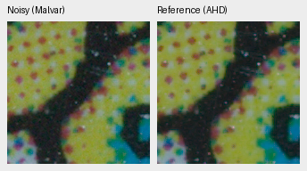
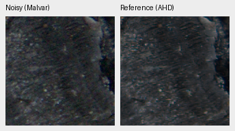

# Paired training-target residual review

Most supported pairs have little same-phase residual correlation. A few warrant
closer motion/sharpness/subpixel review before treating registration as exact.
**This diagnostic changes no target, crop, training recipe or evaluation.**
[Full measurements and source hashes](results/paired-target-residual-diagnostic.json).

The [standalone tool](../scripts/diagnose_paired_residuals.py) reads measured clean
CFA samples, not AHD interpolation. It compares only same-color observed/reference
positions inside the reference mask, scales residuals by the supplied shot/read
noise plus ADC variance, and computes phase-centered lag correlation two sensor
pixels apart. A weighted first-order gradient fit supplies a rough x/y translation
descriptor. Reference noise is omitted from this scale proxy; correlated sensor
noise, gain/black-level error, defocus, motion and clipping can all affect it.
Neither correlation nor a fitted shift proves registration error.

| Dataset | Cases / crops | Cases with direct same-color support | Median case lag correlation |
| --- | ---: | ---: | ---: |
| Original train32 | 64 /576 | 61 | .01223 |
| Two-scene quarantine pilot | 4 /36 | 3 | .01272 |

Odd reference shifts can put every clean CFA sample on a different noisy color
position. Those cases correctly return no direct residual estimate; they are
not assigned a clean score or filled using demosaiced reference pixels.

Selected inspection priorities, ranked by case-median correlation:

| Scene / ISO | Lag correlation | First-order x,y descriptor, sensor pixels |
| --- | ---: | --- |
| Kortlek /1600 | .23387 | −.339,+.290 |
| wet_charred_wood /2500 | .19400 | −.398,−.287 |
| fireplace /1600 | .13579 | −.083,−.097 |
| Pilot Bark /1600 | .20756 | −.345,−.292 |

These fits prioritize native inspection; they are not applied corrections or
automatic rejection thresholds. There is no evidence here that all train32
targets are broadly broken. The new52 scene candidates still require native
reference/crop review before admission. Improving data quantity alone does not
establish better targets or restoration.

Native160px data pairs from the fixed center512px crop, ROI[176,176,160,160],
shared display×1/WB/matrix: noisy Malvar → independently calibrated AHD reference.
No resizing or learned-model output. The right panel is **not exact RGB GT**.

The selected previews retain fine source texture and noise differences; they
do not by themselves identify the cause of a fraction-pixel fit. Source/ROI,
reference alignment/gain, input noise and display metadata are in the receipt.
Source: [RawNIND](https://doi.org/10.14428/DVN/DEQCIM), Benoit Brummer and
Christophe De Vleeschouwer; dataset CC BY-SA4.0, Kortlek CC0 by Peter Wemmert.
Modified by linear normalization, independent demosaicing, registration/exposure
calibration, crop and rendering; retain the applicable source grant.

Nine targeted tests pass: four Bayer patterns with a known fractional offset,
independent white noise, a sharpness mismatch without translation, masked/invalid
data and held-out split rejection. They verify descriptor behavior, not an
automatic diagnosis on real RAWs. Development/test manifests are rejected;
protected-final model scoring remains closed.
