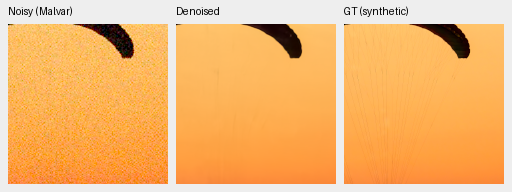
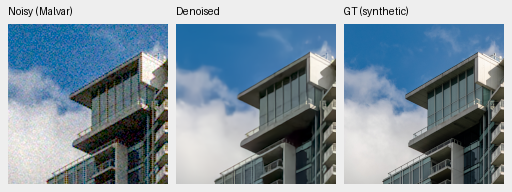
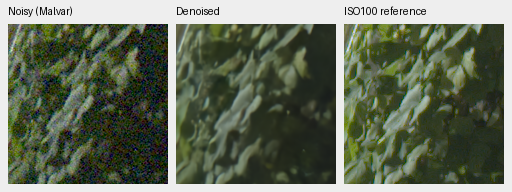
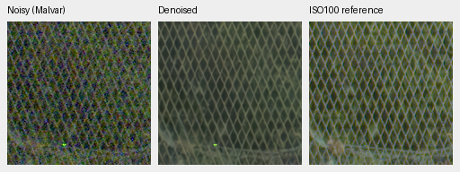

# V33 continuation to step 2,000

V33 improves unseen measured-CFA PSNR by .08887 dB over its step-1000 checkpoint,
but known primary PSNR falls .05617 dB and the photographic synthetic screen
falls .09558 dB. The tradeoff remains mixed, so training stops at this gate.
[Complete matched metrics and native-crop receipt](results/paired50-v33-2k-review.json).

The model resumes AdamW/EMA/RNG at step 1000 with its original planned 3,000-step
schedule, batch 16, seed 46, initial LR 3e-5 and 50% paired / 25% native /
25% Commons mixture. Original frozen 8× data and augmentation are unchanged.
The additional 1,000 updates process 16,000 examples. Checkpoint SHA256:
`847ddfd8358bc8b1a793348753791667d71fb7265c64d04eec9029baa17a006d`.

| Panel | Method | Measured-CFA PSNR | AHD RGB PSNR | AHD SSIM |
| --- | --- | ---: | ---: | ---: |
| Known4 | V33 step1000 | 54.26923 | 39.98100 | .931180 |
| Known4 | V33 step 2000 | 54.21306 | 40.01869 | .931727 |
| Known4 | RawNIND channel CFA-LS | 54.08474 | 39.71710 | .928831 |
| Unseen5 | V33 step1000 | 53.63152 | 38.43170 | .919532 |
| Unseen5 | V33 step 2000 | 53.72039 | 38.42326 | .919000 |
| Unseen5 | RawNIND channel CFA-LS | 53.76822 | 38.56191 | .922127 |

Known: 8 pairs / 72 crops; unseen: 10 pairs / 90 crops. Means average crops and
captures within scenes; bootstrap samples scenes. Step2000−step1000 unseen
primary gain has 95% interval [+.02405,+.15704] dB. The known primary difference
has interval [−.16283,+.02694]. Known SSIM improves .000546
([+.000101,+.000992]); unseen SSIM falls .000532 with an interval crossing zero.
Channel-calibrated RawNIND still leads all three unseen means. Both RawNIND
calibrations and all earlier checkpoints are retained in the receipt.
Registered low-noise measured CFA is the primary reference; independent AHD
RGB is an auxiliary reference, **not exact RGB GT**. Noise fits and calibration
use noisy inputs only.

On the same 16-photo screen, sRGB PSNR/SSIM changes
35.08594/.959624 → **34.99035/.959863**. The PSNR difference's source-bootstrap
95% interval is [−.21009,+.00242] dB. Four procedural sources improve
33.04443/.972692 → **33.26166/.973501**. This candidate has no full427 or full
102 MP review; do not apply step1000's results or timing to it.

Noisy Malvar → V33 step 2000 → **exact synthetic GT**, native 160×160 panels.
ROI [48,48,160,160] within each binned evaluation tile, RGGB, nominal ISO12800
prior (`shot=.00256`, `read=.0000262144`), ×1 display, WB [2,1,1.5] and the fixed
protocol matrix. No resizing; PNGs are 8-bit sRGB previews, metrics unquantized.
Complete source/cache/checkpoint hashes and rendering metadata are in the receipt.

Fine canopy texture remains lost and cloud edges soft. Sources:
[Roy Egloff](https://commons.wikimedia.org/wiki/File:CH.VD.Villeneuve_2007-08-25_Vertigo-Swiss-Riviera_2392_3x2-R_4K.jpg)
and [Dietmar Rabich](https://commons.wikimedia.org/wiki/File:Vancouver_(BC,_Canada),_Coal_Harbour_Seaside_Park,_Blick_in_den_Himmel_--_2022_--_2158.jpg),
[CC BY-SA 4.0](https://creativecommons.org/licenses/by-sa/4.0/). Modified by
linear binning, cropping, simulated Bayer/noise, restoration and rendering;
derivative previews retain that license.

Standing GFX DSCF3879 ISO6400 → V33 step 2000 → separate DSCF3880 ISO100 f/5.6.
Native 160px foliage [8890,5570] and fence [2240,6000] ROIs (reference fence
x2241), using 512px context, shared +2 EV/WB/matrix and input-only prior
(`shot=.001463577592`, `read=.000001071570413`). Aperture, time and motion
differ; the last panel is a qualitative reference, **not GT**.

Foliage remains soft; fence thickness/shape remains irregular and a colored point
persists. No decisive visual improvement is established. All four regions and
matched methods are in the receipt. Native PNG hashes/dimensions, common
source/ROI/noise/display metadata and identical noisy/reference panel bytes were
verified. The README retains the reviewed step1000 full-frame examples. GFX,
siblings and protected-final remain outside training; final remains unscored.
