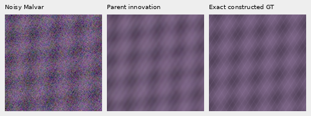
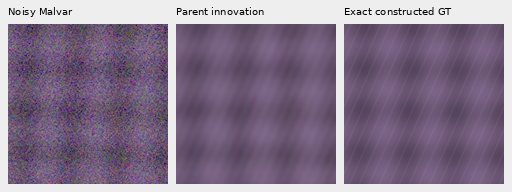

# Fine innovation validation on an A-only neural prediction

Both 48-case numerical reviews and all native viewing are complete. Validating
the delivered fine component against an A-only neural prediction reduces the
analytic building's false color on the standing GFX crop. The new rule leaves
cab crossings soft and gives no useful extra signed-color recovery. The option
remains experimental. The whole-scene model is a separate experiment.
[Native and comparison evidence](results/parent-innovation-native-v1/publication.json) ·
[Whole-scene context](whole-scene-context-next-test.md).

The completed [full guided](neural-guided-phase-full-panel.md) and
[coloured fine-wire](coloured-fine-wire-benchmark.md) reviews show why standalone
nuisance-prediction improvement is insufficient: the delivered neural-parent
correction can have higher weak-increment error. The opt-in
`fine_validation="neural-parent"` tests a closer A-only composition.

For each discovery fold, form the predictor from its genuine A-only neural RGB
field plus both unshrunk full-fit sinusoidal fine innovations computed from
RAW minus that field. Each null removes one delivered direction while retaining
the other. Pool held-out full/null gains over actual CFA colours with the existing
joint score. Require both matched folds and the original fixed threshold(s).
The default remains`"nuisance"`; enabling the new target requires joint support
and sinusoidal additional fine carriers.

Fine discovery, global nuisance, local full-fit RGB coefficients, actual final
RAW-minus-full-parent delivery, broad guided phase and raw-H1 controls retain
their existing definitions. Full-input parent never enters validation. This
scores an **A-only teacher plus unshrunk fine composition**, not the final
shrunk broad+fine/full-input estimator; it is not calibrated final-image risk.
In particular, it does not resolve semantic ambiguity by itself.

114 relevant regression tests pass. New checks cover exact delivered full/null
maps, signed independent RGB amplitudes across allCFAs, zero innovation when
the A-only teacher already equals the observation, invariance to withheld NaNs,
mask mismatch refusal, unchanged broad/H1 controls and full-input-parent
invariance of validation records. No learned weights change.

Two frozen producers completed all96 cases before any new GT/reference review:

|Cohort|Parents/teacher|Cached A-only fields|Thresholds|Correction time, two CPU threads|
|---|---|---:|---|---:|
|Original48-case materials/GFX/development pilot|Procedural V143; real and teacher V120|88|0/2/4|603.59s|
|Fresh coloured48-case follow-up|V120 for parent and teacher|96|2|593.22s|

These are CPU correction-stage timings, not100MP/end-to-end inference. The
original pilot's teacher/parent mismatch is disclosed; the coloured cohort is
the cleaner same-V120 composition test. Both background stages rechecked actual
physical/mask/argument fingerprints and used **zero fresh root/DINO forwards**.
The coloured pair retains96 exact H1 comparisons across48 physical cases.
All original four coloured variants,400 score rows and40 actually viewed figures
remain unchanged. New208 rows/4368 direct norm/dot/cross-product checks and40
new fixed-ROI native figures are complete. The pilot's standard finite/material/
native independent audit also passes. No threshold, crop or new noise seed was
selected from results.

Both standing GFX families remain in the original pilot: DSCF3879/3880 sky,
building, foliage and coarse fence; DSCF3842/3835 both fine cab ROIs/profiles/
JPEGs. Independent ISO100/AHD/JPEG references are qualitative, not exact GT,
and receive no pixelwise scoring. Cached media only, originals read-only;
protected captures/JPEGs/siblings stay outside training.

Pilot plan`18be92d7a04751d37a3f49b5aa9a0b75344dc03431302ebfb7f3858df5ed88eb`;
coloured plan`0b61c598959bfbcfe29e118136b5aece5ccac2e5a3e0e7daeac9353fb6da56b8`.
[Exact source/terminal/audit/test receipts](results/parent-innovation-completed-pre-review-v1/publication.json).

## Matched delivered image comparison

The analytic arm uses the existing conditional local gate at threshold 2.
The table averages both colored sources and all four Bayer layouts. Errors use
the exact sensor-linear target and are shown in DN16 RMS. Color error measures
the component of the predicted weak increment orthogonal to its actual RGB
contrast. Strong response rises from 48.10% to 48.85% at ISO1600 when changing
the gate, with slightly lower full RGB error and higher weak-increment error.

| Prior and method | Weak response | Weak-increment RMS | Weak color RMS | Full RGB RMS |
| --- | ---: | ---: | ---: | ---: |
| ISO1600 V120 | 22.985% | 23.31588 | 13.12802 | 23.89396 |
| ISO1600 joint nuisance gate | 24.088% | 24.29659 | 14.40242 | 23.23376 |
| ISO1600 A-only innovation gate | 24.007% | 24.31145 | 14.40940 | 23.22254 |
| ISO6400 V120 | 20.052% | 34.33265 | 19.28682 | 38.17252 |
| ISO6400 joint nuisance gate | 20.034% | 36.20982 | 21.60706 | 38.33853 |
| ISO6400 A-only innovation gate | 20.035% | 36.22387 | 21.61001 | 38.32160 |

For the signed-color source at ISO1600, the two gates recover 25.36246% and
25.36209% of the weak signal. Its weak-increment RMS rises from 23.01844 to
23.03341 DN16. The original finite-wire pilot gets the same ISO400/far result
with either gate. On the complete outputs at threshold 2, 81 of 96 pilot
method/observation pairs and 36 of 96 colored pairs are pixel-identical to
the corresponding prior gate. These panels cover development cases.
[Matched output differences and source groups](results/parent-innovation-native-v1/comparison.json).

## Native crops

The two unresized 160×160 triplets show noisy Malvar, the new analytic gate
and exact constructed GT on neutral source 0 and signed-color source 1.
Both use RGGB, the two-direction role and native ROI `[176,176,160,160]`.
Shot/read are `0.00032/4.096e-7`. All cells share display exposure 16,
contrast 1, white balance `[1.55,1,1.7]` and the fixed sensor-to-sRGB matrix.
The parent and A-only teacher use V120 EMA SHA256
`a9d9b6b4f974e24a6b11e5e740aab32314233a7f53c056cf37c7d2aac1c589fb`.
The colored comparison configuration is SHA256
`ad22711096ab74568fef317d67b8a54c3a5dbc35a72c2352eeceabaf4b9abbf9`.
The outputs show blurred diagonals where the exact targets have thin crossings.

The real comparison uses the same V120 EMA and the established native ROIs.
DSCF3879 uses display exposure 4 and shot/read `0.00128/6.5536e-6`. DSCF3842
uses exposure 16 with that profile and the transferred `0.0014635776/1.0715704e-6`.
The sky is pixel-identical to V120. On the fixed building crop, analytic
correction RMS from V120 falls from 30.10 to 17.46 DN16, and the visible
green/magenta band is weaker. The neural correction falls from 16.46 to 15.93
DN16. A separate high-correction view still shows building color shifts.
Foliage remains soft and the coarse fence retains its diamonds. Both cab sides
and profiles retain the prior soft lattice with small changes in modulation.
DSCF3880 and DSCF3835 provide independent ISO100 AHD references, with both
straight-out-of-camera JPEGs on the cab boards. Aperture, exposure and motion
differ across captures. These references are qualitative.

[Sky](images/parent-innovation-native-v1/main-overcast-sky-comparison.png) ·
[Building, matched gates](images/parent-innovation-native-v1/main-building-detail-paired.png) ·
[Building stress view](images/parent-innovation-native-v1/main-building-detail-stress.png) ·
[Foliage](images/parent-innovation-native-v1/main-foliage-comparison.png) ·
[Coarse fence](images/parent-innovation-native-v1/main-chain-link-fence-comparison.png) ·
[Cab left](images/parent-innovation-native-v1/mesh-nominal-fine-green-mesh-left-comparison.png) ·
[Cab right](images/parent-innovation-native-v1/mesh-nominal-fine-green-mesh-right-comparison.png) ·
[Transferred left](images/parent-innovation-native-v1/mesh-profile3879-fine-green-mesh-left-comparison.png) ·
[Transferred right](images/parent-innovation-native-v1/mesh-profile3879-fine-green-mesh-right-comparison.png).

The review covers all 28 pilot figures, 40 colored figures and eight matched
camera boards assembled from existing cells. The comparison checks unchanged
inputs and all 32 retained camera cells. The first comparison pass required
selecting the recorded batch sample in the saved parent array. The corrected
pass uses the same saved outputs. No new model weights or PSNR history
measurements are produced by this review.
[Native viewing manifest](images/parent-innovation-native-v1/manifest.json) ·
[Native manifests, original scores and comparison code](results/parent-innovation-native-v1/native-evidence.tar.gz).
