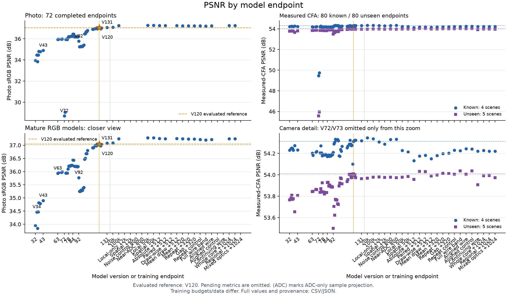

# PSNR history

V120 is the working quality reference, with 37.04008 dB photographic PSNR and 54.31272/54.00872 dB known/unseen measured-CFA PSNR. Its photographic change from V43 is +2.14 dB. Training histories differ; current strengths, tradeoffs and native comparisons are in the [model guide](current-model.md). A version names an experiment, not a training step.

**Coverage reviewed November 20, 2026.** Corpus 20k and Corpus 100k have completed the fixed photo and both camera panels. Corpus 100k gains 0.20739 dB on the 427-photo panel over V120, with a 0.03046 dB unseen-camera loss. [Corpus 20k](full-corpus-control20k-primary.md) · [Corpus 100k](full-corpus-long100k.md#broader-evaluation). Both matched scene 12k endpoints have [completed fixed camera panels](expanded-scene-12000-cameras.md). The matched near-ADC 800-update endpoints also have [completed camera panels](near-adc-bridge-cameras.md). The matched scene 50k pair and two 512-update continuations have [completed fixed photo and camera panels](scene-50000-cameras.md). The two independent-redraw endpoints also have [completed fixed camera panels](local-redraw-average.md#fixed-camera-panels). The mean-redraw parent and three repeat and gap continuations have completed [the fixed photo panel](local-redraw-stability.md#fixed-photo-panel) and [both camera panels](local-redraw-stability.md#fixed-camera-panels). The three signed wire continuations have completed [the fixed photo panel](local-wire-response.md#fixed-photo-panel) and [both camera panels](local-wire-response.md#fixed-camera-panels). The continuing-wire trial has [completed fixed camera panels](local-continuing-wire.md#fixed-camera-panels). Both regional weak-wire endpoints have completed [the fixed photo panel](local-regional-wire-1024.md#fixed-photo-panel) and [both camera panels](local-regional-wire-1024.md#fixed-camera-panels). The mixed-optics arm also has [completed fixed camera panels](local-optical-mixture-1024.md#fixed-camera-panels). The V131 point uses the independent CPU-to-CPU audit: photo 37.08008 dB, known/unseen CFA 54.31993/53.96491 dB. Its photo gain has unseen-camera and ADC-color costs; see the [broad review](v131-broad-primary.md). V132 has only a targeted endpoint review, and V198/V200 and later detail components use different panels. They do not have comparable full427 points here. The opt-in V131 ADC-only repair is not a second all-condition point. The [previous chart and registry](history/before-2026-11-17-cleanup/performance-history.md) are preserved.

Selected fixed primary endpoints, chosen by study scope, never by highest score. Each plotted metric has a completed primary panel; pending metrics remain blank. Version numbers are experiment labels; architectures, data, initialization, training budgets and recorded compute precision differ. This is descriptive history, not a controlled ranking or training curve. Missing versions lack a selected comparable primary report here.

Completed camera panels with pending full-photo results: [Local-only 12k](expanded-scene-12000-cameras.md), [Spatial 12k](expanded-scene-12000-cameras.md), [Noise control 800](near-adc-bridge-cameras.md), [Near-ADC 800](near-adc-bridge-cameras.md), [Draw-wise +512](local-redraw-average.md), [Aligned control](local-continuing-wire.md), [Continuing wire](local-continuing-wire.md), [Mixed optics +1024](local-optical-mixture-1024.md). Selected material means are not substituted for full427 scores. Camera references are measured CFA samples; independently demosaiced RGB references are not exact GT. Small camera panels have scene uncertainty. The plot describes checkpoints with unequal budgets and data; use the linked comparisons to assess particular gains and weaknesses. Dashed lines show V120's measured means. There are 72 completed photo endpoints and 80/80 known/unseen camera endpoints. The lower panels omit V72/V73 RAW-native prototypes only to show the mature RGB range more clearly.

All photo points use the full fixed427-source panel, seven conditions and four CFAs. Known/unseen points balance captures within scenes, then scenes (4/5 scenes,72/90 crops). Precision, checkpoint hashes and per-source results remain in the source reports.

V98/V99 use common ADC-only inference projection; only V99 trained through it. Their original V43/V95 references retain their checkpoint policies. The [completed ADC study](v95-adc-training-quality-review.md) improves ADC color but retains positive-noise color/detail weaknesses. Study-specific statistical gates do not prevent showing progress or choosing a stronger development baseline.

| Version / endpoint | Photo sRGB | Known CFA | Unseen CFA | Report |
| --- | ---: | ---: | ---: | --- |
| V32 / step-1000 | 33.95672 | 54.22962 | 53.76552 | [Review](geometry-corpus-v34-v36-review.md) |
| V34 / step-1000 | 34.46662 | 54.24658 | 53.78664 | [Review](geometry-corpus-v34-v36-review.md) |
| V35 / step-1000 | 33.84007 | 54.25055 | 53.80858 | [Review](geometry-corpus-v34-v36-review.md) |
| V36 / step-1000 | 34.47578 | 54.24577 | 53.77059 | [Review](geometry-corpus-v34-v36-review.md) |
| V37 / step-2000 | 34.81064 | 54.22979 | 53.77653 | [Review](native-corpus-2k-review.md) |
| V39 / step-2000 | 34.78920 | 54.27380 | 53.65415 | [Review](native-corpus-2k-review.md) |
| V43 / step-2000 | 34.89934 | 54.23332 | 53.80606 | [Review](native-corpus-2k-review.md) |
| V63 / V63-control-original20k | 35.93309 | 54.20366 | 53.84298 | [Review](long-commons-v63-v64-original20k-review.md) |
| V64 / V64-expanded-original20k | 35.95907 | 54.18217 | 53.84652 | [Review](long-commons-v63-v64-original20k-review.md) |
| V68 / V68-normalization-control-original4k | 35.96596 | 54.20920 | 53.86301 | [Review](normalization-v68-v69-original4k-review.md) |
| V69 / V69-normalization-augmented-original4k | 35.98628 | 54.21955 | 53.86247 | [Review](normalization-v68-v69-original4k-review.md) |
| V72 / V72-no-dino-mixed16-quarter160000examples | 28.70933 | 49.46916 | 45.56826 | [Review](packed-isotropic-mixed16-quarter-review.md) |
| V73 / V73-dino-mixed16-quarter160000examples | 29.05806 | 49.74359 | 45.94882 | [Review](packed-isotropic-mixed16-quarter-review.md) |
| V74 / V74-first1000 | 35.94016 | 54.20562 | 53.83642 | [Review](reconstruction-objective-first1k-review.md) |
| V75 / V75-first1000 | 35.96041 | 54.27080 | 53.87060 | [Review](reconstruction-objective-first1k-review.md) |
| V76 / V76-first1000 | 35.94163 | 54.20499 | 53.84358 | [Review](camera-supervision-first1k-review.md) |
| V77 / V77-first1000 | 36.10174 | 54.17786 | 53.92456 | [Review](camera-supervision-first1k-review.md) |
| V78 / V78-original4000 | 36.21099 | 54.19247 | 53.83875 | [Review](directional-interval-original4k-review.md) |
| V79 / V79-original4000 | 36.20938 | 54.18654 | 53.83875 | [Review](directional-interval-original4k-review.md) |
| V80 / V80-original4000 | 36.21129 | 54.18538 | 53.82029 | [Review](directional-bank-original4k-review.md) |
| V81 / V81-original4000 | 36.24146 | 54.19135 | 53.83501 | [Review](directional-bank-original4k-review.md) |
| V82 / V82-original4000 | 36.24146 | 54.19135 | 53.83501 | [Review](bank-detachment-original4k-review.md) |
| V83 / V83-original4000 | 36.23795 | 54.18305 | 53.83417 | [Review](bank-detachment-original4k-review.md) |
| V84 / V84-original20000 | 36.43996 | 54.17122 | 53.92823 | [Review](native-data-original20k-review.md) |
| V85 / V85-original20000 | 36.43574 | 54.17942 | 53.93069 | [Review](native-data-original20k-review.md) |
| V86 / V86-original4000 | 36.19663 | 54.18758 | 53.89443 | [Review](training-context-original4k-review.md) |
| V87 / V87-original4000 | 36.19762 | 54.17295 | 53.90475 | [Review](training-context-original4k-review.md) |
| V88 / V88-original4000 | 36.18923 | 54.18227 | 53.89214 | [Review](spectral-original4k-review.md) |
| V89 / V89-original4000 | 36.19699 | 54.17855 | 53.89400 | [Review](spectral-original4k-review.md) |
| V90 / V90-original4000 | 36.18643 | 54.19441 | 53.88461 | [Review](late-rgb-original4k-review.md) |
| V91 / V91-original4000 | 36.18861 | 54.18871 | 53.88604 | [Review](late-rgb-original4k-review.md) |
| V92 / V92-head-only-original4000 | 35.77085 | 54.20873 | 53.49849 | [Review](late-rgb-head-only-original4k-review.md) |
| V93 / step-20000 | 35.24714 | 54.28970 | 53.70392 | [Review](v43-curated-original20k-review.md) |
| V94 / step-20000 | 35.25352 | 54.30619 | 53.62349 | [Review](v43-curated-original20k-review.md) |
| V95 / step-20000 | 35.29553 | 54.33307 | 53.76990 | [Review](v43-curated-original20k-review.md) |
| V96 / step-4000 | 35.27828 | 54.32564 | 53.76643 | [Review](v95-flat-palette-quality-review.md) |
| V97 / step-4000 | 35.28321 | 54.32529 | 53.76365 | [Review](v95-flat-palette-quality-review.md) |
| V98 / step-4000 (ADC-projected) | 35.37252 | 54.33003 | 53.73025 | [Review](v95-adc-training-quality-review.md) |
| V99 / step-4000 (ADC-projected) | 35.40133 | 54.31940 | 53.72165 | [Review](v95-adc-training-quality-review.md) |
| V100 / step-10000 | 36.47264 | 54.17846 | 53.89614 | [Review](v84-curated-quality-review.md) |
| V101 / step-10000 | 36.50347 | 54.17404 | 53.92334 | [Review](v84-curated-quality-review.md) |
| V102 / step-20000 | 36.67951 | 54.23709 | 53.97177 | [Review](v102-v103-quality-review.md) |
| V103 / step-20000 | 36.68091 | 54.22003 | 53.96410 | [Review](v102-v103-quality-review.md) |
| V104 / step-20000 | 36.80085 | 54.26606 | 53.91700 | [Review](v104-reviewed-corpus-quality.md) |
| V111 / step-20000 | 36.90367 | 54.25270 | 53.93706 | [Review](v111-v112-primary-quality.md) |
| V112 / step-20000 | 36.90238 | 54.26914 | 53.95378 | [Review](v111-v112-primary-quality.md) |
| V114 / V114-step-20000 | 36.97973 | 54.28627 | 54.00290 | [Review](v114-v115-quality.md) |
| V115 / V115-step-20000 | 36.97700 | 54.32405 | 54.00417 | [Review](v114-v115-quality.md) |
| V116 / V116-step-20000 | 36.97478 | 54.28701 | 53.99497 | [Review](v116-quality.md) |
| V117 / V117-step-20000 | 37.04408 | 54.27303 | 53.97339 | [Review](v117-v118-quality.md) |
| V118 / V118-step-20000 | 37.03982 | 54.27562 | 53.97449 | [Review](v117-v118-quality.md) |
| V119 / V119-step-20000 | 37.03831 | 54.10063 | 54.00742 | [Review](v119-quality.md) |
| V120 / V120-step-20000 | 37.04008 | 54.31272 | 54.00872 | [Review](v120-v121-primary.md) |
| V121 / V121-step-20000 | 37.04157 | 54.32184 | 53.98947 | [Review](v120-v121-primary.md) |
| V122 / step-20000 | 36.97786 | 54.32375 | 54.00030 | [Review](v122-v123-quality.md) |
| V123 / step-20000 | 37.03279 | 54.32306 | 53.97248 | [Review](v122-v123-quality.md) |
| V131 / step-20000 | 37.08008 | 54.31993 | 53.96491 | [Review](v131-broad-primary.md) |
| Corpus 20k | 37.09079 | 54.34557 | 53.96805 | [Review](full-corpus-control20k-primary.md) |
| Corpus 100k | 37.24747 | 54.33708 | 53.97826 | [Review](full-corpus-long100k.md) |
| Local-only 12k | pending | 54.30773 | 53.97866 | [Review](expanded-scene-12000-cameras.md) |
| Spatial 12k | pending | 54.28798 | 53.97485 | [Review](expanded-scene-12000-cameras.md) |
| Noise control 800 | pending | 54.32990 | 53.97661 | [Review](near-adc-bridge-cameras.md) |
| Near-ADC 800 | pending | 54.33269 | 53.97259 | [Review](near-adc-bridge-cameras.md) |
| Local 50k | 37.27953 | 54.22726 | 53.97844 | [Review](scene-50000-cameras.md) |
| Spatial 50k | 37.27886 | 54.21456 | 53.98465 | [Review](scene-50000-cameras.md) |
| Absolute +512 | 37.25435 | 54.13283 | 53.95658 | [Review](scene-50000-cameras.md) |
| Paired +512 | 37.24583 | 54.17481 | 54.03148 | [Review](scene-50000-cameras.md) |
| Draw-wise +512 | pending | 54.18249 | 54.03049 | [Review](local-redraw-average.md) |
| Mean draw +512 | 37.25003 | 54.15014 | 53.98907 | [Review](local-redraw-average.md) |
| Mean +320 | 37.24141 | 54.18081 | 53.99807 | [Review](local-redraw-stability.md) |
| Repeat +320 | 37.23465 | 54.19868 | 54.01346 | [Review](local-redraw-stability.md) |
| Gap +320 | 37.23273 | 54.20259 | 54.01114 | [Review](local-redraw-stability.md) |
| Repeat control | 37.21991 | 54.22980 | 54.00495 | [Review](local-wire-response.md) |
| Full wire band | 37.19897 | 54.22485 | 54.03753 | [Review](local-wire-response.md) |
| Aligned wire | 37.22113 | 54.24324 | 54.00481 | [Review](local-wire-response.md) |
| Aligned control | pending | 54.24247 | 54.03699 | [Review](local-continuing-wire.md) |
| Continuing wire | pending | 54.22001 | 53.90793 | [Review](local-continuing-wire.md) |
| Whole core +1024 | 37.24230 | 54.22741 | 53.99124 | [Review](local-regional-wire-1024.md) |
| Regional +1024 | 37.24266 | 54.22037 | 53.99397 | [Review](local-regional-wire-1024.md) |
| Mixed optics +1024 | pending | 54.22068 | 53.97366 | [Review](local-optical-mixture-1024.md) |

[CSV](results/version-PSNR-history-corpus-v14.csv) · [Source records, checkpoint hashes and evaluation metadata](results/version-PSNR-history-corpus-v14.json) · [SVG](images/version-PSNR-history.svg) · [PDF](images/version-PSNR-history.pdf). Rebuild from the shipped JSON with `source scripts/env.sh` then `.venv/bin/python scripts/plot_version_history.py`; `--refresh-sources` additionally audits and recollects the original local report archives. `--data docs/results/NAME.json` chooses another recorded registry. These figures reuse completed reports and perform no model inference. Native noisy/restored/reference crops remain in each linked review and the README.
