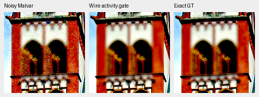
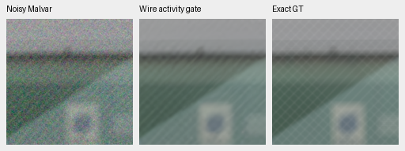

# Local RAW activity gates for weak detail

A local power gate on the frozen Bayer phase correction recovers
**1.28 percentage points** of independent ISO6400 fine-photo response
over local-only 20k. It raises exact-flat RMS by **0.99 DN16**,
compared with **2.60 DN16** for the ungated application of the same
correction. A stricter photo setting gains **0.33 points** with nearly
the same exact-flat RMS as the parent. The stricter setting suppresses
most of the nominal fine-cab correction. Fine crossings on the real
fence remain incomplete.
[Measured results](results/phase-activity-v1/publication.json) ·
[Drivers and receipts](results/phase-activity-v1/evidence.tar.xz).

## What the gate measures

The frozen [Bayer phase correction](quiet-parent-phase.md) already
estimates oriented waveforms from disjoint nearby RAW samples and checks
signed central evidence. This test adds a tile-level decision about how
much texture the local Bayer measurements support. It leaves the
candidate frequency and phase selection in place. A separate option
attenuates existing parent modes above 1/8 cycles per native pixel when
the local activity estimate is low.

Each 32-pixel window fits an affine surface to each green plane. The
two residuals are tapered and transformed using their actual Bayer
offsets. Fourier coefficients in the 0.125–0.221 cycles/pixel band
are normalized with the supplied shot/read prior. The self-power
statistic averages the squared magnitudes of the two planes and
subtracts the nominal noise power. The cross-power statistic averages
the signed real cross product of the two offset-aligned coefficients.
The surroundings control averages cross-power over four disjoint
donor windows within the 256-pixel query. The joint control uses the
geometric mean of the positive central and surrounding cross-power.
The existing head also receives spectral evidence. This comparison
tests an explicit output gate with detrended band power.

A smooth ramp turns each power estimate into a window weight. The
same weight applies to all candidate modes in that window. The
optional attenuation operates along the parent phase, with the
complement of that activity weight. The fixed recipe sweeps ramp
starts 0, 0.15 and 0.30, ramp width 0.30, correction gain 0–1.5
and parent attenuation 0–0.25. Constant scaling and constant
attenuation are controls. No neural weights were fit.

| Frozen EMA | Checkpoint SHA256 |
| --- | --- |
| Local-only 20k | `b892a08c8ebbccb05c000e4f42d1f86c3a7d1d5870721ccd6e1c8fe9e82c3889` |
| Bayer phase refit | `069de3a3d3f18ab0f32cf9b242daa1fb859d03762086ee27244557aced803e54` |
| Corpus 100k | `87b96f3c487b9edaf1c477742b6c38f2a82cc6b20a94716d51cc8cf46a17a760` |
| V120 | `a9d9b6b4f974e24a6b11e5e740aab32314233a7f53c056cf37c7d2aac1c589fb` |

## Held-out photo and wire results

Weights were frozen using 16 independent ISO6400 photo cases and
24 wire fixtures. The photo calibration backgrounds overlap the
wire calibration backgrounds. Sources used for calibration are
excluded from the reported 48-photo and 24-wire sets. The strict photo setting
chooses the highest available response at the Corpus 100k exact-flat
error on the calibration set. The moderate setting maximizes wire
response on the calibration wires within the prior gate's gap-addition
and flat-addition budgets. The same moderate settings also maximize
photo response in the local self-power family at half the calibration
flat increase without parent attenuation. The scaled Bayer and
cross-power controls use that half-increase photo budget. The uniform
Bayer policy at zero and full gain reproduces the preceding independent
scores to within 0.008 DN16 per case.

| Independent ISO6400 photos | Fine response | Fine increment RMS, DN16 | Fine flat RMS, DN16 |
| --- | ---: | ---: | ---: |
| V120, matched earlier replay | 67.045% | 131.525 | 5.026 |
| Corpus 100k | 67.449% | 131.318 | 4.565 |
| Local-only 20k | 66.784% | 130.396 | 4.209 |
| Bayer phase refit | 67.777% | 131.204 | 6.804 |
| Scaled Bayer phase refit | 67.420% | 130.800 | 5.512 |
| Moderate cross-power gate | 67.736% | 130.872 | 5.356 |
| Surroundings-only gate | 67.683% | 130.846 | 6.133 |
| Moderate self-power gate | **68.061%** | 131.030 | 5.204 |
| Strict photo gate | 67.113% | 130.452 | **4.206** |

The moderate setting increases response by 0.284 points [0.204, 0.356]
and lowers flat RMS by 1.600 DN16 [1.300, 1.918] versus the original
Bayer phase refit. Against the scaled control, it gains 0.642 points
[0.538, 0.747] with 0.308 DN16 less flat RMS [0.126, 0.502].
Against local-only 20k, it raises fine-increment RMS by 0.635 DN16.
The surroundings-only gate raises flat RMS by 0.621 DN16 over the
scaled control while delivering less real response than the local
self-power version. Useful surroundings evidence does not imply
there is a weak structure in the center.

The strict setting uses a ramp start of 0.30, unit detail gain and
0.01 parent attenuation. It gains 0.329 points [0.208, 0.438] over
local 20k and changes flat RMS by −0.003 DN16 [−0.014, +0.011].
Its response trails Corpus 100k by 0.336 points on held-out source
means. No calibrated policy matches both the Corpus 100k response
and its flat RMS on the calibration photos. At ISO400 the strict
policy also increases independent flat RMS over local 20k by
0.219 DN16. The effect depends on the noise profile.
[Selection, both draw laws and paired intervals](results/phase-activity-v1/evidence.tar.xz).

| ISO6400 planted wires | Intact response | Intact RMS, DN16 | Absolute gap RMS, DN16 | Flat addition, DN16 |
| --- | ---: | ---: | ---: | ---: |
| V120, matched earlier replay | 31.61% | 207.41 | 154.01 | — |
| Corpus 100k, matched earlier replay | 33.66% | 207.82 | 152.65 | — |
| Local-only 20k | 33.41% | 207.87 | 151.80 | 0.00 |
| Bayer phase refit | 41.15% | 211.24 | 148.16 | 4.78 |
| Scaled Bayer phase refit | 38.37% | 209.71 | 149.07 | 3.06 |
| Moderate cross-power gate | 38.64% | 211.06 | 150.17 | 2.46 |
| Moderate self-power gate | 38.44% | 210.58 | 149.92 | 2.26 |
| Strict photo gate | 33.65% | 207.73 | 151.69 | 0.12 |

The moderate setting adds 5.03 response points [3.52, 6.56] and
lowers absolute known-gap error by 1.88 DN16 [0.77, 3.08] relative
to local 20k. Paired gap error rises from 162.31 to 167.18 DN16.
Relative to the scaled control, it reduces flat addition by 0.79
DN16, raises absolute gap error by 0.86 DN16 and recovers similar
intact response. On these held-out wires, the absolute change
inside gaps is 17.88 DN16 with the moderate gate and 14.63 DN16
with the scaled control.

## What a flat detector can separate

A controlled audit uses 160 Gaussian shot/read draws per scene family
and profile across four Bayer layouts. On ISO6400 mid-gray, the
center-window area under the ROC curve for a 0.002 linear-amplitude
sinusoid versus flat is 0.55 for either self- or cross-power. At 0.006,
cross-power reaches 0.82 and the surroundings measure reaches 0.93
when the sinusoid continues into all donors. With a ramp start of
0.30, 93.75% of flat fields have a positive cross-power gate in at
least one of the 225 windows. Requiring both central and exterior
power eliminates those activations in this small controlled
sample at that threshold, while lowering weak-field sensitivity.
The 0.04 isolated edge also activates the center. Both measures
treat a strong edge as evidence of activity. They do not identify
which weak waveform is supported there.
[Detector audit](results/phase-activity-v1/evidence.tar.xz).

## Exact native crops

Each cell is the same 160 × 160 native footprint at `[48,48,160,160]`.
The same noise, display and 16-bit ADC parameters apply to each
method. Capture exposure is 0.33, black level 0.03 and ISO6400 shot/read
`0.00128/6.5536e-6`. The center restoration in both triplets uses the
moderate local self-power setting with the frozen parent and phase
checkpoints above. The complete comparisons include the strict
photo setting and both controls.
[Source, ROI, checkpoint and display provenance](images/phase-activity-v1/manifest.json).

**Limburg Cathedral**, Berthold Werner, public domain. BGGR,
`[22,250,256,256]`, display exposure ×3.0303 and contrast ×2.
All restoration variants keep the arch outlines. The brick and
thin molding stay softer than the exact target.
[Source](https://commons.wikimedia.org/wiki/File:Limburger_Dom_BW_1.jpg) ·
[All methods](images/phase-activity-v1/exact/001-iso6400-independent-comparison.png).

**St. Valentin railway**, GT1976, CC BY-SA 4.0. RGGB,
source scene `[376,16,512,512]`, query `[128,128,256,256]`,
display exposure ×2 and contrast 1.0. The exact target places
an interrupted wire lattice over the railway photo. The
moderate gate keeps part of one diagonal but the opposing
direction and central gap boundaries stay diffuse.
[Source](https://commons.wikimedia.org/wiki/File:2018-05-04_%28217%29_33_53_9332_586-5_at_Bahnhof_St._Valentin.jpg) ·
[License](https://creativecommons.org/licenses/by-sa/4.0/) ·
[All methods](images/phase-activity-v1/exact/012-iso6400-comparison.png) ·
[Continuous-dip fixture](images/phase-activity-v1/exact/014-iso6400-comparison.png).

## Standing GFX100S comparisons

All eight boards were inspected with the parent, V120 and Corpus 100k
on the same pixels, noise profiles and display transforms. The sky
is visually smooth in both new settings. The strict gate changes
camera RGB by just 0.13 DN16 RMS in the sky and by 15.90 DN16 in
the coarse fence. The moderate setting strengthens existing coarse
crossings. The small building wires and leaves stay soft. In the
nominal fine cab, the strict and moderate self-power gates both
soften the right-side modulation relative to the original refit.
The cross-power gate retains more of those diagonals. Transferred
conditioning retains some additional existing fragments in both
moderate settings. The left stays mottled in places and the fine
junctions remain incomplete. No clear new false colour stands out.
The ISO100 AHD images and both cab JPEGs are independent qualitative
references from different exposures and apertures.

| Capture and noise | Native boards |
| --- | --- |
| DSCF3879/3880, nominal | [Overcast sky](images/phase-activity-v1/standing/main-overcast-sky-main-overcast-sky.png) · [Building](images/phase-activity-v1/standing/main-building-detail-main-building-detail.png) · [Foliage](images/phase-activity-v1/standing/main-foliage-main-foliage.png) · [Coarse fence](images/phase-activity-v1/standing/main-chain-link-fence-main-chain-link-fence.png) |
| DSCF3842/3835, nominal | [Left](images/phase-activity-v1/standing/mesh-nominal-fine-green-mesh-left.png) · [Right](images/phase-activity-v1/standing/mesh-nominal-fine-green-mesh-right.png) |
| DSCF3842/3835, transferred DSCF3879 | [Left](images/phase-activity-v1/standing/mesh-profile3879-fine-green-mesh-left.png) · [Right](images/phase-activity-v1/standing/mesh-profile3879-fine-green-mesh-right.png) |

Calibration, scoped numerical review and native viewing are complete.
The 427-photo and measured-camera panels are outside the crop policy
study. The first calibration driver used an incorrect argument name
on the metric call. The completed driver checks per-case replay
against the saved numerical run. The archive retains the early
calibration, the score-only version without the constant-damping
control, and the import-path failure from the first test invocation.
The auxiliary archived partial-support metric includes the
transition pixels of gapped wires, so it uses a wider definition
than the earlier continuous-dip diagnostic.
[Earlier receipts](results/phase-activity-v1/initial-calibration.tar.xz) ·
[Model choices](current-model.md) · [Comparable PSNR history](performance-history.md).
