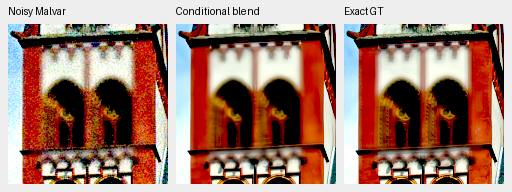
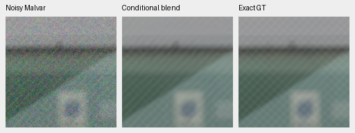

# Learned mixtures of local power and edge evidence

A conditional mixture of the frozen Bayer phase gates recovers
**39.85%** of held-out ISO6400 wire signal, up from **38.44%** for
local power. It lowers absolute gap RMS by **1.70 DN16** and adds
**2.84 DN16** more texture inside the known gaps. On natural photos,
scaled local power retains **0.10 points** more fine response at
similar exact-flat error. The mixtures keep the sky smooth and
retain some fine right-cab diagonals. Fine junctions stay incomplete.
[Checkpoint and results](results/phase-correction-mixture-v1/publication.json) ·
[Training and evaluation receipts](results/phase-correction-mixture-v1/evidence.tar.xz).

## Fixed estimates and learned gains

The [local power setting](phase-activity.md) has the strongest
natural-photo response at similar flat error. The
[reserved Bayer edge checks](phase-edge-validation.md) reduce
false additions on exact edge and gap controls. This study mixes
these responses at the level of each complex Fourier coefficient.
All paths scale the same already trained Bayer phase correction.
The weights sum to one and are nonnegative, so the mixture stays
within the pointwise gain range of the fixed paths. The four
options are zero correction, moderate local power, photo-calibrated
edge contrast and photo-calibrated edge prediction. The method
does not select a new frequency or alter its phase.

One arm learns four constant weights. The two adaptive arms
add a two-layer, width-24 network to the same logits. Inputs
include local self-power and green cross-power, surrounding
power, how often the two green folds found a strong edge,
signed affine and edge evidence, prediction gain on the reserved
fold, exterior strength, correction SNR and signed central
Bayer support. The original loss retains absolute target error,
paired weak-increment error and an exact-flat penalty. The third
arm also minimizes twice the paired and once the absolute
spatial error inside known gaps. Gap and flat labels enter the
loss during training.

The three arms finish **672 updates each**, six passes over **448
photos** with four photos per update. The 224 natural backgrounds
and 224 wire backgrounds are inherited from the earlier training
panel. The wire set contains 56 examples each of ellipse gaps,
strip gaps, contrast steps and continuous dips. The protected
GFX families and held-out sources remain excluded. Each arm
processes **2,688 source visits and 8,064 role queries**. The
shared feature assembly takes **47.39 s**, and the joint FP32
training loop takes **14.84 s**. AdamW uses a 24-update warmup,
cosine learning-rate decay from 0.001 to 0.0001, weight decay
0.001, gradient cap 2 and EMA 0.99. The parent arrays are
frozen. The report uses EMA; raw checkpoints and measurements
are archived with the same model and input bindings.

| Model or component | Checkpoint SHA256 |
| --- | --- |
| Local-only 20k EMA, frozen parent | `b892a08c8ebbccb05c000e4f42d1f86c3a7d1d5870721ccd6e1c8fe9e82c3889` |
| Frozen Bayer phase component EMA | `069de3a3d3f18ab0f32cf9b242daa1fb859d03762086ee27244557aced803e54` |
| Three mixture heads | `273bddd1862dfb6fa8a1c994e1796ee19c068b9f3fdd4bbea9b0cd216d7ca518` |
| Corpus 100k EMA | `87b96f3c487b9edaf1c477742b6c38f2a82cc6b20a94716d51cc8cf46a17a760` |
| V120 EMA | `a9d9b6b4f974e24a6b11e5e740aab32314233a7f53c056cf37c7d2aac1c589fb` |

## Held-out natural photos and wires

The report uses the 48 disjoint natural sources at both ISO values
and with independent and coupled draws. The 16 additional photo
sources set scalar matches for added flat RMS. The wire panel
uses 24 disjoint held-out backgrounds per noise profile, including
12 true gaps. An independent 24-wire calibration set sets the
scalar matches for added gap RMS. The original fixed local power,
edge contrast and edge prediction measurements are checked on the
same input arrays and parent outputs.

| Independent ISO6400 photos | Fine response | Fine increment RMS, DN16 | Exact-flat RMS, DN16 |
| --- | ---: | ---: | ---: |
| V120 | 67.045% | 131.525 | 5.026 |
| Corpus 100k | 67.449% | 131.318 | 4.565 |
| Local-only 20k | 66.784% | 130.396 | 4.209 |
| Original Bayer phase refit | 67.777% | 131.204 | 6.804 |
| Fixed local power | 68.061% | 131.030 | 5.204 |
| Fixed edge contrast | 67.296% | 130.721 | 5.213 |
| Fixed edge prediction | 67.104% | 130.579 | 4.743 |
| Trained constant blend | 67.374% | 130.618 | 4.633 |
| Conditional blend | 67.663% | 130.771 | 4.895 |
| Gap-trained blend | 67.098% | 130.522 | 4.529 |
| Local power scaled to match conditional flat addition | 67.764% | 130.813 | 4.851 |

The conditional blend gains 0.879 response points [0.752, 1.023]
over local-only 20k, with +0.686 DN16 flat error. It gains 0.100
points [0.087, 0.113] versus the scaled trained constant blend
and loses 0.101 points [0.070, 0.128] versus the scaled local
power gate at similar held-out flat RMS. Against the original
unscaled local power setting it loses 0.398 points and lowers
flat error by 0.309 DN16. On the coupled ISO6400 draws, conditional
mixture lowers fine-increment error by 0.611 DN16 versus its parent.
It raises exact-flat RMS on both draw laws.

| ISO6400 wires | Intact response | Intact RMS, DN16 | Absolute gap RMS, DN16 | Added gap RMS, DN16 | Added flat RMS, DN16 |
| --- | ---: | ---: | ---: | ---: | ---: |
| V120 | 31.61% | 207.41 | 154.01 | 25.08 | 9.60 |
| Corpus 100k | 33.66% | 207.82 | 152.65 | 16.70 | 7.14 |
| Local-only 20k | 33.41% | 207.87 | 151.80 | 0.00 | 0.00 |
| Original Bayer phase refit | 41.15% | 211.24 | 148.16 | 22.86 | 4.78 |
| Fixed local power | 38.44% | 210.58 | 149.92 | 17.88 | 2.26 |
| Fixed edge contrast | 41.70% | 210.61 | 146.85 | 27.00 | 2.80 |
| Fixed edge prediction | 39.66% | 210.70 | 147.84 | 25.50 | 1.97 |
| Trained constant blend | 38.58% | 209.60 | 148.49 | 17.28 | 1.51 |
| Conditional blend | 39.85% | 210.24 | 148.22 | 20.71 | 1.95 |
| Gap-trained blend | 38.02% | 209.17 | 148.53 | 15.70 | 1.38 |

The conditional blend gains **6.44 points** [4.45, 8.26] over
local-only 20k and cuts absolute gap error **3.59 DN16**
[1.72, 5.68]. Compared with fixed local power, the gains are
**1.42 points** [0.63, 2.32] and **1.70 DN16** less absolute gap
error [0.88, 2.72], with larger changes inside the true gaps.
Paired gap error is 167.09 DN16 for the conditional blend and
162.31 DN16 for local-only 20k.
Against the trained constant blend scaled to similar gap change,
it gains 0.332 points [0.077, 0.575] and has +0.104 DN16 absolute
gap error [−0.043, +0.264]. Actual held-out gap change is
0.282 DN16 higher for the conditional blend. Gap supervision
shifts the fit toward lower response and smaller false texture.
[All noise levels, raw and EMA, and source-paired intervals](results/phase-correction-mixture-v1/evidence.tar.xz).

## Exact background and missing-wire controls

The fixed [edge control panel](phase-edge-validation.md#exact-edge-and-missing-detail-controls)
has an exact edge-and-tone parent and 24 geometries per noise
profile. In the outside-only condition the center has zero wire
even though the surrounding RAW contains both directions.
The continuous condition measures projection onto both directions
together.

| ISO6400 exact-parent controls | Edge-only added RMS, DN16 | Outside-only added RMS, DN16 | Continuous response |
| --- | ---: | ---: | ---: |
| Fixed local power | 14.46 | 14.31 | 48.43% |
| Fixed edge contrast | 11.20 | 11.76 | 42.40% |
| Trained constant blend | 8.00 | 8.42 | 36.34% |
| Conditional blend | 10.89 | 11.33 | 45.41% |
| Gap-trained blend | 6.06 | 6.52 | 27.92% |

The same conditional blend shifts from stronger local power
on the coarse fence to predominantly edge-contrast correction
on the nominal right cab. Weighting by the frozen coefficient
energy, edge contrast supplies about 88% of the nominal right
cab gain. The power path supplies about 9%. The overall gain
on the smooth sky is smaller than on either fence. These are
measurements of the gain allocation on these crops.
[Bounds check and contribution measurements](results/phase-correction-mixture-v1/evidence.tar.xz).

## Exact native crops

Each cell shows the same 160 × 160 native pixels at
`[48,48,160,160]` with 16-bit ADC, black level 0.03, capture
exposure 0.33 and ISO6400 shot/read `0.00128/6.5536e-6`.
The middle panels use the conditional mixture EMA. The full
comparisons show all three mixtures and both fixed gates.
[Source, ROI, checkpoint and display provenance](images/phase-correction-mixture-v1/manifest.json).

**Limburg Cathedral**, Berthold Werner, public domain. BGGR,
query `[22,250,256,256]`, display exposure ×3.0303 and contrast ×2.
The arch outlines stay clear. Thin molding and small bricks remain
softer than the exact reference. Both exact-flat cores look smooth
under the same display transform.
[Source](https://commons.wikimedia.org/wiki/File:Limburger_Dom_BW_1.jpg) ·
[All methods](images/phase-correction-mixture-v1/exact/001-iso6400-independent-comparison.png) ·
[Matched exact-flat crop](images/phase-correction-mixture-v1/flat/001-iso6400-independent-flat-comparison.png).

**St. Valentin railway**, GT1976, CC BY-SA 4.0. RGGB, source scene
`[376,16,512,512]`, query `[128,128,256,256]`, display exposure ×2
and contrast 1.0. The exact target contains a constructed wire
lattice with a gap. The conditional blend preserves some of the
stronger diagonal, with diffuse gap boundaries and soft crossings.
[Source](https://commons.wikimedia.org/wiki/File:2018-05-04_%28217%29_33_53_9332_586-5_at_Bahnhof_St._Valentin.jpg) ·
[License](https://creativecommons.org/licenses/by-sa/4.0/) ·
[All methods](images/phase-correction-mixture-v1/exact/012-iso6400-comparison.png) ·
[Continuous-dip fixture](images/phase-correction-mixture-v1/exact/014-iso6400-comparison.png).

## Standing GFX100S comparisons

The eight boards were inspected beside V120, Corpus 100k,
local-only 20k, the original phase correction and the two fixed
gates. The conditional mix changes the sky by 0.77 DN16 RMS in
camera RGB and the coarse fence by 21.06 DN16. The sky looks
smooth, the coarse crossings stay coherent and the thin building
wires and leaves remain soft. In the nominal right cab all three
mixtures retain more diagonal modulation than local power, with
less definition than the fixed edge contrast. The transferred
profile preserves more fragments, with incomplete junctions and
some left-side mottling. The independent ISO100 AHD and camera
JPEGs are qualitative references from different exposures,
apertures or rendering pipelines.

| Capture and conditioning | Native comparisons |
| --- | --- |
| DSCF3879/3880, nominal | [Sky](images/phase-correction-mixture-v1/standing/main-overcast-sky-main-overcast-sky.png) · [Building](images/phase-correction-mixture-v1/standing/main-building-detail-main-building-detail.png) · [Foliage](images/phase-correction-mixture-v1/standing/main-foliage-main-foliage.png) · [Coarse fence](images/phase-correction-mixture-v1/standing/main-chain-link-fence-main-chain-link-fence.png) |
| DSCF3842/3835, nominal | [Left](images/phase-correction-mixture-v1/standing/mesh-nominal-fine-green-mesh-left.png) · [Right](images/phase-correction-mixture-v1/standing/mesh-nominal-fine-green-mesh-right.png) |
| DSCF3842/3835, transferred DSCF3879 | [Left](images/phase-correction-mixture-v1/standing/mesh-profile3879-fine-green-mesh-left.png) · [Right](images/phase-correction-mixture-v1/standing/mesh-profile3879-fine-green-mesh-right.png) |

Training, scored holdouts and the native review are complete.
The 427-photo and measured-camera panels are outside this
crop component study. The exact-flat boards were regenerated
after correcting the renderer import order and filtering its
caption list to the actually evaluated controls.
[Initial render receipts](results/phase-correction-mixture-v1/initial-flat-render.tar.xz) ·
[Model guide](current-model.md) · [Comparable PSNR history](performance-history.md).
