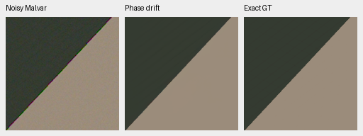
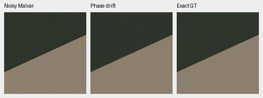

# RAW phase fitting with changing wire geometry

Searching the query for changes in wire spacing or direction reduces
weak recovery at ISO400 and gives little change at ISO6400. At equal
measured quiet RMS, far ISO400 weak response falls from **8.81% to
6.10%**, and increment RMS rises from **11.199 to 11.241 DN16**.
In a separate geometry-only diagnostic, supplying the exact phase
curvature helps the lower-noise far-edge cases. Both real fences
match the planar fit on every reviewed 160×160 region.
[Bound results, sources and viewing](results/phase-drift-v1/publication.json).
A later [reserved-Bayer curvature fit](query-phase-curvature.md)
builds on a different consensus proposal and retains a small gain on
planted bends at ISO6400. No standing crop in that follow-up accepts
curvature.

## Geometry and test

The planar fit begins with two frequencies estimated from a stronger,
disjoint RAW donor. The new fit adds half of `q × u²` to the carrier
phase in cycles. The centered native coordinate `u` is projected on
the carrier normal or tangent and divided by the tile width. The normal
term changes wire spacing and the tangent term bends the wires.
The search tests zero and ±4, ±8, ±12, with one axis varying at a time.
The local frequency stays within the original 1/64 to 0.24 cycles per
pixel range.

A proposal competes with a fitted edge/background and the other
carrier. It must improve the discovery fit by more than four whitened
energy units and reduce prediction error across both inner splits of
that discovery fold. The inner check uses the edge geometry from
outer discovery. The other outer fold remains excluded from proposal
selection. Both arms fit eight periodic knots separately per Bayer
color and use the same outer support, shrinkage and weighted refit.
The drift arm omits a matched direction when the standard deviation
of the difference between its two drift fields exceeds 0.25 cycles
after aligning signs.

Sources 80–87 contain three spacing-varying scenes, three curved scenes
and two straight controls. Each is tested near and far from a strong
edge under ISO400 and ISO6400 priors, with CFA layouts balanced across
sources. Each of the three roles receives an independent noise draw.
The roles contain background, background with the stronger wire family,
and background with both families. Both arms share the exact noisy
inputs, straight donors and V143 step-5000 EMA predictions. The
checkpoint SHA256 is
`96d146d017c54196288c585f8b7eddcf030e8a235061049c31e985b9380b7ce4`.

## Recovery at comparable quiet error

The fixed evaluation uses earlier calibrated thresholds and delivery
scales. The rows below then cap both arms at the smaller measured
quiet RMS at the tighter setting, floored at the parent's quiet RMS.
Response measures the phase-sensitive projection of the present-minus-
absent increment onto its clean target. Increment RMS also penalizes
off-target detail.

| Noise and edge | Weak response, planar → drift | Increment RMS, planar → drift | Quiet RMS for both |
| --- | ---: | ---: | ---: |
| ISO400 far | 8.807% → 6.095% | 11.1991 → 11.2410 | 2.34372 |
| ISO400 near | 3.875% → 2.780% | 14.1221 → 14.1328 | 6.31827 |
| ISO6400 far | 1.972% → 1.925% | 22.9511 → 22.9578 | 6.41811 |
| ISO6400 near | 2.979% → 3.006% | 30.2410 → 30.2443 | 14.97112 |

RMS is in DN16. The smaller response at ISO400 far occurs across spacing
changes, curves and straight controls. On the straight subset, it falls
from 27.23% to 22.39%. Across the curved and spacing-changing scenes,
the fold search recovers the exact nonzero parameters for **4/24**
present weak directions at ISO400 and **1/24** at ISO6400. The exact
strong counts are **23/48** and **5/48**, respectively. Proposal selection
also accepts nonzero drift in absent families. The straight donors
estimate the true center frequencies within 0.137 native bins in all
sixteen donors. This controls the initial guide quality while leaving
the query's varying phase unknown.

In the geometry-only follow-up on sources 80, 81, 83 and 84, the
delivered waveform and amplitude still come from query RAW. The two
arms receive the exact center frequencies, with exact curvature given
to one arm. The same geometry is supplied whether the wires are present
or absent. At the 0.02 DN16 quiet cap, ISO400 far weak response goes
from **2.98% to 10.84%** with increment RMS **11.9783 → 11.9634**.
Quiet RMS is 2.3654 versus 2.3721. Near the edge and at ISO6400,
exact curvature gives little or inconsistent benefit. The lower-noise
far-edge result motivates estimating phase geometry in a cleaner
surrounding region before local validation.
[Independent reductions and geometry counts](results/phase-drift-v1/independent-audit.json).

The [measured donor follow-up](donor-phase-geometry.md) recovers a
little more weak response on curved lower-noise far cases, with
mixed results overall and fallback on both real fences.

## Native comparisons

The triplets use 160×160 cells at `[176,176,160,160]` in the original
512 fields, unresized. Noisy Malvar, the drift fit and exact GT share
display exposure 2, ISO400 shot/read `8e-5 / 2.56e-8` and the same
camera transform per scene. Source 80 is RGGB and source 83 is GBRG.
Both use the tighter frozen near-edge setting at threshold 1.5 and
delivery scale 0.44364. All ten native comparison boards were viewed.

The camera comparison composes the same V120 EMA parent
`a9d9b6b4f974e24a6b11e5e740aab32314233a7f53c056cf37c7d2aac1c589fb`
with both threshold-2 fits. The planar path exactly replays the
prior cross-check outputs. The overcast sky, coarse fence and all
four cab cells are unchanged from that path in linear RGB. The
building and foliage differ by 0.025 and 2.232 DN16 RMS. Thin building
hardware and leaves stay soft. Fine cab crossings remain incomplete
under both fixed noise profiles. The independently exposed ISO100 AHD
and JPEG images serve as qualitative references. The phase fit is a
scoped component tested on the 32 constructed cases and eight GFX
regions. Standard full-photo and camera-panel scores are unavailable
for this component.
[Sky](images/phase-drift-v1/main-overcast-sky.png) ·
[Building](images/phase-drift-v1/main-building-detail.png) ·
[Foliage](images/phase-drift-v1/main-foliage.png) ·
[Coarse fence](images/phase-drift-v1/main-chain-link-fence.png) ·
[Cab left](images/phase-drift-v1/mesh-nominal-left.png) ·
[Cab right](images/phase-drift-v1/mesh-nominal-right.png) ·
[Transferred left](images/phase-drift-v1/mesh-profile3879-left.png) ·
[Transferred right](images/phase-drift-v1/mesh-profile3879-right.png) ·
[Native metadata](images/phase-drift-v1/manifest.json).
