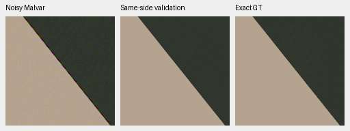
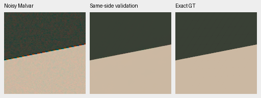

# Keep phase-profile evidence on its side of a strong edge

The [edge exclusion](phase-guide-edge-guard.md) avoided fitting frequency to
edge-adjacent samples. It kept the original waveform and local evidence windows.
This comparison tests those two later stages using the same guarded frequencies,
RAW inputs, nuisance design and development settings.
[Executed sources and native evidence](results/phase-edge-side-v1/publication.json).

Same-side validation recovers more ISO400 weak signal on the dark side at the
same measured quiet error, with a bright-side cost. Splitting the waveform
itself loses more signal overall. At ISO6400, neither arm improves the measured
quiet-error tradeoff, and the real cab views keep the earlier fit.

The [fresh-geometry follow-up](asymmetric-phase-evidence.md) finds
a bright-side gain from same-side validation at matched quiet
error. Restoring cross-edge evidence lowers that gain. Holding
accurate donor frequencies fixed gives a larger ISO400 benefit
on those scenes.

## Detection, fits and evidence

Each discovery fold uses its original affine-plus-step nuisance. The green step
must exceed two noise standard deviations, and each side must contain at least
one eighth of the measured discovery sites of every Bayer color. The sign of the
step labels the brighter side. Both folds must detect the edge; a one-fold
detection falls back to the original fit.

The **same-side validation** arm fits one complete eight-knot waveform per
direction and color. At each pixel, its square validation window uses held-out
evidence from the same side of that fold's edge. The two folds still have to
reduce error for the same direction and color. Per-color scores remain capped
to the relevant side before delivery.

The **separate-profiles** arm also fits a separate waveform on each side. It
retains the affine-plus-step background, tests each direction and side against a
null that keeps the other components, and estimates reliability from discovery
sites on that side. The post-validation weighted refit uses the same side-specific
columns. A split profile contributes where the two folds support the same edge
side. The original nuisance slopes remain shared, and the waveform partition
uses a hard edge.

Each comparison uses 96 existing V143 synthetic observations, both noise levels,
both edge placements and the earlier 0.02 and 0.10 DN16 settings. The real views
use V120 and threshold 2. The exact synthetic side measurements use the known
construction line and exclude the two-pixel band around it. The separate no-wire
edge error uses the eight-pixel band.
[Restoration and scores](../src/demosaic/local_validated_waves.py) ·
[Matched runner](../scripts/probe_phase_edge_side.py).

## Measured edge and quiet tradeoffs

Weighted-refit means across the eight near-edge sources at the frozen 0.02 DN16
development setting. Dark and bright response use the respective sides of the
inner query. Overall response uses the full target increment. Quiet delta is the
measured RMS increase over V143.

| Noise | Fit | Overall weak response | Dark-side response | Bright-side response | Quiet delta (DN16) | Weak increment RMS (DN16) |
| --- | --- | ---: | ---: | ---: | ---: | ---: |
| ISO400 | Independent | 12.16% | 11.83% | 10.01% | 0.01229 | 15.72125 |
| ISO400 | Same-side validation | 9.73% | 11.84% | 5.22% | 0.00452 | 15.73580 |
| ISO400 | Separate profiles | 8.38% | 11.03% | 3.38% | 0.00458 | 15.74982 |
| ISO6400 | Independent | 1.57% | 2.27% | 0.63% | 0.02529 | 36.82079 |
| ISO6400 | Same-side validation | 1.31% | 1.98% | 0.39% | 0.02192 | 36.81911 |
| ISO6400 | Separate profiles | −0.02% | 0.51% | −0.81% | 0.02020 | 36.82003 |

At equal measured quiet RMS, same-side validation recovers 11.84% of the
ISO400 dark-side signal versus 8.19% for the independent fit. Total response
rises from 8.77% to 9.73%, and bright-side response falls from 6.87% to 5.22%.
The difference in whole-increment RMS is under 0.0005 DN16. This descriptive
comparison uses evaluation targets to scale the independent correction by
0.60014 for every source. The original operating-point table uses frozen scales.

At the looser setting, ISO400 near recovery drops from 22.81% to 17.33% for
validation and 14.28% for separate profiles, with quieter outputs. At ISO6400
near, matched-error comparison favors the independent fit. The no-wire RMS
in the eight-pixel band around the step differs by under 0.031 DN16 in all
three ISO400 fits. This region remains dominated by the parent edge error
of about 137.5 DN16.

Both folds detect the edge on all 48 near-edge observations. Both variants
reproduce the earlier far-edge fits bit for bit on all 48 far-edge observations.
[Source-paired metrics and matched quiet checks](results/phase-edge-side-v1/summary.json).

## Native crop provenance

The triplets show noisy Malvar, the same-side-validation weighted refit at
the frozen 0.02 DN16 setting, and exact constructed GT. They use source
40 RGGB and source 41 BGGR, near two-wire placement, repeat 7311 and
parent ROI `[176,176,160,160]`. Every cell is 160×160 native pixels.
ADC16 black fraction is 0.03. Shot/read are `8e-5/2.56e-8` at ISO400
and `0.00128/6.5536e-6` at ISO6400. Exposure 2, white balance, color
matrix and clipped-sRGB display match across panels. The synthetic
parent is V143 EMA SHA256
`96d146d017c54196288c585f8b7eddcf030e8a235061049c31e985b9380b7ce4`.

The restored dark side of source 40 retains faint diagonals, with more
defined wires and crossings in the exact target. Differences on source 41
are subtle. The ISO6400 restored views are nearly flat in the dark region.

[ISO400 RGGB](images/phase-edge-side-v1/iso400-source40-near-RGGB-comparison.png) ·
[ISO400 BGGR](images/phase-edge-side-v1/iso400-source41-near-BGGR-comparison.png) ·
[ISO6400 RGGB](images/phase-edge-side-v1/iso6400-source40-near-RGGB-comparison.png) ·
[ISO6400 BGGR](images/phase-edge-side-v1/iso6400-source41-near-BGGR-comparison.png) ·
[Separate profiles, ISO400 RGGB](images/phase-edge-side-v1/iso400-source40-near-RGGB-triplet.png) ·
[Separate profiles, ISO400 BGGR](images/phase-edge-side-v1/iso400-source41-near-BGGR-triplet.png).

The real parent is V120 EMA SHA256
`a9d9b6b4f974e24a6b11e5e740aab32314233a7f53c056cf37c7d2aac1c589fb`.
DSCF3879/3880 uses exposure 4 and shot/read `0.00128/6.5536e-6`.
DSCF3842/3835 uses exposure 16 with that nominal profile and the
transferred DSCF3879 profile `0.0014635776/1.0715704e-6`. The boards
include both sides and both camera JPEGs. The ISO100 AHD and the low-ISO
JPEG are independent qualitative references with different aperture,
exposure and subject motion.
[Exact ROI, conditioning and image manifest](images/phase-edge-side-v1/manifest.json).

Both variants give the V120 sky bit for bit in linear camera RGB and in the
display. Only the building activates the partition. Changes from the guarded
fit are 0.035 DN16 RMS with same-side validation and 0.051 DN16 RMS with separate
profiles. Fine hardware remains soft. Foliage, the coarse fence and all four
cab views reproduce the guarded fit bit for bit. Existing coarse diamonds
remain visible and the cab lattice remains incomplete.
[Sky](images/phase-edge-side-v1/main-overcast-sky.png) ·
[Building](images/phase-edge-side-v1/main-building-detail.png) ·
[Foliage](images/phase-edge-side-v1/main-foliage.png) ·
[Coarse fence](images/phase-edge-side-v1/main-chain-link-fence.png) ·
[Cab left](images/phase-edge-side-v1/mesh-nominal-left.png) ·
[Cab right](images/phase-edge-side-v1/mesh-nominal-right.png) ·
[Transferred profile left](images/phase-edge-side-v1/mesh-profile3879-left.png) ·
[Transferred profile right](images/phase-edge-side-v1/mesh-profile3879-right.png).

The 192 synthetic and 16 real fits take 205.23 seconds on two CPU cores.
The independent audit checks 4,800 saved-image reductions, 1,248 fold
fields, 494 bit-exact inactive fields and 120 retained camera cells.
All twelve complete boards were viewed. The two same-side validation
triplets are exact subsets of the corresponding full boards.
[Independent audit](results/phase-edge-side-v1/independent-audit.json) ·
[Native viewing receipt](results/phase-edge-side-v1/actual-native-viewing.json).
