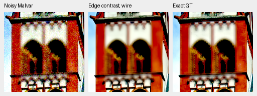
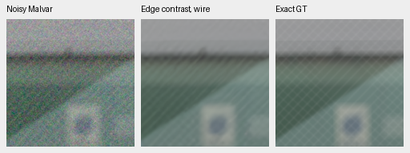

# Validate weak Bayer waveforms against a local edge

Accounting for a strong edge in reserved RAW samples reduced added
texture in a constructed wire gap from **15.45 to 11.76 DN16** versus
an affine-only fit at the same correction strength. On 24 held-out
ISO6400 wire backgrounds, the setting calibrated on photos recovered
**0.27 more response points** and lowered absolute gap error by
**0.49 DN16** versus the matched affine fit. It retains some nominal
right-cab diagonals that the previous local power gate suppresses.
The fine crossings remain incomplete. On natural photos, the local
power gate delivers more response at essentially the same flat error.
[Results](results/phase-edge-validation-v1/publication.json) ·
[Drivers and receipts](results/phase-edge-validation-v1/evidence.tar.xz).

## Wave evidence at native Bayer sites

The [local power gate](phase-activity.md) applies one weight to a
window's candidate waves. This test scores the wavelength and phase
of each candidate separately. It uses the same frozen
[Bayer phase correction on local 20k](quiet-parent-phase.md) and the
same 86 exterior-selected modes. For every 32-pixel window, up to four
neighbor windows at one window width supply the exterior RAW votes.
The center samples do not enter the nomination.

Two disjoint subsets of the center's green Bayer pixels exchange
discovery and validation roles. Discovery green samples jointly
select a blurred step from 12 orientations and 12 offsets after
fitting the plane-wise affine background. The maximum improvement
must reach 24 nominal noise variance units. Both fits use actual
sensor coordinates. The two validation contrasts compare an
affine design and the same design with the selected edge column.
Within each contrast, the fixed-phase wave is projected out of the
background span on the validation coordinates. A separately
estimated amplitude from discovery gives a second score, the
noise-normalized held-out error reduction of that fixed prediction.
Both scores require support in both directions of the split. The
estimated noise scale comes from the discovery sample mean.
Validation of each fold's candidate precedes the use of the full
RAW and neural parent in the delivered correction. The combined
scores are empirical measures.

The same cubic ramp of width 0.75 weights the frozen correction
with each score. Candidates use start values 0, 0.25 and 0.55.
A separate variant replaces the original evidence factor with
this held-out prediction score, leaving its exterior strength
factor and parent-phase attenuation in place. The replacement
variants are included in the archive. A direct calculation
matches the FFT projection and normalization at 135 frequencies.
Perturbing the reserved central samples leaves the opposite-fold
edge nomination and both exterior frequency and phase values
unchanged for the audited center.

No neural weights changed. Results use the frozen local-only
20k EMA with SHA256
`b892a08c8ebbccb05c000e4f42d1f86c3a7d1d5870721ccd6e1c8fe9e82c3889`
and the Bayer phase component EMA from
`069de3a3d3f18ab0f32cf9b242daa1fb859d03762086ee27244557aced803e54`.
Crop baselines include Corpus 100k EMA
`87b96f3c487b9edaf1c477742b6c38f2a82cc6b20a94716d51cc8cf46a17a760`
and V120 EMA
`a9d9b6b4f974e24a6b11e5e740aab32314233a7f53c056cf37c7d2aac1c589fb`.

## Held-out photos and wires

Gains were selected on 16 independent ISO6400 photo backgrounds
and 24 wire fixtures. These share some source photos with each
other and none with either reported holdout. Each method varies
correction gain from 0 to 1.5. The photo setting maximizes signed
fine response within the moderate local power gate's flat error.
The wire setting uses that gate's flat-addition and gap-addition
limits on separate calibration fixtures. The original phase
correction and local power results were reproduced on the same
input arrays. The archive includes both noise profiles and draw
laws, with source-paired intervals.

| Independent ISO6400 photos, 48 sources | Fine response | Increment RMS, DN16 | Exact-flat RMS, DN16 |
| --- | ---: | ---: | ---: |
| V120, earlier matched replay | 67.045% | 131.525 | 5.026 |
| Corpus 100k | 67.449% | 131.318 | 4.565 |
| Local-only 20k | 66.784% | 130.396 | 4.209 |
| Original Bayer phase refit | 67.777% | 131.204 | 6.804 |
| Local power gate | 68.061% | 131.030 | 5.204 |
| Photo-calibrated constant scaling | 67.281% | 130.676 | 5.088 |
| Photo-calibrated affine contrast | 67.263% | 130.712 | 5.285 |
| Photo-calibrated edge contrast | 67.296% | 130.721 | 5.213 |
| Photo-calibrated edge prediction | 67.104% | 130.579 | 4.743 |

At the photo-calibrated contrast settings, the step lowers exact-flat
RMS by 0.071 DN16 [0.025, 0.124] versus affine. The response difference
is +0.034 points [−0.015, +0.072]. The local power gate delivers
0.765 more response points than the edge contrast at similar flat
error. The edge prediction setting is quieter than local power,
with 0.957 points less response. The variance-weighted edge fit
therefore improves on the affine fit in parts of this experiment,
with a different response tradeoff from local power.

| ISO6400 wires, 24 backgrounds | Intact response | Intact RMS, DN16 | Absolute gap RMS, DN16 | Added gap RMS, DN16 | Added flat RMS, DN16 |
| --- | ---: | ---: | ---: | ---: | ---: |
| V120, earlier matched replay | 31.61% | 207.41 | 154.01 | 25.08 | 9.60 |
| Corpus 100k, earlier matched replay | 33.66% | 207.82 | 152.65 | 16.70 | 7.14 |
| Local-only 20k | 33.41% | 207.87 | 151.80 | 0.00 | 0.00 |
| Original Bayer phase refit | 41.15% | 211.24 | 148.16 | 22.86 | 4.78 |
| Local power gate | 38.44% | 210.58 | 149.92 | 17.88 | 2.26 |
| Wire-calibrated constant scaling | 37.51% | 209.31 | 149.44 | 12.11 | 2.53 |
| Wire-calibrated affine contrast | 37.46% | 208.96 | 149.06 | 12.69 | 1.95 |
| Wire-calibrated edge contrast | 37.58% | 208.86 | 148.89 | 12.80 | 1.95 |
| Photo-calibrated affine contrast | 41.43% | 210.83 | 147.35 | 26.63 | 2.80 |
| Photo-calibrated edge contrast | 41.70% | 210.61 | 146.85 | 27.00 | 2.80 |
| Photo-calibrated edge prediction | 39.66% | 210.70 | 147.84 | 25.50 | 1.97 |

For the wire-calibrated edge contrast, the intact gain over the
parent is 4.16 points [2.82, 5.40]. Relative to the local power gate,
it lowers gap RMS by 1.03 DN16 [0.53, 1.66] and adds 5.07 DN16 less
gap texture [3.13, 6.63], with −0.86 response points [−1.76, +0.13].
The photo-calibrated edge contrast recovers more signal and has
higher added gap RMS than the power gate on these held-out wires.
Its affine comparison uses identical gain and threshold. The step
raises response by 0.269 points [0.136, 0.419] and lowers absolute
gap RMS by 0.493 DN16 [0.288, 0.738].
[Paired source intervals and complete policy results](results/phase-edge-validation-v1/evidence.tar.xz).

## Exact edge and missing-detail controls

One audit supplies a deliberately adverse phase that aligns with
the fine-band leakage of an affine-only fit to a step. At ISO6400,
the fraction of 64 edge-only cases exceeding 0.25 on the fixed phase
falls from 90.6% to 28.1% when the background includes the edge. For
the prediction score, it falls from 40.6% to 10.9%. With actual
exterior nomination and a threshold of 1.0, at least one candidate
in the center passes the prediction test in 54.7% of edge-only
affine cases and 15.6% with the edge. In the flat fields, both
prediction fits pass at least one candidate in 1.6% of the center
windows at this threshold. Searching the whole image is a larger
multiple-candidate test.

A separate test propagates the correction to RGB, using the exact
edge-and-tone background as its frozen delivery parent. There are
24 geometries at each noise level with independent observations.
In the outside-only condition the 64-pixel center has exactly zero
wire, although surrounding RAW contains two directions. Values
below average per-source RMS. Continuous response measures
projection onto both directions together. Exact surroundings and
targets are only used for the constructed panel.

| ISO6400, exact-parent controls | Edge-only added RMS, DN16 | Outside-only added RMS, DN16 | Continuous response |
| --- | ---: | ---: | ---: |
| Local power gate | 14.46 | 14.31 | 48.43% |
| Photo-calibrated affine contrast | 15.74 | 15.45 | 42.07% |
| Photo-calibrated edge contrast | 11.20 | 11.76 | 42.40% |
| Wire-calibrated affine contrast | 7.88 | 7.90 | 19.38% |
| Wire-calibrated edge contrast | 6.63 | 6.88 | 19.47% |

The edge check takes 21–30 ms per 256-pixel query on eight warmed
CPU-resident standing crops. The existing phase nomination takes
18–28 ms in the same session. These measurements exclude decoding,
the neural model, tile blending and export.
[Detector audit, exact-parent controls and timings](results/phase-edge-validation-v1/evidence.tar.xz).

## Exact native crops

Each cell shows 160 × 160 unchanged native pixels at `[48,48,160,160]`.
The comparison uses 16-bit ADC, black 0.03, capture exposure 0.33 and
ISO6400 shot/read `0.00128/6.5536e-6`. Both middle panels use the
wire-calibrated edge contrast above the frozen EMA parent. Each
full comparison uses identical coordinates and display transforms.
[Image and model provenance](images/phase-edge-validation-v1/manifest.json).

**Limburg Cathedral**, Berthold Werner, public domain. BGGR query
`[22,250,256,256]`, display exposure ×3.0303 and contrast ×2. Thin
molding and brick texture remain soft near the arch.
[Source](https://commons.wikimedia.org/wiki/File:Limburger_Dom_BW_1.jpg) ·
[All methods](images/phase-edge-validation-v1/exact/001-iso6400-independent-comparison.png).

**St. Valentin railway**, GT1976, CC BY-SA 4.0. RGGB scene
`[376,16,512,512]` with query `[128,128,256,256]`, display exposure
×2 and contrast 1.0. The planted wire signal is present in the
restoration as soft diagonals. The weaker direction and central gap
boundaries remain diffuse.
[Source](https://commons.wikimedia.org/wiki/File:2018-05-04_%28217%29_33_53_9332_586-5_at_Bahnhof_St._Valentin.jpg) ·
[License](https://creativecommons.org/licenses/by-sa/4.0/) ·
[All methods](images/phase-edge-validation-v1/exact/012-iso6400-comparison.png) ·
[Continuous-dip fixture](images/phase-edge-validation-v1/exact/014-iso6400-comparison.png).

## Standing GFX100S comparisons

All eight boards were inspected alongside V120, Corpus 100k, the
unmodified local 20k parent, the original Bayer phase correction
and the local power gate. The sky stays visually smooth. Existing
coarse crossings are coherent. Fine building wires and leaves
remain soft. On the nominal right cab the photo-calibrated contrast
and prediction retain more visible diagonals than the local power
gate. The left remains faint and mottled in places. No convincing
new junctions or clear added false colour appear. With the
transferred profile the structures stay incomplete. The ISO100
AHD images and the two camera JPEGs are qualitative references
with different exposure, aperture and subject motion.

| Capture and conditioning | Native comparisons |
| --- | --- |
| DSCF3879/3880, nominal | [Sky](images/phase-edge-validation-v1/standing/main-overcast-sky-main-overcast-sky.png) · [Building](images/phase-edge-validation-v1/standing/main-building-detail-main-building-detail.png) · [Foliage](images/phase-edge-validation-v1/standing/main-foliage-main-foliage.png) · [Coarse fence](images/phase-edge-validation-v1/standing/main-chain-link-fence-main-chain-link-fence.png) |
| DSCF3842/3835, nominal | [Left](images/phase-edge-validation-v1/standing/mesh-nominal-fine-green-mesh-left.png) · [Right](images/phase-edge-validation-v1/standing/mesh-nominal-fine-green-mesh-right.png) |
| DSCF3842/3835, transferred DSCF3879 | [Left](images/phase-edge-validation-v1/standing/mesh-profile3879-fine-green-mesh-left.png) · [Right](images/phase-edge-validation-v1/standing/mesh-profile3879-fine-green-mesh-right.png) |

Calibration, scoped numerical evaluation and native viewing are
complete. The fixed 427-photo and measured-camera panels are
outside this crop study. The early audits retain a shape mismatch
in the projection test, an initial guide based on the unprojected
step and the first soft-gap fixture. The completed checks use the
fixed shape, the adverse affine-residual phase and a gap with
exactly zero wire at the center.
[Early audit receipts](results/phase-edge-validation-v1/early-audits.tar.xz) ·
[Current model choices](current-model.md) · [Comparable PSNR history](performance-history.md).
