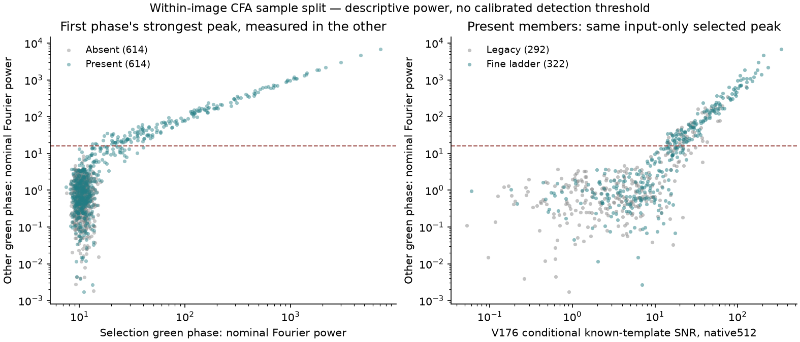

# Frequencies selected in one green CFA phase

The V177 diagnostic finds an input-only distinction on the retained training
bank: a frequency selected from the first green CFA phase has nominal power≥16
in the other phase in **170/614 present cases and 0/614 matched absent cases**.
At power≥4, six absent cases pass. Checking eight candidates instead raises
that absent count to 71. These are descriptive training counts, not calibrated
confidence or evidence of safe restoration.

This supplies a possible continuous feature for future detail work. **No model
is trained, no RGB is restored, and no flat-safety or unseen-image claim is
made.** The completed [V176 diagnostic](mesh-template-evidence.md) supplied exact
hidden templates; this follow-up selects frequencies from RAW alone, with GT
entering only afterward for scoring. V175's fixed continuation remains separate
and its quality pending. Current model choices and native comparisons remain
in [V172](local-noise-matching.md) and [V174](spread-sample-matching.md).

Every point uses the strongest eligible frequency in the lower-index green CFA
phase, then measures the other green phase at that fixed frequency. The dashed
line marks the predeclared descriptive power 16 bin. The right panel uses V176's
GT-conditional SNR as a diagnostic x axis only; it is not an inference input or
a directly comparable Fourier-power bound. Both panels retain all relevant
points. The members share coupled noise construction and phase directions reuse
observations; they are not independent scene replications.

[SVG](images/v177-phase-frequency-holdout-v1/phase-frequency-v1.svg) ·
[PDF](images/v177-phase-frequency-holdout-v1/phase-frequency-v1.pdf) ·
[Source, all plot points and independent verification](results/v177-phase-frequency-holdout-v1.json).

## Fixed measurement

The same 307 retained noisy mesh batches supply 614 pairs/1,228 member observations.
Each member is processed separately; **no noisy present-minus-absent difference**
is used. One green phase selects four peaks from its own Hann-tapered,
weighted-affine-background-removed unitary Fourier transform. Ranking uses its
own squared coefficient magnitude divided by propagated input variance. The
other phase cannot change those bins, ranks or selection-phase power.

The principal packed band maps to native radial frequencies 1/16..1/3 cycles/pixel,
using one conjugate half-plane. Each pick suppresses its 3×3 neighborhood and
conjugate neighborhood. The other phase is measured at those fixed bins. Both
selection directions run separately, producing eight records per observation.
Their combined maxima reuse both phases; they are not independent tests.

The primary chart/table uses **rank 1 from the lower-index green phase only**.
The all-eight results explicitly measure the effect of considering more
candidates. Bins 1, 4, 16, 64 were fixed before execution; no cutoff is selected for
deployment or tuned against model quality here.

All four observations' input-only selections are durably journaled per batch
before target or pair-index arrays are interpreted. Full npz hashes verify
file bytes but do not expose clean values to the selector. Exact clean member
and template spectra enter scoring only after selection. Supplied variance
depends on noisy intensity; the nominal powers are not calibrated probabilities.
Fourier variance propagation includes the fitted plane, rather than assuming
that only a mean input variance matters. ADC effects remain outside the linear
pre-ADC variance model.

## Observed distributions and costs

| Other-phase nominal power | Primary present cases /614 | Primary absent cases /614 | Any of8 present cases /614 | Any of8 absent cases /614 |
|---:|---:|---:|---:|---:|
|≥1|374|224|611|601|
|≥4|231|6|303|71|
|≥16|170|0|191|0|
|≥64|93|0|97|0|

Selection-phase median power is 11.646 present versus 10.570 absent: choosing a
large peak in one noisy phase alone is weak evidence. Primary other-phase
medians are 1.713 versus 0.666; 90th percentiles 147.373 versus 2.276. The median
maximum over all eight measurements is 3.831 versus 2.340. The lower-power tails
overlap substantially. Zero observed absent cases above 16 does not establish
zero false discoveries on new images, edges, real noise or different search sizes.

Among 374 present cases with V176 conditional green SNR≥5, only 170 primary
measurements reach power 16; 204 do not. Exact-template evidence does not imply
that one unknown-frequency sinusoidal coefficient is strong. Spatial support,
two line families, harmonics, off-grid frequency and CFA aliasing can distribute
the signal, but this comparison does not isolate their individual contributions.
A hard power 16 gate would discard many such cases, so it is not adopted.

Across all 4,912 present peak records, 980 reach other-phase power 16. All 980 have
clean other-phase nominal power≥1 in post-selection scoring. Twenty have negative
principal-band phase agreement despite this clean spectral evidence. Native
aliases can reverse that agreement or make a carrier disappear in one green
phase; a simple positive-sign rule is therefore not a general signal test.
The corresponding absent records have no peaks above 16 in this cohort. These
are correlated, selected training records, not precision estimates on new data.

The noisy proxy/actual clean propagated-variance ratio has median 1.00217
present/1.00214 absent, with maxima 1.14587/1.14583. Thus even these nominal noise
units can differ materially from clean conditional variance on particular cases.
No real-camera independence or noise calibration is inferred from these data.

The useful next hypothesis is to provide the model with continuous evidence
from separately measured samples, preserving native phase/alias information
and spatial support. It does not justify drawing a global sinusoid throughout
an image, treating spectral peaks as recovered wires, or replacing empty/sky
controls. The existing [periodic correction](supported-wave-amplitude.md)
already shows support seams and boundary spill; that limitation remains.

## Checks and preserved execution

The 33 focused CPU tests include the new 11 checks plus 22 existing green-spectrum
checks. They cover all four Bayer layouts, independent DFT/covariance,
phase alignment, nuisance invariance, invalid inputs and the critical test that
changing the measured phase cannot change the selecting phase's bins or power.

An independent QR/FFT implementation uses a different orthonormal projection
and sorted peak search on the fixed first 12 batches. It matches 384 selected
bins and 1,920 scalar values, including 384 direct complex DFT rows/covariances;
maximum scaled difference is 1.13e−14. All 9,824 selected records are unchanged
between input-only journals and target-scored results. All 307 npz files and
1,535 actually used array fingerprints pass; unused parent arrays are not read.
Scientific peak RSS is 144.9 MiB. The scientific process imports neither Torch
nor rawpy and makes zero neural, parent/DINO, checkpoint, source-render,
noise-draw or RAW-decoder calls.

Full journals/result remain at
`/mnt/external/demosaic/quality-20261107/V177-phase-frequency-holdout-v1/`.
Plan v1 and its exact source/preparation log are preserved; plan v2 corrects import
ordering and adds an explicit plan argument before any scientific claim, owner
or array work. No successful scientific prefix was repeated. The final chart
was actually viewed. No real capture/original or unavailable `/mnt/dataz` source
was accessed. Both protected GFX scenes remain outside training and retain their
existing qualitative comparisons, whose independent ISO100 references are not GT.
