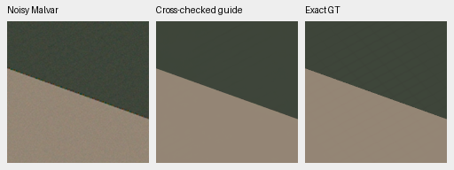
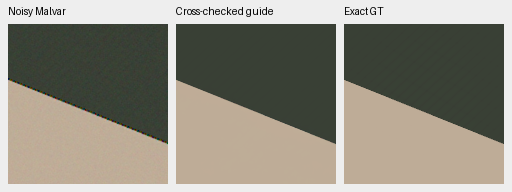

# Cross-check frequency moves within a RAW discovery fold

Bidirectional checking rejects some unsupported frequency moves around
accurate donors. It modestly improves recovery near the edge at ISO400,
while rejecting useful moves when the donor is deliberately shifted
far from the edge. ISO6400 changes are small, and the cab mesh still
has incomplete crossings.
[Executed sources and audit](results/phase-guide-crosscheck-v1/publication.json).

## Proposal and confirmation

The existing guarded search proposes a frequency change when its
whitened full-discovery fit gains more than four units of energy. The
new option checks that proposal on two disjoint green subsets within
the same discovery fold. Each subset estimates nuisance and noise and
fits both the original and proposed frequencies. The move must lower
prediction error on the opposite subset in both directions. The search
nominates the proposal using both subsets, so this rule checks
prediction consistency on those subsets. The separate outer held-out
score remains available for reconstruction validation.
[Implementation](../src/demosaic/local_validated_waves.py) ·
[Frozen replay](../scripts/probe_phase_guide_crosscheck.py).

The 16 near groups use nominal guides and same-side validation on
sources 60–67 and both priors from the [fresh comparison](asymmetric-phase-evidence.md).
The 16 far groups use the saved one-bin radial guide displacement on
sources 40–47 from the [guide guard comparison](phase-guide-edge-guard.md).
The two groups answer different questions. Everything else, including
the parent, masks, development thresholds and weighted-refit scales,
matches the saved corresponding control. GFX uses fixed threshold 2
with nominal guides and same-side validation.

## Measured tradeoff

The table uses a single descriptive correction multiplier in each
stratum to match mean attained quiet RMS. Multipliers use the evaluation
targets. The underlying variant decisions and fixed scales are archived
separately. Each row pools eight sources.

| Noise and geometry | Weak response, guarded → cross-checked | Increment RMS, guarded → cross-checked (DN16) |
| --- | ---: | ---: |
| ISO400 near, nominal donor | 3.94% → 4.35% | 15.15961 → 15.15497 |
| ISO6400 near, nominal donor | 1.39% → 1.40% | 34.06126 → 34.06127 |
| ISO400 far, shifted donor | 22.33% → 19.92% | 11.65035 → 11.66090 |
| ISO6400 far, shifted donor | 0.77% → 0.74% | 26.60682 → 26.61766 |

For ISO400 near, mean weak-guide error falls from 0.464 to 0.343
Fourier bin in the two-wire observation. The cross-check retains 22 of
31 proposed moves across all near ISO400 roles. The deliberately
shifted ISO400 far guides lose seven of 61 proposed moves and mean
weak-guide error increases from 0.077 to 0.198 bin. The option stays
experimental. The fixed-guide diagnostic on the same near cohort
retains more weak signal at matched quiet error.
[Complete metrics and paired operating points](results/phase-guide-crosscheck-v1/summary.json) ·
[Fixed donor diagnostic](asymmetric-phase-evidence.md#retaining-accurate-donor-frequencies).

## Native comparisons

Synthetic triplets show noisy Malvar, cross-checked same-side validation
and exact synthetic GT. They use source 60 RGGB and 61 BGGR, near two-wire
placement, repeat 7521, ROI `[176,176,160,160]`, and the tight 0.02 DN16
development setting. The ADC16 black fraction is 0.03 and shot/read are
`8e-5/2.56e-8` at ISO400 or `0.00128/6.5536e-6` at ISO6400. Exposure 2,
white balance, matrix and clipped sRGB are shared.
V143 EMA SHA256 is
`96d146d017c54196288c585f8b7eddcf030e8a235061049c31e985b9380b7ce4`.

Both restored panels stay close, with more defined diagonal strands in
the targets. The camera runs use V120 EMA SHA256
`a9d9b6b4f974e24a6b11e5e740aab32314233a7f53c056cf37c7d2aac1c589fb`.
DSCF3879/3880 uses exposure 4 and shot/read `0.00128/6.5536e-6`; the
DSCF3842/3835 cab uses exposure 16 with that profile and the transferred
`0.0014635776/1.0715704e-6`. ISO100 AHD and the low-ISO JPEG are separate
qualitative references with different aperture, exposure and motion.

The sky equals V120 in camera RGB and display pixels. The coarse fence
changes by 1.64 DN16 RMS from the guarded same-side fit while retaining
its diamonds. Fine hardware and foliage remain soft. The left cab views
match the control, and changes on the right are below 0.81 DN16 RMS.
Fine crossings remain incomplete.
[Sky](images/phase-guide-crosscheck-v1/main-overcast-sky.png) ·
[Building](images/phase-guide-crosscheck-v1/main-building-detail.png) ·
[Foliage](images/phase-guide-crosscheck-v1/main-foliage.png) ·
[Coarse fence](images/phase-guide-crosscheck-v1/main-chain-link-fence.png) ·
[Cab left](images/phase-guide-crosscheck-v1/mesh-nominal-left.png) ·
[Cab right](images/phase-guide-crosscheck-v1/mesh-nominal-right.png) ·
[Transferred left](images/phase-guide-crosscheck-v1/mesh-profile3879-left.png) ·
[Transferred right](images/phase-guide-crosscheck-v1/mesh-profile3879-right.png) ·
[All native crop settings](images/phase-guide-crosscheck-v1/manifest.json).

Collection took 92.76 seconds for 104 fits on two CPU cores. The
independent audit verifies 960 image reductions, 370 nested
held-out gains and 152 retained camera cells. The first audit omitted
a phase-index wrap at a floating-point boundary. The corrected audit
uses the same saved predictions and matches the nested gains within
`2.62e-10`. All twelve boards were viewed.
[Audit and recovery receipts](results/phase-guide-crosscheck-v1/publication.json).
