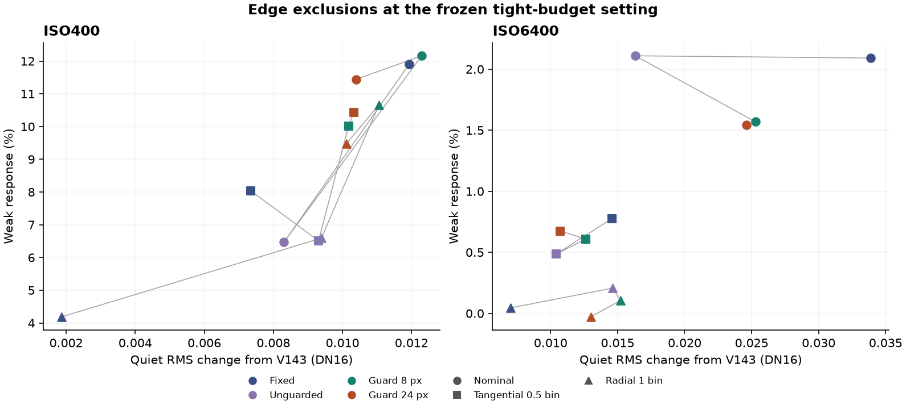
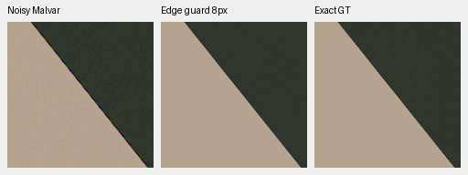
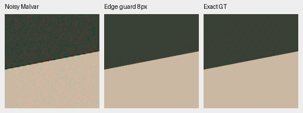

# Keep strong edges out of the RAW frequency search

The [bounded guide search](phase-guide-recenter.md) repairs a shifted
frequency well on lower-noise fields away from a strong edge. Near an
edge it can move an accurate guide away from the true frequency.
This replay tests whether excluding edge-adjacent green samples from
frequency selection improves that tradeoff.

The 8-pixel exclusion improves ISO400 recovery near the edge and
preserves the far-edge repair. ISO6400 recovery remains weak. The
standing sky matches V120 and the real fine lattice remains
incomplete.

The [same-side follow-up](phase-edge-side.md) retains the frequency
guard and confines held-out evidence to the fitted side of each edge.
At matched quiet error it improves lower-noise dark-side recovery.

## Discovery-fold exclusion

Each discovery fold fits the existing affine background and edge step
on its own green samples. If the step amplitude exceeds twice the
shot/read standard deviation at the brightest fitted level, the
frequency search omits samples within 8 or 24 native pixels of the
fitted line. Each width is a perpendicular half-width. The search
still uses the same half-bin and one-bin candidates and the same
required increase in whitened fitted energy. The fit to deliver, the
other fold's validation and the final refit use all of their original
samples. The exclusion is opt-in and starts from the supplied noisy
donor frequencies.
[Implementation](../src/demosaic/local_validated_waves.py) ·
[Frozen replay](../scripts/probe_phase_guide_edge_guard.py).

The synthetic comparison reuses the 96 observations, V143 parent and
fixed and unguarded baselines. Both widths are tested with accurate
nominal guides, half-bin tangential offsets and one-bin radial
offsets, at both edge placements and both noise levels. The 0.02
and 0.10 DN16 development budgets identify the earlier frozen
thresholds and correction scales. Quiet error is measured on this
fresh panel. The camera crops use nominal noisy donor guides and
threshold 2 with the V120 parent.

## Lower-noise recovery

At ISO400, neither width changes the far-edge results. The
weighted refit still recovers 22.33% of the weak increment after
a one-bin radial guide error, compared with 1.36% using the
shifted guide directly. In the near field, the 8-pixel guard
reduces mean weak-guide frequency error from 0.473 to 0.098
native bin with nominal guides and from 0.701 to 0.162 with the
radial error. The weak-increment RMS after the radial error
falls from 15.75610 to 15.72966 DN16.

The table gives weighted-refit means across eight ISO400 near-edge
sources at the frozen 0.02 DN16 development setting.

| Starting guide | Fixed response | Unguarded response | 8 px response | 24 px response | Quiet RMS change, unguarded / 8 px / 24 px (DN16) |
| --- | ---: | ---: | ---: | ---: | ---: |
| Nominal | 11.91% | 6.47% | 12.16% | 11.44% | 0.00830 / 0.01229 / 0.01040 |
| Half-bin tangential | 8.04% | 6.51% | 10.01% | 10.44% | 0.00931 / 0.01017 / 0.01033 |
| One-bin radial | 4.19% | 6.59% | 10.66% | 9.47% | 0.00939 / 0.01106 / 0.01011 |

Nominal guides with the 8-pixel guard have a 0.00036 DN16 mean
quiet cost against the fixed guide and 0.00399 DN16 against
the unguarded search. Weak response improves on all eight sources
relative to unguarded search, and increment RMS improves on seven.
On the separate no-wire views, mean delivered correction RMS
from V143 falls from 0.334 to 0.139 DN16. This measures the
correction itself, while quiet RMS measures error over all three
roles against their targets. The 24-pixel guard omits an average of
3,415 green sites per two-wire discovery fold, about three times
the 8-pixel guard's 1,140.

At ISO6400, far-edge arms also reproduce the unguarded search.
Near-edge response remains weak. With nominal guides the 8-pixel
guard lowers response from 2.11% to 1.57%, raising mean quiet
error by 0.00897 DN16. With a one-bin radial error, response
falls from 0.21% to 0.10%. Localizing the frequency search helps
when the step contaminates a measurable carrier. The available
samples still carry little recoverable signal in these high-noise
cases.
[Paired source means and measured background-only corrections](results/phase-guide-edge-guard-v1/summary.json).

## Crop and noise provenance

The synthetic triplets show noisy Malvar, the 8-pixel weighted refit
with nominal guides and exact constructed GT. They use the 0.02
DN16 development setting, near placement and repeat 7311. Native
160×160 cells use parent ROI `[176,176,160,160]`. Source 40 uses
RGGB and source 41 uses BGGR. The ADC16 black fraction is 0.03.
Shot/read variance parameters are `8e-5/2.56e-8` at ISO400 and
`0.00128/6.5536e-6` at ISO6400. Exposure 2, white balance, color
matrix and clipped-sRGB display match across methods. The V143 EMA
SHA256 is
`96d146d017c54196288c585f8b7eddcf030e8a235061049c31e985b9380b7ce4`.

The camera parent is V120 EMA SHA256
`a9d9b6b4f974e24a6b11e5e740aab32314233a7f53c056cf37c7d2aac1c589fb`.
DSCF3879/3880 sky, building, foliage and coarse fence use exposure 4.
DSCF3842/3835 cab mesh uses exposure 16 and shows both crop sides,
both recorded noise profiles and both camera JPEGs. The independently
demosaiced ISO100 and low-ISO JPEG references differ in aperture,
exposure and subject motion.

Source 40 shows faint diagonals in the dark triangle after the
guarded fit. The exact target shows the diagonals and their
crossings more clearly. On source 41, differences among the
restored panels are subtle. At ISO6400, both restored examples
are nearly flat where the exact target shows wires.
[ISO400 RGGB](images/phase-guide-edge-guard-v1/iso400-source40-near-RGGB-comparison.png) ·
[ISO400 BGGR](images/phase-guide-edge-guard-v1/iso400-source41-near-BGGR-comparison.png) ·
[ISO6400 RGGB](images/phase-guide-edge-guard-v1/iso6400-source40-near-RGGB-comparison.png) ·
[ISO6400 BGGR](images/phase-guide-edge-guard-v1/iso6400-source41-near-BGGR-comparison.png).

The nominal camera prior uses shot/read `0.00128/6.5536e-6`. The
separate transferred cab prior uses `0.0014635776/1.0715704e-6`,
estimated from DSCF3879. The source crop coordinates, exact
conditioning, display settings and original panel bindings are in
the manifest.
[Native image manifest](images/phase-guide-edge-guard-v1/manifest.json).

## Real-camera results and verification

Both guarded sky crops match V120 bit for bit in linear camera
RGB and displayed pixels. Only the building crop triggers the
exclusion. Its 8-pixel result matches unguarded search and its
24-pixel result differs by 0.141 DN16 RMS. Fine hardware still
looks soft. The foliage, coarse fence and four cab views
reproduce the unguarded fit bit for bit. The coarse fence keeps
its visible diamonds. The fine cab lattice remains incomplete
under both profiles.
[Sky](images/phase-guide-edge-guard-v1/main-overcast-sky.png) ·
[Building](images/phase-guide-edge-guard-v1/main-building-detail.png) ·
[Foliage](images/phase-guide-edge-guard-v1/main-foliage.png) ·
[Coarse fence](images/phase-guide-edge-guard-v1/main-chain-link-fence.png) ·
[Cab left](images/phase-guide-edge-guard-v1/mesh-nominal-left.png) ·
[Cab right](images/phase-guide-edge-guard-v1/mesh-nominal-right.png) ·
[Transferred profile left](images/phase-guide-edge-guard-v1/mesh-profile3879-left.png) ·
[Transferred profile right](images/phase-guide-edge-guard-v1/mesh-profile3879-right.png).

This search uses a local line fit. It tests whether rejecting
edge-contaminated samples improves phase selection from measured
RAW. Whole-scene context can supply a prior for where to seek
structure, while the local measurements still determine its
frequency and phase. The trained scene-context comparison measures
that input separately.
[Whole-scene context results](whole-scene-context-development64.md).

The 576 synthetic and 16 real refits take 450.34 seconds on two
CPU cores. The recovered reporting pass uses the same saved predictions
after correcting the camera-record argument. The archive preserves the
first report failure and the successful replay. The independent audit
checks 4,608 reductions, 1,184 sample counts, 104 retained camera
cells and four triplet subsets. All 288 synthetic refits with zero
exclusions match the earlier predictions bit for bit. All twelve native
comparison boards were viewed.
[Independent audit](results/phase-guide-edge-guard-v1/independent-audit.json) ·
[Viewing record](results/phase-guide-edge-guard-v1/actual-native-viewing.json) ·
[Executed sources and receipts](results/phase-guide-edge-guard-v1/publication.json).
