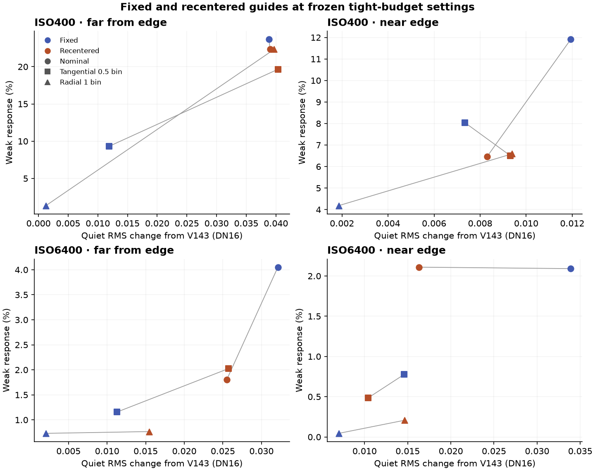
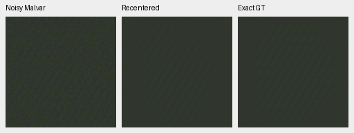
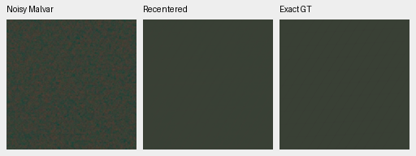

# A bounded RAW search for shifted phase guides

The bounded search recovers most of the lost ISO400 far-edge signal
after a one-bin radial guide error. It hurts the ISO400 near-edge
comparison even with an accurate guide, and offers little recovery
from the same error at ISO6400. The real sky matches V120, and fine
cab crossings remain unresolved.
[Audited comparison and executed sources](results/phase-guide-recenter-v1/publication.json).

## The guide-error test

The [fresh weighted-refit comparison](fresh-phase-refit.md) recovered
more ISO400 far-edge detail with guides already within 0.091 native
Fourier bin of the true frequencies. This test measures what happens
when the same observations receive a displaced guide and lets each
discovery fold try to repair it.

Each of the two guide frequencies gets a radial offset of one
native bin or a tangential offset of half a bin. A native bin in
the 256-pixel query is 1/256 cycles per pixel. The offsets are applied
to the noisy donor estimates. Source and guide-index parity determine
the sign. Each error condition compares fixed and recentered guides.
A nominal-guide comparison tests the effect of recentering an
accurate starting estimate.

The search considers the supplied frequency and offsets of half a
bin and one bin in both directions along its radial and tangential
axes. It uses only discovery-fold green sites. The fitted nuisance
and the competing direction's eight-knot phase basis are projected
out of the search. A candidate must add more than four units of
whitened fitted energy to move the guide. The other fold validates
the resulting profile. The existing 1.5-bin fold-matching radius,
per-color pooled gate and weighted refit then apply. This is a
bounded empirical search and gate.
[RAW guide and delivery implementation](../src/demosaic/local_validated_waves.py) ·
[Frozen replay runner](../scripts/probe_phase_guide_recenter.py).

The replay reuses the 96 RAW observations, both placements, both
noise profiles and the saved V143 parent. All thresholds and
correction scales come from the [earlier calibration](fresh-phase-refit.md#frozen-development-settings).
The 0.02 and 0.10 DN16 development budgets label those settings.
Achieved quiet error on the fresh fields is measured separately.
The standing GFX crops use the measured nominal donor guides
with and without the search at threshold 2.

## What the search recovers

The table gives weighted-refit means for the frozen 0.02 DN16
development setting. Each pair is fixed / recentered. Quiet delta
is the achieved increase over the V143 parent.

| Noise and edge | Guide offset | Weak response | Quiet delta, DN16 |
| --- | --- | ---: | ---: |
| ISO400 far | Nominal | 23.66% / 22.36% | 0.03881 / 0.03902 |
| ISO400 far | Half-bin tangential | 9.32% / 19.65% | 0.01193 / 0.04033 |
| ISO400 far | One-bin radial | 1.36% / 22.33% | 0.00127 / 0.03970 |
| ISO400 near | Nominal | 11.91% / 6.47% | 0.01193 / 0.00830 |
| ISO400 near | Half-bin tangential | 8.04% / 6.51% | 0.00734 / 0.00931 |
| ISO400 near | One-bin radial | 4.19% / 6.59% | 0.00186 / 0.00939 |
| ISO6400 far | Nominal | 4.05% / 1.81% | 0.03213 / 0.02551 |
| ISO6400 far | Half-bin tangential | 1.16% / 2.02% | 0.01129 / 0.02571 |
| ISO6400 far | One-bin radial | 0.73% / 0.77% | 0.00208 / 0.01543 |
| ISO6400 near | Nominal | 2.09% / 2.11% | 0.03390 / 0.01633 |
| ISO6400 near | Half-bin tangential | 0.78% / 0.49% | 0.01458 / 0.01041 |
| ISO6400 near | One-bin radial | 0.04% / 0.21% | 0.00701 / 0.01464 |

Recentering lowers ISO400 far weak-increment RMS from 11.78842 to
11.65035 DN16 in the radial arm, close to 11.64021 with the nominal
guide. Weak-absent projection averages 0.2838% after recentering
and 0.2837% with the nominal guide.

On the two-wire far views in the radial stress, both recovered
frequencies are within one-quarter bin of truth in 15 of 16
discovery folds. The near views satisfy that condition in seven
of 16. The weak frequency in the near views remains 0.701 bin from
truth on average after the search. With the nominal near guide,
its error rises from 0.050 to 0.473 bin, while weak response falls
from 11.91% to 6.47%. The unguarded search can therefore hurt even
when the supplied guide is accurate.

At ISO6400 far with radial error, the mean weak frequency error
increases from 0.984 to 1.069 bins. The mean increment RMS rises from
26.57904 to 26.60682 DN16. In the ISO400 background-only near views,
recentering the nominal guide raises the mean delivered correction
RMS from 0.170 to 0.334 DN16. This measures change from the parent in
the no-wire role. It separates that change from quiet RMS averaged
over all three roles.
[Paired metrics, guide choices, and no-wire controls](results/phase-guide-recenter-v1/summary.json).

## Native crop protocol

Synthetic triplets show noisy Malvar, the weighted fit with
recentered radial-error guides, and exact constructed GT. Both
use the frozen 0.02 DN16 development setting, far placement and
repeat 7311. Native 160×160 cells come from the parent ROI
`[176,176,160,160]`. Source 40 uses RGGB and source 41 uses BGGR.
The sensor simulation uses ADC16 black fraction 0.03 and shot/read
`8e-5/2.56e-8` at ISO400 or `0.00128/6.5536e-6` at ISO6400.
Exposure is 2 with the same white balance, color matrix and
clipped-sRGB display across methods. The synthetic parent is V143
EMA SHA256 `96d146d017c54196288c585f8b7eddcf030e8a235061049c31e985b9380b7ce4`.

The real views use V120 EMA SHA256
`a9d9b6b4f974e24a6b11e5e740aab32314233a7f53c056cf37c7d2aac1c589fb`.
DSCF3879/3880 sky, building, foliage and coarse-fence crops use
display exposure 4. DSCF3842/3835 uses exposure 16 with both
recorded noise profiles and both camera JPEGs. ISO100 AHD and
the low-ISO JPEG are independent qualitative references, with
different aperture, exposure and subject motion.

On the first ISO400 crop, recentering restores visible diagonals
lost with the radial offset. The exact target keeps clearer
crossings. The other low-noise crop has subtler changes. The
ISO6400 examples look almost flat at the recorded exposure.

The sky is bit exact to V120 in camera RGB and displayed pixels.
The coarse fence changes by 21.78 DN16 RMS from the fixed weighted
fit, with visible crossings in both versions. Thin building and
foliage details remain soft. The cab changes are subtle. Fine
crossings remain unresolved under both recorded profiles.
[ISO400 RGGB](images/phase-guide-recenter-v1/iso400-source40-far-RGGB-comparison.png) ·
[ISO400 BGGR](images/phase-guide-recenter-v1/iso400-source41-far-BGGR-comparison.png) ·
[ISO6400 RGGB](images/phase-guide-recenter-v1/iso6400-source40-far-RGGB-comparison.png) ·
[ISO6400 BGGR](images/phase-guide-recenter-v1/iso6400-source41-far-BGGR-comparison.png) ·
[Sky](images/phase-guide-recenter-v1/main-overcast-sky.png) ·
[Building](images/phase-guide-recenter-v1/main-building-detail.png) ·
[Foliage](images/phase-guide-recenter-v1/main-foliage.png) ·
[Coarse fence](images/phase-guide-recenter-v1/main-chain-link-fence.png) ·
[Cab left](images/phase-guide-recenter-v1/mesh-nominal-left.png) ·
[Cab right](images/phase-guide-recenter-v1/mesh-nominal-right.png) ·
[Transferred profile left](images/phase-guide-recenter-v1/mesh-profile3879-left.png) ·
[Transferred profile right](images/phase-guide-recenter-v1/mesh-profile3879-right.png).

The 480 synthetic and eight real refit calls take 365.37 seconds on
two CPU threads. The 128 nominal metric rows reproduce exactly.
The separate audit checks 4,608 image measurements, 1,920 guide
vectors, 96 retained camera cells, and four exact triplet subsets.
All twelve comparison boards were opened.
[Independent audit](results/phase-guide-recenter-v1/independent-audit.json) ·
[Native crop and viewing manifest](images/phase-guide-recenter-v1/manifest.json).
