# Local harmonic refinement on complete GFX frames

The experimental local correction now runs through `demosaic infer` on complete
102MP images and exports linear and sRGB RGB16 TIFFs. It uses measured RAW
evidence to add periodic detail after neural restoration. Window positions affect
its response; this does not establish broad photographic improvement.

The [centred-patch report](local-phase-harmonic-patch.md) demonstrates stronger
fine-mesh response in selected windows. Its independent validation found less
blank-region spill
than the first global correction, with residual spill and many undetected recipes.
The packaged operator retains that fixed patch policy. A regular overlapping
grid makes it usable without manually choosing a fence-centred window.

## Running it

```bash
source scripts/env.sh
uv run demosaic infer /mnt/external/demosaic/models/v143-final5000.pt photo.raf \
  /mnt/external/demosaic/output/photo-local-linear.tiff \
  --preview /mnt/external/demosaic/output/photo-local-srgb.tiff \
  --shot 0.00128 --read 0.0000065536 \
  --tile 512 --overlap 64 --batch-size 4 --precision float32 \
  --phase-harmonic --phase-harmonic-stride 128
```

Noise values above are the tested nominal GFX prior, not calibrated coefficients
for every camera. The optional stage defaults to stride 128; even strides 2–192
are accepted. It operates in linear camera RGB before clipping, color rendering,
orientation and RGB16 rounding. Shot=read=0 takes an exact float32 parent bypass.
The output JSON separately records neural and correction timing, active patches,
selected frequencies and added-field magnitude. Existing inference defaults stay
unchanged. The DNG batch exporter does not yet expose this option.

[Package implementation](../src/demosaic/phase_harmonic.py) ·
[CLI](../src/demosaic/cli.py) ·
[Tests](../tests/test_phase_harmonic_inference.py) ·
[Actual execution and publication](results/phase-harmonic-inference-publication-v1.json) ·
[Complete native metadata](images/phase-harmonic-inference-v1/manifest.json).

## Tiling and compatibility

Each fixed 256px patch uses the same input-only phase/frequency selection, weighted
RAW-minus-parent harmonic fit and local green evidence as the archived patch
operator: native Gaussian sigma 32, variance shrink 4, cap 3 and 32-pixel cosine-squared
aprons. Adjacent corrections are summed and divided by `max(sum tapers,1)`.
Inactive windows participate in the denominator. This can dilute detections but
avoids selecting whichever window has the largest noisy response.

All origins are even sensor coordinates, including the final covering patch.
Odd and small images extend complete CFA cells, preserving phase. Images never
resize. Fits and spectral calculations use float64; full-image accumulators and
returned RGB use float32, with patch-sized fitting arrays. There are no additional
neural evaluations, training updates, reference inputs or random draws.

The port matches 2,359,296 retained patch values exactly. Twelve larger-context
comparisons agree with the original float64 tile probe within float32 rounding;
their largest difference is 5.96×10⁻⁸ normalized units. Actual sky/foliage contexts
remain unchanged. Building and fence corrections depend on stride and origin;
stride 128 does not win everywhere. Four-CFA seam tests include odd full-image
dimensions and a known continuous wave. All 45 relevant tests pass.

## Full-frame results and limits

Completed V143 5k EMA SHA256:
`96d146d017c54196288c585f8b7eddcf030e8a235061049c31e985b9380b7ce4`.
The main DSCF3879 frame uses the fixed historical Haar prior
shot 0.0014635775921166604/read variance 1.0715704128646712×10⁻⁶.
DSCF3842 uses both that nearby-capture prior and nominal
shot 0.00128/read variance 6.5536×10⁻⁶. These are fixed comparison conventions,
not new camera calibration. All inputs came from local read-only RAF caches;
no unavailable source drive was accessed.

All three 8746×11662 frames complete in IEEE FP32, using neural native512/B4/
overlap64 followed by 6,188 local windows at stride128. This adds 390 actual
root/DINO forwards, 1,560 neural tiles and three cached RAF decodes. Correction
adds no neural work. Model/backbone hashes remain unchanged. All 70 current
package modules match the executed frozen copy; older 69-module experiment
snapshots and receipts remain preserved.

| Complete101.996MP frame | Neural seconds | CPU correction seconds | Instrumented CLI seconds | Active correction windows |
| --- | ---: | ---: | ---: | ---: |
| Main, fixed Haar prior | 164.21 | 109.73 | 309.36 | 1103/6188 |
| Fine mesh, nominal prior | 163.92 | 90.81 | 289.01 | 133/6188 |
| Fine mesh, nearby Haar prior | 165.59 | 107.95 | 309.95 | 1111/6188 |

Times include read-only witnesses/copies; CLI time also includes RAW decoding,
model loading and exports. They are shared-device observations, not a speed
ranking or a10s result. CPU correction is a substantial added cost.

Every one of 917,962,668 linear RGB16 channel values matches saved FP32
clip/round/orientation exactly. Complete sRGB16 previews agree with an independent
float64 render within one output DN16, with 16-bit and ICC tags verified.
[Export and native audit](results/phase-harmonic-inference-native-audit-v1.json).

Main rows: noisy → V120 → V143 → V143 plus local correction → independent
DSCF3880 ISO100 reference, **not exact GT**. All130 complete five-argument batches
match the earlier V120 run exactly, without rerunning that control.
Native160 sensor-pixel cells use the original fixed ROIs and shared+2EV/WB/matrix.
Differences remain subtle; foliage stays painterly and the larger fence coherent.
Full-frame correction changes foliage/building/fence by0.066/0.552/0.693 DN16 RGB
RMS respectively; these are added-field magnitudes, not GT error improvements.

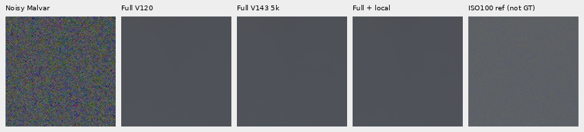

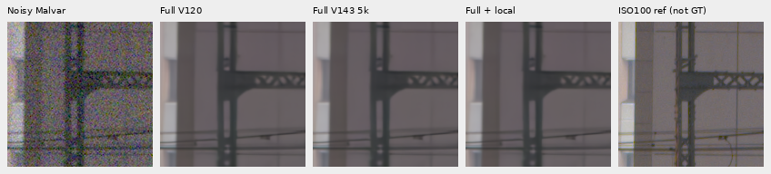

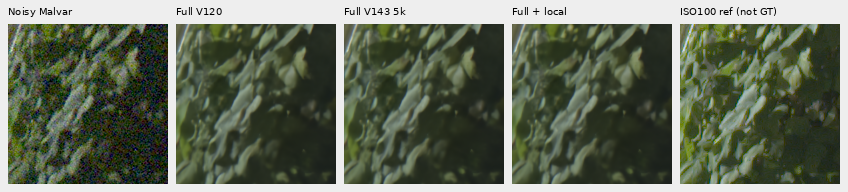

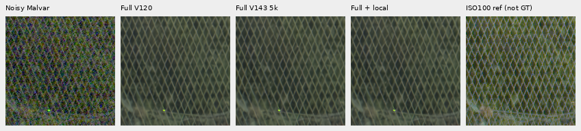

Fine mesh: noisy → full V143 → full local correction → DSCF3842 camera JPEG →
independent DSCF3835 ISO100 AHD → ISO100 camera JPEG. Native160 crops begin at
`[806,6489]` and`[1026,6449]`, with the original reference integer offset and
shared+4EV display. Camera JPEGs retain their native pixel grids and published
display transform. Aperture, exposure time, moving subjects and processing
differ; both ISO100 comparators are **not exact GT**.

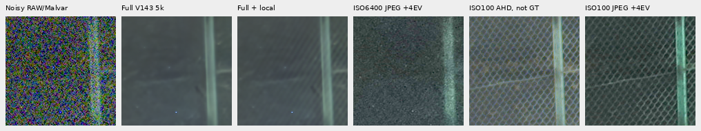

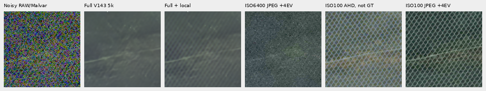

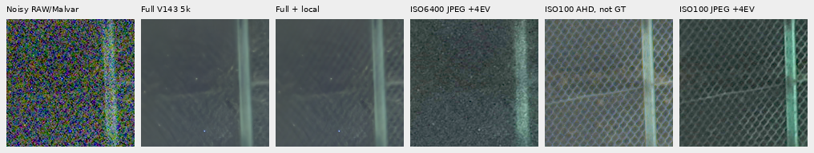

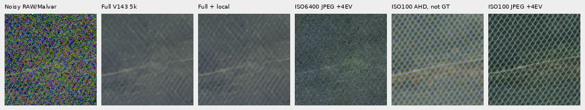

Both priors show clearer soft diagonals, especially on the right. The crossing
family remains much weaker than the low-ISO reference, with a patchy response
and strong dependence on window placement. This is useful partial recovery,
not a reconstructed sharp lattice or evidence of general photographic superiority.

The strongest added-field 160px region in the main image is a bright sign at
`[2720,1760,160,160]`. Its added RGB RMS is 678.41 DN16, while the largest individual
full-frame change is 5032.09 DN16. The shared−2EV view reveals highlight detail
that the usual+2EV display clips. The sign remains soft and some edges change;
this is not evidence that the lettering is correctly recovered. Large changes
outside the fence remain a reason to inspect optional refinement carefully.

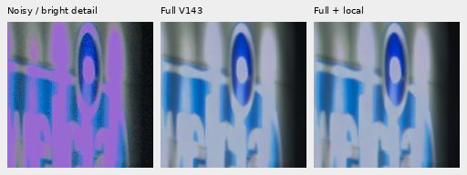

The three strongest fixed-grid regions and their usual+2EV views are also in
the manifest. This outcome-based selection is explicitly separate from the
input-only standing ROIs. All21 published boards were actually viewed at native
scale; direct rendering and copy checks cover6,220,800 PNG channels.

## Wider sky and exact-flat checks

A 2.88MP sky box `[5200,200,2400,1200]` was selected from the input-only overview
before inspecting the full result. **Every parent pixel is unchanged** there.
Three additional native160 views are retained. This measures added structure
against the parent; it is not an exact-GT sky error measurement.

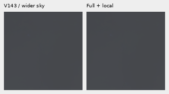

Twelve 1024×1536 uniform-field cases also retain every parent pixel across 924
windows: levels 0.002/0.02/0.2, Poisson–Gaussian nominal noise and four CFAs.
The three noise realizations are shared across the CFA layouts. Their parent is
the exact constant field rather than a neural prediction; they have no ADC
quantization. This is a limited false-activation stress check. The earlier
partial-texture blank-region spill remains measurable, and neither flat result
proves general protection against hallucinated structure.

## Native exact-GT examples

Noisy Malvar → packaged tiled correction on V143 → **exact procedural GT**.
These retained active/inactive examples use the smallest 256px tiling case,
ROI `[48,48,160,160]`, scene level 0.02 before camera transport, nominal ISO6400
conditioning, ADC16/black 0.03 and common WB/matrix/+3EV display. They reuse the
previous locked validation inputs and predictions, with no fresh neural calls
or noise; they are not new independent validation. Each 160×160 cell preserves
its native pixels.

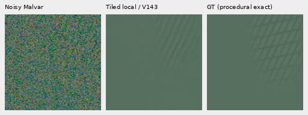

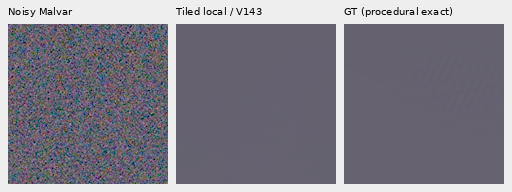

Recovery remains incomplete: one line family is stronger than the crossing
family in the active example, while the weaker example remains suppressed.
Broader photo/camera quality, a calibrated selection rule, stable recovery
across window positions and 100MP/10s remain open.
