# Clearer fine mesh from a phase-aware harmonic patch

The [local version](local-phase-harmonic-patch.md) supersedes this experimental
patch option: stronger response with less spill on new validation, now tested
with V1435k and both standing scenes. Its
[optional full-image path](phase-harmonic-inference.md) now exports102MP RGB16.
The original implementation and evidence
below remain preserved.

**A new input-only correction makes the fine green lattice visibly stronger in
both fixed GFX mesh windows and both noise priors.** It is a useful experimental
native256 patch option on saved V120 outputs. It also exposes a localization
cost: a fitted periodic field can extend into blank parts of a textured patch.
V120 remains the general inference recommendation. This original global
operator remains a saved-patch experiment.

[Operator](../scripts/phase_harmonic_patch.py) ·
[Results and execution](results/phase-harmonic-publication-v1.json) ·
[Independent native audit](results/phase-harmonic-native-audit-v1.json) ·
[Complete source/ROI/noise/display metadata](images/phase-harmonic-v1/manifest.json).

## Real fine green fence

Each row is noisy Malvar → V120 → harmonic patch → independent ISO100 reference,
**not exact GT**. DSCF3842 ISO6400 and DSCF3835 ISO100 f/5.6 differ in aperture,
exposure time and moving subjects. Left/right native160×160 ROIs start at
`[806,6489]` / `[1026,6449]`; +4 EV display, the existing reference x shift,
coordinates and transforms are unchanged. No crop pixels are resized.

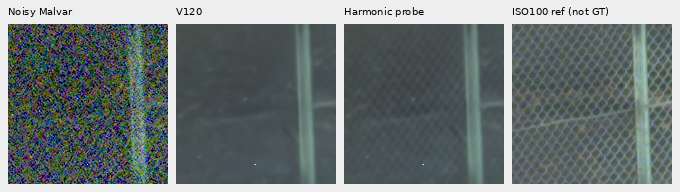

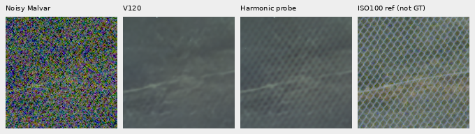

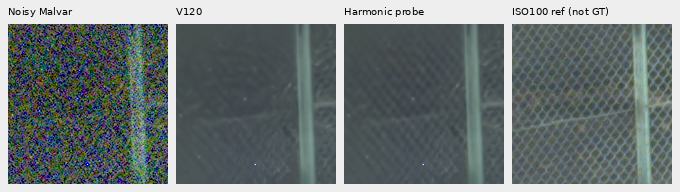

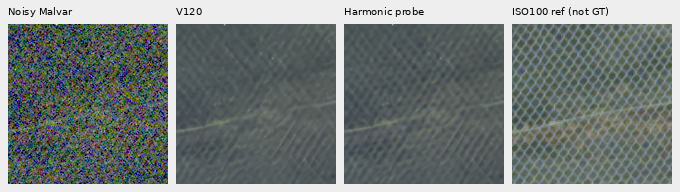

Nominal prior is shot0.00128/read variance6.5536×10⁻⁶; nearby DSCF3879 prior
is shot0.0014635775921166604/read variance1.0715704128646712×10⁻⁶, not fitted
to this capture. The correction uses even-origin256 windows within the retained
768 contexts; their exact origins and ROI offsets are recorded. The added
lattice remains soft and much weaker than the independent low-ISO reference.
This is qualitative support, not pixelwise real-GT scoring.

[Four camera-JPEG comparison boards](images/phase-harmonic-v1/manifest.json)
include both camera JPEGs at both priors. The JPEGs remain appearance comparators.

## What the operator does

The [controlled mesh diagnostic](crossed-line-response.md) found nearly zero
noisy mesh response despite coherent evidence in its clearest inputs. This
prototype selects up to four separated peaks from phase-compensated, tapered
green-pair cross spectra: native radial frequency0.03–0.22, positivefy,
signed coherence above0.8 and cross/noise score above5. These are empirical
scores, not calibrated probabilities or an all-frequency detector.
The settings were chosen after inspecting the procedural diagnostic, then fixed
before these real/flat/photo checks. Procedural gains reuse development cases;
they are not independent validation. The standing GFX scene had already informed
earlier spectral diagnostics, so its comparisons remain qualitative development
evidence.

At those input-selected frequencies, weighted least squares fits the observed
RAW minus the parent's measured-CFA samples. It includes per-phase affine
background terms and RGB sine/cosine coefficients at the actual physical CFA
positions. A shared green-innovation score shrinks each RGB harmonic together;
the score uses an inverse weighted-Gram proxy and is **not calibrated noise
confidence**. A native Hann taper localizes the returned field.

Only RAW, variance, CFA layout and the parent prediction enter correction.
GT/reference arrays are used solely for evaluation. The prototype changes no
network weights and makes no new neural calls, noise draws or RAW decodes.
Exact-zero-variance ADC observations bypass it. Source checkpoint SHA256:
`a9d9b6b4f974e24a6b11e5e740aab32314233a7f53c056cf37c7d2aac1c589fb`.
The complete operator hash is bound in every result; no learned checkpoint is
silently relabeled as containing this correction.

## Measured strengths and costs

On the32 noisy procedural cases, only the clearest present recipe activates.
Across its four CFAs, template gain rises from0.00397 to0.29807 and spatial
error RMS falls23.92494→19.08899 DN16. Across all16 present cases, gain rises
0.00095→0.07447 and mean spatial RMS falls12.43013→11.22114 DN16. The three
weaker recipes remain unchanged. All16 noisy absent outputs are unchanged.

The96 retained photographic predictions have unchanged pixel values: all222
selected photo harmonics receive zero final weight. All48 analytic flat fields
also retain their parent pixel values, including24 ADC bypasses. Main sky,
building and foliage are unchanged; the larger fence has a small correction.

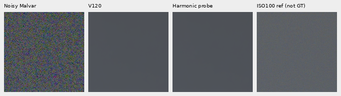

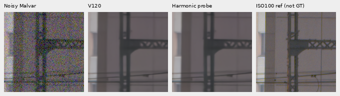

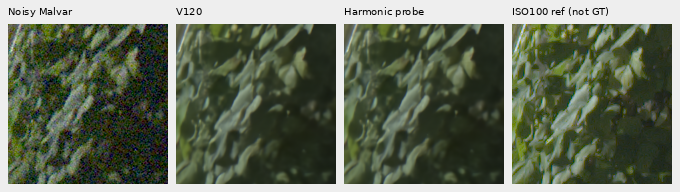

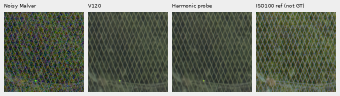

These main-scene native160 cells use DSCF3879/3880, local ROI
`[176,176,160,160]` in512 contexts and shared +2 EV display. DSCF3880 ISO100
f/5.6 is an independent qualitative reference, **not exact GT**.

The strong procedural case contains900 exactly empty ROI pixels per CFA.
Their error RMS worsens from3.99–6.56 to5.30–7.84 DN16. Harmonics can continue
past the true support of a texture. This measured failure prevents a broad
flat-safety claim despite unchanged sky and uniform-field tests. Unknown
textures, frequency aliases, camera color, highlights, tile origins and
full-frame seams remain untested. No threshold carries a false-discovery guarantee.

## Native synthetic-GT triplets

Two unchanged photographic checks: noisy → V120 plus harmonic stage → exact
synthetic GT. These160×160 cells retain8×-binned resolution, ROI
`[48,48,160,160]`, ISO12800-prior shot0.00256/read variance2.62144×10⁻⁵,
16-bit ADC and +0 EV display. The stage leaves these parent outputs unchanged.
Attribution and full matrix/noise/checkpoint bindings are in the manifest.

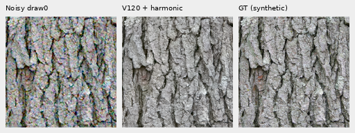

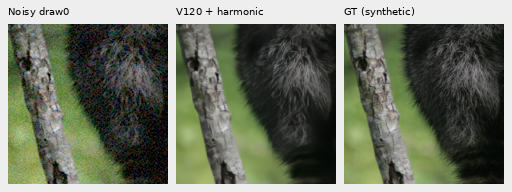

Two additional exact procedural-GT triplets use +3 EV display. The first
recovers one diagonal family; the weaker second remains suppressed.

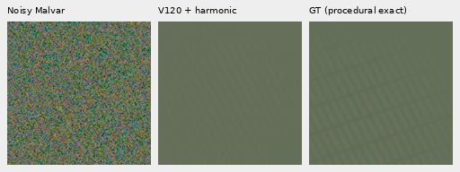

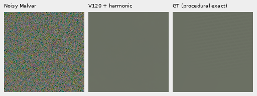

## Reproduce a patch

```bash
PYTHONPATH=src:scripts .venv/bin/python scripts/phase_harmonic_patch.py \
  INPUTS.npz BASE-PREDICTION.npy OUTPUT-DIRECTORY --checkpoint V120-CHECKPOINT.pt
```

The input archive supplies`packed`, `variance` and`colors`; the base is one
linear camera-RGB array of shape1×3×256×256. Output remains float64 linear
camera RGB with input/prediction/checkpoint/operator hashes, preserving precision
beyond16 bits. This command refines saved patches; it does not implement tiled
full-image inference. The checkpoint argument records the declared source and
does not execute a model. The public operator exactly reproduces all7,864,320
values from32 procedural and8 real prototype windows. Nine tests check physical
phase geometry across all CFAs, uniform/ADC bypasses and invalid inputs.

All16 native boards were actually viewed. Independent direct matrix/gamma
rendering and original-cell comparisons check5,222,400 PNG channels exactly.
The original prototype, subsequent checks and all machine receipts are retained.
