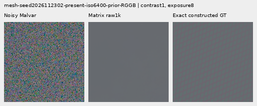
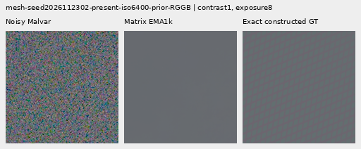
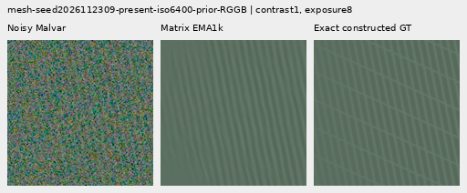
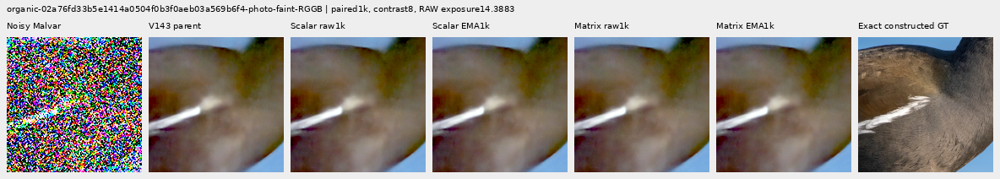
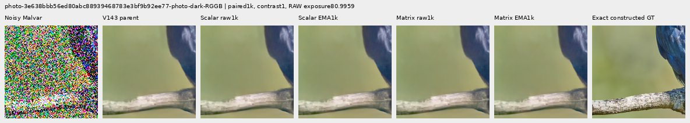

# V148 phase mixing: completed matched review

Learned complex mixing of the four CFA phases does not improve weak detail at
1,000 updates. Both matrix endpoints reduce mesh response, increase photographic
band error and worsen noisy 512-pixel flats against frozen V143. The native green
fence, feathers and bark remain soft. Small whole-image gains on strong edges
coexist with worse exact quiet patches. This implementation remains available
for research; [V120/general and V143/explicit periodic detail](current-model.md)
retain their existing strengths and weaknesses.

The fresh scalar control reproduces V147's final raw/EMA weights and all **1,596
predictions exactly**, including the 32 mixed controls. The matrix comparison
therefore tests a changed estimator family with matched data, initialization of
the common network, loss and schedule. It does not establish that every learned
phase estimator must fail.

## Measured strengths and weaknesses

Errors are mean per-observation RMS in unclipped camera RGB, scaled by 65535.
Mesh response projects onto exact plane-detrended procedural texture; ideal is 1.
The 256 present observations reuse 64 recipes over four CFAs, not 256 independent
scenes. All four final endpoints were fixed before review.

| Test | V143 | Scalar raw | Scalar EMA | Matrix raw | Matrix EMA |
| --- | ---: | ---: | ---: | ---: | ---: |
| Present mesh full RMS; 256 cases |9.11124|9.14578|9.14852|9.14391|9.14421|
| Present mesh response |.0220209|.0202623|.0202942|.0200224|.0202779|
| Mean added blank RMS in present cases |0|.62761|.67211|.63867|.67386|
| Absent mesh full RMS; 256 cases |5.23791|5.26714|5.27176|5.26616|5.26982|
| Native512 ISO6400 flat full RMS; 24 cases |18.54681|18.59095|18.59957|18.57179|18.58100|
| Native512 ISO12800 flat full RMS; 24 cases |24.07189|24.14170|24.15489|24.11647|24.13017|

Matrix mesh image error rises .359%/.362% raw/EMA against V143, despite being
slightly lower than the scalar control. Response falls about 9.08%/7.92%; it is
also below the matched scalar. Worst blank spill is .80321/.84657, versus
.75583/.80903 scalar. The existing explicit periodic `detail` comparator gives
mesh RMS 8.58613 and response .0708975, with mean blank spill .000636. It remains
stronger on selected meshes, with incomplete recovery, support seams and spill.

Matrix native512 noisy-flat error rises .135%/.184% at ISO6400 and .185%/.242%
at ISO12800. Full spatial error also rises. A real, small gain exists on the
older native256 ISO12800 cohort: RMS 27.23355 becomes 27.21444/27.21728, a
.070%/.060% reduction. Its coarse block32 error still rises slightly, and the
gain does not transfer to native512. Central-crop spatial error alone would hide
the wider-field regressions. All 48 ADC-only observations across both sizes
remain exactly at their parent values under all four endpoints; this is not a
noisy-flat safety guarantee.

Photographic band error rises and luma-band gain falls in every group against
both V143 and the matched scalar. The band is a native DCT16 luma annulus at
1/8–1/3 cycles/pixel.

| Photo group; 32 observations each | V143 band error | Scalar raw | Scalar EMA | Matrix raw | Matrix EMA |
| --- | ---: | ---: | ---: | ---: | ---: |
| Retained512 faint |.824639|.824909|.824912|.825033|.824991|
| Retained512 dark |.661447|.661485|.661481|.661510|.661497|
| Organic384 faint |.924117|.924623|.924631|.924888|.924829|
| Organic384 dark |.781612|.781680|.781680|.781709|.781699|

Organic-dark full-image RMS improves only .0013%/.0029% for the matrix, while
band error rises and native feather/grass/bark detail stays soft. The other
three groups have higher full-image error than V143.

Strong-edge whole-scene error improves .347–.469% with the matrix. Its exact
quiet ROI gets worse than both parent and scalar:

| Prior; 16 cases each | Method | Whole-scene RMS | Quiet160 RMS | Quiet spatial RMS |
| --- | --- | ---: | ---: | ---: |
| ISO6400 |V143|27.10563|3.89885|3.26850|
| ISO6400 |Scalar raw/EMA|27.02133 /27.01686|3.93315 /3.93828|3.30709 /3.31291|
| ISO6400 |Matrix raw/EMA|27.01160 /27.00909|3.93960 /3.94348|3.31411 /3.31845|
| ISO12800 |V143|36.74747|6.15265|5.34183|
| ISO12800 |Scalar raw/EMA|36.60879 /36.59419|6.19026 /6.19517|5.38432 /5.38988|
| ISO12800 |Matrix raw/EMA|36.58945 /36.57498|6.20589 /6.20733|5.40200 /5.40362|

The existing colored mottle remains, with subtle added fine grain visible under
diagnostic contrast40. The main real sky remains visually close to V143: its
descriptive block32 variation is 9.97264 parent versus 9.97291/9.97308 matrix.
These are not GT errors. The ISO100 reference differs in aperture, exposure and
moving subjects and is never used as a pixelwise scoring target.

## Native 100% comparisons

All 58 figures were actually inspected in 15 unscaled sheets. Every cell is
160×160 original pixels. The [manifest](images/v148-phase-matrix-v1/manifest-v1.json)
records source/ROI, noise, exposure, shared contrast/anchor, checkpoint hashes
and byte-exact image bindings. Four endpoints share the same input and display
transform. Sixteen triplets repeat existing comparison pixels, not observations.

The following two procedural cases use native512 contexts, RGGB,
ROI `[176,176,160,160]`, shot .00128/read 6.5536e-6, display exposure 8 and contrast1.
Their observation seed labels end2302 and2309; full procedural recipes are in the
manifest. The first stays nearly flat; the second retains one line family and
misses the crossing family. Both raw and EMA are shown.

Faint moorhen feathers remain soft. This Commons source is Alexis Lours,
CC BY4.0, SHA1 `02a76fd33b5e1414a0504f0b3f0aeb03a569b6f4`; its384 context uses
ROI `[112,112,160,160]`, exposure 14.388348 and diagnostic contrast8 about common
target channel means. These photographic targets are constructed from binned
free images, not exact GT for a physical captured scene.

The dark bird/branch context is512, ROI `[176,176,160,160]`, exposure 80.995917,
contrast1; source `3e638bbb56ed80abc88939468783e3bf9b92ee77`, Andrew Mercer,
CC BY-SA4.0. Bark and feather detail remain soft:

The standing DSCF3879/3880 boards include native
[sky](images/v148-phase-matrix-v1/comparison-05.png),
[building](images/v148-phase-matrix-v1/comparison-06.png),
[foliage](images/v148-phase-matrix-v1/comparison-07.png) and
[chain-link fence](images/v148-phase-matrix-v1/comparison-08.png), at exposure4.
Building detail stays soft and foliage painterly.

DSCF3842/3835 cab-mesh boards use a768 context and left/right ROIs
`[206,229,160,160]` / `[426,189,160,160]`, exposure16 and contrast1. Both windows
remain close to the parent under [nominal left](images/v148-phase-matrix-v1/comparison-09.png),
[nominal right](images/v148-phase-matrix-v1/comparison-10.png),
[profile3879 left](images/v148-phase-matrix-v1/comparison-11.png) and
[profile3879 right](images/v148-phase-matrix-v1/comparison-12.png) conditioning.
ISO100 AHD and both native camera JPEGs are qualitative references, **not exact
GT**. JPEG pixels receive no RAW exposure or contrast boost.

The [exact quiet patch](images/v148-phase-matrix-v1/comparison-26.png) beside the
strong step is shown at diagnostic40; its corresponding
[whole-edge crop](images/v148-phase-matrix-v1/comparison-27.png) uses contrast1.
The ROI/target and exposure8 are identical across methods.

## Implementation and fixed protocol

The [implementation](../src/demosaic/late_spectral_matrix.py) replaces V147's
scalar frequency gain with a complex4×4 matrix acting on the observed-minus-parent
spectrum after frozen V143. Conjugate frequency pairing permits real-image
synthesis. It divides by `max(1,sqrt(norm1(H)*normInf(H)))`, bounding the induced
2-norm per bin up to FP32 rounding. The family contains the shared scalar
diagonal. This is not a global RGB/nonlinear or noisy-flat guarantee. Existing
constant-observation handling, analysis/synthesis and local support are shared.

There are 31,409 parameters in 12 tensors, versus 30,402 scalar. All ten common
tensors initialize identically; output operators start zero and preserve the
parent initially. Only16 identifiable real output biases are stored: constant
imaginary biases cancel under conjugate pairing. Forward never receives targets
or references. All 32 component tests passed, including independent NumPy math,
singular-value bounds, gradients at zero, constants, RNG/devices, optimizer
continuation and CUDA parity. A coherent-green averaging example verifies
representational capacity, not learned quality. Legacy/current/embedded scalar
outputs match exactly on 28 cases across native256/384/512/768 contexts.

The [recipe](../configs/quality-v143-phase-matrix-v148.yaml) fixes both fresh
heads at1k/B4. V147's original seed, 4,000 IDs/noise realizations, source/loss,
schedule, clipping and EMA are replayed, with every input/target fingerprint and
metadata exact. The first40 input/parent observations are adopted;990 parent/DINO
batches are evaluated once and cached for both arms. The foundation hashes stay
exact. Discarded CUDA10 per arm passes genuine8+2 reload checks, with4.07GiB peak.
Neither arm starts from the old trained scalar.

Procedural training remains native512, photographs256, with90,782-photo/27-region
eligibility and bin4→geometry→area2 construction. No photo is stretched or tiled
to fake512 support. The sixteen reviewed photographic sources and protected
GFX scenes/siblings remain excluded from training. The review reuses retained
cases:512 present/absent meshes,128 photos,120 flats,6 real contexts and32 mixed
quiet controls. It draws no new validation noise, parent or DINO predictions.

The [final evidence](results/v148-phase-matrix-final-v2.json) includes independent
state/batch/prediction checks,30,034 scalar checks and385 Decimal reductions
(maximum difference4.55e-13),27,264,000 independently checked display channels,
all native-viewing notes and11 terminal process-owner records. Real references
remain unscored. The original preparation snapshot, receipts and experiment
arrays are preserved.

Two reporting corrections are explicit. A preflight helper-field error was fixed
before quality inference, preserving the original postprocessor. A later audit
initially required bit-exact reported loss reductions: total/pixel/gradient
losses differ by at most1.91e-6. Spectral loss, gradient norm and LR traces, both
final scalar weight sets and all scalar predictions are exact. The failed audit
source/receipt and corrected audit are preserved. No training or endpoint changed.

Paired checkpoint SHA256:
`bf32e14a6f80c82e4369e9d32c75aa4edab75fac77d5e866087c0bd8cffcc576`.
Matrix raw export:
`027994ba7f5bbdea83c15dcb203bfa6632cddf2a88978465e215478d0b715382`;
matrix EMA:
`70efed3bb08f94c4e88e4831ebfea4ddce407e2c22c810cca3f3727b69ad2a2e`.
All four export hashes and parent bindings are in the manifest.

This finite1k result argues against opening support or merely widening this
matrix head. A target-using constrained spectral diagnostic could next separate
operator/support limitations from estimation/training limitations; that would
be an explicitly labeled oracle diagnostic, not an inference result. The broader
fine-detail/clean-sky goal remains unmet. See the
[final diary](../diary/2026-11-03-12-44-17-v148-final-phase-mixing.md).
