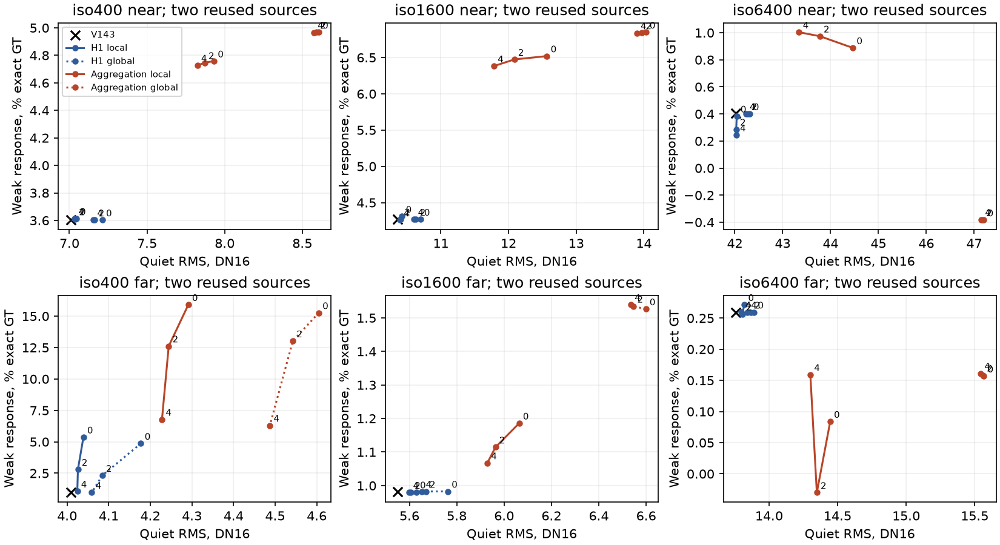
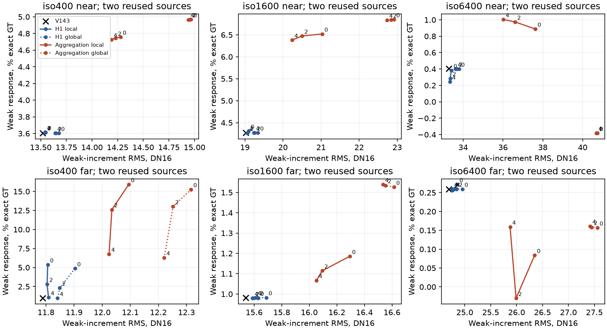
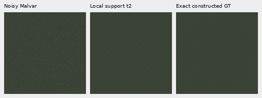
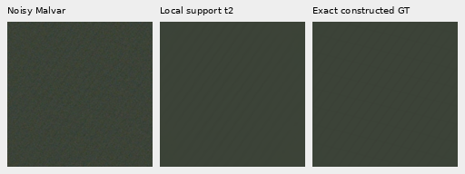

# Phase aggregation gains weak response with larger errors and real color bands

**At400/far, current local measurement aggregation raises weak response2.80%→12.68%
versus the matched H1 stage**, with strong response43.33%→65.96%. Quiet error
rises5.44% and weak-increment error1.94%. Higher-noise results are poor, and the
building stress crop has severe new green/magenta bands. Local averaging does
not resolve the fidelity problem. H1 remains the simpler experimental wave
baseline; V120 remains the general photographic recommendation.

The fixed48-input, three-prior development pilot, independent audit and actual
native review are complete. The [implementation](../src/demosaic/phase_aggregation.py)
is available with explicit matched H1 controls and its measured costs.
[Native viewer](images/phase-aggregation-v1/native-viewer.html) ·
[Complete receipts and executed sources](results/phase-aggregation-v1/publication.json).
[Viewing, absolute-role and follow-up evidence](results/phase-aggregation-v1/publication-addendum.json).

The [surface-constrained follow-up](surface-phase-aggregation.md)
tests phase averages with two fitted boundaries and a shared wave
gate. It measures a small ISO400 response gain on separate
geometries and larger peak rail errors.

The first figures/table below describe the **initial innovation-projection arm**.
The current default applies a consistent conditional-null projection. Its
separate matched48-input audit/native review is also complete, with similar
costs and the same artifact; current figures/results appear in the follow-up
section. Neither arm supplies clean weak-detail reconstruction.

The experiment follows the measurement-aggregation question in the
[weak-detail review](weak-detail-literature-2026-11.md#4-compare-measurement-aggregation-with-wave-synthesis).
[NLFeMF](https://arxiv.org/html/2604.17453v1) uses learned nonlocal matching,
filtering and aggregation; [IDF](https://arxiv.org/html/2508.19649v1) predicts
normalized dynamic filters. This prototype uses analytic phase groups, explicit
CFA coordinates and independently validated color amplitudes. It is not a port
of either learned model or a claim to reproduce their benchmark results.

## Measurements determine the proposed detail

The [implementation](../src/demosaic/phase_aggregation.py) retains the existing
A-only H1 discovery: a refined edge/affine nuisance, two competing angular
families, per-color weighted fits and A-only plug-in noise proxies. No parent,
GT, reference or target variance enters those fits.

For each direction and color, samples on the discovery subset are linearly
assigned to32 circular phase bins. Fixed `[1,2,3,2,1]/9` circular weights smooth
the bins. Native129-pixel spatial boxes on a16-pixel query grid restrict each
query's measurements; trilinear interpolation uses phase and native location.
Inverse-variance weights come from the same A-only nuisance fit. Source and query
must lie on the same side of its fitted edge. Different CFA colors never share
amplitude samples.

Let `Lphase` denote that normalized phase-conditioned mean and `Llocal` the
same-side/color local mean without phase conditioning. The detail operator is
`Q = Lphase − Llocal`. Each mean has nonnegative normalized measurement weights
where support exists. **Their difference is signed**: the delivered correction
and RGB output are not convex averages or bounded-range guarantees. Constants
are annihilated up to floating-point roundoff; this does not establish noisy-flat
safety for input-dependent geometry and weights.

On discovery A, the proposed direction is `Q(raw − competing-null)`, where the
null retains the nuisance and the other H1 direction. B tests that fixed
proposal against the same null, separately for every color and direction.
The original empirical squared-error improvement/energy scores, local129
validation windows, fixed thresholds0/2/4 and reverse fold are retained.
Both folds must match frequencies under the current cardinality matcher.
These scores are not calibrated probabilities, risk bounds or independent
estimates of the final full-input model's error.

In the measured initial arm, only after all scores are fixed does the correction read the parent:
`Q(raw − mosaic(parent))`. This is the difference between applying the same
operator to measured and parent residuals; the nuisance cancels. The two folds
are averaged and weighted by their minimum conditional support. Overlapping
native256 windows blend at stride128. The H1 control shares the exact same
discovery fits, frequencies, noise proxies, split and matching. Global/local
support and the threshold sweep are retained for both methods. Explicit
shot=read=0 returns the exact parent.

## Fixed evaluation and measured tradeoffs

The pilot uses sources0/1, RGGB/repeat0, near/far placements, all three original
400/1600/6400 noise priors and independently corrupted zero/one/two-direction
roles:36 finite-wire images. The other12 contexts are the original ordinary
bark/fur, four ADC/faint-material controls, all four main GFX contexts and both
cab profiles with both ROIs/JPEG metadata. All48 predictions close before any
new GT/reference scoring. Fixed primary comparison is local threshold2.

These geometries and real views have been adaptively reused; this is a
development experiment, not blind population/camera generalization. It creates
no new independent source/noise observation, neural/DINO forward, original RAW
decode or optimizer update. Procedural parent is V143 SHA256
`96d146d017c54196288c585f8b7eddcf030e8a235061049c31e985b9380b7ce4`;
photographic/GFX parent is V120 SHA256
`a9d9b6b4f974e24a6b11e5e740aab32314233a7f53c056cf37c7d2aac1c589fb`.
Protected RAW caches, JPEGs and siblings remain outside training; originals
remain read-only. ISO100/AHD/JPEG references are qualitative, not exact GT.

Each row averages **two reused source geometries**, one CFA/repeat. Response
is projected increment amplitude, not restoration quality. H1 and aggregation
use the same current-cardinality discovery fits and inputs. Local threshold2
is the primary fixed operating point; all0/2/4 global/local curves are retained.

| Prior / placement | Method | Strong response | Weak response | Quiet RMS DN16 | Weak-increment RMS DN16 |
| --- | --- | ---: | ---: | ---: | ---: |
|400 near | V143 |17.923% |3.603% |7.00841 |13.52012 |
| | H1 local2 |18.006% |3.611% |7.03781 |13.54121 |
| | Aggregation local2 |18.364% |4.746% |7.87168 |14.23081 |
|400 far | V143 |33.783% |0.958% |4.00857 |11.78863 |
| | H1 local2 |43.332% |2.801% |4.02596 |11.80386 |
| | Aggregation local2 |65.988% |12.614% |4.24421 |12.03450 |
|1600 near | V143 |1.056% |4.270% |10.36307 |19.02173 |
| | H1 local2 |4.393% |4.272% |10.40707 |19.07537 |
| | Aggregation local2 |8.490% |6.473% |12.08508 |20.50372 |
|1600 far | V143 |0.849% |0.983% |5.55081 |15.53872 |
| | H1 local2 |5.536% |0.979% |5.60632 |15.59392 |
| | Aggregation local2 |18.334% |1.114% |5.96356 |16.09349 |
|6400 near | V143 |0.550% |0.407% |42.01893 |33.28739 |
| | H1 local2 |0.546% |0.286% |42.02871 |33.35383 |
| | Aggregation local2 |0.549% |0.974% |43.77553 |36.60466 |
|6400 far | V143 |0.143% |0.259% |13.75699 |24.69560 |
| | H1 local2 |0.980% |0.257% |13.80463 |24.76031 |
| | Aggregation local2 |6.685% |−0.030% |14.34850 |25.98955 |

The400/far gain is source-dependent: source1 weak response rises H1
`4.592%→23.601%`, source0 `1.011%→1.627%`. Mean full-image error falls
`21.72125→21.56611 DN16`, while both quiet and increment errors rise. Across
all six cells, aggregation local2 has higher quiet/increment error than H1
local2. Local support lowers aggregation's own global-support errors in every
cell, without removing those costs.

The absolute edge-only role0 check prevents paired differences from hiding
common false structure. Its full-image error worsens versus H1 in all six
cells:400 near/far `22.01966→22.25611` / `20.84595→20.89893 DN16`;1600
`30.82571→31.49717` / `27.73576→27.82120`;6400 `58.41187→59.15541` /
`40.27490→40.47547`. All468 role/method/source/cell rows remain archived.
This is a fixed two-source descriptive result, without population intervals.

Ordinary bark/fur sRGB PSNR changes versus V120 are **−0.00680/−0.04459 dB**;
native outputs stay close to the parent, with soft irregular detail. All four
ADC/faint-material controls are exact parent identities. Neither this pilot
nor the amplitude gain supplies broad photo/camera quality or noisy-flat safety.

## Native recovery, remaining detail and both protected real families

Noisy Malvar → **aggregation local2 above V143** → exact constructed GT.
Each cell is160×160 unchanged pixels, native512 RGGB/repeat0/two-direction
role, far placement, ROI `[176,176,160,160]`. Shot/read are
`.00008/2.56e-8`, ADC16/black.03, exposure2/contrast1, with identical saved
per-source WB/matrix and clipped sRGB across methods. No new learned checkpoint
is involved; the exact analytic configuration and parents are in the
[manifest](images/phase-aggregation-v1/manifest.json).

Source1 has more modulation; complete weak crossings remain missing. At1600/
6400, the matched boards remain mostly flat, with occasional false modulation.
All22 matched comparisons, six stress boards, these two triplets and both
plots were actually viewed:32 views. Other original triplets are independently
audited, not claimed as separately visually inspected.

The DSCF3879/3880 main views retain native512 contexts/native160 crops,
exposure4 and nominal `.00128/6.5536e-6` conditioning:
[sky](images/phase-aggregation-v1/matched/main-overcast-sky-comparison.png),
[building](images/phase-aggregation-v1/matched/main-building-detail-comparison.png),
[foliage](images/phase-aggregation-v1/matched/main-foliage-comparison.png),
[coarse fence](images/phase-aggregation-v1/matched/main-chain-link-fence-comparison.png).
Sky is unchanged, foliage stays painted, coarse geometry remains but gains
unwanted modulation, and the building develops new color bands.

The [building stress view](images/phase-aggregation-v1/stress/main-building-detail-stress.png)
at ROI `[76,260,160,160]` exposes severe green/magenta bands around bright
windows and foreground bars. Its correction RMS relative to V120 is410.30
DN16; this is **correction magnitude, not reference error**. Stress selection
maximizes a native160 square's correction RMS after inference, with no GT
selection or reference at the extra coordinates. All six stress ROIs remain
in the manifest. Normalized phase means and empirical held-out agreement have
not prevented this failure.

DSCF3842/3835 cab boards retain native768 contexts/native160 ROIs, exposure16,
both original-pixel SOOC JPEGs and both profiles: nominal
[left](images/phase-aggregation-v1/matched/mesh-nominal-fine-green-mesh-left-comparison.png)/
[right](images/phase-aggregation-v1/matched/mesh-nominal-fine-green-mesh-right-comparison.png),
and nearby DSCF3879 `.0014635775921166604/1.0715704128646712e-6`
[left](images/phase-aggregation-v1/matched/mesh-profile3879-fine-green-mesh-left-comparison.png)/
[right](images/phase-aggregation-v1/matched/mesh-profile3879-fine-green-mesh-right-comparison.png).
Some diagonal modulation is stronger, with incomplete crossings and residual
periodic changes. ISO100/AHD/JPEG captures differ in aperture/exposure/motion:
qualitative references, **not exact GT**, without pixelwise scoring.

Phase pooling still assumes a locally coherent direction and period. Bad
geometry, curved/occluded wires, edge-model error and chance validation agreement
can produce false texture. More local freedom can also increase estimator
variance and erase weak details through validation. Native finite triplets,
both protected real families and maximum-correction stress ROIs must remain in
the completed report, including negative findings. No full102MP runtime/export
or broad photo/camera quality claim is made for this CPU prototype.

## Independent closure and reproducibility

The new27 tests and existing68 local-wave checks pass95 total. Directly
enumerated measurement weights independently match the implementation for both
directions/four CFAs. Actual withheld samples replaced by NaN leave all
discovery/aggregation predictions unchanged; validation can ignore discovery
values once its predictor is fixed. Tests also cover edge/color isolation,
linearity, constant annihilation, exact-parent replacement, ADC identity,
boundary axes and byte-exact H1 controls. The first test log's four fixture
failures and corrected run are retained; no numerical tolerance was relaxed.

The expanded reporter checks the complete declared ID set. A separate frozen
postprocessing addendum corrects the legacy auditor's missing noise-profile
join key, retaining its original frozen source and any failed audit evidence.
This changes no prediction, observation or metric definition. The original
frozen auditor's profile-join failure is preserved. The corrected independent
audit verifies2,613 metric fields,156 finite rows and14,131,200 RGB channels
in44 original boards: score/finite differences zero, maximum material-band
difference `2.94e-15`. The matched/stress reporter checks a further3,532,800
inserted/native RGB channels against independent channelwise display sums.
All24 overlapping H1 cases match the previously completed matching study's
144 prediction arrays exactly, with the same input fingerprints.

Prediction closes412 tiles/824 A-only geometry fits in818.46s under concurrent
V132 training. This CPU experiment is not a full-frame speed benchmark.
All original outputs, failed test fixture run, known legacy audit failure,
corrected postprocessing sources and independent checks remain preserved.

## Completed consistent-projection follow-up: same artifact, small numerical changes

The initial arm validates `Q(I−Pnull)raw`, but its delivered parent innovation
uses `Q(raw−parent)`. Since phase/local averaging does not itself annihilate
the complete affine/step/competing-direction null, these are different component
operators. The current optional-policy implementation retains
`parent_projection="innovation"` to reproduce that initial arm. Its default
`"conditional_null"` instead delivers **`Q(I−Pnull)(raw−parent)`**, fitting
the parent's null component with the same fixed A-only design/noise weights,
only after scores are fixed. It does not reselect geometry or support.

Four additional checks, one per CFA, bring the combined suite to99 passes: the projection
reproduces the exact validation null, excludes withheld values and annihilates
its full affine/step/competing-wave span before averaging. This is an algebraic
consistency correction, **not a demonstrated image-quality gain**.

A fixed-support source-contribution diagnostic reconstructs the initial
building output exactly. Its34 saturated native samples contribute13.60 DN16
RMS in the410.30-DN16 correction ROI; removing that direct contribution leaves
409.88 DN16. Saturation may still affect discovery or support, but directly
discarding its innovation is not a sufficient explanation/repair. This test
reads no target/reference arrays and performs no neural work.

The consistent-projection building check retains byte-exact H1 control and
changes the same failure ROI's correction RMS **410.30→411.88 DN16**, with no
new reference/GT access. The original and new maximum ROIs coincide.

The full three-prior48-input projected arm is complete in828.14s, with the same
observations, geometry, validation, thresholds and parents. All288 H1 prediction
files match the initial arm byte-for-byte. All44 positive-noise cases' saved
raw-only edge/frequency/matching/validation records also match exactly; four
ADC cases retain exact parent identities. The change is isolated to delivered
aggregation projection, not discovery or validation.

| Prior / placement | Initial weak response | Current weak response | Current quiet RMS DN16 | Current weak-increment RMS DN16 |
| --- | ---: | ---: | ---: | ---: |
|400 near |4.746% |4.749% |7.86499 |14.22694 |
|400 far |12.614% |12.676% |4.24512 |12.03250 |
|1600 near |6.473% |6.488% |12.04775 |20.46812 |
|1600 far |1.114% |1.114% |5.95801 |16.09730 |
|6400 near |0.974% |0.953% |43.81330 |36.56831 |
|6400 far |−0.030% |−0.051% |14.34096 |25.98722 |

Changes versus the initial arm are small and mixed. Building bands remain
severe; sky/foliage/fence/cab limitations remain visible under both real priors.
The consistent operator is retained for its exact nuisance-span behavior,
without claiming a quality win over the initial arm.
[Current native viewer](images/phase-aggregation-projected-v1/native-viewer.html) ·
[Projected-arm receipts and sources](results/phase-aggregation-projected-v1/publication.json) ·
[Complete isolation/viewing addendum](results/phase-aggregation-projected-v1/publication-addendum.json).

Current noisy → aggregation local2 → exact-GT triplets retain the same source,
ROI, checkpoint/noise and native160 display settings stated above:

All22 current matched comparisons, six stress boards, two triplets and both
plots were actually viewed. Its independent audit again checks2,613 fields,
44 original boards/14,131,200 RGB channels; score/finite differences zero,
maximum band difference `3.28e-15`. A further3,532,800 matched/stress channels
pass the independent display check. The separate
[V132 full20k review](v132-endpoint-quality.md) is now complete, with a
faint-ADC regression and no new fine crossings.

The next discriminating evidence is the [A-only neural background diagnostic](withheld-neural-background.md):
it predicts withheld building/cab sensor samples better than the analytic fit,
while retaining artifacts. That supports testing a richer nuisance competitor,
not treating larger wave amplitude as recovered faithful detail.
