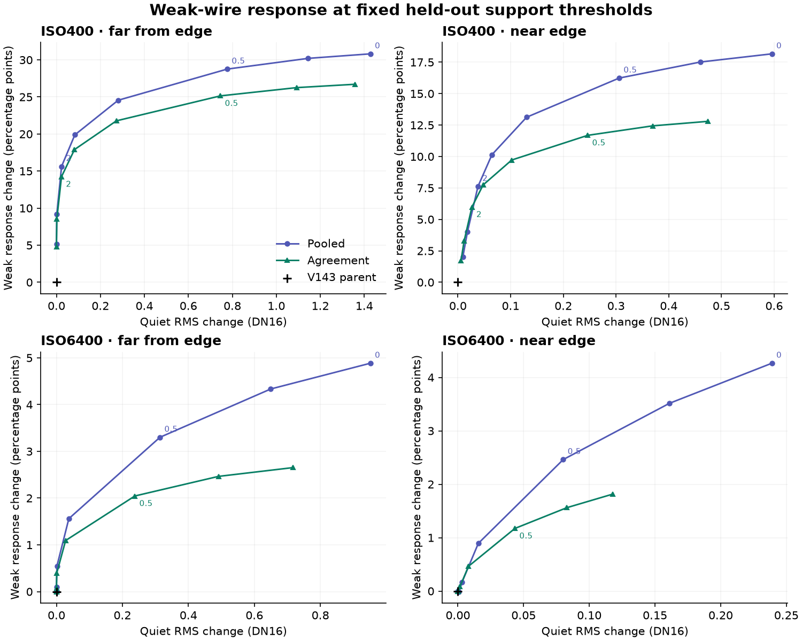
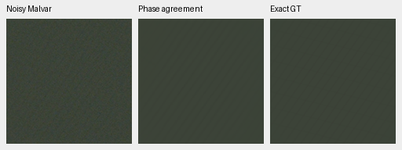
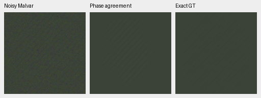

# Agreement between fitted RAW phase profiles

Weighting the pooled correction by agreement between the two phase fits
reduces weak-wire recovery at the tightest quiet-error budget. At ISO400
far from the edge it drops from **16.89% to 15.60%**, with nearly equal
quiet error and higher weak-increment error. The standing sky matches V120.
The small building correction falls from **0.421 to 0.166 DN16 RMS**.
The fine cab crossings remain unresolved.
[Full evidence](results/phase-agreement-v1/publication.json).

## What changes

The [pooled gate](fold-support-pooling.md) requires both RAW folds to
support a correction. Each can still estimate a different phase or
waveform. This experiment compares their two fitted periodic profiles
with a cosine over the interpolated phase cycle. The cosine retains
its sign, so profiles that disagree in phase or polarity get a smaller
delivery weight. Each direction and CFA color has its own weight.

The weighted arm multiplies the existing pooled correction by the positive
part of that cosine. A zero-norm profile gets weight zero. The two-fold
predictive gates, fits, frequencies, noise conditioning, eight knots, and
parent projection are shared. Both profiles already enter the predictive
test, so the cosine measures empirical agreement on the existing folds.
No target or parent image enters that calculation.
[Implementation](../src/demosaic/local_validated_waves.py).

Both arms use the same eight fixed thresholds, 384 retained query views,
and eight standing GFX comparisons as the prior study. Each geometry is
evaluated after calibrating the threshold and one correction scale on the
other seven. The table uses the tightest additive quiet-RMS budget of
0.02 DN16 on the calibration geometries. The achieved held-out quiet cost
is reported alongside recovery. All geometries remain in the reconstruction
scores. For the separate diagnosis of signed profile agreement, a guide must
be within one native query-frequency bin of the true direction.

## Held-out quiet-error comparison

Each value averages the eight held-out geometries. The quiet and increment
RMS of each geometry pool its four Bayer layouts in squared-error units.
Quiet cost is the excess over the V143 parent. The same 0.02 DN16 allowance
is used in calibration for each arm. The budget leaves room for variations
in the achieved error on the held-out geometries.

| Noise and edge | Delivery | Weak response | Strong response | Excess quiet RMS DN16 | Weak-increment RMS DN16 |
| --- | --- | ---: | ---: | ---: | ---: |
| ISO400 far | Pooled | 16.894% | 58.699% | 0.02306 | 10.02219 |
| ISO400 far | Phase agreement | 15.601% | 58.062% | 0.02281 | 10.02762 |
| ISO400 near | Pooled | 9.467% | 29.667% | 0.02651 | 13.02159 |
| ISO400 near | Phase agreement | 8.872% | 30.655% | 0.02649 | 13.02519 |
| ISO6400 far | Pooled | 2.221% | 16.209% | 0.02109 | 22.46424 |
| ISO6400 far | Phase agreement | 2.010% | 16.138% | 0.02157 | 22.46881 |
| ISO6400 near | Pooled | 3.881% | 7.362% | 0.02349 | 30.82628 |
| ISO6400 near | Phase agreement | 3.488% | 8.514% | 0.02210 | 30.83571 |

All 12 combinations of noise, distance, and quiet budget have lower mean
weak response with the weight. At the tightest budget, the weight does
help the stronger direction in the near-edge cases, and full query RMS
falls slightly there. It does not address weak-direction recovery. The
decrease at higher budgets can coincide with a different achieved quiet
cost, especially at ISO6400 near the edge. The separate target-assisted
curves in the summary compare both arms under the same cap per geometry.
[All paired scores and phase diagnostics](results/phase-agreement-v1/summary.json).

## When the two profiles agree

For each noise and placement cell, the weak-direction diagnostic uses
84 color-specific fits with the true wire present and 168 with it absent.
These are repeated views and CFA colors from seven correctly guided
geometries. The two outlying weak guides, ISO400 source 3 and ISO6400
source 4, miss by 15.19 and 12.61 native query bins. The main reconstruction
scores include them.

| Noise and edge | Median agreement, absent | Median agreement, present | Positive agreement, absent / present |
| --- | ---: | ---: | ---: |
| ISO400 far | −0.011 | 0.632 | 48.8% / 90.5% |
| ISO400 near | −0.072 | 0.395 | 46.4% / 75.0% |
| ISO6400 far | 0.054 | 0.022 | 53.6% / 53.6% |
| ISO6400 near | −0.029 | 0.080 | 45.8% / 54.8% |

At ISO6400 far, even the correctly guided weak fits have the same positive
agreement rate with and without the wire. Strong far-wire fits in the same
noise profile separate better, with 57.3% positive agreement when absent
and 81.8% when present. An agreement weight can preserve an already
measurable direction, while damping faint signal along with false fits.
[Signed phase diagnostics](results/phase-agreement-v1/summary.json).

## Native comparisons

Both triplets show noisy Malvar, the phase-agreement arm at threshold 2,
and exact constructed GT. They use ISO400 far queries from sources 0 and 1,
RGGB draw 1, two-direction role, original ROI `[176,176,160,160]`, exposure 2,
the same WB and display transform, and ADC16 black fraction 0.03. The
synthetic parent is V143 EMA
`96d146d017c54196288c585f8b7eddcf030e8a235061049c31e985b9380b7ce4`.
ISO400 shot/read coefficients are `8e-5/2.56e-8`. ISO6400 uses
`0.00128/6.5536e-6`.

The real parent is V120 EMA
`a9d9b6b4f974e24a6b11e5e740aab32314233a7f53c056cf37c7d2aac1c589fb`.
The standing DSCF3879/3880 scene uses exposure 4, and the DSCF3842/3835
cab comparisons use exposure 16 with both established noise profiles.
The building receives a smaller correction, with little visible change
to foliage or coarse fence detail. On the cab, the independently fitted
profiles have strongly positive agreement for both guide directions,
while the resulting crossings stay weak and incomplete. The separate
ISO100 AHD and camera JPEG are qualitative references with changed
aperture, exposure and subject positions. The ISO6400 JPEG shows the
camera rendering of the input capture.
[Sky](images/phase-agreement-v1/main-overcast-sky.png) ·
[Building](images/phase-agreement-v1/main-building-detail.png) ·
[Foliage](images/phase-agreement-v1/main-foliage.png) ·
[Coarse fence](images/phase-agreement-v1/main-chain-link-fence.png) ·
[Cab left](images/phase-agreement-v1/mesh-nominal-left.png) ·
[Cab right](images/phase-agreement-v1/mesh-nominal-right.png) ·
[Transferred profile left](images/phase-agreement-v1/mesh-profile3879-left.png) ·
[Transferred profile right](images/phase-agreement-v1/mesh-profile3879-right.png).

The two-thread CPU collector took 361.22 seconds. All 392 recomputed
pooled threshold-2 controls match their retained predictions exactly.
The report contains 2,048 fixed-threshold rows and verifies the 96
adopted pooled calibration rows exactly. The independent audit reports
1,152 direct-pixel reductions, 72 exact retained camera cells, and two
exact synthetic triplet subsets. All ten comparison boards were opened.
[Native provenance and viewing](images/phase-agreement-v1/manifest.json) ·
[Independent audit](results/phase-agreement-v1/independent-audit.json) ·
[Real camera-RGB corrections relative to V120](results/phase-agreement-v1/native-parent-deltas.json).
