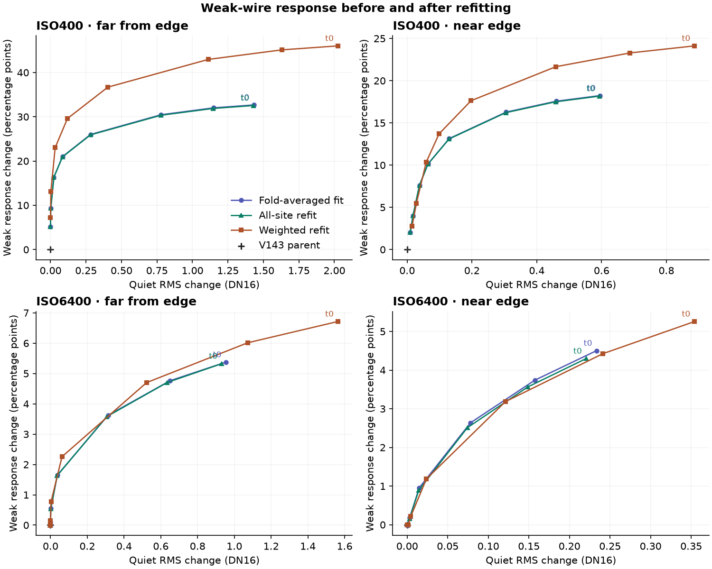
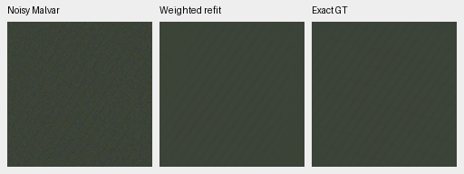
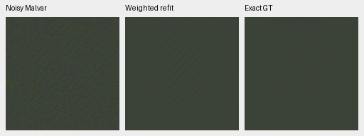

# Refit the RAW correction after held-out validation

Giving more weight to sites supported by both folds improves
lower-noise weak-wire recovery. At the tight quiet budget, ISO400
far response rises from **17.54% to 21.07%** with lower increment
error and slightly higher quiet RMS. A separate check gives **19.16%**
at the same measured quiet RMS as the original fit. Uniform all-site
refitting changes little. The ISO6400 results are mixed and the real
cab crossings remain unresolved.
[Executed sources, audits, and native evidence](results/phase-refit-delivery-v1/publication.json).

## What changes in the delivered correction

The [full eight-knot phase fit](donor-phase-support.md) was better
at recovering weak wires than the reduced waveform bases. This
experiment keeps its admission decision and tests how to estimate
the correction once that decision has been made.

- **Fold-averaged fit.** Each discovery fold fits the native RAW
  and projects the parent with the same linear operator. The
  difference supplies its correction. The existing delivery
  averages the two fold corrections after reliability shrinkage.
- **All-site refit.** After validation, refit each of the two fixed
  designs on every measured query site of the corresponding Bayer
  color. Each row has inverse noise variance from that design's
  discovery fold. Use the same operator for the RAW and parent
  projection. Average the two results with their original shrinkage.
- **Weighted refit.** Multiply that inverse variance by a second
  factor based on the pooled support for the direction being delivered.
  Its value is 0.25 plus 0.75 times the existing support weight at
  threshold 1. The floor retains all measurements. The selected
  direction's weighted refit also includes the nuisance and competing
  direction, which are fitted together.

All three arms use the corrected donor frequencies, the same split,
nuisance designs, eight-knot basis, discovery reliability, 129×129
square support and final correction weights. The threshold-1 weighting
in the third arm is fixed across the output threshold sweep. All-site
estimators read both folds only after the scores are fixed. Their
delivered images depend on those measurements and the parent.
[Implementation](../src/demosaic/local_validated_waves.py).

The comparison adopts 384 synthetic views across eight geometries,
four CFAs, near and far placements, two noise profiles and three
paired roles. It evaluates eight thresholds. The held-out budget
comparison selects threshold and correction scale on seven
geometries, then measures response and actual quiet and increment error
on the eighth. The eight GFX cases use fixed threshold 2. The weak-absent
role measures the absolute projected response at the missing wire.

## Held-out quiet-budget results

The tight budget allows 0.02 DN16 of added quiet RMS over V143 on
the seven calibration geometries. The table averages the eight
held-out geometries, with RMS pooled in squared-error units across
their four CFA layouts. Weak response projects the delivered weak
increment on the exact target increment.

| Noise and edge | Delivery | Weak response | Quiet RMS DN16 | Weak-increment RMS DN16 |
| --- | --- | ---: | ---: | ---: |
| ISO400 far | Fold average | 17.536% | 2.51694 | 10.02081 |
| ISO400 far | All-site refit | 17.503% | 2.51695 | 10.02092 |
| ISO400 far | Weighted refit | 21.073% | 2.52216 | 10.00349 |
| ISO400 near | Fold average | 9.481% | 6.11456 | 13.02156 |
| ISO400 near | All-site refit | 9.472% | 6.11457 | 13.02161 |
| ISO400 near | Weighted refit | 9.931% | 6.11463 | 13.01854 |
| ISO6400 far | Fold average | 2.294% | 6.74949 | 22.46433 |
| ISO6400 far | All-site refit | 2.301% | 6.74954 | 22.46498 |
| ISO6400 far | Weighted refit | 2.361% | 6.74945 | 22.46263 |
| ISO6400 near | Fold average | 3.973% | 22.92022 | 30.82640 |
| ISO6400 near | All-site refit | 3.946% | 22.92005 | 30.82679 |
| ISO6400 near | Weighted refit | 3.895% | 22.91822 | 30.82979 |

At ISO400 far, all eight geometries improve weak response and
increment error after calibration. The absolute weak-absent
projection averages 0.1496% for the fold average and 0.1493% for
the weighted refit. At threshold 2 the weighted fit raises response
from 18.09% to 24.78%, lowers increment RMS from 10.0210 to 10.0007
DN16, and raises quiet RMS from 2.5173 to 2.5265 DN16.

An additional common multiplier of 0.90078 on the already calibrated
weighted corrections gives exactly the fold average's measured mean
quiet RMS. Response rises from 17.54% to 19.16%, and weak increment
RMS falls from 10.02081 to 10.00816 DN16. The absolute weak-absent
projection is 0.1498%. All eight geometries still improve response
and increment error. This descriptive scale uses the held-out
quiet targets. The leave-one-geometry-out table above is the
calibrated comparison.
[Measured quiet diagnostic](results/phase-refit-delivery-v1/actual-quiet-diagnostic.json).

The weighted ISO400 near fit gains a little response and lowers
increment error at the tight budget, with more weak-absent projection
from 0.799% to 0.818%. The ISO6400 near fit loses weak response and
increases increment error at that budget. At looser ISO6400 budgets,
any extra response frequently comes with higher error. The lower-noise
gain is on retained development geometries. Independent scenes and
fresh sensor-noise draws remain open.
[Paired summaries and all eight thresholds](results/phase-refit-delivery-v1/summary.json).

## Native comparisons

Triplets show noisy Malvar, the weighted refit at threshold 2, and
exact constructed GT. Every cell is 160×160 original pixels.
Geometries 0 and 1 use the far two-wire role, RGGB draw 1, parent
ROI `[176,176,160,160]`, display exposure 2 and the same white
balance, matrix and clipped-sRGB transform. ADC16 black fraction is
0.03, and shot/read conditioning is `8e-5/2.56e-8` at ISO400 and
`0.00128/6.5536e-6` at ISO6400. The V143 EMA parent hash is
`96d146d017c54196288c585f8b7eddcf030e8a235061049c31e985b9380b7ce4`.

Both standing GFX series use V120 EMA, SHA256
`a9d9b6b4f974e24a6b11e5e740aab32314233a7f53c056cf37c7d2aac1c589fb`.
Main DSCF3879/3880 crops use exposure 4. The cab DSCF3842/3835
crops use exposure 16 with both recorded noise profiles. The ISO100
AHD and camera JPEGs are qualitative references from a separate
exposure with different aperture and subject motion.

The weighted fit strengthens some faint ISO400 diagonals, with
clearer intersections in the exact targets. The ISO6400 examples
look nearly flat. The overcast sky matches V120 in linear RGB and
display pixels. Building and foliage remain soft. The weighted coarse
fence differs from the fold average by 5.63 DN16 RMS, with visible
crossings in both and a slight contrast change. On the left cab crop,
the weighted fit strengthens residual diagonals. New fine crossings
remain unconvincing under either conditioning profile.
[ISO400 full comparison](images/phase-refit-delivery-v1/iso400-index0009-comparison.png) ·
[ISO6400 full comparison](images/phase-refit-delivery-v1/iso6400-index0009-comparison.png) ·
[Sky](images/phase-refit-delivery-v1/main-overcast-sky.png) ·
[Building](images/phase-refit-delivery-v1/main-building-detail.png) ·
[Foliage](images/phase-refit-delivery-v1/main-foliage.png) ·
[Coarse fence](images/phase-refit-delivery-v1/main-chain-link-fence.png) ·
[Cab left](images/phase-refit-delivery-v1/mesh-nominal-left.png) ·
[Cab right](images/phase-refit-delivery-v1/mesh-nominal-right.png) ·
[Transferred profile left](images/phase-refit-delivery-v1/mesh-profile3879-left.png) ·
[Transferred profile right](images/phase-refit-delivery-v1/mesh-profile3879-right.png).

Collection took 329.24 seconds on two CPU threads. All 392 threshold-2
controls and saved fold diagnostics are bit exact. The numerical audit
reproduces 1,728 saved-image reductions and 80 retained camera cells.
The separate refit audit independently reconstructs 192 outputs
across 32 views, two refits and three thresholds. Pixels with every
direction gate closed are bit exact to the parent in that replay.
All twelve full comparison boards were opened.
[Image audit](results/phase-refit-delivery-v1/independent-audit.json) ·
[Refit audit](results/phase-refit-delivery-v1/refit-audit.json) ·
[Native crop and viewing manifest](images/phase-refit-delivery-v1/manifest.json).
