# Phase-aware wave readout: completed quality

V184 adds a useful stronger-response architecture above frozen V183 EMA, with
new quiet-field artifacts. Mean constructed-mesh response rises **9.596% raw /
15.963% EMA versus V183 EMA**, reaching **4.86497% / 5.14762% of exact
constructed GT amplitude**. Responses increase on163/256 raw and160/256 EMA
inputs. Present-image full RMS falls0.650% / 0.938%, improving210/256 raw and
194/256 EMA inputs. The raw endpoint has the smaller quiet-field cost; EMA
provides the stronger mean response. Keep the direct phase-aware readout as a
detail-development option beside V183's intermediate response, V181's quieter
output and V180's earlier local architecture. V120 Small remains the general
photo/camera recommendation. The joint fine-fence/clean-sky goal remains open.

**Both primary comparisons use V183 EMA**, the actual frozen initializer.
These are additional head updates above a completed model, not same-total-budget
loss-only retraining. Extra training,316 new parameters and freezing change
together. The architecture supplies a separate learned wave path; it does not
isolate which of those changes causes the measured gains.

Quiet spatial RMS rises **0.936% / 0.765% raw and2.346% / 1.807% EMA** at
ISO6400/12800 versus V183 EMA. Spatial error worsens28/32 raw and29/32 EMA
inputs. Quiet total RMS rises **0.836% / 0.575% raw and1.855% / 1.386% EMA**,
worsening28/32 raw and30/32 EMA. Quiet DC RMS changes+0.200% / −0.108% raw
and+0.169% / −0.138% EMA; lower higher-noise DC error coexists with worse
spatial error. Stronger wave response is not a guarantee against false structure.

Present-mesh blank RMS falls **0.0341% raw / 0.0178% EMA**, improving223/256
and204/256 inputs. Blank spatial RMS falls0.0368% / 0.0194%. Absent full RMS
falls0.0139% / 0.0072%, improving217/256 raw and182/256 EMA inputs; absent
spatial RMS falls0.0151% / 0.0079%. Signed absent-template gains are near zero,
0.000001316 raw / 0.000004490 EMA. No relative percentage is assigned to that
near-zero quantity. These small blank-cohort improvements do not override
the measured and visible cost in quiet fields beside structure.

Standalone512 full-flat RMS falls **0.0094% / 0.0086% raw and0.0060% /
0.0037% EMA** versus V183 EMA. Full-flat means improve40/48 raw and37/48 EMA
inputs. Spatial RMS falls0.0100% / 0.0091% raw and0.0064% / 0.0040% EMA.
Coarse32 RMS rises0.00012% / 0.00050% raw and0.00012% / 0.00044% EMA.
Broad flat error remains; the tiny full-flat changes do not establish flat safety.

Natural photographic results are mixed. Across retained faint/dark and organic
faint/dark cohorts, raw fine-band response changes **+0.2018%, +0.0786%,
−0.0062% and+0.0153%** versus V183 EMA;60/128 inputs increase. EMA response
rises **0.3756%, 0.2147%, 0.0226% and0.0342%**, with83/128 inputs increasing.
Relative band-error means worsen in all four cohorts: **+0.0150%, +0.0158%,
+0.0010% and+0.0046% raw; +0.0267%, +0.0297%, +0.0013% and+0.0070% EMA**.
Eighty-two of128 inputs worsen in relative band error at each endpoint. A
larger band projection is not broad photographic fidelity improvement.

Against V180 EMA, mean mesh response rises **6.959% raw / 13.174% EMA**, but
only84/256 raw and93/256 EMA inputs increase. Quiet spatial RMS rises0.440% /
0.675% raw and1.843% / 1.716% EMA; quiet total rises0.405% / 0.584% raw and
1.419% / 1.394% EMA. Against V181 EMA, mesh response rises17.216% / 24.026%,
with230/256 raw and229/256 EMA increases, at1.15–3.03% higher quiet spatial
RMS. Against V172 EMA, mesh response rises25.477% / 32.767%, though only100/256
and103/256 inputs increase; quiet spatial RMS rises1.551% / 1.440% raw and
2.970% / 2.489% EMA. None of these means establishes uniform detail recovery.

EMA approaches the stronger learned V161 response: mean mesh amplitude is
1.760% lower, while quiet total RMS is10.703% / 9.178% lower, improving31/32
inputs. Raw has7.154% less mesh response than V161 EMA with11.596% / 9.904%
lower quiet total RMS, also improving31/32 inputs. This is a useful architectural
tradeoff. Keep V161's stronger response visible, together with V173's quiet
spatial reduction, V171's standalone-flat strength and V175 raw's modest
quiet-total gain.

All **60 actual native figures in15 original-detail sheets** were inspected,
including12 unresized noisy/restored/exact constructed-GT triplets. Mesh2302
remains nearly uniform at normal contrast. Contrast40 reveals clearly stronger
fine periodic modulation in V184 raw/EMA than V183, under persistent broad
colored error. A complete lattice still does not emerge. Mesh2309 keeps the
strong orientation, with the weaker crossing missing. Fine cab nominal and
profile3879 windows show small strand-contrast/modulation changes but remain
soft and incomplete; no clearly complete new crossings emerge beside the
independent ISO100/AHD/JPEG references. Main coarse fence strands survive.
Building edges, foliage, bird feathers, butterfly pattern and bark remain soft.

The main sky looks smooth at ordinary exposure4. Noisy gray/color flats retain
broad green/purple mottle at contrast40; ordinary gray/bright fields are nearly
smooth. Quiet ROIs beside vertical/slanted steps, narrow bars and stripe patches
show **extra regular fine striping/modulation**, especially V184 EMA, over the
broad colored field. Faint added banding or diagonal modulation can also be
seen in some normal-contrast dark fields. Boundaries survive, but these false
quiet structures directly qualify the response gain. ADC bark/fur and all four
ADC planes retain the exact inherited output. Zero-noise identities do not
establish noisy-sky safety.

Both protected GFX families remain in the report: DSCF3879 ISO6400 / independent
DSCF3880 ISO100 f/5.6 for sky, building, foliage and coarse fence; DSCF3842 ISO6400
/ independent DSCF3835 ISO100 f/5.6 and both camera JPEGs for the fine cab mesh.
**ISO100/AHD/JPEG references are qualitative, not exact GT**: aperture, exposure
time, processing and moving subjects differ. No real-reference pixelwise score
is used. Captures, JPEGs and siblings remain excluded from training. Originals
and unavailable `/mnt/dataz` remain untouched; only cached inputs and parents
are used, without new source/noise, parent/DINO inference or RAW decode.

Mesh triplets retain source cases mesh2302/mesh2309, native ROI
`[176,176,160,160]` in512px RGGB contexts, exposure8/contrast1, shot .00128 and
read variance6.5536e−6. Quiet triplets retain ROI `[80,176,160,160]`, exposure8/
contrast40 about camera RGB `[.001500000013,.006000000052,.002666666871]`, with
shot/read variance .00128/6.5536e−6 or .00256/2.62144e−5. Fine cab crops retain
context `[600,6260,768,768]`, ROIs `[206,229,160,160]` / `[426,189,160,160]`,
exposure16. All methods share identical coordinates and transforms; crop pixels
are never resized. Final training checkpoint SHA256 is
`b99b2c72f0db0026cdbe9d8f1709e4fffd40b4412e1d9b5280874cb5b6e03576`.
The two strict exports bind this checkpoint, source/class/config, raw/EMA state
and module hashes. All ten older viewer states retain separate metadata.

The model adds316 shared phase-aware readout parameters to frozen V183 EMA.
The same local RAW coefficients feed a6→16→12 pointwise contextual MLP, complex
mixing and explicit native subpixel phase transport. All189 inherited tensors
remain exact and in evaluation mode. The final204 readout weights/biases start
at zero;112 hidden parameters have a fixed local seed. New readout Adam/EMA
starts at0. One run adds900 updates/3,600 noisy images across1,000 cached rows
with100 ADC skips. All nine V183 losses, actual clean mask, domain weights and
cached data stay unchanged. Head LR.001 follows the same warmup/cosine schedule
and clipping1. The inherited network/adapter remain at1,800/900 historical
updates. Genuine row8 restoration resumes at9 without prefix replay. The
two admission probes never initialize this trial.

Independent training audit verifies all900 nine-term FP32 totals, input/mask/LR/
EMA bindings and five strict raw/EMA/Adam/frozen/RNG checkpoints, with1,890
inherited-tensor comparisons and final head Adam900. Training peak CUDA allocation
is6,682,433,024bytes, about6.22GiB. Independent quality audit verifies6,576 input
fingerprints,1,644 exact V183 EMA replays plus1,644 exact V169 replays,72 native
RGB and72 wave arrays,53,772,288 ordered addition channels,582 native metric
scalars,72 wave-RMS scalars,278Decimal means and750 exact input-only raw/EMA
evidence pairs. The new output is inherited V183 RGB plus the added wave;
regrouping the older V169 correction would change FP32 rounding. Local feature
geometry/powers are checked, without independent spectrum/confidence calibration.

All21 methods/17,262 metric rows, two frozen-V183 primary contrasts and36
contextual contrasts retain1,386 table cells,2,869 independent Decimal means and
13,896 paired checks. The marked all-EMA structural fixture has15,336 paired
checks because reused old correction-RMS fields are shared there; actual new
wave RMS is a different quantity and is not compared with whole older residual
RMS. Actual scientific losses, tolerances and core metrics are unchanged.
The first comparison tests caught two stale raw-role test labels;12 checks
passed and2 failed, with source/log preserved. Correcting only the labels and
adding a both-endpoints-use-V183-EMA check gives15 passes. The first reducer
source/fixture remain preserved; v2 changes two human-facing titles and seal
filename only, with all numerical bodies exact. No scientific work is repeated.

The reused development suite provides no blind or seed-uncertainty estimate.
The useful result is a stronger-response direct signal path with a raw/EMA
tradeoff, accompanied by visible extra quiet-field striping. Real missing
crossings and broad mottling keep the original goal unfulfilled.

The first publication command stopped at its local-space guard before creating
exports or public outputs; its failure log remains preserved. A separate
[completed-render storage receipt](results/v184-completed-render-copy-storage-v1.json)
records full-hash consolidation of1,416 explicit original/public PNG-copy pairs
from21 completed publications, with69 launch owners checked terminal. Every
path and PNG byte remains intact. Previous duplicate allocation is345.203MiB;
observed local free space then reaches48.708847GiB. No neural source, checkpoint,
training input, original or scientific result is altered, and no training,
review, audit, reduction or rendering is replayed. Public V184 receipt/PNG paths
share their closed private artifacts to avoid further duplicate storage.

[Exact evidence](results/v184-wave-readout-final-v1.json) · [Native-pixel viewer](images/v184-wave-readout-v1/native-viewer.html).

# Phase-aware readout and retained flat/local/global/control comparison tables

RMS values are camera-RGB DN16. Signed gain 1 is exact constructed amplitude. Real ISO100 references are unscored. This reused development suite is not blind validation.

## New readout and retained local/global/control

### Mesh response and blank error

| Metric | V178-control-raw | V178-control-EMA | V178-evidence-raw | V178-evidence-EMA | V180-local-phase-raw | V180-local-phase-EMA | V181-flat-spatial-raw | V181-flat-spatial-EMA | V183-coherent-pair-raw | V183-coherent-pair-EMA | V184-wave-readout-raw | V184-wave-readout-EMA |
| --- | ---: | ---: | ---: | ---: | ---: | ---: | ---: | ---: | ---: | ---: | ---: | ---: |
| Present full RMS | 8.954916 | 8.957374 | 8.950154 | 8.953061 | 8.876450 | 8.877083 | 8.906324 | 8.907939 | 8.876014 | 8.876582 | 8.818888 | 8.793299 |
| Present signed template gain | 0.03888490 | 0.03887981 | 0.03924275 | 0.03923549 | 0.04521940 | 0.04548425 | 0.04143345 | 0.04150431 | 0.04422806 | 0.04439006 | 0.04864969 | 0.05147617 |
| Present blank RMS | 5.610388 | 5.613564 | 5.610671 | 5.614318 | 5.616159 | 5.620176 | 5.604892 | 5.607879 | 5.609462 | 5.612432 | 5.610517 | 5.611432 |
| Present blank spatial RMS | 5.428461 | 5.428190 | 5.429207 | 5.429165 | 5.435846 | 5.437361 | 5.421840 | 5.421916 | 5.426760 | 5.427226 | 5.425229 | 5.426176 |
| Present blank DC RMS | 1.302865 | 1.315066 | 1.301321 | 1.314366 | 1.297771 | 1.306773 | 1.305530 | 1.315772 | 1.304924 | 1.313785 | 1.313856 | 1.313838 |
| Absent full RMS | 5.308835 | 5.311586 | 5.308666 | 5.311814 | 5.310667 | 5.314059 | 5.303987 | 5.306787 | 5.306048 | 5.308645 | 5.307907 | 5.308263 |
| Absent signed template gain | 0.00001722 | 0.00001355 | 0.00001755 | 0.00001511 | 0.00008047 | 0.00009106 | -0.00002453 | -0.00002356 | 0.00001412 | 0.00001744 | 0.00000132 | 0.00000449 |
| Absent blank RMS | 5.308835 | 5.311586 | 5.308666 | 5.311814 | 5.310667 | 5.314059 | 5.303987 | 5.306787 | 5.306048 | 5.308645 | 5.307907 | 5.308263 |
| Absent blank spatial RMS | 5.166172 | 5.165967 | 5.166425 | 5.166424 | 5.169570 | 5.170659 | 5.160459 | 5.160529 | 5.162771 | 5.163024 | 5.162245 | 5.162616 |
| Absent blank DC RMS | 1.128316 | 1.139692 | 1.126611 | 1.138905 | 1.121278 | 1.130202 | 1.131491 | 1.142331 | 1.130450 | 1.139720 | 1.139799 | 1.139778 |

### Quiet fields beside detail

| Metric | V178-control-raw | V178-control-EMA | V178-evidence-raw | V178-evidence-EMA | V180-local-phase-raw | V180-local-phase-EMA | V181-flat-spatial-raw | V181-flat-spatial-EMA | V183-coherent-pair-raw | V183-coherent-pair-EMA | V184-wave-readout-raw | V184-wave-readout-EMA |
| --- | ---: | ---: | ---: | ---: | ---: | ---: | ---: | ---: | ---: | ---: | ---: | ---: |
| iso6400-prior whole RMS | 26.807064 | 26.802756 | 26.805698 | 26.801574 | 26.783953 | 26.770305 | 26.746588 | 26.742613 | 26.732431 | 26.727564 | 27.183310 | 26.954659 |
| iso6400-prior quiet RMS | 4.036107 | 4.031506 | 4.034977 | 4.029954 | 4.067919 | 4.063950 | 4.031306 | 4.024922 | 4.051807 | 4.046584 | 4.080410 | 4.121629 |
| iso6400-prior quiet spatial RMS | 3.442433 | 3.441227 | 3.443856 | 3.443032 | 3.478830 | 3.479326 | 3.440358 | 3.439251 | 3.461858 | 3.462220 | 3.494628 | 3.543452 |
| iso6400-prior quiet DC RMS | 1.992752 | 1.988387 | 1.988485 | 1.983280 | 1.994619 | 1.988680 | 1.989691 | 1.982039 | 1.992888 | 1.984961 | 1.988934 | 1.988311 |
| iso12800-prior whole RMS | 35.438505 | 35.433998 | 35.432874 | 35.427920 | 35.277377 | 35.253643 | 35.325202 | 35.317787 | 35.247833 | 35.237946 | 35.319896 | 35.151283 |
| iso12800-prior quiet RMS | 6.297270 | 6.292864 | 6.297440 | 6.292439 | 6.328901 | 6.324568 | 6.309551 | 6.302588 | 6.331010 | 6.325115 | 6.361515 | 6.412757 |
| iso12800-prior quiet spatial RMS | 5.556405 | 5.555426 | 5.557017 | 5.556344 | 5.599142 | 5.600006 | 5.575015 | 5.573477 | 5.595272 | 5.594999 | 5.637800 | 5.696091 |
| iso12800-prior quiet DC RMS | 2.777805 | 2.774289 | 2.778281 | 2.773895 | 2.772617 | 2.766157 | 2.773563 | 2.768331 | 2.779599 | 2.773697 | 2.770699 | 2.769863 |

### Standalone 512-pixel flats

| Metric | V178-control-raw | V178-control-EMA | V178-evidence-raw | V178-evidence-EMA | V180-local-phase-raw | V180-local-phase-EMA | V181-flat-spatial-raw | V181-flat-spatial-EMA | V183-coherent-pair-raw | V183-coherent-pair-EMA | V184-wave-readout-raw | V184-wave-readout-EMA |
| --- | ---: | ---: | ---: | ---: | ---: | ---: | ---: | ---: | ---: | ---: | ---: | ---: |
| iso6400-prior full RMS | 18.631764 | 18.629767 | 18.632121 | 18.629596 | 18.624531 | 18.624026 | 18.607935 | 18.609537 | 18.611860 | 18.611952 | 18.610199 | 18.610832 |
| iso6400-prior spatial RMS | 18.303915 | 18.303283 | 18.302926 | 18.302710 | 18.306471 | 18.306564 | 18.272367 | 18.271228 | 18.281757 | 18.280332 | 18.278512 | 18.279165 |
| iso6400-prior coarse32 RMS | 13.431766 | 13.432282 | 13.432070 | 13.432578 | 13.433240 | 13.433568 | 13.433259 | 13.433500 | 13.433497 | 13.433758 | 13.433774 | 13.433775 |
| iso12800-prior full RMS | 24.202722 | 24.199457 | 24.205429 | 24.202115 | 24.206583 | 24.202340 | 24.174201 | 24.175828 | 24.183025 | 24.181174 | 24.179083 | 24.180272 |
| iso12800-prior spatial RMS | 23.741963 | 23.740972 | 23.740806 | 23.740427 | 23.749890 | 23.750376 | 23.706304 | 23.704605 | 23.718775 | 23.716694 | 23.714528 | 23.715747 |
| iso12800-prior coarse32 RMS | 17.915130 | 17.915920 | 17.915587 | 17.916187 | 17.915837 | 17.914310 | 17.922998 | 17.922111 | 17.923288 | 17.921780 | 17.921870 | 17.921858 |

### Natural photographic detail

| Metric | V178-control-raw | V178-control-EMA | V178-evidence-raw | V178-evidence-EMA | V180-local-phase-raw | V180-local-phase-EMA | V181-flat-spatial-raw | V181-flat-spatial-EMA | V183-coherent-pair-raw | V183-coherent-pair-EMA | V184-wave-readout-raw | V184-wave-readout-EMA |
| --- | ---: | ---: | ---: | ---: | ---: | ---: | ---: | ---: | ---: | ---: | ---: | ---: |
| retained512/photo-faint full RMS | 33.964565 | 33.965091 | 33.964381 | 33.964993 | 33.965056 | 33.965822 | 33.967023 | 33.967698 | 33.966346 | 33.967004 | 33.972690 | 33.979277 |
| retained512/photo-faint band response | 0.298162 | 0.298158 | 0.298217 | 0.298218 | 0.298853 | 0.298969 | 0.296127 | 0.296243 | 0.296890 | 0.297015 | 0.297615 | 0.298131 |
| retained512/photo-faint band error | 0.824616 | 0.824613 | 0.824628 | 0.824625 | 0.824678 | 0.824669 | 0.824773 | 0.824771 | 0.824731 | 0.824729 | 0.824852 | 0.824948 |
| retained512/photo-dark full RMS | 29.094201 | 29.094373 | 29.094067 | 29.094435 | 29.097274 | 29.097995 | 29.095585 | 29.096066 | 29.096498 | 29.097180 | 29.102365 | 29.111425 |
| retained512/photo-dark band response | 0.530784 | 0.530763 | 0.530842 | 0.530826 | 0.531147 | 0.531274 | 0.527270 | 0.527464 | 0.528097 | 0.528282 | 0.528698 | 0.529417 |
| retained512/photo-dark band error | 0.661241 | 0.661240 | 0.661242 | 0.661241 | 0.661293 | 0.661292 | 0.661350 | 0.661347 | 0.661335 | 0.661334 | 0.661439 | 0.661531 |
| organic384/photo-faint full RMS | 37.480380 | 37.481906 | 37.480903 | 37.482130 | 37.481665 | 37.482521 | 37.494874 | 37.496490 | 37.491161 | 37.492516 | 37.492637 | 37.492709 |
| organic384/photo-faint band response | 0.149424 | 0.149428 | 0.149414 | 0.149424 | 0.149544 | 0.149626 | 0.147867 | 0.147920 | 0.148326 | 0.148382 | 0.148373 | 0.148416 |
| organic384/photo-faint band error | 0.924915 | 0.924907 | 0.924921 | 0.924914 | 0.924930 | 0.924906 | 0.925232 | 0.925227 | 0.925151 | 0.925143 | 0.925152 | 0.925154 |
| organic384/photo-dark full RMS | 33.685298 | 33.685606 | 33.685377 | 33.685832 | 33.687261 | 33.687290 | 33.691034 | 33.691601 | 33.690263 | 33.690724 | 33.691298 | 33.691748 |
| organic384/photo-dark band response | 0.397869 | 0.397863 | 0.397874 | 0.397876 | 0.397806 | 0.397910 | 0.394844 | 0.394988 | 0.395447 | 0.395580 | 0.395640 | 0.395715 |
| organic384/photo-dark band error | 0.781673 | 0.781672 | 0.781676 | 0.781676 | 0.781730 | 0.781733 | 0.781703 | 0.781707 | 0.781723 | 0.781728 | 0.781764 | 0.781782 |

### ADC controls

| Metric | V178-control-raw | V178-control-EMA | V178-evidence-raw | V178-evidence-EMA | V180-local-phase-raw | V180-local-phase-EMA | V181-flat-spatial-raw | V181-flat-spatial-EMA | V183-coherent-pair-raw | V183-coherent-pair-EMA | V184-wave-readout-raw | V184-wave-readout-EMA |
| --- | ---: | ---: | ---: | ---: | ---: | ---: | ---: | ---: | ---: | ---: | ---: | ---: |
| Photo full RMS | 18.142182 | 18.142182 | 18.142182 | 18.142182 | 18.142182 | 18.142182 | 18.142182 | 18.142182 | 18.142182 | 18.142182 | 18.142182 | 18.142182 |
| Photo band error | 0.101800 | 0.101800 | 0.101800 | 0.101800 | 0.101800 | 0.101800 | 0.101800 | 0.101800 | 0.101800 | 0.101800 | 0.101800 | 0.101800 |
| fresh-flat512 full RMS | 3.322910 | 3.322910 | 3.322910 | 3.322910 | 3.322910 | 3.322910 | 3.322910 | 3.322910 | 3.322910 | 3.322910 | 3.322910 | 3.322910 |
| fresh-flat512 coarse32 RMS | 0.538587 | 0.538587 | 0.538587 | 0.538587 | 0.538587 | 0.538587 | 0.538587 | 0.538587 | 0.538587 | 0.538587 | 0.538587 | 0.538587 |
| adc-sloped512 full RMS | 3.776943 | 3.776943 | 3.776943 | 3.776943 | 3.776943 | 3.776943 | 3.776943 | 3.776943 | 3.776943 | 3.776943 | 3.776943 | 3.776943 |
| adc-sloped512 coarse32 RMS | 0.573442 | 0.573442 | 0.573442 | 0.573442 | 0.573442 | 0.573442 | 0.573442 | 0.573442 | 0.573442 | 0.573442 | 0.573442 | 0.573442 |

## Earlier strengths and both endpoints

### Mesh response and blank error

| Metric | parent | V161-EMA | V169-EMA | V171-EMA | V172-EMA | V173-EMA | V174-EMA | V175-raw | V175-EMA | V178-control-raw | V178-control-EMA | V178-evidence-raw | V178-evidence-EMA | V180-local-phase-raw | V180-local-phase-EMA | V181-flat-spatial-raw | V181-flat-spatial-EMA | V183-coherent-pair-raw | V183-coherent-pair-EMA | V184-wave-readout-raw | V184-wave-readout-EMA |
| --- | ---: | ---: | ---: | ---: | ---: | ---: | ---: | ---: | ---: | ---: | ---: | ---: | ---: | ---: | ---: | ---: | ---: | ---: | ---: | ---: | ---: |
| Present full RMS | 9.111243 | 8.979201 | 8.956287 | 8.909846 | 8.955686 | 8.948849 | 8.955665 | 8.956087 | 8.949633 | 8.954916 | 8.957374 | 8.950154 | 8.953061 | 8.876450 | 8.877083 | 8.906324 | 8.907939 | 8.876014 | 8.876582 | 8.818888 | 8.793299 |
| Present signed template gain | 0.02202090 | 0.05239854 | 0.03836594 | 0.03884819 | 0.03877185 | 0.03723868 | 0.03867667 | 0.03879218 | 0.03878479 | 0.03888490 | 0.03887981 | 0.03924275 | 0.03923549 | 0.04521940 | 0.04548425 | 0.04143345 | 0.04150431 | 0.04422806 | 0.04439006 | 0.04864969 | 0.05147617 |
| Present blank RMS | 5.523323 | 5.816396 | 5.609300 | 5.544439 | 5.610812 | 5.590872 | 5.609727 | 5.610388 | 5.601944 | 5.610388 | 5.613564 | 5.610671 | 5.614318 | 5.616159 | 5.620176 | 5.604892 | 5.607879 | 5.609462 | 5.612432 | 5.610517 | 5.611432 |
| Present blank spatial RMS | 5.343113 | 5.645413 | 5.431940 | 5.361961 | 5.429880 | 5.410955 | 5.428378 | 5.421000 | 5.420632 | 5.428461 | 5.428190 | 5.429207 | 5.429165 | 5.435846 | 5.437361 | 5.421840 | 5.421916 | 5.426760 | 5.427226 | 5.425229 | 5.426176 |
| Present blank DC RMS | 1.289621 | 1.287310 | 1.289568 | 1.300170 | 1.299983 | 1.294365 | 1.300955 | 1.326118 | 1.300870 | 1.302865 | 1.315066 | 1.301321 | 1.314366 | 1.297771 | 1.306773 | 1.305530 | 1.315772 | 1.304924 | 1.313785 | 1.313856 | 1.313838 |
| Absent full RMS | 5.237910 | 5.501669 | 5.305929 | 5.248144 | 5.309113 | 5.291708 | 5.308678 | 5.311212 | 5.302362 | 5.308835 | 5.311586 | 5.308666 | 5.311814 | 5.310667 | 5.314059 | 5.303987 | 5.306787 | 5.306048 | 5.308645 | 5.307907 | 5.308263 |
| Absent signed template gain | 0.00003236 | 0.00039787 | -0.00000719 | 0.00001071 | 0.00000519 | -0.00003993 | -0.00000498 | -0.00000001 | 0.00000192 | 0.00001722 | 0.00001355 | 0.00001755 | 0.00001511 | 0.00008047 | 0.00009106 | -0.00002453 | -0.00002356 | 0.00001412 | 0.00001744 | 0.00000132 | 0.00000449 |
| Absent blank RMS | 5.237910 | 5.501669 | 5.305929 | 5.248144 | 5.309113 | 5.291708 | 5.308678 | 5.311212 | 5.302362 | 5.308835 | 5.311586 | 5.308666 | 5.311814 | 5.310667 | 5.314059 | 5.303987 | 5.306787 | 5.306048 | 5.308645 | 5.307907 | 5.308263 |
| Absent blank spatial RMS | 5.099652 | 5.367749 | 5.169538 | 5.102240 | 5.167332 | 5.151649 | 5.166379 | 5.161086 | 5.160891 | 5.166172 | 5.165967 | 5.166425 | 5.166424 | 5.169570 | 5.170659 | 5.160459 | 5.160529 | 5.162771 | 5.163024 | 5.162245 | 5.162616 |
| Absent blank DC RMS | 1.098115 | 1.111598 | 1.098120 | 1.135453 | 1.122982 | 1.113479 | 1.125281 | 1.155025 | 1.121672 | 1.128316 | 1.139692 | 1.126611 | 1.138905 | 1.121278 | 1.130202 | 1.131491 | 1.142331 | 1.130450 | 1.139720 | 1.139799 | 1.139778 |

### Quiet fields beside detail

| Metric | parent | V161-EMA | V169-EMA | V171-EMA | V172-EMA | V173-EMA | V174-EMA | V175-raw | V175-EMA | V178-control-raw | V178-control-EMA | V178-evidence-raw | V178-evidence-EMA | V180-local-phase-raw | V180-local-phase-EMA | V181-flat-spatial-raw | V181-flat-spatial-EMA | V183-coherent-pair-raw | V183-coherent-pair-EMA | V184-wave-readout-raw | V184-wave-readout-EMA |
| --- | ---: | ---: | ---: | ---: | ---: | ---: | ---: | ---: | ---: | ---: | ---: | ---: | ---: | ---: | ---: | ---: | ---: | ---: | ---: | ---: | ---: |
| iso6400-prior whole RMS | 27.105631 | 26.972453 | 26.806949 | 27.302897 | 26.801695 | 26.860185 | 26.797020 | 26.795723 | 26.796191 | 26.807064 | 26.802756 | 26.805698 | 26.801574 | 26.783953 | 26.770305 | 26.746588 | 26.742613 | 26.732431 | 26.727564 | 27.183310 | 26.954659 |
| iso6400-prior quiet RMS | 3.898845 | 4.615625 | 4.046127 | 5.289473 | 4.033561 | 4.012548 | 4.026601 | 4.028107 | 4.033524 | 4.036107 | 4.031506 | 4.034977 | 4.029954 | 4.067919 | 4.063950 | 4.031306 | 4.024922 | 4.051807 | 4.046584 | 4.080410 | 4.121629 |
| iso6400-prior quiet spatial RMS | 3.268502 | 3.772120 | 3.439626 | 3.429768 | 3.441249 | 3.417869 | 3.438372 | 3.436096 | 3.435861 | 3.442433 | 3.441227 | 3.443856 | 3.443032 | 3.478830 | 3.479326 | 3.440358 | 3.439251 | 3.461858 | 3.462220 | 3.494628 | 3.543452 |
| iso6400-prior quiet DC RMS | 2.016074 | 2.478187 | 2.018205 | 3.855646 | 1.991393 | 1.991098 | 1.982841 | 1.992262 | 2.001566 | 1.992752 | 1.988387 | 1.988485 | 1.983280 | 1.994619 | 1.988680 | 1.989691 | 1.982039 | 1.992888 | 1.984961 | 1.988934 | 1.988311 |
| iso12800-prior whole RMS | 36.747466 | 35.371842 | 35.462223 | 36.176612 | 35.435967 | 35.609092 | 35.430797 | 35.338865 | 35.348725 | 35.438505 | 35.433998 | 35.432874 | 35.427920 | 35.277377 | 35.253643 | 35.325202 | 35.317787 | 35.247833 | 35.237946 | 35.319896 | 35.151283 |
| iso12800-prior quiet RMS | 6.152652 | 7.060811 | 6.344343 | 7.979617 | 6.295703 | 6.278894 | 6.288010 | 6.278763 | 6.309106 | 6.297270 | 6.292864 | 6.297440 | 6.292439 | 6.328901 | 6.324568 | 6.309551 | 6.302588 | 6.331010 | 6.325115 | 6.361515 | 6.412757 |
| iso12800-prior quiet spatial RMS | 5.341833 | 5.949189 | 5.559786 | 5.525857 | 5.557772 | 5.540053 | 5.555586 | 5.554541 | 5.553504 | 5.556405 | 5.555426 | 5.557017 | 5.556344 | 5.599142 | 5.600006 | 5.575015 | 5.573477 | 5.595272 | 5.594999 | 5.637800 | 5.696091 |
| iso12800-prior quiet DC RMS | 2.849060 | 3.597003 | 2.853327 | 5.513166 | 2.780697 | 2.778718 | 2.770721 | 2.739782 | 2.800261 | 2.777805 | 2.774289 | 2.778281 | 2.773895 | 2.772617 | 2.766157 | 2.773563 | 2.768331 | 2.779599 | 2.773697 | 2.770699 | 2.769863 |

### Standalone 512-pixel flats

| Metric | parent | V161-EMA | V169-EMA | V171-EMA | V172-EMA | V173-EMA | V174-EMA | V175-raw | V175-EMA | V178-control-raw | V178-control-EMA | V178-evidence-raw | V178-evidence-EMA | V180-local-phase-raw | V180-local-phase-EMA | V181-flat-spatial-raw | V181-flat-spatial-EMA | V183-coherent-pair-raw | V183-coherent-pair-EMA | V184-wave-readout-raw | V184-wave-readout-EMA |
| --- | ---: | ---: | ---: | ---: | ---: | ---: | ---: | ---: | ---: | ---: | ---: | ---: | ---: | ---: | ---: | ---: | ---: | ---: | ---: | ---: | ---: |
| iso6400-prior full RMS | 18.546808 | 19.024279 | 18.618871 | 18.394478 | 18.607969 | 18.561545 | 18.609537 | 18.624985 | 18.626425 | 18.631764 | 18.629767 | 18.632121 | 18.629596 | 18.624531 | 18.624026 | 18.607935 | 18.609537 | 18.611860 | 18.611952 | 18.610199 | 18.610832 |
| iso6400-prior spatial RMS | 18.235130 | 18.723699 | 18.308796 | 18.067235 | 18.308685 | 18.249657 | 18.312272 | 18.300711 | 18.296671 | 18.303915 | 18.303283 | 18.302926 | 18.302710 | 18.306471 | 18.306564 | 18.272367 | 18.271228 | 18.281757 | 18.280332 | 18.278512 | 18.279165 |
| iso6400-prior coarse32 RMS | 13.440561 | 13.375119 | 13.438463 | 13.205937 | 13.435593 | 13.434259 | 13.438287 | 13.433167 | 13.431800 | 13.431766 | 13.432282 | 13.432070 | 13.432578 | 13.433240 | 13.433568 | 13.433259 | 13.433500 | 13.433497 | 13.433758 | 13.433774 | 13.433775 |
| iso12800-prior full RMS | 24.071890 | 24.866512 | 24.219097 | 23.850667 | 24.198471 | 24.125142 | 24.180955 | 24.197306 | 24.177811 | 24.202722 | 24.199457 | 24.205429 | 24.202115 | 24.206583 | 24.202340 | 24.174201 | 24.175828 | 24.183025 | 24.181174 | 24.179083 | 24.180272 |
| iso12800-prior spatial RMS | 23.596861 | 24.441501 | 23.747288 | 23.431650 | 23.747758 | 23.675332 | 23.745663 | 23.744923 | 23.737404 | 23.741963 | 23.740972 | 23.740806 | 23.740427 | 23.749890 | 23.750376 | 23.706304 | 23.704605 | 23.718775 | 23.716694 | 23.714528 | 23.715747 |
| iso12800-prior coarse32 RMS | 17.932544 | 17.847243 | 17.930574 | 17.619500 | 17.921661 | 17.925292 | 17.922356 | 17.923633 | 17.920121 | 17.915130 | 17.915920 | 17.915587 | 17.916187 | 17.915837 | 17.914310 | 17.922998 | 17.922111 | 17.923288 | 17.921780 | 17.921870 | 17.921858 |

### Natural photographic detail

| Metric | parent | V161-EMA | V169-EMA | V171-EMA | V172-EMA | V173-EMA | V174-EMA | V175-raw | V175-EMA | V178-control-raw | V178-control-EMA | V178-evidence-raw | V178-evidence-EMA | V180-local-phase-raw | V180-local-phase-EMA | V181-flat-spatial-raw | V181-flat-spatial-EMA | V183-coherent-pair-raw | V183-coherent-pair-EMA | V184-wave-readout-raw | V184-wave-readout-EMA |
| --- | ---: | ---: | ---: | ---: | ---: | ---: | ---: | ---: | ---: | ---: | ---: | ---: | ---: | ---: | ---: | ---: | ---: | ---: | ---: | ---: | ---: |
| retained512/photo-faint full RMS | 33.963754 | 33.989892 | 33.966492 | 33.965750 | 33.965651 | 33.972592 | 33.965226 | 33.966362 | 33.964199 | 33.964565 | 33.965091 | 33.964381 | 33.964993 | 33.965056 | 33.965822 | 33.967023 | 33.967698 | 33.966346 | 33.967004 | 33.972690 | 33.979277 |
| retained512/photo-faint band response | 0.298560 | 0.300629 | 0.298025 | 0.298141 | 0.298194 | 0.290365 | 0.298145 | 0.297719 | 0.297729 | 0.298162 | 0.298158 | 0.298217 | 0.298218 | 0.298853 | 0.298969 | 0.296127 | 0.296243 | 0.296890 | 0.297015 | 0.297615 | 0.298131 |
| retained512/photo-faint band error | 0.824639 | 0.824519 | 0.824693 | 0.824595 | 0.824629 | 0.824737 | 0.824629 | 0.824593 | 0.824596 | 0.824616 | 0.824613 | 0.824628 | 0.824625 | 0.824678 | 0.824669 | 0.824773 | 0.824771 | 0.824731 | 0.824729 | 0.824852 | 0.824948 |
| retained512/photo-dark full RMS | 29.097715 | 29.108120 | 29.094009 | 29.115518 | 29.095378 | 29.108366 | 29.095377 | 29.092722 | 29.092537 | 29.094201 | 29.094373 | 29.094067 | 29.094435 | 29.097274 | 29.097995 | 29.095585 | 29.096066 | 29.096498 | 29.097180 | 29.102365 | 29.111425 |
| retained512/photo-dark band response | 0.531446 | 0.531944 | 0.530900 | 0.531020 | 0.530919 | 0.516410 | 0.530799 | 0.529616 | 0.529657 | 0.530784 | 0.530763 | 0.530842 | 0.530826 | 0.531147 | 0.531274 | 0.527270 | 0.527464 | 0.528097 | 0.528282 | 0.528698 | 0.529417 |
| retained512/photo-dark band error | 0.661447 | 0.661212 | 0.661251 | 0.661223 | 0.661241 | 0.661891 | 0.661235 | 0.661219 | 0.661222 | 0.661241 | 0.661240 | 0.661242 | 0.661241 | 0.661293 | 0.661292 | 0.661350 | 0.661347 | 0.661335 | 0.661334 | 0.661439 | 0.661531 |
| organic384/photo-faint full RMS | 37.469061 | 37.468656 | 37.483612 | 37.498859 | 37.482240 | 37.489719 | 37.483229 | 37.485465 | 37.482585 | 37.480380 | 37.481906 | 37.480903 | 37.482130 | 37.481665 | 37.482521 | 37.494874 | 37.496490 | 37.491161 | 37.492516 | 37.492637 | 37.492709 |
| organic384/photo-faint band response | 0.150701 | 0.151718 | 0.149160 | 0.149403 | 0.149407 | 0.145102 | 0.149378 | 0.149340 | 0.149335 | 0.149424 | 0.149428 | 0.149414 | 0.149424 | 0.149544 | 0.149626 | 0.147867 | 0.147920 | 0.148326 | 0.148382 | 0.148373 | 0.148416 |
| organic384/photo-faint band error | 0.924117 | 0.924824 | 0.925058 | 0.924904 | 0.924935 | 0.925212 | 0.924941 | 0.924914 | 0.924916 | 0.924915 | 0.924907 | 0.924921 | 0.924914 | 0.924930 | 0.924906 | 0.925232 | 0.925227 | 0.925151 | 0.925143 | 0.925152 | 0.925154 |
| organic384/photo-dark full RMS | 33.685796 | 33.688406 | 33.685928 | 33.717351 | 33.687728 | 33.688935 | 33.687788 | 33.684152 | 33.682841 | 33.685298 | 33.685606 | 33.685377 | 33.685832 | 33.687261 | 33.687290 | 33.691034 | 33.691601 | 33.690263 | 33.690724 | 33.691298 | 33.691748 |
| organic384/photo-dark band response | 0.398945 | 0.398821 | 0.397799 | 0.398053 | 0.397914 | 0.386519 | 0.397835 | 0.397145 | 0.397168 | 0.397869 | 0.397863 | 0.397874 | 0.397876 | 0.397806 | 0.397910 | 0.394844 | 0.394988 | 0.395447 | 0.395580 | 0.395640 | 0.395715 |
| organic384/photo-dark band error | 0.781612 | 0.781774 | 0.781691 | 0.781667 | 0.781679 | 0.781560 | 0.781680 | 0.781671 | 0.781673 | 0.781673 | 0.781672 | 0.781676 | 0.781676 | 0.781730 | 0.781733 | 0.781703 | 0.781707 | 0.781723 | 0.781728 | 0.781764 | 0.781782 |

### ADC controls

| Metric | parent | V161-EMA | V169-EMA | V171-EMA | V172-EMA | V173-EMA | V174-EMA | V175-raw | V175-EMA | V178-control-raw | V178-control-EMA | V178-evidence-raw | V178-evidence-EMA | V180-local-phase-raw | V180-local-phase-EMA | V181-flat-spatial-raw | V181-flat-spatial-EMA | V183-coherent-pair-raw | V183-coherent-pair-EMA | V184-wave-readout-raw | V184-wave-readout-EMA |
| --- | ---: | ---: | ---: | ---: | ---: | ---: | ---: | ---: | ---: | ---: | ---: | ---: | ---: | ---: | ---: | ---: | ---: | ---: | ---: | ---: | ---: |
| Photo full RMS | 18.149871 | 18.146394 | 18.142182 | 18.142182 | 18.142182 | 18.142182 | 18.142182 | 18.142182 | 18.142182 | 18.142182 | 18.142182 | 18.142182 | 18.142182 | 18.142182 | 18.142182 | 18.142182 | 18.142182 | 18.142182 | 18.142182 | 18.142182 | 18.142182 |
| Photo band error | 0.101855 | 0.101811 | 0.101800 | 0.101800 | 0.101800 | 0.101800 | 0.101800 | 0.101800 | 0.101800 | 0.101800 | 0.101800 | 0.101800 | 0.101800 | 0.101800 | 0.101800 | 0.101800 | 0.101800 | 0.101800 | 0.101800 | 0.101800 | 0.101800 |
| fresh-flat512 full RMS | 3.322910 | 3.322910 | 3.322910 | 3.322910 | 3.322910 | 3.322910 | 3.322910 | 3.322910 | 3.322910 | 3.322910 | 3.322910 | 3.322910 | 3.322910 | 3.322910 | 3.322910 | 3.322910 | 3.322910 | 3.322910 | 3.322910 | 3.322910 | 3.322910 |
| fresh-flat512 coarse32 RMS | 0.538587 | 0.538587 | 0.538587 | 0.538587 | 0.538587 | 0.538587 | 0.538587 | 0.538587 | 0.538587 | 0.538587 | 0.538587 | 0.538587 | 0.538587 | 0.538587 | 0.538587 | 0.538587 | 0.538587 | 0.538587 | 0.538587 | 0.538587 | 0.538587 |
| adc-sloped512 full RMS | 3.771369 | 3.769995 | 3.776943 | 3.776943 | 3.776943 | 3.776943 | 3.776943 | 3.776943 | 3.776943 | 3.776943 | 3.776943 | 3.776943 | 3.776943 | 3.776943 | 3.776943 | 3.776943 | 3.776943 | 3.776943 | 3.776943 | 3.776943 | 3.776943 |
| adc-sloped512 coarse32 RMS | 0.574652 | 0.575804 | 0.573442 | 0.573442 | 0.573442 | 0.573442 | 0.573442 | 0.573442 | 0.573442 | 0.573442 | 0.573442 | 0.573442 | 0.573442 | 0.573442 | 0.573442 | 0.573442 | 0.573442 | 0.573442 | 0.573442 | 0.573442 | 0.573442 |

RMS is camera-RGB DN16; template gain1 means exact constructed amplitude. Both new endpoints use frozen V183 EMA as their primary baseline. Additional training/capacity/freezing change together; this is not a matched total-budget loss comparison. Reused development inputs establish neither blind generalization nor noisy-sky safety. ISO100/AHD/JPEG references are qualitative, not exact GT.

## Native comparisons

All cells retain160×160 source pixels without resizing. The manifest binds source/ROI, checkpoint/state, noise and display exposure/contrast/anchor. Both protected GFX families/JPEGs/siblings remain excluded from training.

### Comparison boards

mesh-seed2026112302-present-iso6400-prior-RGGB; ROI `[176, 176, 160, 160]`, exposure8, contrast1.

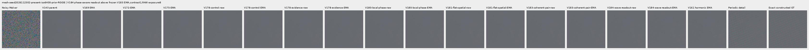

mesh-seed2026112302-present-iso6400-prior-RGGB; ROI `[176, 176, 160, 160]`, exposure8, contrast40.

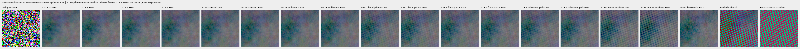

mesh-seed2026112309-present-iso6400-prior-RGGB; ROI `[176, 176, 160, 160]`, exposure8, contrast1.

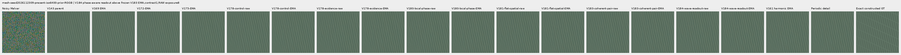

mesh-seed2026112309-present-iso6400-prior-RGGB; ROI `[176, 176, 160, 160]`, exposure8, contrast40.

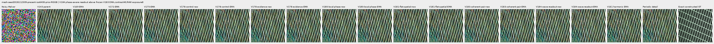

mesh-seed2026112304-absent-iso6400-prior-RGGB; ROI `[165, 0, 160, 160]`, exposure8, contrast40.

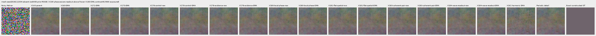

main-overcast-sky; ROI `[176, 176, 160, 160]`, exposure4, contrast1.

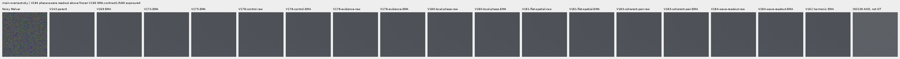

main-building-detail; ROI `[176, 176, 160, 160]`, exposure4, contrast1.

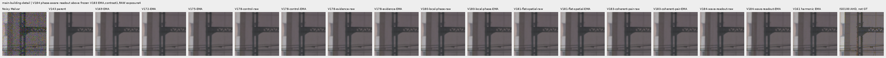

main-foliage; ROI `[176, 176, 160, 160]`, exposure4, contrast1.

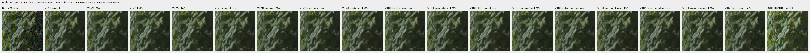

main-chain-link-fence; ROI `[176, 176, 160, 160]`, exposure4, contrast1.

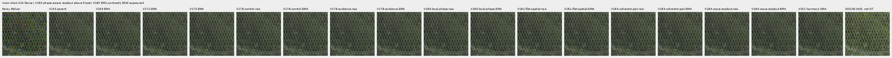

mesh-nominal; ROI `[206, 229, 160, 160]`, exposure16, contrast1.

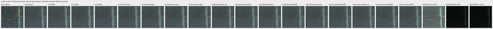

mesh-nominal; ROI `[426, 189, 160, 160]`, exposure16, contrast1.

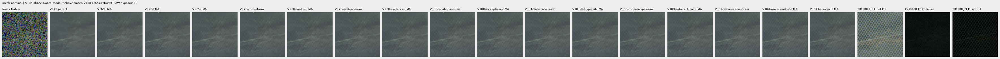

mesh-profile3879; ROI `[206, 229, 160, 160]`, exposure16, contrast1.

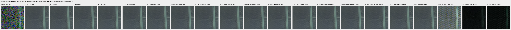

mesh-profile3879; ROI `[426, 189, 160, 160]`, exposure16, contrast1.

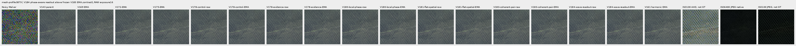

organic-02a76fd33b5e1414a0504f0b3f0aeb03a569b6f4-photo-faint-RGGB; ROI `[112, 112, 160, 160]`, exposure14.3883, contrast8.

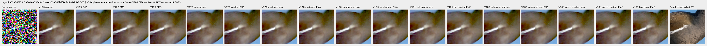

organic-dabacecd4780a1c230f8e9fce6ca1a604bdeab4c-photo-dark-RGGB; ROI `[112, 112, 160, 160]`, exposure102.758, contrast1.

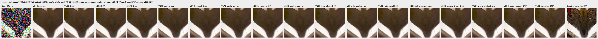

organic-6b3920bceba82d95ecf9351d47f6f94267694bd0-photo-dark-RGGB; ROI `[112, 112, 160, 160]`, exposure64.0491, contrast1.

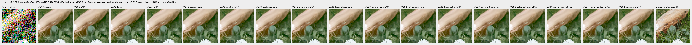

gray-l0.02-adc-only-RGGB; ROI `[48, 48, 160, 160]`, exposure4, contrast40.

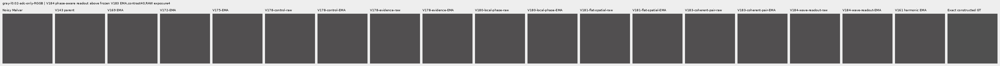

gray-l0.02-iso12800-prior-RGGB; ROI `[48, 48, 160, 160]`, exposure4, contrast40.

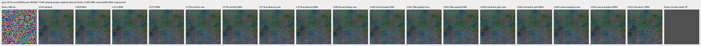

flat512-gray-l0.02-adc-only-RGGB; ROI `[176, 176, 160, 160]`, exposure4, contrast40.

flat512-gray-l0.02-iso6400-prior-RGGB; ROI `[176, 176, 160, 160]`, exposure4, contrast40.

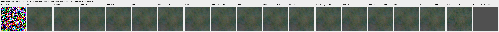

flat512-gray-l0.02-iso12800-prior-RGGB; ROI `[176, 176, 160, 160]`, exposure4, contrast40.

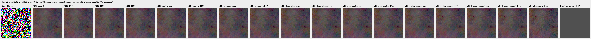

flat512-h210-s0.50-l0.02-iso6400-prior-RGGB; ROI `[176, 176, 160, 160]`, exposure4, contrast40.

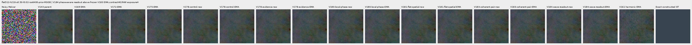

flat512-gray-l0.18-iso12800-prior-RGGB; ROI `[176, 176, 160, 160]`, exposure1, contrast8.

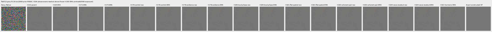

flat512-gray-l0.90-iso12800-prior-RGGB; ROI `[176, 176, 160, 160]`, exposure1, contrast4.

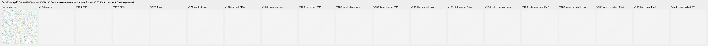

photo-3e638bbb56ed80abc88939468783e3bf9b92ee77-photo-faint-RGGB; ROI `[176, 176, 160, 160]`, exposure12.1494, contrast8.

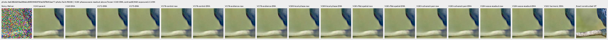

photo-3e638bbb56ed80abc88939468783e3bf9b92ee77-photo-dark-RGGB; ROI `[176, 176, 160, 160]`, exposure80.9959, contrast1.

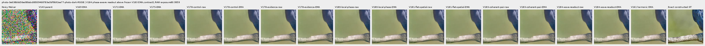

mixed-vertical-step-iso6400-prior-RGGB; ROI `[80, 176, 160, 160]`, exposure8, contrast40.

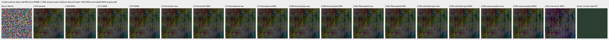

mixed-vertical-step-iso6400-prior-RGGB; ROI `[240, 176, 160, 160]`, exposure8, contrast1.

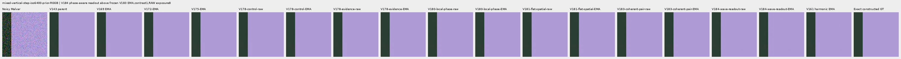

mixed-vertical-step-iso12800-prior-RGGB; ROI `[80, 176, 160, 160]`, exposure8, contrast40.

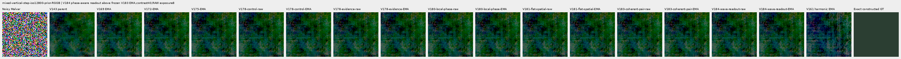

mixed-vertical-step-iso12800-prior-RGGB; ROI `[240, 176, 160, 160]`, exposure8, contrast1.

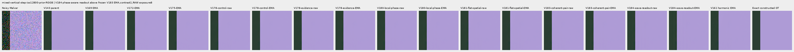

mixed-narrow-bar-iso6400-prior-RGGB; ROI `[80, 176, 160, 160]`, exposure8, contrast40.

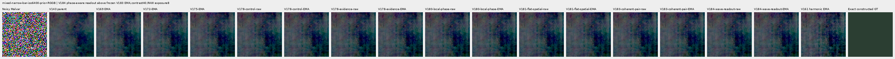

mixed-narrow-bar-iso6400-prior-RGGB; ROI `[240, 176, 160, 160]`, exposure8, contrast1.

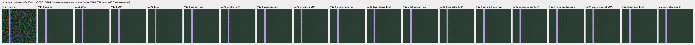

mixed-narrow-bar-iso12800-prior-RGGB; ROI `[80, 176, 160, 160]`, exposure8, contrast40.

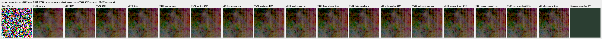

mixed-narrow-bar-iso12800-prior-RGGB; ROI `[240, 176, 160, 160]`, exposure8, contrast1.

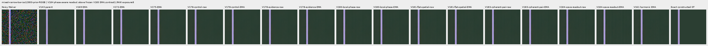

mixed-slanted-step-iso6400-prior-RGGB; ROI `[80, 176, 160, 160]`, exposure8, contrast40.

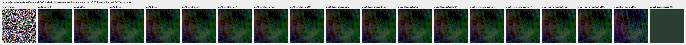

mixed-slanted-step-iso6400-prior-RGGB; ROI `[240, 176, 160, 160]`, exposure8, contrast1.

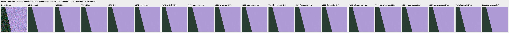

mixed-slanted-step-iso12800-prior-RGGB; ROI `[80, 176, 160, 160]`, exposure8, contrast40.

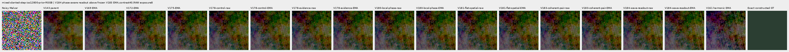

mixed-slanted-step-iso12800-prior-RGGB; ROI `[240, 176, 160, 160]`, exposure8, contrast1.

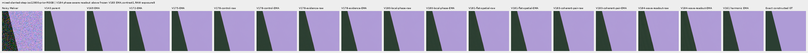

mixed-striped-patch-iso6400-prior-RGGB; ROI `[80, 176, 160, 160]`, exposure8, contrast40.

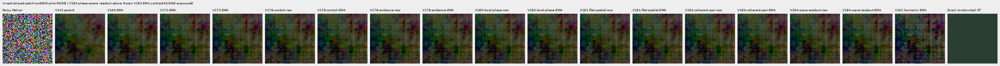

mixed-striped-patch-iso6400-prior-RGGB; ROI `[240, 176, 160, 160]`, exposure8, contrast1.

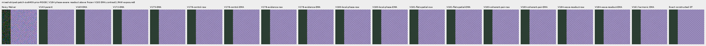

mixed-striped-patch-iso12800-prior-RGGB; ROI `[80, 176, 160, 160]`, exposure8, contrast40.

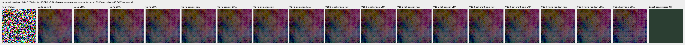

mixed-striped-patch-iso12800-prior-RGGB; ROI `[240, 176, 160, 160]`, exposure8, contrast1.

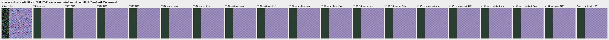

V150-control-bark-contrast0p025-adc-RGGB; ROI `[48, 48, 160, 160]`, exposure1, contrast40.

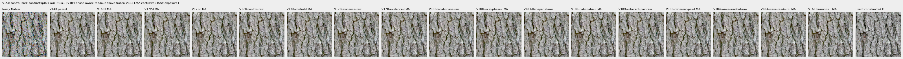

V150-control-raccoon-fur-contrast0p025-adc-RGGB; ROI `[48, 48, 160, 160]`, exposure1, contrast40.

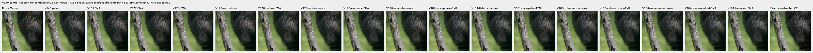

V150-control-ADC-plane0-RGGB; ROI `[176, 176, 160, 160]`, exposure45, contrast8.

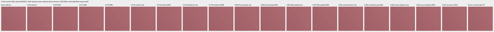

V150-control-ADC-plane1-RGGB; ROI `[176, 176, 160, 160]`, exposure9, contrast8.

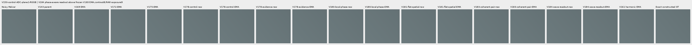

V150-control-ADC-plane2-RGGB; ROI `[176, 176, 160, 160]`, exposure1, contrast8.

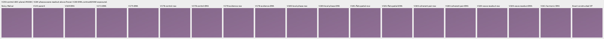

V150-control-ADC-plane3-RGGB; ROI `[176, 176, 160, 160]`, exposure0.24, contrast8.

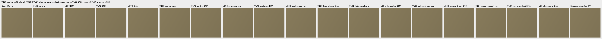

### Noisy, restored and exact constructed GT

mesh-seed2026112302-present-iso6400-prior-RGGB; ROI `[176, 176, 160, 160]`, exposure8, contrast1.

mesh-seed2026112302-present-iso6400-prior-RGGB; ROI `[176, 176, 160, 160]`, exposure8, contrast1.

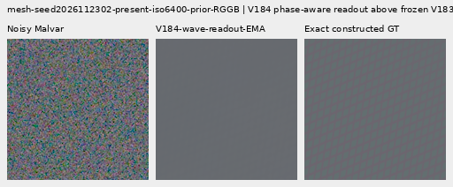

mesh-seed2026112309-present-iso6400-prior-RGGB; ROI `[176, 176, 160, 160]`, exposure8, contrast1.

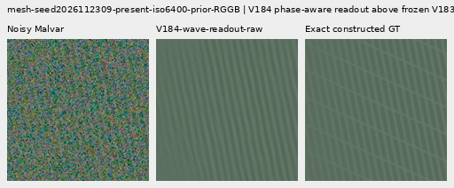

mesh-seed2026112309-present-iso6400-prior-RGGB; ROI `[176, 176, 160, 160]`, exposure8, contrast1.

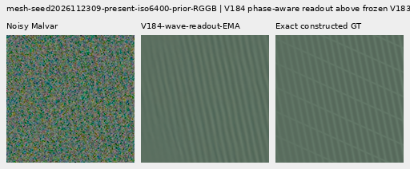

flat512-gray-l0.02-iso6400-prior-RGGB; ROI `[176, 176, 160, 160]`, exposure4, contrast40.

flat512-gray-l0.02-iso6400-prior-RGGB; ROI `[176, 176, 160, 160]`, exposure4, contrast40.

flat512-gray-l0.02-iso12800-prior-RGGB; ROI `[176, 176, 160, 160]`, exposure4, contrast40.

flat512-gray-l0.02-iso12800-prior-RGGB; ROI `[176, 176, 160, 160]`, exposure4, contrast40.

mixed-vertical-step-iso6400-prior-RGGB; ROI `[80, 176, 160, 160]`, exposure8, contrast40.

mixed-vertical-step-iso6400-prior-RGGB; ROI `[80, 176, 160, 160]`, exposure8, contrast40.

mixed-vertical-step-iso12800-prior-RGGB; ROI `[80, 176, 160, 160]`, exposure8, contrast40.

mixed-vertical-step-iso12800-prior-RGGB; ROI `[80, 176, 160, 160]`, exposure8, contrast40.

[Publication verification](results/v184-wave-readout-publication-verification-v1.json).
