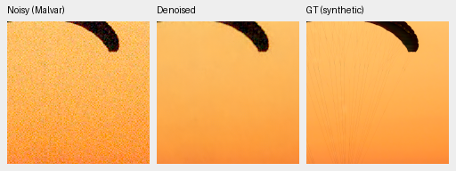
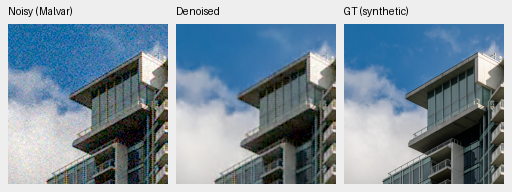
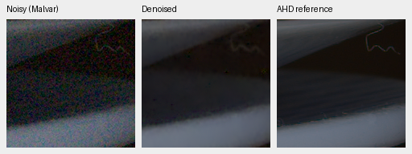
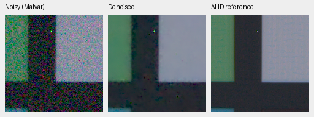

# Photo-trained RGB refinement

V15 improves real denoising substantially over its V11 initialization, while
retaining a small positive gain on the full synthetic validation protocol. It
still trails RawNIND on real RAWs and has visible residual color blotches and
detail loss. This is an improved experimental candidate, not the final model or
evidence of state-of-the-art quality.

The original restoration/DINO weights are frozen. Only the zero-initialized
27,696-parameter IEEE FP32 RGB correction branch trains, for 5000 steps at initial
learning rate 5e-4. Unlike rejected V14, the branch sees the normal mixture of
photographs, procedural detail and smooth scenes: half of batches use Commons
simulation, half use the independently selected 32-scene paired RAW training
subset. Physical input units, original reconstruction losses and the DINO
backbone are preserved. No development, official-test or GFX qualitative RAWs
enter training. The V14/V15 contrast is descriptive, not a matched training-budget
ablation: their data and step counts differ.

All real scores are scene-balanced; the known-camera subset has four scenes and
the unseen Canon M100 subset five. Primary PSNR uses measured clean CFA samples;
rendered RGB scores use the auxiliary calibrated AHD reference.

| Method | Known CFA PSNR | Unseen CFA PSNR | Known AHD sRGB PSNR | Unseen AHD sRGB PSNR |
| --- | ---: | ---: | ---: | ---: |
| V11 step5000 | 51.6932 | 50.9835 | 37.6638 | 35.2913 |
| V15 step1000 | 52.5264 | 52.1592 | 38.4926 | 36.6675 |
| V15 step5000 | **53.0998** | **52.8518** | **38.9752** | **37.3160** |
| RawNIND, publisher units, CFA-LS | 54.0686 | 53.5622 | 39.6780 | 38.1448 |

V15's measured-CFA gains over V11 are +1.4066/+1.8683 dB. Exploratory paired
scene-bootstrap 95% intervals are [0.8255,2.0842]/[1.4496,2.2307] dB; four/five
scenes provide limited evidence of generalization. Auxiliary SSIM rises from
0.88482/0.83333 to 0.91754/0.89840, still below RawNIND's 0.92881/0.91838.

The complete shared synthetic panel contains 427 photos, four CFAs and seven
noise/exposure conditions, plus 16 procedural sources. Photo sRGB PSNR/SSIM rises
from 31.37486/0.918028 to **31.44165/0.921748**. The paired source-bootstrap PSNR
gain interval is [0.05287,0.08406] dB. Procedural PSNR/SSIM rises from
30.40732/0.912986 to 30.49185/0.919789. The camera-linear photo gain is small and
its interval includes zero. These results do not replace the stronger historical
V6 synthetic score or prove superiority on real photographs. Protected Commons
test sources and official RAW test targets remain untouched for model selection.

These native 160×160 triplets show the first two fixed source/condition examples
used by the synthetic report. Left: noisy Malvar. Middle: V15. Right: exact
synthetic GT. They are 100% at the 8×8-binned evaluation resolution, with identical
display transforms and no resizing or sharpening. Fine fabric detail is lost.

The real development report selects two fixed scene/ISO/tile locations before
viewing output. Its right panel is an auxiliary AHD reference, not exact RGB GT.
Remaining grain, missing fine structure and edge artifacts are visible:

Open the original PNGs at 100%. The [complete receipts](results/photo-refiner-v15-review.json)
contain source/manifest/checkpoint hashes, native coordinates, display settings,
all aggregate metrics and bootstrap comparisons. The same frozen step5000 model
also produced complete 11662×8746 RGB16 and ICC-tagged sRGB16 GFX outputs;
[see the whole-frame qualitative comparison](gfx-qualitative.md).

An input-only gain diagnostic on the 18 preselected central development tiles
An input-only gain diagnostic on the 18 preselected central development tiles
does not explain the remaining gap. With equal-channel weighting, the DC/MSE
fraction has median 1.96% for V11. Global/per-channel CFA gain fitting to the
noisy input worsens center-tile PSNR from 47.9712 to 47.8786/47.7974 dB. This is a
different, smaller diagnostic protocol, not the full real suite. No such output
calibration is promoted. [Diagnostic and source receipts](results/paired-bias-diagnostic.json)
are retained.

V16 tests a larger 144,072-parameter correction branch (width48, eight blocks)
with the same V11 initialization and training proportions/losses/LR as V15.
Different initialization consumes a different RNG sequence, so it is a capacity
trial rather than a matched data-sequence ablation. Its first 1000-step review
improved real/synthetic scores over V15 at the same step count; it is being
extended to 5000 and improved again. See [the completed V16 review](wide-refinement-review.md).

Synthetic crop sources: Roy Egloff,
[Villeneuve Vertigo-Swiss-Riviera](https://commons.wikimedia.org/wiki/File:CH.VD.Villeneuve_2007-08-25_Vertigo-Swiss-Riviera_2392_3x2-R_4K.jpg),
and Dietmar Rabich,
[Vancouver Coal Harbour](https://commons.wikimedia.org/wiki/File:Vancouver_(BC,_Canada),_Coal_Harbour_Seaside_Park,_Blick_in_den_Himmel_--_2022_--_2158.jpg),
[CC BY-SA 4.0](https://creativecommons.org/licenses/by-sa/4.0/). Modified by
binning, crop, simulated noise and restoration. Real crop sources: Benoit Brummer
and Christophe De Vleeschouwer, *Raw Natural Image Noise Dataset (2025)*,
[dataset](https://doi.org/10.14428/DVN/DEQCIM), CC BY-SA 4.0, with additional scene
grants in the retained publisher permissions file (`7D-1`: Peter Wemmert, CC0).
Modified by registration, calibration, demosaicing/restoration, crop and display.
