# Pooled-selection wave readout: completed quality

V187 pools green-phase and neighboring-frequency measurements at V185's same 508-parameter readout and matched training budget. **Mean constructed mesh response rises 5.23% raw / 3.64% EMA over V185, reaching 5.2273% / 5.3591% of exact GT amplitude.** Both endpoints improve 168/256 present inputs and lose response on 88. Quiet spatial RMS falls 0.03–0.27% raw / 0.48–0.52% EMA. Retain this as the current experimental wave architecture, alongside V185's slightly better absent/flat controls and earlier quieter strengths. V120 Small remains the general recommendation.

## Matched strengths and costs

| Metric versus same-state V185 | V187 raw | V187 EMA |
| --- | ---: | ---: |
| Present signed template response | +5.2283%; 168/256 increase | +3.6395%; 168/256 increase |
| Present full RMS | −0.2703%; only 92/256 improve | −0.1902%; only 90/256 improve |
| Present blank RMS | +0.0448%; 253/256 worsen | +0.0388%; 252/256 worsen |
| Absent full RMS | +0.0348%; all 256 worsen | +0.0341%; all 256 worsen |
| Absent spatial RMS | +0.0371% | +0.0364% |
| ISO6400 quiet total / spatial RMS | −0.2664% / −0.2665% | −0.4457% / −0.5172% |
| ISO12800 quiet total / spatial RMS | +0.00093% / −0.0327% | −0.3431% / −0.4776% |
| Fresh512 full-flat RMS, ISO6400 / ISO12800 | +0.0201% / +0.0215% | +0.0197% / +0.0213% |
| Fresh512 spatial-flat RMS, ISO6400 / ISO12800 | +0.0211% / +0.0225% | +0.0207% / +0.0224% |

Quiet spatial RMS is 3.46624 / 5.61233 DN16 raw and 3.47664 / 5.62165 DN16 EMA for ISO6400/12800. Raw improves 20/32 quiet spatial cases and 18/32 total cases; EMA improves 27/32 spatial and 28/32 total. The quiet DC mean changes −0.0919% / +0.1410% raw and −0.0979% / +0.1648% EMA, so a lower aggregate RMS does not imply uniform color improvement. All 48 fresh noisy standalone flats worsen in both endpoints. Coarse32 changes are mixed and smaller than 0.001% in their fresh-flat means.

Absent signed response is 6.34776e−6 raw and 7.89760e−7 EMA; there is no relative percentage for these near-zero signed values. Lower mean present full RMS also masks many regressions. These repeatedly reused, correlated development cases are not independent scene replications or a blind safety test.

Natural fine-band response rises in all four means: retained faint/dark +0.1607% / +0.0772% raw and +0.1072% / +0.0405% EMA; organic faint/dark +0.0846% / +0.0476% raw and +0.0802% / +0.0438% EMA. Band-error means fall slightly in both retained cohorts but rise slightly in both organic cohorts. These small numerical gains do not establish visible photographic-detail recovery.

Relative to the frozen V183 EMA initializer, mean mesh response rises 17.76% raw / 20.73% EMA, with quiet spatial RMS still 0.12–0.48% higher. Against V181 EMA, response rises 25.95% / 29.12%, with quiet spatial error 0.70–1.09% higher. Against V172 EMA it rises 34.82% / 38.22%, with quiet spatial error 0.73–1.15% higher. Against V180 EMA it rises 14.93% / 17.82%; quiet spatial error is slightly lower at ISO6400 and higher at ISO12800. These contextual comparisons also differ in capacity and training history.

V187 EMA exceeds V161 EMA's mean mesh response by 2.28%, while quiet spatial RMS is 5.51–7.83% lower on all 32 inputs. Only 69/256 present responses increase against V161; it is not uniform per-case superiority. Raw response is 0.24% below V161 with quiet spatial RMS 5.66–8.11% lower. The earlier optional periodic-detail correction retains higher average response and its known seam/false-wave costs. No model combines all strengths.

## Actual native inspection

All 60 figures, 12 noisy/restored/exact-GT triplets and 15 original sheets were actually viewed, with a second set of native focus sheets for V185/V187 comparisons. Every cell retains 160×160 pixels. On mesh seed2026112302 the amplified view shows small periodic-modulation changes; normal exposure is still weak. Seed2026112309 retains its strong orientation while the weak crossing family remains largely missing. Broad colored blotches survive in absent mesh and dark flats.

Main DSCF3879 sky remains visually smooth at exposure4. Building details and foliage remain soft; the coarse chain-link fence survives. Fine DSCF3842 cab mesh at exposure16 has small strand-modulation changes in both 160-pixel ROIs under nominal and profile3879 conditioning, without clear recovery of missing crossings. The ISO100/AHD and both SOOC JPEG panels remain independent qualitative references, not exact GT: aperture, exposure time, motion and processing differ. No pixelwise real-reference score is used.

Natural bird/branch, butterfly and organic detail remain soft. Amplified quiet step/bar/slant/stripe ROIs still contain false vertical or diagonal modulation and broad mottle; some faint modulation remains visible at normal exposure. The measured quiet gain does not resolve hallucinated detail. ADC gray, bark, fur and all four sloped-plane controls retain inherited pixels exactly.

## Source, checkpoint, noise and display

Both states use source checkpoint SHA256 `40b7c7c295ba82cc6b4a4646245483a3234de2759e2ae4d5a8e4e63a16a5e05a`. Raw module SHA256 is `3c61f8575b7c0ffa77bd42ba07ce17273d2f2d0fd36a4ba148a1ac578c24c012`; EMA is `4739e107a2460166dae5f14c7d89415b4b0c1ccc689d5a3480787ffa1696ebc4`. The final index binds strict full exports and all native manifests.

Representative mesh triplets use procedural seeds2026112302 and2026112309, RGGB, native ROI `[176,176,160,160]`, Poisson shot coefficient0.00128 and read variance6.5536e−6, exposure8, contrast1. Amplified boards use contrast40 around the same fixed anchor; no crop pixel is resized. Quiet ROI is `[80,176,160,160]`, exposure8/contrast40, with ISO12800 shot0.00256/read2.62144e−5. Main protected ROIs use `[176,176,160,160]`, exposure4. Cab ROIs are `[206,229,160,160]` and `[426,189,160,160]` within native context `[600,6260,768,768]`, exposure16. The manifests retain exact source/arrays, per-capture variance, CFA, white balance, display anchor and reference labels for every figure.

## Execution and interpretation

The fresh head starts from V183 EMA with V185's exact initial state hash, four trainable tensors, 508 parameters and 193 state tensors; all 189 inherited tensors remain frozen/eval. The same 1,000 cached rows give 900 updates, 3,600 noisy images and 100 ADC skips, with identical nine losses, masks, domain weights, LR schedule and Adam/EMA clocks. Genuine row-eight restoration continues at row nine without replay. Pooling both greens, 3×3 spectral smoothing, unique allocation and interleaved ranks change together; neither phase is a selection holdout, and selected powers are not calibrated confidence. Frozen V183 matching retains its original selections.

The training audit passes all rows, nine-term totals, masks and five checkpoint restores. The quality audit checks 1,644 outputs, 6,576 input fingerprints, exact V183/V169 replays, 144 ADC outputs and all 750 raw/EMA pooled-wave/support pairs. It independently recomputes 72 native RGB plus 72 wave arrays, 53,772,288 addition channels, 510 ordinary metric scalars, 72 wave RMS values and 278 Decimal means. Tables retain all 25 methods/20,550 rows/46 contrasts/1,722 cells; 3,425 means and 17,184 paired checks pass. No older source or receipt is replaced.

Peak CUDA allocation is about6.22GiB for training and2.79GiB for review. This is not a new 102MP speed result. All new outputs remain local under a bounded0.4GiB forecast; external inputs are read-only. Protected GFX families/JPEGs/siblings stay out of training; originals and /mnt/dataz are unused. The next architectural work must improve weak orientation/crossing evidence and local suppression of false waves; further whole-head contrast amplification alone does not resolve those failures.

[Exact evidence](results/v187-pooled-wave-final-v1.json) · [Native-pixel viewer](images/v187-pooled-wave-v1/native-viewer.html).

# Pooled-selection wave readout and retained flat/local/global/control comparison tables

RMS values are camera-RGB DN16. Signed gain 1 is exact constructed amplitude. Real ISO100 references are unscored. This reused development suite is not blind validation.

## New readout and retained local/global/control

### Mesh response and blank error

| Metric | V178-control-raw | V178-control-EMA | V178-evidence-raw | V178-evidence-EMA | V180-local-phase-raw | V180-local-phase-EMA | V181-flat-spatial-raw | V181-flat-spatial-EMA | V183-coherent-pair-raw | V183-coherent-pair-EMA | V184-wave-readout-raw | V184-wave-readout-EMA | V185-spatial-context-raw | V185-spatial-context-EMA | V187-pooled-wave-raw | V187-pooled-wave-EMA |
| --- | ---: | ---: | ---: | ---: | ---: | ---: | ---: | ---: | ---: | ---: | ---: | ---: | ---: | ---: | ---: | ---: |
| Present full RMS | 8.954916 | 8.957374 | 8.950154 | 8.953061 | 8.876450 | 8.877083 | 8.906324 | 8.907939 | 8.876014 | 8.876582 | 8.818888 | 8.793299 | 8.811855 | 8.792990 | 8.788035 | 8.776265 |
| Present signed template gain | 0.03888490 | 0.03887981 | 0.03924275 | 0.03923549 | 0.04521940 | 0.04548425 | 0.04143345 | 0.04150431 | 0.04422806 | 0.04439006 | 0.04864969 | 0.05147617 | 0.04967608 | 0.05170912 | 0.05227328 | 0.05359110 |
| Present blank RMS | 5.610388 | 5.613564 | 5.610671 | 5.614318 | 5.616159 | 5.620176 | 5.604892 | 5.607879 | 5.609462 | 5.612432 | 5.610517 | 5.611432 | 5.610755 | 5.611348 | 5.613266 | 5.613525 |
| Present blank spatial RMS | 5.428461 | 5.428190 | 5.429207 | 5.429165 | 5.435846 | 5.437361 | 5.421840 | 5.421916 | 5.426760 | 5.427226 | 5.425229 | 5.426176 | 5.425480 | 5.426093 | 5.428087 | 5.428353 |
| Present blank DC RMS | 1.302865 | 1.315066 | 1.301321 | 1.314366 | 1.297771 | 1.306773 | 1.305530 | 1.315772 | 1.304924 | 1.313785 | 1.313856 | 1.313838 | 1.313840 | 1.313830 | 1.313787 | 1.313786 |
| Absent full RMS | 5.308835 | 5.311586 | 5.308666 | 5.311814 | 5.310667 | 5.314059 | 5.303987 | 5.306787 | 5.306048 | 5.308645 | 5.307907 | 5.308263 | 5.308078 | 5.308333 | 5.309924 | 5.310143 |
| Absent signed template gain | 0.00001722 | 0.00001355 | 0.00001755 | 0.00001511 | 0.00008047 | 0.00009106 | -0.00002453 | -0.00002356 | 0.00001412 | 0.00001744 | 0.00000132 | 0.00000449 | 0.00001200 | 0.00001101 | 0.00000635 | 0.00000079 |
| Absent blank RMS | 5.308835 | 5.311586 | 5.308666 | 5.311814 | 5.310667 | 5.314059 | 5.303987 | 5.306787 | 5.306048 | 5.308645 | 5.307907 | 5.308263 | 5.308078 | 5.308333 | 5.309924 | 5.310143 |
| Absent blank spatial RMS | 5.166172 | 5.165967 | 5.166425 | 5.166424 | 5.169570 | 5.170659 | 5.160459 | 5.160529 | 5.162771 | 5.163024 | 5.162245 | 5.162616 | 5.162426 | 5.162691 | 5.164342 | 5.164568 |
| Absent blank DC RMS | 1.128316 | 1.139692 | 1.126611 | 1.138905 | 1.121278 | 1.130202 | 1.131491 | 1.142331 | 1.130450 | 1.139720 | 1.139799 | 1.139778 | 1.139777 | 1.139766 | 1.139704 | 1.139701 |

### Quiet fields beside detail

| Metric | V178-control-raw | V178-control-EMA | V178-evidence-raw | V178-evidence-EMA | V180-local-phase-raw | V180-local-phase-EMA | V181-flat-spatial-raw | V181-flat-spatial-EMA | V183-coherent-pair-raw | V183-coherent-pair-EMA | V184-wave-readout-raw | V184-wave-readout-EMA | V185-spatial-context-raw | V185-spatial-context-EMA | V187-pooled-wave-raw | V187-pooled-wave-EMA |
| --- | ---: | ---: | ---: | ---: | ---: | ---: | ---: | ---: | ---: | ---: | ---: | ---: | ---: | ---: | ---: | ---: |
| iso6400-prior whole RMS | 26.807064 | 26.802756 | 26.805698 | 26.801574 | 26.783953 | 26.770305 | 26.746588 | 26.742613 | 26.732431 | 26.727564 | 27.183310 | 26.954659 | 26.794504 | 26.767163 | 26.770032 | 26.763736 |
| iso6400-prior quiet RMS | 4.036107 | 4.031506 | 4.034977 | 4.029954 | 4.067919 | 4.063950 | 4.031306 | 4.024922 | 4.051807 | 4.046584 | 4.080410 | 4.121629 | 4.063159 | 4.079132 | 4.052335 | 4.060950 |
| iso6400-prior quiet spatial RMS | 3.442433 | 3.441227 | 3.443856 | 3.443032 | 3.478830 | 3.479326 | 3.440358 | 3.439251 | 3.461858 | 3.462220 | 3.494628 | 3.543452 | 3.475501 | 3.494718 | 3.466239 | 3.476644 |
| iso6400-prior quiet DC RMS | 1.992752 | 1.988387 | 1.988485 | 1.983280 | 1.994619 | 1.988680 | 1.989691 | 1.982039 | 1.992888 | 1.984961 | 1.988934 | 1.988311 | 1.988393 | 1.988065 | 1.986566 | 1.986119 |
| iso12800-prior whole RMS | 35.438505 | 35.433998 | 35.432874 | 35.427920 | 35.277377 | 35.253643 | 35.325202 | 35.317787 | 35.247833 | 35.237946 | 35.319896 | 35.151283 | 35.079847 | 35.018561 | 35.046519 | 34.990295 |
| iso12800-prior quiet RMS | 6.297270 | 6.292864 | 6.297440 | 6.292439 | 6.328901 | 6.324568 | 6.309551 | 6.302588 | 6.331010 | 6.325115 | 6.361515 | 6.412757 | 6.340148 | 6.370269 | 6.340207 | 6.348412 |
| iso12800-prior quiet spatial RMS | 5.556405 | 5.555426 | 5.557017 | 5.556344 | 5.599142 | 5.600006 | 5.575015 | 5.573477 | 5.595272 | 5.594999 | 5.637800 | 5.696091 | 5.614161 | 5.648627 | 5.612327 | 5.621649 |
| iso12800-prior quiet DC RMS | 2.777805 | 2.774289 | 2.778281 | 2.773895 | 2.772617 | 2.766157 | 2.773563 | 2.768331 | 2.779599 | 2.773697 | 2.770699 | 2.769863 | 2.769444 | 2.768868 | 2.773348 | 2.773431 |

### Standalone 512-pixel flats

| Metric | V178-control-raw | V178-control-EMA | V178-evidence-raw | V178-evidence-EMA | V180-local-phase-raw | V180-local-phase-EMA | V181-flat-spatial-raw | V181-flat-spatial-EMA | V183-coherent-pair-raw | V183-coherent-pair-EMA | V184-wave-readout-raw | V184-wave-readout-EMA | V185-spatial-context-raw | V185-spatial-context-EMA | V187-pooled-wave-raw | V187-pooled-wave-EMA |
| --- | ---: | ---: | ---: | ---: | ---: | ---: | ---: | ---: | ---: | ---: | ---: | ---: | ---: | ---: | ---: | ---: |
| iso6400-prior full RMS | 18.631764 | 18.629767 | 18.632121 | 18.629596 | 18.624531 | 18.624026 | 18.607935 | 18.609537 | 18.611860 | 18.611952 | 18.610199 | 18.610832 | 18.610556 | 18.611011 | 18.614299 | 18.614680 |
| iso6400-prior spatial RMS | 18.303915 | 18.303283 | 18.302926 | 18.302710 | 18.306471 | 18.306564 | 18.272367 | 18.271228 | 18.281757 | 18.280332 | 18.278512 | 18.279165 | 18.278884 | 18.279350 | 18.282738 | 18.283128 |
| iso6400-prior coarse32 RMS | 13.431766 | 13.432282 | 13.432070 | 13.432578 | 13.433240 | 13.433568 | 13.433259 | 13.433500 | 13.433497 | 13.433758 | 13.433774 | 13.433775 | 13.433771 | 13.433773 | 13.433779 | 13.433787 |
| iso12800-prior full RMS | 24.202722 | 24.199457 | 24.205429 | 24.202115 | 24.206583 | 24.202340 | 24.174201 | 24.175828 | 24.183025 | 24.181174 | 24.179083 | 24.180272 | 24.179782 | 24.180595 | 24.184970 | 24.185747 |
| iso12800-prior spatial RMS | 23.741963 | 23.740972 | 23.740806 | 23.740427 | 23.749890 | 23.750376 | 23.706304 | 23.704605 | 23.718775 | 23.716694 | 23.714528 | 23.715747 | 23.715247 | 23.716078 | 23.720585 | 23.721378 |
| iso12800-prior coarse32 RMS | 17.915130 | 17.915920 | 17.915587 | 17.916187 | 17.915837 | 17.914310 | 17.922998 | 17.922111 | 17.923288 | 17.921780 | 17.921870 | 17.921858 | 17.921869 | 17.921869 | 17.921716 | 17.921730 |

### Natural photographic detail

| Metric | V178-control-raw | V178-control-EMA | V178-evidence-raw | V178-evidence-EMA | V180-local-phase-raw | V180-local-phase-EMA | V181-flat-spatial-raw | V181-flat-spatial-EMA | V183-coherent-pair-raw | V183-coherent-pair-EMA | V184-wave-readout-raw | V184-wave-readout-EMA | V185-spatial-context-raw | V185-spatial-context-EMA | V187-pooled-wave-raw | V187-pooled-wave-EMA |
| --- | ---: | ---: | ---: | ---: | ---: | ---: | ---: | ---: | ---: | ---: | ---: | ---: | ---: | ---: | ---: | ---: |
| retained512/photo-faint full RMS | 33.964565 | 33.965091 | 33.964381 | 33.964993 | 33.965056 | 33.965822 | 33.967023 | 33.967698 | 33.966346 | 33.967004 | 33.972690 | 33.979277 | 33.972829 | 33.977373 | 33.974834 | 33.977304 |
| retained512/photo-faint band response | 0.298162 | 0.298158 | 0.298217 | 0.298218 | 0.298853 | 0.298969 | 0.296127 | 0.296243 | 0.296890 | 0.297015 | 0.297615 | 0.298131 | 0.297779 | 0.298142 | 0.298258 | 0.298462 |
| retained512/photo-faint band error | 0.824616 | 0.824613 | 0.824628 | 0.824625 | 0.824678 | 0.824669 | 0.824773 | 0.824771 | 0.824731 | 0.824729 | 0.824852 | 0.824948 | 0.824870 | 0.824941 | 0.824843 | 0.824877 |
| retained512/photo-dark full RMS | 29.094201 | 29.094373 | 29.094067 | 29.094435 | 29.097274 | 29.097995 | 29.095585 | 29.096066 | 29.096498 | 29.097180 | 29.102365 | 29.111425 | 29.103421 | 29.110154 | 29.104608 | 29.108614 |
| retained512/photo-dark band response | 0.530784 | 0.530763 | 0.530842 | 0.530826 | 0.531147 | 0.531274 | 0.527270 | 0.527464 | 0.528097 | 0.528282 | 0.528698 | 0.529417 | 0.529066 | 0.529539 | 0.529475 | 0.529754 |
| retained512/photo-dark band error | 0.661241 | 0.661240 | 0.661242 | 0.661241 | 0.661293 | 0.661292 | 0.661350 | 0.661347 | 0.661335 | 0.661334 | 0.661439 | 0.661531 | 0.661466 | 0.661545 | 0.661437 | 0.661474 |
| organic384/photo-faint full RMS | 37.480380 | 37.481906 | 37.480903 | 37.482130 | 37.481665 | 37.482521 | 37.494874 | 37.496490 | 37.491161 | 37.492516 | 37.492637 | 37.492709 | 37.492629 | 37.492681 | 37.493034 | 37.493118 |
| organic384/photo-faint band response | 0.149424 | 0.149428 | 0.149414 | 0.149424 | 0.149544 | 0.149626 | 0.147867 | 0.147920 | 0.148326 | 0.148382 | 0.148373 | 0.148416 | 0.148416 | 0.148446 | 0.148541 | 0.148565 |
| organic384/photo-faint band error | 0.924915 | 0.924907 | 0.924921 | 0.924914 | 0.924930 | 0.924906 | 0.925232 | 0.925227 | 0.925151 | 0.925143 | 0.925152 | 0.925154 | 0.925138 | 0.925140 | 0.925171 | 0.925181 |
| organic384/photo-dark full RMS | 33.685298 | 33.685606 | 33.685377 | 33.685832 | 33.687261 | 33.687290 | 33.691034 | 33.691601 | 33.690263 | 33.690724 | 33.691298 | 33.691748 | 33.691211 | 33.691548 | 33.691811 | 33.692154 |
| organic384/photo-dark band response | 0.397869 | 0.397863 | 0.397874 | 0.397876 | 0.397806 | 0.397910 | 0.394844 | 0.394988 | 0.395447 | 0.395580 | 0.395640 | 0.395715 | 0.395690 | 0.395741 | 0.395879 | 0.395914 |
| organic384/photo-dark band error | 0.781673 | 0.781672 | 0.781676 | 0.781676 | 0.781730 | 0.781733 | 0.781703 | 0.781707 | 0.781723 | 0.781728 | 0.781764 | 0.781782 | 0.781765 | 0.781778 | 0.781780 | 0.781788 |

### ADC controls

| Metric | V178-control-raw | V178-control-EMA | V178-evidence-raw | V178-evidence-EMA | V180-local-phase-raw | V180-local-phase-EMA | V181-flat-spatial-raw | V181-flat-spatial-EMA | V183-coherent-pair-raw | V183-coherent-pair-EMA | V184-wave-readout-raw | V184-wave-readout-EMA | V185-spatial-context-raw | V185-spatial-context-EMA | V187-pooled-wave-raw | V187-pooled-wave-EMA |
| --- | ---: | ---: | ---: | ---: | ---: | ---: | ---: | ---: | ---: | ---: | ---: | ---: | ---: | ---: | ---: | ---: |
| Photo full RMS | 18.142182 | 18.142182 | 18.142182 | 18.142182 | 18.142182 | 18.142182 | 18.142182 | 18.142182 | 18.142182 | 18.142182 | 18.142182 | 18.142182 | 18.142182 | 18.142182 | 18.142182 | 18.142182 |
| Photo band error | 0.101800 | 0.101800 | 0.101800 | 0.101800 | 0.101800 | 0.101800 | 0.101800 | 0.101800 | 0.101800 | 0.101800 | 0.101800 | 0.101800 | 0.101800 | 0.101800 | 0.101800 | 0.101800 |
| fresh-flat512 full RMS | 3.322910 | 3.322910 | 3.322910 | 3.322910 | 3.322910 | 3.322910 | 3.322910 | 3.322910 | 3.322910 | 3.322910 | 3.322910 | 3.322910 | 3.322910 | 3.322910 | 3.322910 | 3.322910 |
| fresh-flat512 coarse32 RMS | 0.538587 | 0.538587 | 0.538587 | 0.538587 | 0.538587 | 0.538587 | 0.538587 | 0.538587 | 0.538587 | 0.538587 | 0.538587 | 0.538587 | 0.538587 | 0.538587 | 0.538587 | 0.538587 |
| adc-sloped512 full RMS | 3.776943 | 3.776943 | 3.776943 | 3.776943 | 3.776943 | 3.776943 | 3.776943 | 3.776943 | 3.776943 | 3.776943 | 3.776943 | 3.776943 | 3.776943 | 3.776943 | 3.776943 | 3.776943 |
| adc-sloped512 coarse32 RMS | 0.573442 | 0.573442 | 0.573442 | 0.573442 | 0.573442 | 0.573442 | 0.573442 | 0.573442 | 0.573442 | 0.573442 | 0.573442 | 0.573442 | 0.573442 | 0.573442 | 0.573442 | 0.573442 |

## Earlier strengths and both endpoints

### Mesh response and blank error

| Metric | parent | V161-EMA | V169-EMA | V171-EMA | V172-EMA | V173-EMA | V174-EMA | V175-raw | V175-EMA | V178-control-raw | V178-control-EMA | V178-evidence-raw | V178-evidence-EMA | V180-local-phase-raw | V180-local-phase-EMA | V181-flat-spatial-raw | V181-flat-spatial-EMA | V183-coherent-pair-raw | V183-coherent-pair-EMA | V184-wave-readout-raw | V184-wave-readout-EMA | V185-spatial-context-raw | V185-spatial-context-EMA | V187-pooled-wave-raw | V187-pooled-wave-EMA |
| --- | ---: | ---: | ---: | ---: | ---: | ---: | ---: | ---: | ---: | ---: | ---: | ---: | ---: | ---: | ---: | ---: | ---: | ---: | ---: | ---: | ---: | ---: | ---: | ---: | ---: |
| Present full RMS | 9.111243 | 8.979201 | 8.956287 | 8.909846 | 8.955686 | 8.948849 | 8.955665 | 8.956087 | 8.949633 | 8.954916 | 8.957374 | 8.950154 | 8.953061 | 8.876450 | 8.877083 | 8.906324 | 8.907939 | 8.876014 | 8.876582 | 8.818888 | 8.793299 | 8.811855 | 8.792990 | 8.788035 | 8.776265 |
| Present signed template gain | 0.02202090 | 0.05239854 | 0.03836594 | 0.03884819 | 0.03877185 | 0.03723868 | 0.03867667 | 0.03879218 | 0.03878479 | 0.03888490 | 0.03887981 | 0.03924275 | 0.03923549 | 0.04521940 | 0.04548425 | 0.04143345 | 0.04150431 | 0.04422806 | 0.04439006 | 0.04864969 | 0.05147617 | 0.04967608 | 0.05170912 | 0.05227328 | 0.05359110 |
| Present blank RMS | 5.523323 | 5.816396 | 5.609300 | 5.544439 | 5.610812 | 5.590872 | 5.609727 | 5.610388 | 5.601944 | 5.610388 | 5.613564 | 5.610671 | 5.614318 | 5.616159 | 5.620176 | 5.604892 | 5.607879 | 5.609462 | 5.612432 | 5.610517 | 5.611432 | 5.610755 | 5.611348 | 5.613266 | 5.613525 |
| Present blank spatial RMS | 5.343113 | 5.645413 | 5.431940 | 5.361961 | 5.429880 | 5.410955 | 5.428378 | 5.421000 | 5.420632 | 5.428461 | 5.428190 | 5.429207 | 5.429165 | 5.435846 | 5.437361 | 5.421840 | 5.421916 | 5.426760 | 5.427226 | 5.425229 | 5.426176 | 5.425480 | 5.426093 | 5.428087 | 5.428353 |
| Present blank DC RMS | 1.289621 | 1.287310 | 1.289568 | 1.300170 | 1.299983 | 1.294365 | 1.300955 | 1.326118 | 1.300870 | 1.302865 | 1.315066 | 1.301321 | 1.314366 | 1.297771 | 1.306773 | 1.305530 | 1.315772 | 1.304924 | 1.313785 | 1.313856 | 1.313838 | 1.313840 | 1.313830 | 1.313787 | 1.313786 |
| Absent full RMS | 5.237910 | 5.501669 | 5.305929 | 5.248144 | 5.309113 | 5.291708 | 5.308678 | 5.311212 | 5.302362 | 5.308835 | 5.311586 | 5.308666 | 5.311814 | 5.310667 | 5.314059 | 5.303987 | 5.306787 | 5.306048 | 5.308645 | 5.307907 | 5.308263 | 5.308078 | 5.308333 | 5.309924 | 5.310143 |
| Absent signed template gain | 0.00003236 | 0.00039787 | -0.00000719 | 0.00001071 | 0.00000519 | -0.00003993 | -0.00000498 | -0.00000001 | 0.00000192 | 0.00001722 | 0.00001355 | 0.00001755 | 0.00001511 | 0.00008047 | 0.00009106 | -0.00002453 | -0.00002356 | 0.00001412 | 0.00001744 | 0.00000132 | 0.00000449 | 0.00001200 | 0.00001101 | 0.00000635 | 0.00000079 |
| Absent blank RMS | 5.237910 | 5.501669 | 5.305929 | 5.248144 | 5.309113 | 5.291708 | 5.308678 | 5.311212 | 5.302362 | 5.308835 | 5.311586 | 5.308666 | 5.311814 | 5.310667 | 5.314059 | 5.303987 | 5.306787 | 5.306048 | 5.308645 | 5.307907 | 5.308263 | 5.308078 | 5.308333 | 5.309924 | 5.310143 |
| Absent blank spatial RMS | 5.099652 | 5.367749 | 5.169538 | 5.102240 | 5.167332 | 5.151649 | 5.166379 | 5.161086 | 5.160891 | 5.166172 | 5.165967 | 5.166425 | 5.166424 | 5.169570 | 5.170659 | 5.160459 | 5.160529 | 5.162771 | 5.163024 | 5.162245 | 5.162616 | 5.162426 | 5.162691 | 5.164342 | 5.164568 |
| Absent blank DC RMS | 1.098115 | 1.111598 | 1.098120 | 1.135453 | 1.122982 | 1.113479 | 1.125281 | 1.155025 | 1.121672 | 1.128316 | 1.139692 | 1.126611 | 1.138905 | 1.121278 | 1.130202 | 1.131491 | 1.142331 | 1.130450 | 1.139720 | 1.139799 | 1.139778 | 1.139777 | 1.139766 | 1.139704 | 1.139701 |

### Quiet fields beside detail

| Metric | parent | V161-EMA | V169-EMA | V171-EMA | V172-EMA | V173-EMA | V174-EMA | V175-raw | V175-EMA | V178-control-raw | V178-control-EMA | V178-evidence-raw | V178-evidence-EMA | V180-local-phase-raw | V180-local-phase-EMA | V181-flat-spatial-raw | V181-flat-spatial-EMA | V183-coherent-pair-raw | V183-coherent-pair-EMA | V184-wave-readout-raw | V184-wave-readout-EMA | V185-spatial-context-raw | V185-spatial-context-EMA | V187-pooled-wave-raw | V187-pooled-wave-EMA |
| --- | ---: | ---: | ---: | ---: | ---: | ---: | ---: | ---: | ---: | ---: | ---: | ---: | ---: | ---: | ---: | ---: | ---: | ---: | ---: | ---: | ---: | ---: | ---: | ---: | ---: |
| iso6400-prior whole RMS | 27.105631 | 26.972453 | 26.806949 | 27.302897 | 26.801695 | 26.860185 | 26.797020 | 26.795723 | 26.796191 | 26.807064 | 26.802756 | 26.805698 | 26.801574 | 26.783953 | 26.770305 | 26.746588 | 26.742613 | 26.732431 | 26.727564 | 27.183310 | 26.954659 | 26.794504 | 26.767163 | 26.770032 | 26.763736 |
| iso6400-prior quiet RMS | 3.898845 | 4.615625 | 4.046127 | 5.289473 | 4.033561 | 4.012548 | 4.026601 | 4.028107 | 4.033524 | 4.036107 | 4.031506 | 4.034977 | 4.029954 | 4.067919 | 4.063950 | 4.031306 | 4.024922 | 4.051807 | 4.046584 | 4.080410 | 4.121629 | 4.063159 | 4.079132 | 4.052335 | 4.060950 |
| iso6400-prior quiet spatial RMS | 3.268502 | 3.772120 | 3.439626 | 3.429768 | 3.441249 | 3.417869 | 3.438372 | 3.436096 | 3.435861 | 3.442433 | 3.441227 | 3.443856 | 3.443032 | 3.478830 | 3.479326 | 3.440358 | 3.439251 | 3.461858 | 3.462220 | 3.494628 | 3.543452 | 3.475501 | 3.494718 | 3.466239 | 3.476644 |
| iso6400-prior quiet DC RMS | 2.016074 | 2.478187 | 2.018205 | 3.855646 | 1.991393 | 1.991098 | 1.982841 | 1.992262 | 2.001566 | 1.992752 | 1.988387 | 1.988485 | 1.983280 | 1.994619 | 1.988680 | 1.989691 | 1.982039 | 1.992888 | 1.984961 | 1.988934 | 1.988311 | 1.988393 | 1.988065 | 1.986566 | 1.986119 |
| iso12800-prior whole RMS | 36.747466 | 35.371842 | 35.462223 | 36.176612 | 35.435967 | 35.609092 | 35.430797 | 35.338865 | 35.348725 | 35.438505 | 35.433998 | 35.432874 | 35.427920 | 35.277377 | 35.253643 | 35.325202 | 35.317787 | 35.247833 | 35.237946 | 35.319896 | 35.151283 | 35.079847 | 35.018561 | 35.046519 | 34.990295 |
| iso12800-prior quiet RMS | 6.152652 | 7.060811 | 6.344343 | 7.979617 | 6.295703 | 6.278894 | 6.288010 | 6.278763 | 6.309106 | 6.297270 | 6.292864 | 6.297440 | 6.292439 | 6.328901 | 6.324568 | 6.309551 | 6.302588 | 6.331010 | 6.325115 | 6.361515 | 6.412757 | 6.340148 | 6.370269 | 6.340207 | 6.348412 |
| iso12800-prior quiet spatial RMS | 5.341833 | 5.949189 | 5.559786 | 5.525857 | 5.557772 | 5.540053 | 5.555586 | 5.554541 | 5.553504 | 5.556405 | 5.555426 | 5.557017 | 5.556344 | 5.599142 | 5.600006 | 5.575015 | 5.573477 | 5.595272 | 5.594999 | 5.637800 | 5.696091 | 5.614161 | 5.648627 | 5.612327 | 5.621649 |
| iso12800-prior quiet DC RMS | 2.849060 | 3.597003 | 2.853327 | 5.513166 | 2.780697 | 2.778718 | 2.770721 | 2.739782 | 2.800261 | 2.777805 | 2.774289 | 2.778281 | 2.773895 | 2.772617 | 2.766157 | 2.773563 | 2.768331 | 2.779599 | 2.773697 | 2.770699 | 2.769863 | 2.769444 | 2.768868 | 2.773348 | 2.773431 |

### Standalone 512-pixel flats

| Metric | parent | V161-EMA | V169-EMA | V171-EMA | V172-EMA | V173-EMA | V174-EMA | V175-raw | V175-EMA | V178-control-raw | V178-control-EMA | V178-evidence-raw | V178-evidence-EMA | V180-local-phase-raw | V180-local-phase-EMA | V181-flat-spatial-raw | V181-flat-spatial-EMA | V183-coherent-pair-raw | V183-coherent-pair-EMA | V184-wave-readout-raw | V184-wave-readout-EMA | V185-spatial-context-raw | V185-spatial-context-EMA | V187-pooled-wave-raw | V187-pooled-wave-EMA |
| --- | ---: | ---: | ---: | ---: | ---: | ---: | ---: | ---: | ---: | ---: | ---: | ---: | ---: | ---: | ---: | ---: | ---: | ---: | ---: | ---: | ---: | ---: | ---: | ---: | ---: |
| iso6400-prior full RMS | 18.546808 | 19.024279 | 18.618871 | 18.394478 | 18.607969 | 18.561545 | 18.609537 | 18.624985 | 18.626425 | 18.631764 | 18.629767 | 18.632121 | 18.629596 | 18.624531 | 18.624026 | 18.607935 | 18.609537 | 18.611860 | 18.611952 | 18.610199 | 18.610832 | 18.610556 | 18.611011 | 18.614299 | 18.614680 |
| iso6400-prior spatial RMS | 18.235130 | 18.723699 | 18.308796 | 18.067235 | 18.308685 | 18.249657 | 18.312272 | 18.300711 | 18.296671 | 18.303915 | 18.303283 | 18.302926 | 18.302710 | 18.306471 | 18.306564 | 18.272367 | 18.271228 | 18.281757 | 18.280332 | 18.278512 | 18.279165 | 18.278884 | 18.279350 | 18.282738 | 18.283128 |
| iso6400-prior coarse32 RMS | 13.440561 | 13.375119 | 13.438463 | 13.205937 | 13.435593 | 13.434259 | 13.438287 | 13.433167 | 13.431800 | 13.431766 | 13.432282 | 13.432070 | 13.432578 | 13.433240 | 13.433568 | 13.433259 | 13.433500 | 13.433497 | 13.433758 | 13.433774 | 13.433775 | 13.433771 | 13.433773 | 13.433779 | 13.433787 |
| iso12800-prior full RMS | 24.071890 | 24.866512 | 24.219097 | 23.850667 | 24.198471 | 24.125142 | 24.180955 | 24.197306 | 24.177811 | 24.202722 | 24.199457 | 24.205429 | 24.202115 | 24.206583 | 24.202340 | 24.174201 | 24.175828 | 24.183025 | 24.181174 | 24.179083 | 24.180272 | 24.179782 | 24.180595 | 24.184970 | 24.185747 |
| iso12800-prior spatial RMS | 23.596861 | 24.441501 | 23.747288 | 23.431650 | 23.747758 | 23.675332 | 23.745663 | 23.744923 | 23.737404 | 23.741963 | 23.740972 | 23.740806 | 23.740427 | 23.749890 | 23.750376 | 23.706304 | 23.704605 | 23.718775 | 23.716694 | 23.714528 | 23.715747 | 23.715247 | 23.716078 | 23.720585 | 23.721378 |
| iso12800-prior coarse32 RMS | 17.932544 | 17.847243 | 17.930574 | 17.619500 | 17.921661 | 17.925292 | 17.922356 | 17.923633 | 17.920121 | 17.915130 | 17.915920 | 17.915587 | 17.916187 | 17.915837 | 17.914310 | 17.922998 | 17.922111 | 17.923288 | 17.921780 | 17.921870 | 17.921858 | 17.921869 | 17.921869 | 17.921716 | 17.921730 |

### Natural photographic detail

| Metric | parent | V161-EMA | V169-EMA | V171-EMA | V172-EMA | V173-EMA | V174-EMA | V175-raw | V175-EMA | V178-control-raw | V178-control-EMA | V178-evidence-raw | V178-evidence-EMA | V180-local-phase-raw | V180-local-phase-EMA | V181-flat-spatial-raw | V181-flat-spatial-EMA | V183-coherent-pair-raw | V183-coherent-pair-EMA | V184-wave-readout-raw | V184-wave-readout-EMA | V185-spatial-context-raw | V185-spatial-context-EMA | V187-pooled-wave-raw | V187-pooled-wave-EMA |
| --- | ---: | ---: | ---: | ---: | ---: | ---: | ---: | ---: | ---: | ---: | ---: | ---: | ---: | ---: | ---: | ---: | ---: | ---: | ---: | ---: | ---: | ---: | ---: | ---: | ---: |
| retained512/photo-faint full RMS | 33.963754 | 33.989892 | 33.966492 | 33.965750 | 33.965651 | 33.972592 | 33.965226 | 33.966362 | 33.964199 | 33.964565 | 33.965091 | 33.964381 | 33.964993 | 33.965056 | 33.965822 | 33.967023 | 33.967698 | 33.966346 | 33.967004 | 33.972690 | 33.979277 | 33.972829 | 33.977373 | 33.974834 | 33.977304 |
| retained512/photo-faint band response | 0.298560 | 0.300629 | 0.298025 | 0.298141 | 0.298194 | 0.290365 | 0.298145 | 0.297719 | 0.297729 | 0.298162 | 0.298158 | 0.298217 | 0.298218 | 0.298853 | 0.298969 | 0.296127 | 0.296243 | 0.296890 | 0.297015 | 0.297615 | 0.298131 | 0.297779 | 0.298142 | 0.298258 | 0.298462 |
| retained512/photo-faint band error | 0.824639 | 0.824519 | 0.824693 | 0.824595 | 0.824629 | 0.824737 | 0.824629 | 0.824593 | 0.824596 | 0.824616 | 0.824613 | 0.824628 | 0.824625 | 0.824678 | 0.824669 | 0.824773 | 0.824771 | 0.824731 | 0.824729 | 0.824852 | 0.824948 | 0.824870 | 0.824941 | 0.824843 | 0.824877 |
| retained512/photo-dark full RMS | 29.097715 | 29.108120 | 29.094009 | 29.115518 | 29.095378 | 29.108366 | 29.095377 | 29.092722 | 29.092537 | 29.094201 | 29.094373 | 29.094067 | 29.094435 | 29.097274 | 29.097995 | 29.095585 | 29.096066 | 29.096498 | 29.097180 | 29.102365 | 29.111425 | 29.103421 | 29.110154 | 29.104608 | 29.108614 |
| retained512/photo-dark band response | 0.531446 | 0.531944 | 0.530900 | 0.531020 | 0.530919 | 0.516410 | 0.530799 | 0.529616 | 0.529657 | 0.530784 | 0.530763 | 0.530842 | 0.530826 | 0.531147 | 0.531274 | 0.527270 | 0.527464 | 0.528097 | 0.528282 | 0.528698 | 0.529417 | 0.529066 | 0.529539 | 0.529475 | 0.529754 |
| retained512/photo-dark band error | 0.661447 | 0.661212 | 0.661251 | 0.661223 | 0.661241 | 0.661891 | 0.661235 | 0.661219 | 0.661222 | 0.661241 | 0.661240 | 0.661242 | 0.661241 | 0.661293 | 0.661292 | 0.661350 | 0.661347 | 0.661335 | 0.661334 | 0.661439 | 0.661531 | 0.661466 | 0.661545 | 0.661437 | 0.661474 |
| organic384/photo-faint full RMS | 37.469061 | 37.468656 | 37.483612 | 37.498859 | 37.482240 | 37.489719 | 37.483229 | 37.485465 | 37.482585 | 37.480380 | 37.481906 | 37.480903 | 37.482130 | 37.481665 | 37.482521 | 37.494874 | 37.496490 | 37.491161 | 37.492516 | 37.492637 | 37.492709 | 37.492629 | 37.492681 | 37.493034 | 37.493118 |
| organic384/photo-faint band response | 0.150701 | 0.151718 | 0.149160 | 0.149403 | 0.149407 | 0.145102 | 0.149378 | 0.149340 | 0.149335 | 0.149424 | 0.149428 | 0.149414 | 0.149424 | 0.149544 | 0.149626 | 0.147867 | 0.147920 | 0.148326 | 0.148382 | 0.148373 | 0.148416 | 0.148416 | 0.148446 | 0.148541 | 0.148565 |
| organic384/photo-faint band error | 0.924117 | 0.924824 | 0.925058 | 0.924904 | 0.924935 | 0.925212 | 0.924941 | 0.924914 | 0.924916 | 0.924915 | 0.924907 | 0.924921 | 0.924914 | 0.924930 | 0.924906 | 0.925232 | 0.925227 | 0.925151 | 0.925143 | 0.925152 | 0.925154 | 0.925138 | 0.925140 | 0.925171 | 0.925181 |
| organic384/photo-dark full RMS | 33.685796 | 33.688406 | 33.685928 | 33.717351 | 33.687728 | 33.688935 | 33.687788 | 33.684152 | 33.682841 | 33.685298 | 33.685606 | 33.685377 | 33.685832 | 33.687261 | 33.687290 | 33.691034 | 33.691601 | 33.690263 | 33.690724 | 33.691298 | 33.691748 | 33.691211 | 33.691548 | 33.691811 | 33.692154 |
| organic384/photo-dark band response | 0.398945 | 0.398821 | 0.397799 | 0.398053 | 0.397914 | 0.386519 | 0.397835 | 0.397145 | 0.397168 | 0.397869 | 0.397863 | 0.397874 | 0.397876 | 0.397806 | 0.397910 | 0.394844 | 0.394988 | 0.395447 | 0.395580 | 0.395640 | 0.395715 | 0.395690 | 0.395741 | 0.395879 | 0.395914 |
| organic384/photo-dark band error | 0.781612 | 0.781774 | 0.781691 | 0.781667 | 0.781679 | 0.781560 | 0.781680 | 0.781671 | 0.781673 | 0.781673 | 0.781672 | 0.781676 | 0.781676 | 0.781730 | 0.781733 | 0.781703 | 0.781707 | 0.781723 | 0.781728 | 0.781764 | 0.781782 | 0.781765 | 0.781778 | 0.781780 | 0.781788 |

### ADC controls

| Metric | parent | V161-EMA | V169-EMA | V171-EMA | V172-EMA | V173-EMA | V174-EMA | V175-raw | V175-EMA | V178-control-raw | V178-control-EMA | V178-evidence-raw | V178-evidence-EMA | V180-local-phase-raw | V180-local-phase-EMA | V181-flat-spatial-raw | V181-flat-spatial-EMA | V183-coherent-pair-raw | V183-coherent-pair-EMA | V184-wave-readout-raw | V184-wave-readout-EMA | V185-spatial-context-raw | V185-spatial-context-EMA | V187-pooled-wave-raw | V187-pooled-wave-EMA |
| --- | ---: | ---: | ---: | ---: | ---: | ---: | ---: | ---: | ---: | ---: | ---: | ---: | ---: | ---: | ---: | ---: | ---: | ---: | ---: | ---: | ---: | ---: | ---: | ---: | ---: |
| Photo full RMS | 18.149871 | 18.146394 | 18.142182 | 18.142182 | 18.142182 | 18.142182 | 18.142182 | 18.142182 | 18.142182 | 18.142182 | 18.142182 | 18.142182 | 18.142182 | 18.142182 | 18.142182 | 18.142182 | 18.142182 | 18.142182 | 18.142182 | 18.142182 | 18.142182 | 18.142182 | 18.142182 | 18.142182 | 18.142182 |
| Photo band error | 0.101855 | 0.101811 | 0.101800 | 0.101800 | 0.101800 | 0.101800 | 0.101800 | 0.101800 | 0.101800 | 0.101800 | 0.101800 | 0.101800 | 0.101800 | 0.101800 | 0.101800 | 0.101800 | 0.101800 | 0.101800 | 0.101800 | 0.101800 | 0.101800 | 0.101800 | 0.101800 | 0.101800 | 0.101800 |
| fresh-flat512 full RMS | 3.322910 | 3.322910 | 3.322910 | 3.322910 | 3.322910 | 3.322910 | 3.322910 | 3.322910 | 3.322910 | 3.322910 | 3.322910 | 3.322910 | 3.322910 | 3.322910 | 3.322910 | 3.322910 | 3.322910 | 3.322910 | 3.322910 | 3.322910 | 3.322910 | 3.322910 | 3.322910 | 3.322910 | 3.322910 |
| fresh-flat512 coarse32 RMS | 0.538587 | 0.538587 | 0.538587 | 0.538587 | 0.538587 | 0.538587 | 0.538587 | 0.538587 | 0.538587 | 0.538587 | 0.538587 | 0.538587 | 0.538587 | 0.538587 | 0.538587 | 0.538587 | 0.538587 | 0.538587 | 0.538587 | 0.538587 | 0.538587 | 0.538587 | 0.538587 | 0.538587 | 0.538587 |
| adc-sloped512 full RMS | 3.771369 | 3.769995 | 3.776943 | 3.776943 | 3.776943 | 3.776943 | 3.776943 | 3.776943 | 3.776943 | 3.776943 | 3.776943 | 3.776943 | 3.776943 | 3.776943 | 3.776943 | 3.776943 | 3.776943 | 3.776943 | 3.776943 | 3.776943 | 3.776943 | 3.776943 | 3.776943 | 3.776943 | 3.776943 |
| adc-sloped512 coarse32 RMS | 0.574652 | 0.575804 | 0.573442 | 0.573442 | 0.573442 | 0.573442 | 0.573442 | 0.573442 | 0.573442 | 0.573442 | 0.573442 | 0.573442 | 0.573442 | 0.573442 | 0.573442 | 0.573442 | 0.573442 | 0.573442 | 0.573442 | 0.573442 | 0.573442 | 0.573442 | 0.573442 | 0.573442 | 0.573442 |

RMS is camera-RGB DN16; template gain1 means exact constructed amplitude. The two primary comparisons match V187 raw to V185 raw and V187 EMA to V185 EMA, each trained for900newheadupdates above frozen V183EMA. Parametercount508andtrainingbudgetmatch;pooling,smoothing,uniqueallocation/interleavedranks change together. Reused development inputs establish neither blind generalization nor noisy-sky safety. ISO100/AHD/JPEG references are qualitative, not exact GT.

## Native comparisons

All cells retain160×160 source pixels without resizing. The manifest binds source/ROI, checkpoint/state, noise and display exposure/contrast/anchor. Both protected GFX families/JPEGs/siblings remain excluded from training.

### Comparison boards

mesh-seed2026112302-present-iso6400-prior-RGGB; ROI `[176, 176, 160, 160]`, exposure8, contrast1.

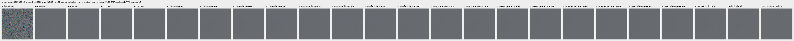

mesh-seed2026112302-present-iso6400-prior-RGGB; ROI `[176, 176, 160, 160]`, exposure8, contrast40.

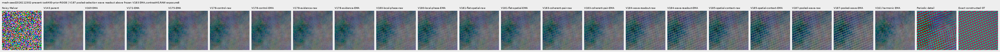

mesh-seed2026112309-present-iso6400-prior-RGGB; ROI `[176, 176, 160, 160]`, exposure8, contrast1.

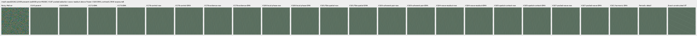

mesh-seed2026112309-present-iso6400-prior-RGGB; ROI `[176, 176, 160, 160]`, exposure8, contrast40.

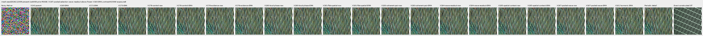

mesh-seed2026112304-absent-iso6400-prior-RGGB; ROI `[165, 0, 160, 160]`, exposure8, contrast40.

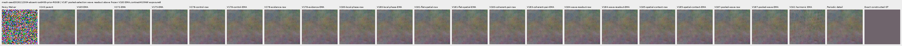

main-overcast-sky; ROI `[176, 176, 160, 160]`, exposure4, contrast1.

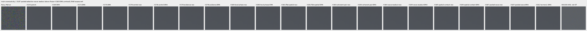

main-building-detail; ROI `[176, 176, 160, 160]`, exposure4, contrast1.

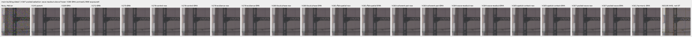

main-foliage; ROI `[176, 176, 160, 160]`, exposure4, contrast1.

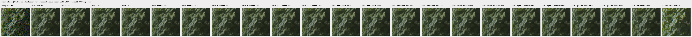

main-chain-link-fence; ROI `[176, 176, 160, 160]`, exposure4, contrast1.

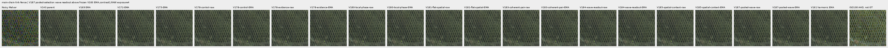

mesh-nominal; ROI `[206, 229, 160, 160]`, exposure16, contrast1.

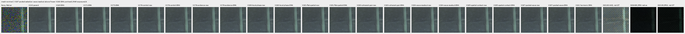

mesh-nominal; ROI `[426, 189, 160, 160]`, exposure16, contrast1.

mesh-profile3879; ROI `[206, 229, 160, 160]`, exposure16, contrast1.

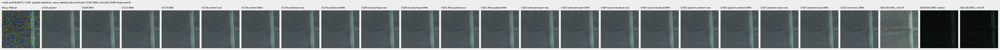

mesh-profile3879; ROI `[426, 189, 160, 160]`, exposure16, contrast1.

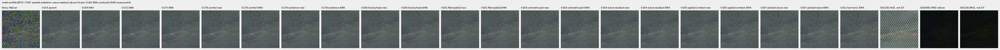

organic-02a76fd33b5e1414a0504f0b3f0aeb03a569b6f4-photo-faint-RGGB; ROI `[112, 112, 160, 160]`, exposure14.3883, contrast8.

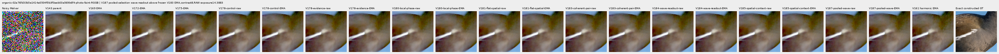

organic-dabacecd4780a1c230f8e9fce6ca1a604bdeab4c-photo-dark-RGGB; ROI `[112, 112, 160, 160]`, exposure102.758, contrast1.

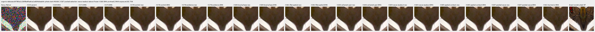

organic-6b3920bceba82d95ecf9351d47f6f94267694bd0-photo-dark-RGGB; ROI `[112, 112, 160, 160]`, exposure64.0491, contrast1.

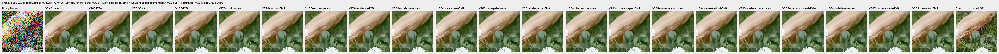

gray-l0.02-adc-only-RGGB; ROI `[48, 48, 160, 160]`, exposure4, contrast40.

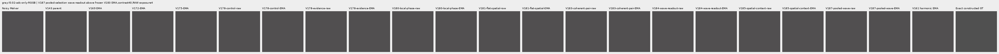

gray-l0.02-iso12800-prior-RGGB; ROI `[48, 48, 160, 160]`, exposure4, contrast40.

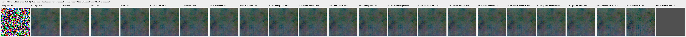

flat512-gray-l0.02-adc-only-RGGB; ROI `[176, 176, 160, 160]`, exposure4, contrast40.

flat512-gray-l0.02-iso6400-prior-RGGB; ROI `[176, 176, 160, 160]`, exposure4, contrast40.

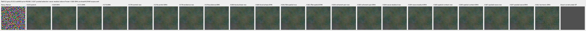

flat512-gray-l0.02-iso12800-prior-RGGB; ROI `[176, 176, 160, 160]`, exposure4, contrast40.

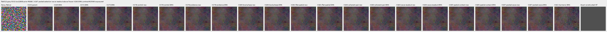

flat512-h210-s0.50-l0.02-iso6400-prior-RGGB; ROI `[176, 176, 160, 160]`, exposure4, contrast40.

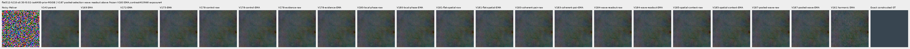

flat512-gray-l0.18-iso12800-prior-RGGB; ROI `[176, 176, 160, 160]`, exposure1, contrast8.

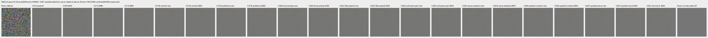

flat512-gray-l0.90-iso12800-prior-RGGB; ROI `[176, 176, 160, 160]`, exposure1, contrast4.

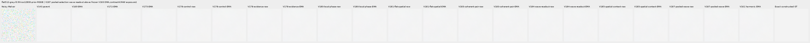

photo-3e638bbb56ed80abc88939468783e3bf9b92ee77-photo-faint-RGGB; ROI `[176, 176, 160, 160]`, exposure12.1494, contrast8.

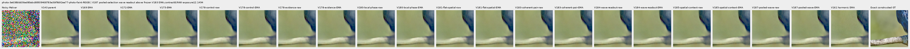

photo-3e638bbb56ed80abc88939468783e3bf9b92ee77-photo-dark-RGGB; ROI `[176, 176, 160, 160]`, exposure80.9959, contrast1.

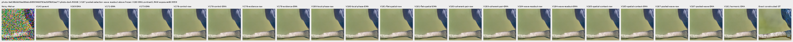

mixed-vertical-step-iso6400-prior-RGGB; ROI `[80, 176, 160, 160]`, exposure8, contrast40.

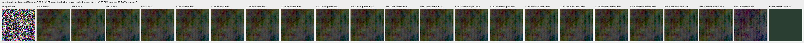

mixed-vertical-step-iso6400-prior-RGGB; ROI `[240, 176, 160, 160]`, exposure8, contrast1.

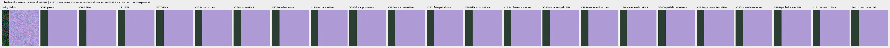

mixed-vertical-step-iso12800-prior-RGGB; ROI `[80, 176, 160, 160]`, exposure8, contrast40.

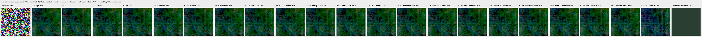

mixed-vertical-step-iso12800-prior-RGGB; ROI `[240, 176, 160, 160]`, exposure8, contrast1.

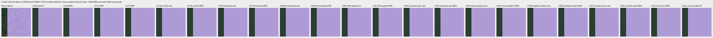

mixed-narrow-bar-iso6400-prior-RGGB; ROI `[80, 176, 160, 160]`, exposure8, contrast40.

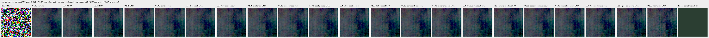

mixed-narrow-bar-iso6400-prior-RGGB; ROI `[240, 176, 160, 160]`, exposure8, contrast1.

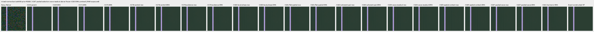

mixed-narrow-bar-iso12800-prior-RGGB; ROI `[80, 176, 160, 160]`, exposure8, contrast40.

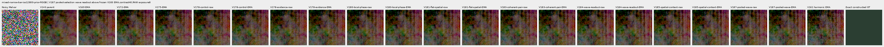

mixed-narrow-bar-iso12800-prior-RGGB; ROI `[240, 176, 160, 160]`, exposure8, contrast1.

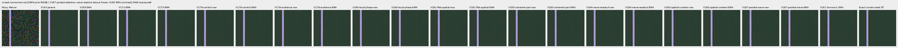

mixed-slanted-step-iso6400-prior-RGGB; ROI `[80, 176, 160, 160]`, exposure8, contrast40.

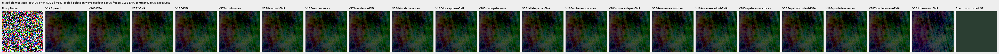

mixed-slanted-step-iso6400-prior-RGGB; ROI `[240, 176, 160, 160]`, exposure8, contrast1.

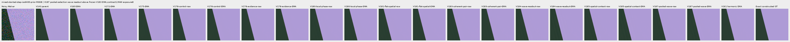

mixed-slanted-step-iso12800-prior-RGGB; ROI `[80, 176, 160, 160]`, exposure8, contrast40.

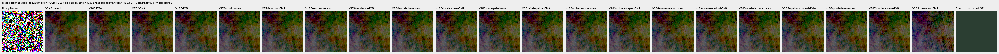

mixed-slanted-step-iso12800-prior-RGGB; ROI `[240, 176, 160, 160]`, exposure8, contrast1.

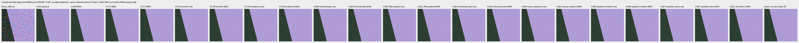

mixed-striped-patch-iso6400-prior-RGGB; ROI `[80, 176, 160, 160]`, exposure8, contrast40.

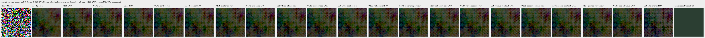

mixed-striped-patch-iso6400-prior-RGGB; ROI `[240, 176, 160, 160]`, exposure8, contrast1.

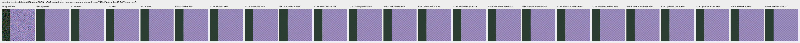

mixed-striped-patch-iso12800-prior-RGGB; ROI `[80, 176, 160, 160]`, exposure8, contrast40.

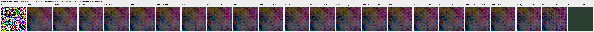

mixed-striped-patch-iso12800-prior-RGGB; ROI `[240, 176, 160, 160]`, exposure8, contrast1.

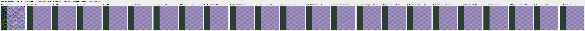

V150-control-bark-contrast0p025-adc-RGGB; ROI `[48, 48, 160, 160]`, exposure1, contrast40.

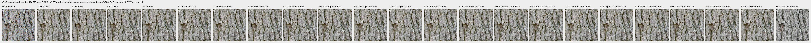

V150-control-raccoon-fur-contrast0p025-adc-RGGB; ROI `[48, 48, 160, 160]`, exposure1, contrast40.

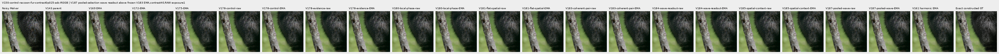

V150-control-ADC-plane0-RGGB; ROI `[176, 176, 160, 160]`, exposure45, contrast8.

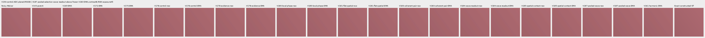

V150-control-ADC-plane1-RGGB; ROI `[176, 176, 160, 160]`, exposure9, contrast8.

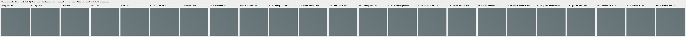

V150-control-ADC-plane2-RGGB; ROI `[176, 176, 160, 160]`, exposure1, contrast8.

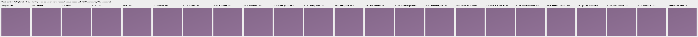

V150-control-ADC-plane3-RGGB; ROI `[176, 176, 160, 160]`, exposure0.24, contrast8.

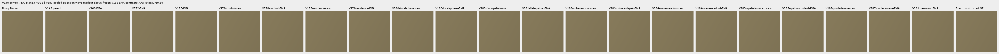

### Noisy, restored and exact constructed GT

mesh-seed2026112302-present-iso6400-prior-RGGB; ROI `[176, 176, 160, 160]`, exposure8, contrast1.

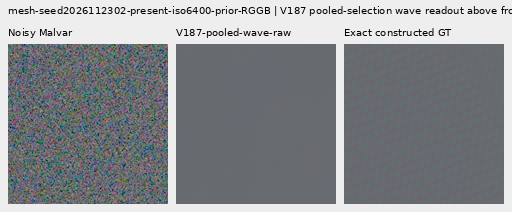

mesh-seed2026112302-present-iso6400-prior-RGGB; ROI `[176, 176, 160, 160]`, exposure8, contrast1.

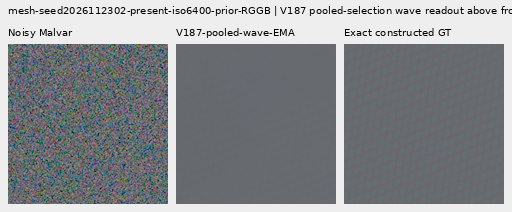

mesh-seed2026112309-present-iso6400-prior-RGGB; ROI `[176, 176, 160, 160]`, exposure8, contrast1.

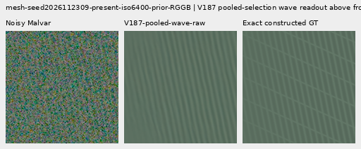

mesh-seed2026112309-present-iso6400-prior-RGGB; ROI `[176, 176, 160, 160]`, exposure8, contrast1.

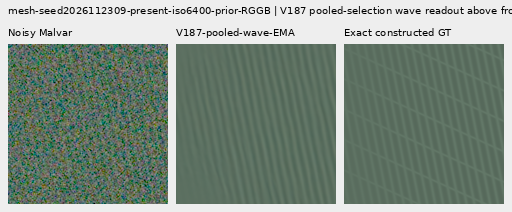

flat512-gray-l0.02-iso6400-prior-RGGB; ROI `[176, 176, 160, 160]`, exposure4, contrast40.

flat512-gray-l0.02-iso6400-prior-RGGB; ROI `[176, 176, 160, 160]`, exposure4, contrast40.

flat512-gray-l0.02-iso12800-prior-RGGB; ROI `[176, 176, 160, 160]`, exposure4, contrast40.

flat512-gray-l0.02-iso12800-prior-RGGB; ROI `[176, 176, 160, 160]`, exposure4, contrast40.

mixed-vertical-step-iso6400-prior-RGGB; ROI `[80, 176, 160, 160]`, exposure8, contrast40.

mixed-vertical-step-iso6400-prior-RGGB; ROI `[80, 176, 160, 160]`, exposure8, contrast40.

mixed-vertical-step-iso12800-prior-RGGB; ROI `[80, 176, 160, 160]`, exposure8, contrast40.

mixed-vertical-step-iso12800-prior-RGGB; ROI `[80, 176, 160, 160]`, exposure8, contrast40.

[Publication verification](results/v187-pooled-wave-publication-verification-v1.json).
