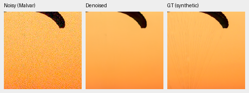
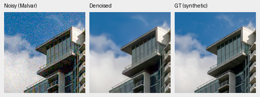
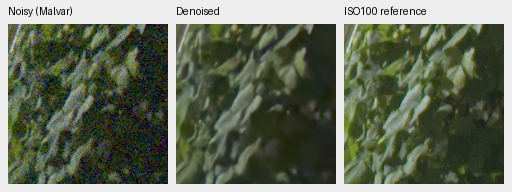
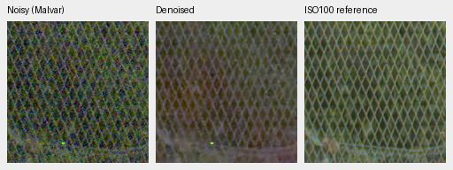

# V28: completed 5,000-step review

V28 improves the complete 427-photo synthetic-noise evaluation over V16 by
**1.48657 dB** and increases measured-CFA means on both real development panels.
Its small primary advantage over RawNIND is uncertain; real rendered PSNR/SSIM
remain slightly lower. Native GFX crops retain colored texture, dots and soft
fine detail. This is a stronger prototype, not the requested final quality.

[Architecture](pretrained-rgb-restoration.md), [first 1k review](pretrained-rgb-v28-review.md),
[complete numerical/native-crop receipt](results/pretrained-rgb-v28-5k-review.json).
Checkpoint SHA256:
`fbb3c489950361e92e5ca277ba5562f79d3b44bcd3ef03efdc77dd1e30756947`.
Evaluation uses FP16 deep features with IEEE FP32 RGB boundary/measurement
projections and physical arithmetic. Original source, weights, initialization,
all noise conditions, display transforms and crop coordinates are recorded.
Protected-final scenes and the standing GFX scene/siblings remain outside training.

## Complete photographic evaluation

427 validation photos +16 procedural sources, all four Bayer layouts and seven
fixed noise/exposure conditions. V16 and RawNIND were rerun in the same suite;
their photographic scores reproduce the existing frozen reference. Means
balance conditions/patterns within each source. Synthetic noise on binned
Commons RGB does not establish superiority on real camera noise.

| Sources | Method | Rendered PSNR | SSIM |
| --- | --- | ---: | ---: |
| 427 photos | V16 | 31.48800 | .923018 |
| 427 photos | **V28 step5000** | **32.97457** | **.940248** |
| 427 photos | RawNIND global-CFA LS | 26.69578 | .790028 |
| 16 procedural | V16 | 30.56577 | .922656 |
| 16 procedural | **V28 step5000** | **32.52517** | **.952263** |
| 16 procedural | RawNIND global-CFA LS | 24.97427 | .720411 |

V28 minus V16 photo PSNR: +1.48657 dB, source-bootstrap95%
[+1.35947,+1.58359]. The earlier 16-photo screen was consistent:33.88736/.953252,
versus V16 32.41824/.937421 and V28 step1000 33.43530/.947856. Its four procedural
sources scored32.61865/.968475. Compare those means only within that smaller
screen; it is not interchangeable with the full427.

Native160px exact-GT triplets from the complete evaluation: noisy Malvar →
V28 step5000 → synthetic GT, RGGB, ISO12800 nominal prior (`shot=.00256`,
`read=.0000262144`), ×1 display exposure, WB[2,1,1.5] and the protocol matrix.
Sources are linearly binned8×8, so these are native **binned evaluation pixels**.
No crop pixels were resized; open the original PNG at100%. Scores use
unquantized predictions; the PNGs are8-bit sRGB previews.

Matched V16 [fabric](images/v28-5k-full427-v16-0014aa4e.png) /
[building](images/v28-5k-full427-v16-002fc6ee.png), and RawNIND
[fabric](images/v28-5k-full427-rawnind-0014aa4e.png) /
[building](images/v28-5k-full427-rawnind-002fc6ee.png) are retained.
Fine fabric lines and some cloud/detail texture are still lost.

Sources: [Roy Egloff](https://commons.wikimedia.org/wiki/File:CH.VD.Villeneuve_2007-08-25_Vertigo-Swiss-Riviera_2392_3x2-R_4K.jpg)
and [Dietmar Rabich](https://commons.wikimedia.org/wiki/File:Vancouver_(BC,_Canada),_Coal_Harbour_Seaside_Park,_Blick_in_den_Himmel_--_2022_--_2158.jpg),
[CC BY-SA4.0](https://creativecommons.org/licenses/by-sa/4.0/); modified by
linear-light binning, crop, simulated Bayer/noise, restoration and rendering.
Derivative previews retain that license; source/cache hashes and full credits
are in the receipt.

## Real-camera development

Known:4 scenes/8 pairs/72 crops. Unseen M100:5 scenes/10 pairs/90 crops.
Primary PSNR uses registered low-noise measured CFA; AHD RGB is an independently
demosaiced auxiliary reference, not exact RGB GT. Same source, crop, input-only
conditioning and render settings across methods; no target-derived model gains.

| Panel | Method | Measured-CFA PSNR | AHD RGB PSNR | AHD SSIM |
| --- | --- | ---: | ---: | ---: |
| Known4 | V16 | 53.27465 | 39.15834 | .921518 |
| Known4 | V28 step1000 | 53.99180 | 39.06454 | .922445 |
| Known4 | **V28 step5000** | **54.11062** | **39.50919** | **.927015** |
| Known4 | RawNIND | 54.06860 | 39.67805 | .928811 |
| Unseen5 | V16 | 53.07856 | 37.65963 | .907179 |
| Unseen5 | V28 step1000 | 53.62905 | 38.05576 | .913260 |
| Unseen5 | **V28 step5000** | **53.65897** | **38.12501** | **.916569** |
| Unseen5 | RawNIND | 53.56220 | 38.14484 | .918380 |

V28 minus RawNIND primary deltas are+.04202 dB, scene-bootstrap95%
[−.31255,+.34557] known, and+.09677 dB [−.06529,+.27187] unseen. Known rendered
PSNR is−.16885 dB [−.42158,+.09927], unseen−.01983 dB [−.34451,+.30500].
Both SSIM means trail RawNIND. These small development panels do not support
a broad superiority claim; untouched final evaluation remains for a mature model.

## Standing GFX qualitative test

DSCF3879 ISO6400 versus DSCF3880 ISO100, same fixed native160px foliage/fence
coordinates, +2EV, high-ISO WB/matrix and input-only shot/read across all methods.
These are512px-context predictions, not new full-frame5k outputs. The independent
ISO100 f/5.6 exposure differs in aperture/time/motion and is **not GT**.
No resampling, output-dependent registration or per-panel exposure adjustments.

Matched fixed eight-step RGB prior:

V28 reveals more mesh than V16/RawNIND, but the5k fence has colored texture and
irregular/thick wires, while foliage remains soft. The fixed prior retains
cleaner mesh structure but is far slower. All V16/1k/RawNIND and sky/building
triplets are in the receipt. Published PNG hashes/dimensions and exact equality
of matched noisy/reference panels were checked.

The architecture's [first1k full102MP run](pretrained-rgb-v28-review.md#full-102-mp-output)
produced verified RGB16/ICC sRGB files in24.88s, compared with V16 30.53s and
RawNIND17.43s in that shared run. This is not a new5k timing, a controlled idle
benchmark or the10-second goal. New weights require a fresh full-frame review.

The [next matched experiment](stabilized-rgb-v29-review.md) retains V28's exact
step-zero neural tensors, seed/data schedule and training recipe, and changes to
explicit shot/read variance stabilization with an expectation inverse. Its first
1k review improves the synthetic screen with mixed real results. A matched
no-DINO training ablation also remains open.
