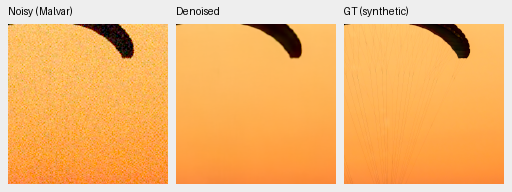
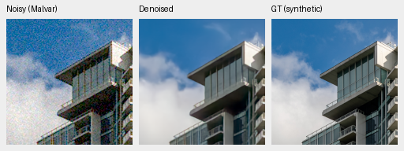
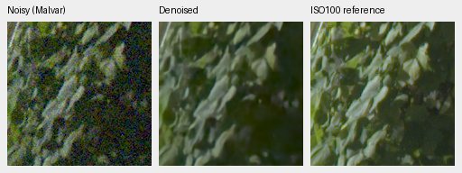
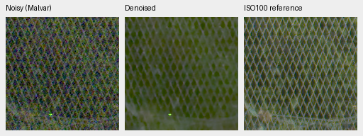
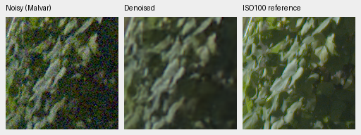
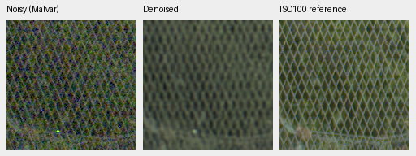
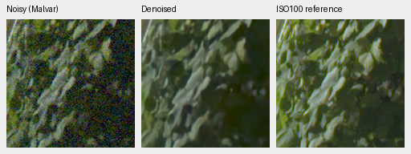
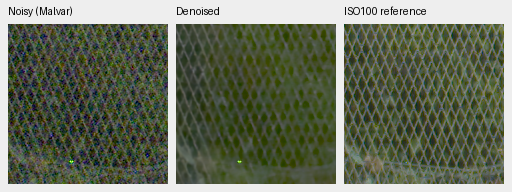

# V28 pretrained RGB/DINO: first 1,000 steps

The single-pass pretrained restoration experiment improves the matched
16-photo synthetic screen over V16 by **1.01706 dB**, and improves primary
real measured-CFA means on both development panels. It does **not** establish
an overall win over RawNIND: primary means are close, known-camera rendered
quality and both SSIM means still trail it. GFX mesh/foliage are more legible
than V16, but remain soft and contain residual color structure. Not promoted.

[Architecture and recipe](pretrained-rgb-restoration.md),
[full numerical/native-crop receipt](results/pretrained-rgb-v28-1k-review.json),
[startup/source/validation evidence](results/pretrained-rgb-v28-startup.json).
The frozen 1k checkpoint SHA256 is
`2dd792004d55dbfabbace9b3f635444f39a6200a917837b052f59b83bed21d7b`.
Step-zero weights, original Gaussian source/weights, DINO revision, actual
training source snapshot and prepared/evaluation manifests are recorded.
No protected-final scenes or GFX scene/siblings were trained on or fitted.

Training uses BF16 deep features with IEEE FP32 RGB boundary/measurement
projections and physical arithmetic. Evaluation uses FP16 deep features and
the same FP32 boundaries/physics. All 226 tests pass, including pretrained-weight
compatibility, weak-signal preservation and spawned-worker restart. The genuine
DINO backbone stays frozen. A no-DINO matched control remains needed; changing
the backbone, initialization and data mix cannot isolate DINO's contribution.

## Complete real development panels

Known: four scenes, eight pairs, 72 crops. Unseen M100: five scenes, ten pairs,
90 crops. Means balance crops, pairs, then scenes. Primary scores use registered
low-noise measured CFA; AHD RGB/SSIM are auxiliary independently demosaiced
references, not exact RGB GT. RawNIND uses publisher normalization and observed
CFA global least-squares gain. All comparisons use identical prepared data and
input-only/nominal noise conditioning, with no reference-derived model gains.

| Panel | Method | Measured-CFA PSNR | AHD RGB PSNR | AHD SSIM |
| --- | --- | ---: | ---: | ---: |
| Known4 | V16 | 53.27465 | 39.15834 | .921518 |
| Known4 | V28 step0 | 48.36508 | 34.34479 | .792730 |
| Known4 | **V28 step1000** | **53.99180** | **39.06454** | **.922445** |
| Known4 | RawNIND | 54.06860 | 39.67805 | .928811 |
| Unseen5 | V16 | 53.07856 | 37.65963 | .907179 |
| Unseen5 | V28 step0 | 45.28231 | 30.63082 | .663961 |
| Unseen5 | **V28 step1000** | **53.62905** | **38.05576** | **.913260** |
| Unseen5 | RawNIND | 53.56220 | 38.14484 | .918380 |

V28 minus RawNIND primary PSNR is −.07680 dB, scene-bootstrap 95%
[−.35705,+.22955] on known cameras, and +.06685 dB [−.16270,+.26595] unseen.
Known rendered PSNR loses .61351 dB [−1.17077,−.05624]. The intervals and SSIM
deficits do not support superiority. The
[fixed eight-step comparator](stabilized-gaussian-review.md) has stronger unseen
PSNR (53.84615) but takes 967.31 seconds for the full 102 MP GFX frame.

## Synthetic screen and native exact-GT crops

Same 16 validation photos + four procedural sources, all four CFAs/seven
conditions, including ADC-only, shadows and clipped highlights. This is a
development screen, **not** the full 427-photo evaluation or protected final.

| Source type | Method | Rendered PSNR | SSIM |
| --- | --- | ---: | ---: |
| Photo | V16 | 32.41824 | .937421 |
| Photo | V28 step0 | 30.59365 | .904216 |
| Photo | **V28 step1000** | **33.43530** | **.947856** |
| Photo | RawNIND | 27.70768 | .826958 |
| Procedural | V16 | 29.74338 | .925096 |
| Procedural | V28 step0 | 28.14116 | .870315 |
| Procedural | **V28 step1000** | **31.76320** | **.961572** |
| Procedural | RawNIND | 24.64040 | .813535 |

Photo PSNR improves +1.01706 dB over V16, source-bootstrap 95%
[+.74836,+1.32740], and +2.84165 dB [2.48929,3.28419] over the same step-zero
initialization. The fixed eight-step comparator's matched 16-photo mean is
34.23888/.954308; V28 has not caught it overall. Per-condition highlight/shadow
and chroma metrics are retained in the receipt rather than inferring successful
highlight recovery from the aggregate.

Native 160px triplets: noisy Malvar → V28 step1000 → exact synthetic GT. RGGB,
nominal ISO12800 (`shot=.00256`, `read=.0000262144`), ×1 display exposure,
WB [2,1,1.5], shared protocol matrix. Exact source/cache/ROI and checkpoint/noise
metadata accompany each PNG in the receipt. Sources were linearly binned 8×8
before evaluation; these are native **binned evaluation pixels**, not original
camera-JPEG pixels. No crop pixels were resized; open the PNG at 100%.

Matched [initial fabric](images/v28-1k-synthetic-initial-0014aa4e.png),
[initial building](images/v28-1k-synthetic-initial-002fc6ee.png),
[V16 fabric](images/v28-1k-synthetic-v16-0014aa4e.png),
[V16 building](images/v28-1k-synthetic-v16-002fc6ee.png),
[RawNIND fabric](images/v28-1k-synthetic-rawnind-0014aa4e.png) and
[RawNIND building](images/v28-1k-synthetic-rawnind-002fc6ee.png) are preserved.
Fine fabric lines are still lost and cloud/detail smoothing remains.

Sources: [Roy Egloff](https://commons.wikimedia.org/wiki/File:CH.VD.Villeneuve_2007-08-25_Vertigo-Swiss-Riviera_2392_3x2-R_4K.jpg)
and [Dietmar Rabich](https://commons.wikimedia.org/wiki/File:Vancouver_(BC,_Canada),_Coal_Harbour_Seaside_Park,_Blick_in_den_Himmel_--_2022_--_2158.jpg),
[CC BY-SA 4.0](https://creativecommons.org/licenses/by-sa/4.0/); modified by
linear-light binning, crop, simulated Bayer/noise, restoration and rendering.
Derivative previews retain that license; full attribution is in the receipt.

## Standing GFX crops

DSCF3879 ISO6400 versus DSCF3880 ISO100, unchanged evaluation-only pair. These
are 512px-context predictions, **not full-frame results**. Identical native 160px
foliage/fence coordinates, +2 EV display exposure, WB/matrix and input-only
noise conditioning across methods. Source/checkpoint hashes and exact ROIs are
in the receipt. Noisy/reference panels were checked for byte equality across
all methods. Aperture/time/motion differ; the ISO100 panel is **not GT**.

Matched RawNIND:

The fence is visible but remains thick/irregular relative to the fixed HQS8
result. Leaves are soft, colored dots and spatial color texture remain. Sky
and building views, matched V16 and HQS8 triplets, and calibrated real AHD
crops are retained in the receipt. This is useful early progress, not the
requested final photographic quality.

## Full 102 MP output

The frozen 1k model completed the full 11662×8746 image: 512px tiles, 64px overlap,
batch4, 520 tiles. [Full receipt and validation](results/gfx-pretrained-rgb-v28-1k-full.json).

| Method | Restoration seconds | Peak CUDA GB |
| --- | ---: | ---: |
| V16 | 30.53 | 1.062 |
| V28 step1000 | **24.88** | **1.905** |
| RawNIND | 17.43 | 1.603 |

Single shared-machine runs, excluding decode/loading/rendering/TIFF encoding;
peak CUDA is not total UMA. The 10-second target remains unmet. The expensive
fixed Joint8 comparator took 967.31s in its separate run; timings across those
runs are not controlled idle comparisons.

All six TIFFs were rehashed and checked as 8746×11662×3 uint16, 16-bit samples,
with all three sRGB ICC profiles and more than256 distinct sampled values.
Files: `/mnt/external/demosaic/evaluation/gfx-3879-3880-pretrained-rgb-v28-1k-full/`,
`restored-{0,1,2}-{linear16,srgb16}.tiff` (V16/V28/RawNIND). The receipt records
all original hashes and code counts. This proves geometry/output precision,
not final photographic quality.

Native crops from the blended FP32 **full frame**, same foliage/fence ROIs and
+2EV display transform, with the separate ISO100 qualitative reference:

Full-frame output retains the same soft leaves, thick/irregular mesh and colored
dots seen in the context test. Matched V16/RawNIND full-frame triplets for all
four regions are retained. No exact-GT or seam-free claim is made for this scene.

Training has resumed the original schedule from1k to5k in a fresh CLI process
with spawned workers. Defaults/README representative model remain V16 until a
stronger complete review supports promotion.
