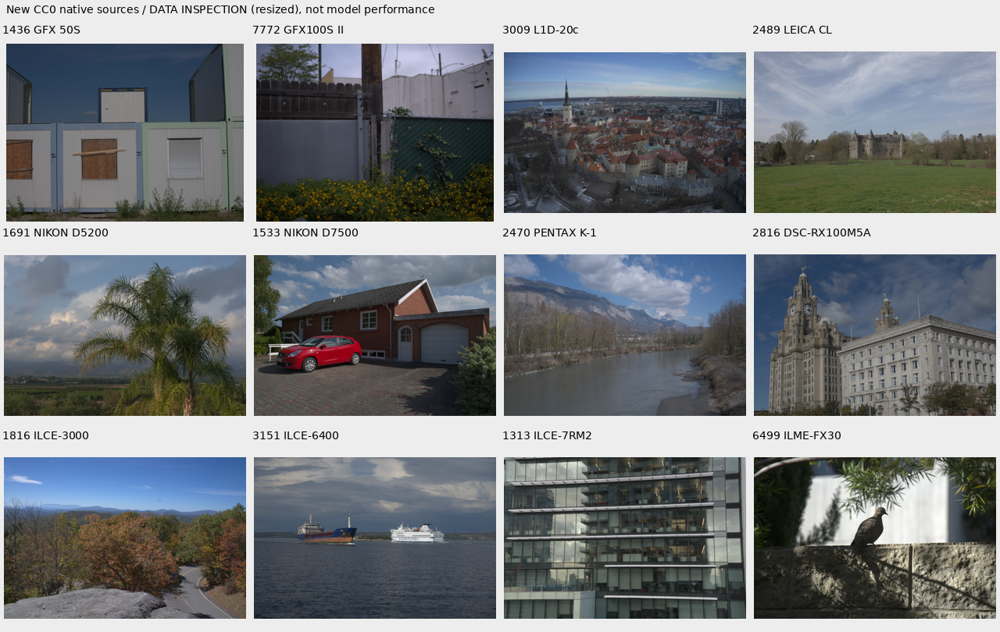

# Broader public RAW quarantine

The reviewed extension adds **69 new CC0 photographic captures**. Together with
the six prior public sources and 53 original native captures, its frozen 4×/8×
datasets contain **128 captures across 106 declared scene groups** (previously
53/31, or 59/37 with the small public extension). Scene counts describe reviewed
capture groups, not proof of every physical-place identity. The original
quarantine remains unchanged; only a separate SHA-pinned subset is admitted.
No model quality gain is established by data admission.
[Frozen selection and producer checks](results/public-raw-expansion-v2-startup.json).
[Complete source admission](results/public-raw-admission-v2.json),
[frozen dataset identities](results/native-public-extension-v2.json).

The metadata survey inspects 291 catalog entries across 185 camera models and
selects 138 models with explicit per-entry CC0 links and ISO 50–200. It prefers
full-area/high-bit-depth variants at catalog resolution ≥20 MP, investigates up
to two entries per model and selects one low-ISO entry. It excludes previous
pilot file IDs, catalog monochrome/pixel-shift/reduced modes, non-GFX Fujifilm
CFAs and the declared unseen camera models. Nine makes are represented:
Canon, Fujifilm, Hasselblad, Leica, Nikon, Panasonic, Pentax, Ricoh and Sony.
These are camera-model counts, **not verified distinct-scene counts**.

The [publisher](https://raw.pixls.us/) asks for low-ISO scenery and uses explicit
per-entry license links. The selection requires those CC0 links; it does not
infer a license from the site alone. It retains the frozen catalog, original
metadata URLs and payload hashes. Eighteen oversized metadata responses are
recorded and excluded. Spaces in metadata URLs are encoded for retrieval while
retaining the exact catalog URL as provenance.

The frozen survey is
`/mnt/external/demosaic/references/raw-pixls-expansion-v2-scout/survey.json`, SHA256
`c3f4e85966f7164fb77e530c8e5563c2e5742866ebde001144a7077cae46d9fd`.
Acquisition uses the existing tested downloader with two workers, published
SHA256/HTTP byte checks, verified reuse, an output lock and a 512 GiB reserve.
Its complete manifest appears only after every download verifies. The separate
Commons downloader continues under its existing lock.

```bash
source scripts/env.sh
uv run --no-sync python scripts/fetch_public_raw.py \
  --survey /mnt/external/demosaic/references/raw-pixls-expansion-v2-scout/survey.json \
  --catalog /mnt/external/demosaic/references/raw-pixls/catalog.json \
  --output /mnt/external/demosaic/references/raw-pixls-expansion-v2 --workers 2
```

The reusable producer verifies actual source bytes, ordinary Bayer geometry,
actual ISO and size, existing/protected source hashes, unseen camera aliases and
the standing GFX identifiers/date family. It applies the existing phase-aligned
4×/8× binning, with no demosaicer, WB/matrix, tone curve or 8-bit intermediate in
the camera-linear uint16 targets. Source noise is reduced, not eliminated:
these are **low-noise estimates, not exact noiseless GT**.

```bash
source scripts/env.sh
uv run --no-sync python scripts/prepare_public_raw_quarantine.py \
  --acquisition /mnt/external/demosaic/references/raw-pixls-expansion-v2/manifest.json \
  --output /mnt/external/demosaic/raw-pixls-expansion-quarantine-v2
```

Per-capture atomic outcomes let interruption/restart reuse completed targets.
Recipe/source changes or changed cached bytes are rejected. Actual decode
failures and unsupported captures remain explicit rejections. The manifest
retains source/cache hashes, metadata, near-white fractions and inspection-only
renderings. The source clipping criterion remains ≤0.1% of bin4 pixels with
any channel ≥65500; passing it is insufficient for admission.

A genuine GFX50R source reproduces the old producer's bin4, bin8 and screen
cache bytes exactly. Resume reuses both target files without changing mtimes.
All 343 tests pass (27.49 s), including unseen-camera aliases and standing GFX
siblings with differing file numbers. Quarantine preparation changes no
existing training manifest. The completed review
below subsequently pins its explicit opt-in subset.

## Source review and separate admission

All 138 downloads verify, totaling 5,835,986,623 bytes. 131 decode successfully;
seven have unsupported formats or unusable color matrices. 102 decoded sources
pass the clipping criterion. Reviewing all seven contact sheets and flagged
references retains 69 new photographic sources: landscape, architecture,
foliage, fences, water, wildlife and a few photographic indoor/plant subjects.
Charts, staged props, clipped sources and duplicate/ambiguous variants are
excluded. Plant 1275/2925 and building 2401/2403 are manually grouped even though
the finite fingerprint screen misses them; building 1118 is conservatively
omitted as a possible family variant of 1533. The prior six sources remain exact.

The identity audit compares all 131 new renders against 42 protected references,
53 original native references, nine previous public candidates and each other.
Full/center 75%/center 50%/four corner 50% views and eight dihedral orientations
use dHash≤40 OR correlation≥.95 after aspect/information checks. Cached protected
screen hashes, source-manifest identities and standing selection bytes verify.
It also checks 46,738 Commons records using full-view cross-render thresholds
dHash≤24 AND correlation≥.97 with 3% aspect tolerance. No Commons matches appear.

Three new sources flag against protected data. The staged D6 jar is excluded;
retained SF/Korean skylines differ clearly from the flagged development plate
stack. Other retained flags compare scenery with ferry, plumbing, radiator,
redbox or different landscapes and are resolved by full-source inspection.
The retained European rail station and unfinished-house source were directly
compared with the cached Tokyo GFX river/platform view and are different scenes.
Protected-final model performance is never scored. These finite screens and
visual checks are **not complete scene recognition**; arbitrary crops, changing
lighting, aspect and viewpoint remain limitations.

The admission preserves the existing pinned review and adds exactly this new
payload SHA256:
`7b1eb85c10d738875f6e0abdda5274ed900c42783b48e0a6987e83d9e76ce591`.
Both native extensions preserve all 53 legacy rows and all six prior public
source/cache/metadata identities. Originals, quarantine manifests and active
training datasets are unchanged. Targets remain low-noise estimates, not exact
GT. Self-signing, flipping quarantine splits or relabeling a source still fails.

Representative source inspection, **resized**, metadata-WB/color/sRGB rendering
at ×1. It is dataset inspection, not a performance/native-pixel comparison:



All sources are explicitly CC0; per-file URLs, original metadata, checksums and
license links are retained in the admission. The preview applies phase binning,
WB/color rendering, orientation and resizing.

The [V43 recipe](../configs/dino-anchored-native-diverse-b16-v43.yaml) tests this
larger native dataset against frozen V37/V39 controls. Same immutable V34 EMA,
fresh AdamW/EMA, seed 47, batch 16, LR 3e-5/planned 3000, 25% paired/25% native/50%
Commons, original 8× validation and full-resolution CNN/precision policy. Only
the native dataset changes. V42's inference precision export is separate.
Stop after 1000 updates for known/unseen, full 427-photo/procedural and full 102 MP GFX
review with native crops; shared logged Commons/paired hashes must match.
