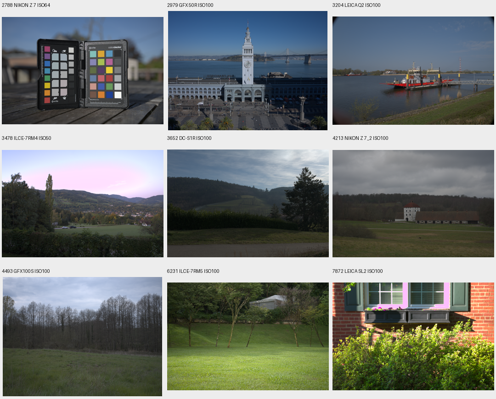

# Public low-ISO RAW candidates

Nine camera samples from [raw.pixls.us](https://raw.pixls.us/) were acquired and
decoded into **quarantine**. Six now have a separately reviewed native-training
extension; the original quarantine and the running V37/V38 datasets stay fixed.
Each selected catalog entry explicitly
links CC0, and all nine published SHA256 values and HTTP byte counts verified:
909,367,652 bytes total. The acquisition archives the catalog, selection, EXIF,
implementation and per-file license/source records.
[Acquisition receipt](results/public-raw-pilot-acquisition.json).

The site requests low-ISO scenery and releases new submissions under CC0, but
individual files still need inspection. Its catalog includes other licenses;
the downloader refuses entries without an explicit CC0 link. Seven acquisition
tests check the license/metadata/catalog identities before network I/O, verified
reuse, standing capture identifiers and competing ownership. Existing checksum
verification is reused from the paired RAW downloader.

All nine decode as ordinary 2×2 Bayer with actual ISO 50–100. The same tested
phase-aligned binning used for native RawNIND targets creates 4× and 8× uint16
camera-RGB caches, with no demosaicer, WB, matrix, tone curve or 8-bit intermediate
in those target caches. These are **low-noise estimates, not exact noiseless GT**.
Per-cache shapes, hashes, raw metadata and code counts are retained;
having many uint16 codes does not establish independent sensor precision.
[Quarantine/cache receipt](results/public-raw-pilot-quarantine.json).

| File ID | Actual camera | ISO | CFA | Content review |
| ---: | --- | ---: | --- | --- |
| 2788 | Nikon Z7 | 64 | RGGB | Color chart/shallow focus; omit from proposed photographic subset |
| 2979 | GFX50R | 100 | RGGB | Ferry Building and bay |
| 3204 | Leica Q2 | 100 | GBRG | Ferry/river |
| 3478 | Sony a7RIV | 50 | RGGB | Valley/foliage; reject prior source saturation |
| 3652 | Panasonic S1R | 100 | GBRG | Hills/foliage |
| 4213 | Nikon Z7II | 100 | RGGB | Building/grass/sky |
| 4493 | GFX100S | 100 | RGGB | Trees/grass/sky |
| 6231 | Sony a7RV | 100 | RGGB | Trees/grass/buildings |
| 7872 | Leica SL2 | 100 | GBRG | Brick/window/foliage; reject prior source saturation |

Dataset inspection overview, **resized**, fixed ×1 metadata-WB/color rendering.
This is not a performance report or a native-pixel comparison. Sources are CC0;
the preview applies phase binning, color rendering, orientation and resizing.



No exact source matches were found against 211 previously acquired training,
development, protected-final and standing-GFX capture hashes. Actual metadata
also rejects the standing GFX date/file family. A cross-render near-duplicate
screen checks all 46,738 Commons records and 53 native training references using
dihedral dHash ≤24, correlation ≥.97 and aspect tolerance 3%. The wider thresholds
flag possible RAW/JPEG overlaps for review. No candidates were flagged. The
reviewed overviews show no standing train/platform scene.
[Screen and limitations](results/public-raw-pilot-screen.json).

That first screen did not compare protected-final image content. The subsequent
data-only audit compares **42 protected references**: five known-development,
ten unseen-development,25 final-test and both locally cached GFX captures.
It tests full/center75%/center50%/four corner50% views and eight dihedral
orientations on both sides. Its deliberately broad gate flags dHash≤40 **or**
correlation≥.95 after aspect/information checks. One candidate, the Q2 ferry,
flags against a smooth tabletop crop in `2pilesofplates`; the best flagged
correlation is only.531. Full and partial source views show different scenes.
All42 protected and nine candidate overviews were inspected for data identity.
No model or protected-final performance scoring occurred.

The source-quality gate also excludes sources with >0.1% of bin4 pixels having
any camera channel≥65500/65535. Sony3478 has20.40%; Leica7872 has3.58%. The
Sony sky has clipped green samples over roughly52% of its top third, and the
color artifact also appears in independent LibRaw rendering. Treating these
clipped source values as clean RGB supervision would undermine the highlight
objective. The chart is omitted separately. The six retained natural scenes
have at most.00047% near-white pixels under the same check. Selection uses only
source data, before model performance on the extension.

This is not complete scene recognition: arbitrary crops, tone curves and
different views can evade finite screening and manual review. All original
quarantine rows and their manifest remain `split: quarantine`, which the loader
rejects. Neither these sources nor screening renders enter V32–V38.
[Reviewed source/cache admission](results/public-raw-admission-v1.json).

## Separate native extension

Both4× and8× extensions contain **59 captures across37 scenes**, preserving all
53 original native captures/31 scenes and adding six distinct CC0 sources:
GFX50R, Q2, S1R, Z7II, GFX100S and a7RV. The target pixels are existing verified
camera-linear uint16 caches; no copies, demosaicer, WB/matrix, gamma or8-bit
intermediate is introduced. They remain low-noise estimates, not exact GT.
[Frozen manifests, hashes and complete screening receipt](results/native-public-extension-v1.json).

`RawCleanDataset` retains the original train-scene whitelist and accepts public
rows only when they exactly match an embedded, SHA-pinned reviewed admission.
Changing quarantine split flags, camera metadata, cache identity or scene names
is rejected, including attempts to relabel a public row as a legacy scene.
The receipt is embedded in the new manifest, so training's existing source
snapshot and resume hash capture the complete admission. This is an explicit
dataset choice, not automatic growth of an active run. V39 now tests it against
the V37 full-resolution control, with the same V34 parent bytes, seed47,
batch16 and schedule. Before training, old/new loader output hashes match for
all53 legacy captures; numerical/model/trainer/evaluator source bytes match,
apart from admission validation and its helper. Commons/paired observation
hashes must match at the first1000 gate. CanonM100 andDMC-GH1 camera holdouts
are preserved; the six added camera models differ. No quality gain is assumed.

```bash
source scripts/env.sh
uv run --no-sync python scripts/extend_native_targets.py \
  --base /mnt/external/demosaic/raw-clean-train32-bin4-v1/manifest.json \
  --admission docs/results/public-raw-admission-v1.json \
  --output /mnt/external/demosaic/raw-clean-public-extension-next/bin4
```

Use the corresponding bin8 base/output for the8× variant. The builder checks
base and new cache hashes, actual shape/dtype and minimum size, preserves every
base row, archives inputs/code and validates the complete candidate before
publishing it. Existing outputs and duplicate admissions are rejected. Current
datasets live under `/mnt/external/demosaic/raw-clean-public-extension-v1/`.
All304 tests pass, including admission/immutability checks; Ruff passes.

To reproduce acquisition in a new directory:

```bash
source scripts/env.sh
uv run --no-sync python scripts/fetch_public_raw.py \
  --survey docs/results/public-raw-candidate-survey.json \
  --catalog /mnt/external/demosaic/references/raw-pixls/catalog.json \
  --output /mnt/external/demosaic/references/raw-pixls-pilot-next --workers 2
```

The downloader preserves verified existing files, uses at most two workers and
a 512 GiB free-space reserve, and publishes the complete acquisition manifest only
after every checksum passes. Interrupted files are retried; finished files are
reused. A new recipe requires a new output. The current phase-bin prototype and
its exact source are archived in `/mnt/external/demosaic/raw-pixls-quarantine-v1/source/`.
