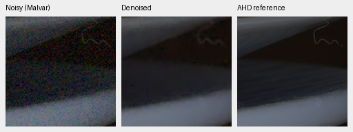
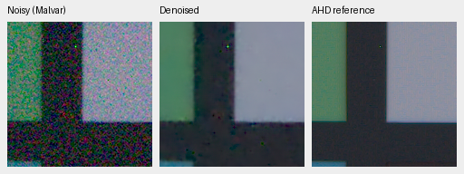
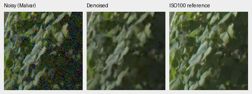
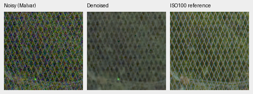

# Multiscale correction with measured-CFA innovation

This experiment addresses the fine-detail loss and coarse color variation in
[the current GFX texture crops](gfx-qualitative.md). Its completed first
1000-step review does not establish a quality improvement. V16 remains the reviewed
model until real RAW, synthetic and native-crop comparisons justify a change.

V24/V25 append the same 255,840-parameter correction network to frozen V16
step5000. A two-level encoder/decoder uses existing gated blocks, skip paths
and channels 24/48/96. It sees the current RGB estimate's local high-pass signal
in noise units, log noise-scale maps, actual CFA phase labels and projected
frozen decoder features. The output is an additive RGB correction scaled by an
input-derived noise proxy. The final head starts at zero, and zero sensor
variance forces zero correction even after training. The scale is a proxy,
not a claim about posterior RGB noise covariance.

V25 also sees four channels of **measured-CFA innovation**:

`(original packed RAW − current RGB sampled at the CFA phases) / noise scale`.

This may expose structure removed by earlier denoising and distinguish a noisy
current estimate from the original measurements. That benefit is an inference
to test, not a result. V24 supplies zeros to these four channels, keeping the
same capacity, RNG consumption and initial weights. Neither receives reference
pixels, target-derived gains or quality scores as inference inputs. The features
are clipped in noise units; physical RAW values and RGB predictions are retained.

The existing Bayer/DINO/fine-refinement path remains frozen, so the experiment
can first test whether measurement access helps without also changing the
previous restoration model. This adds inference cost; it is a quality experiment,
not a claim to have reached the 10-second target. A successful correction would
still need a quality/speed consolidation review.

Both arms use seed 45, LR 5e-4, the existing 50/50 paired-RAW/Commons recipe and
original losses, with a planned 5000-step schedule and a predeclared first
review at 1000 steps. Only the new branch trains. Per-step data RNG isolates
observations from optimization, and sampled batch hashes check that both arms
actually see the same input/target draws. The previous native-target substitution
is disabled for this comparison. Protected final and GFX qualitative scenes and
siblings remain excluded from training.

Physical feature construction, noise normalization and output scaling remain
IEEE FP32. The correction's neural operations also default to IEEE FP32, with
the previously validated optional inference precision selector available for
later measurement. Base training uses BF16; reviewed inference uses explicit
FP16 base compute and default FP32 refinement.

Validation before training: 182 tests passed, including phase-aware access to
measurements, removal of that access in the control, arbitrary even geometry,
zero-variance identity, frozen-weight preservation, exact CPU checkpoint resume,
resume mode rejection and CUDA FP16 convolutions with FP32 physical output.
Both genuine-DINO trial models were compared against frozen V16 on four CFA
layouts and ADC/noisy inputs: 6,291,456 RGB values per arm were bit-identical.
[Source hashes, initialization and startup receipt](results/pyramid-v24-v25-startup.json).

Configs: `configs/dino-pyramid-control-v24.yaml` and
`configs/dino-pyramid-raw-v25.yaml`. Run directories:
`/mnt/external/demosaic/runs/dino-pyramid-{control-v24,raw-v25}/`.
Each run archives actual source, manifests, weights and initialization hash.
Quality reports after training must contain at least two native noisy/denoised/
reference triplets per candidate; this startup note makes no performance claim.

Research context: the [AIM 2025 RAW denoising challenge](https://arxiv.org/abs/2510.06601)
emphasizes synthetic training and evaluation across multiple camera models.
Its abstract supports keeping camera generalization explicit; it does not prove
this innovation representation or reproduce any participant's results. The
implementation here reuses this repository's independently written blocks.

## First 1000-step review

Both arms completed 1000 steps and stopped. **Neither is promoted.** Direct
measurement access improves the small synthetic-photo screen slightly but does
not improve mean real development scores or the visible GFX texture failures.
These results apply to this short frozen-parent training recipe; they do not
establish that RAW access is generally ineffective.

All 41 sampled batch hashes match. CPU/Python/CUDA RNG states, archived training
source and initialization match. Every original restoration weight and EMA value
is bit-identical to the frozen parent; only the new branch changed.
[Completed observation audit](results/pyramid-v24-v25-observations-1k.json).

| Method | Known CFA PSNR | Unseen CFA PSNR | Known AHD sRGB PSNR | Unseen AHD sRGB PSNR |
| --- | ---: | ---: | ---: | ---: |
| Parent V16 step5000 | 53.27466 | 53.07857 | 39.15836 | 37.65963 |
| V24 pyramid control step1000 | 53.28219 | 53.07837 | 39.17458 | 37.66932 |
| V25 RAW innovation step1000 | 53.26126 | 53.07230 | 39.15721 | 37.64656 |
| RawNIND, observed-CFA LS | 54.06860 | 53.56220 | 39.67805 | 38.14484 |

V25-minus-V24 primary PSNR is −0.02093/−0.00608 dB. Scene-bootstrap 95% intervals
are [−0.06179,+0.01712]/[−0.04028,+0.01786] over four/five scenes, so even the
sign of the population effect is uncertain. Auxiliary SSIM is 0.921399/0.906678
versus control 0.921559/0.907352. These are development panels; the protected
final test is untouched. The parent comparison includes additional trainable
capacity and training, so it is not a capacity-matched architecture ablation.

On the same 64-photo synthetic screen, V16/V24/V25 give 31.96724/31.96949/
31.98107 dB and 0.924058/0.924097/0.924425 SSIM. The matched raw-minus-control
PSNR improvement is +0.01158 dB (source-bootstrap 95% [+0.01043,+0.01281]).
Eight procedural sources give 29.22482/29.21752/29.22141 dB. This small screen
is not the full 427-photo evaluation and does not establish superior real quality.

Native 160×160 real triplets at identical coordinates and display transforms:
noisy Malvar → denoised → registered/calibrated low-noise AHD reference,
**not exact RGB GT**. Open original PNGs at 100%. V24 control:

V25 with measurement innovation:

Paired crop sources: Benoit Brummer and Christophe De Vleeschouwer,
*Raw Natural Image Noise Dataset (2025)*, [dataset](https://doi.org/10.14428/DVN/DEQCIM),
[CC BY-SA 4.0](https://creativecommons.org/licenses/by-sa/4.0/); additional
`7D-1` permission: Peter Wemmert, CC0. Modified by registration, calibration,
demosaicing/restoration, crop and shared display. Synthetic source reports also
include two exact synthetic-GT triplets per candidate.

On exact neutral synthetic flats using GFX metadata and the ISO6400 prior,
level 0.01 camera-RGB centered residual standard deviations are:

| Method | Total | 32-pixel means | 64-pixel means |
| --- | ---: | ---: | ---: |
| V16 | 0.00023195 | 0.00009647 | 0.00006318 |
| V24 control | 0.00023225 | 0.00009650 | 0.00006320 |
| V25 RAW innovation | 0.00024438 | 0.00009669 | 0.00006336 |
| RawNIND, CFA-LS | 0.00008124 | 0.00006251 | 0.00005266 |

This diagnostic exposes added fine noise without a coarse-error reduction.
It is one fixed realization per level, not a photographic quality score or a
measured camera noise profile. The larger receptive field and original loss
alone do not establish useful multiscale denoising. A subsequent experiment
should test scale-aware supervision against a matched original-loss control,
rather than assume more correction capacity will remove coarse residuals.

The new DSCF3879/DSCF3880 standing test was also run, with all four fixed ROIs
and shared +2 EV display, using the same 512-pixel context for V16, V24, V25 and
RawNIND. These are crop-only outputs, distinct from the published blended
full-frame comparison. Matched V16/V25 foliage:

Matched V16/V25 fence:

The visible mesh/detail loss remains. The independently captured f/5.6 ISO100
view is a qualitative reference; aperture, motion and lighting still differ.
No GFX pixelwise scores or new full-frame timing claims are made for these
trials. The README and main GFX page retain reviewed V16 full-frame examples.

[Complete numerical, source, weight, ROI, conditioning and display receipts](results/pyramid-v24-v25-1k-review.json)
include all four GFX regions and methods, flat diagnostics, paired bootstrap
comparisons and the synthetic screen. Both quality and speed goals remain open.
