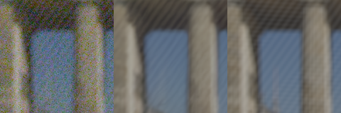
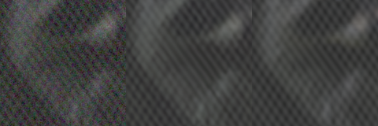

# Finding fine mesh on reserved Bayer samples

An automatic search inside the noisy crop finds both fine-mesh directions
on the right GFX100S cab under both noise profiles. A fit on separate
Bayer samples then makes both directions clearer, while the standing
sky and both left-cab crops stay pixel-identical to Corpus 100k.
The lattice remains soft and uneven in places. Across 16 fresh
ISO6400 photographs with planted weak detail, checked query proposals
reduce false texture in gaps and flat cores, with slightly lower
average recovery than the exterior-only full fit.

[Results and sample-isolation checks](results/query-bayer-reserve-v1/publication.json) ·
[Inputs, code and numerical records](results/query-bayer-reserve-v1/evidence.tar.xz) ·
[Viewed 100% crops and provenance](images/query-bayer-reserve-v1/manifest.json).

## Separate samples for finding and fitting detail

The [exterior peak search](donor-peak-prominence.md) finds useful small
periodic patterns where they repeat in the surroundings. Its exterior
tiles did not corroborate either fine frequency on the right cab.
The new method splits the packed Bayer cells of each 256-pixel query
into four equal groups. Each group includes all four Bayer positions
once per selected cell. Every adjacent 2×2 block of packed cells
independently assigns one cell per group.

1. The first quarter nominates narrow green spectral peaks in four
   radial bands between 0.055 and 0.22 cycles per native pixel. A smooth
   background and noise proxy use that same quarter. The FFT uses a
   Hann window and accounts for both green sample offsets.
2. A second quarter tests fixed sinusoidal predictions fitted on the
   first quarter. Each direction must improve the conditional prediction
   given the other direction, with standardized gain at least 2.75.
3. The other two quarters fit phase and amplitude with the existing
   [localized phase resolver](green-gap-validation.md). It estimates phase
   beyond a 30-native-pixel radius and estimates amplitude inside that
   radius. Delivery requires agreement across those two subsets and
   deducts aligned detail already present in Corpus 100k.

**Reserved query peaks** uses query nominations only. **Query and exterior
peaks** also allows the previous exterior nominations to enter the same
confirmation test. **Exterior peaks, half fit** supplies the original
exterior peaks to the same reduced-sample resolver. **Exterior peaks, full
fit** is the original pipeline. The exact-frequency diagnostic gives the
synthetic frequencies to the half-sample resolver.

Replacing either half's RAW and variance leaves the other half's specified
operation byte-identical in six nonzero fresh examples. The analytic
delivery test holds the nominated frequencies and neural parent fixed.
The parent itself sees all samples, and the empirical gain score can be
affected by shared readout noise. After the first float32 replay showed
CPU/CUDA sensitivity, the reserved fits use float64 normal equations.
The final independent CPU and CUDA lifts agree within `9.32e-10` in
camera-linear units on those examples.

## Fresh exact-target evaluation

Twelve archived calibration fields from the exterior study set the complete
correction strength under the same previous calibration limits for added
gap luma and exact-flat luma. The 20 archived test fields provide a
paired replay. Sixteen new bin4 photographs with fresh noise, frequency
and gap placements provide the second test. All new source IDs are
outside the active 90,692-image training manifest. Each field uses two
independent captures of four roles, including a control where the weak
carrier exists only outside the scored query and a control with an
exactly flat center.

| Fresh ISO6400 method | Intact weak response | Intact increment RMS, DN16 | Added gap RMS, DN16 | Spurious gap response | Added flat RMS, DN16 |
| --- | ---: | ---: | ---: | ---: | ---: |
| Corpus 100k | 29.40% | 178.591 | 0.000 | 5.63% | 0.000 |
| Exterior peaks, full fit | 34.11% | 176.633 | 10.901 | 6.12% | 2.154 |
| Exterior peaks, half fit | 32.84% | 177.685 | 10.570 | 5.69% | 2.367 |
| Reserved query peaks | 33.30% | 177.824 | 6.327 | 5.75% | 0.000 |
| Query and exterior peaks | 33.41% | 177.148 | 7.640 | 5.71% | 0.000 |
| Exact frequencies, half fit | 37.13% | 175.922 | 9.720 | 5.80% | 2.534 |

Relative to exterior peaks with the full fit, the combined policy's
intact response changes by **−0.69 percentage points**, with a 95% paired
bootstrap interval of **−3.06 to +2.07**. Spurious gap projection falls
by **0.41 points** (**−0.94 to −0.03**), and the mean added gap RMS
falls by **3.26 DN16** (**−6.62 to +0.04**). Intact increment RMS is
0.515 DN16 higher with an interval spanning zero. On the 20 replay
photos, intact response changes by −2.02 points and spurious gap projection
by −0.60 points. Both checked policies return the parent in all 72
held-out exact-flat draws across the two panels.

The combined search retains both frequencies within two query DFT bins
in 9 of 32 fresh present draws, equal to the exterior search. It chooses
no weak-frequency hit in the 32 outside-only draws, where the exterior
search proposes the absent weak pattern in 10. In the separate replay,
the two figures for outside-only hits are zero and 16 of 40. A foreground
or another real direction can still qualify, and the whole outside-only
score remains close to the parent.

### Native exact-target crops

Each cell is 160×160 native pixels at `[48,48,160,160]` within the
native 256-pixel query. Triplets show noisy Malvar, the checked combined
policy and the exact constructed target, for repeats 0 of the first
stripe and elliptical cases. Both use ISO6400 shot/read
`.00128/6.5536e-6`, sensor exposure 0.33, display exposure ×2 and common
WB/matrix before clipped sRGB. The parent is Corpus 100k EMA
`87b96f3c487b9edaf1c477742b6c38f2a82cc6b20a94716d51cc8cf46a17a760`.

[All stripe methods](images/query-bayer-reserve-v1/exact/000-present-all.png) ·
[Weak carrier outside only](images/query-bayer-reserve-v1/exact/000-outside-only-all.png) ·
[Exact flat](images/query-bayer-reserve-v1/exact/000-quiet-query-all.png).

[All ellipse methods](images/query-bayer-reserve-v1/exact/002-present-all.png) ·
[Weak carrier outside only](images/query-bayer-reserve-v1/exact/002-outside-only-all.png) ·
[Exact flat](images/query-bayer-reserve-v1/exact/002-quiet-query-all.png).

## Standing GFX100S comparisons

The two right-cab frequencies are **0.50 and 0.71 query DFT bins** from
the two [earlier in-query RAW measurements](green-phase-spectrum.md).
The earlier peaks were used only to audit the result. The checked
query-only bank and combined bank select the same right-cab pair
for both noise profiles. The combined fit changes the right crops
by 12.39 DN16 RGB RMS under nominal and 9.13 under transferred
conditioning. Both diagonal families and more intersections are
visible than in the exterior-only fit. Some intersections remain
soft, disappear locally or form an overly regular lattice. The checked
banks leave the two standing left crops unchanged.

Across nine fixed even crop shifts, the query-only search selects
two directions in every right-cab placement. Eight placements put
both directions within one bin of the earlier noisy-RAW measurements
at each noise profile. On the left, two shifted transferred-profile
placements meet that check. The nominal left and the sky return no
candidate pair in any of the nine shifts. This is a nomination test.
The displayed boards use the fixed standing crop placement.

Fitting and aligning the shifted right-cab outputs to the same 160-pixel
ROI gives added-field cosines of 0.61–0.86 under nominal and 0.47–0.82
under transferred conditioning, relative to the center placement.
The pixelwise median retains 80% and 72% of the center correction's
aligned amplitude, respectively. Overlapping crops share RAW, so this
measures placement stability on these captures. All displayed versions
use the single fixed placement.
[Delivered-field stability](results/query-bayer-reserve-v1/placement-delivery.json).

The main sky stays pixel-identical. Both coarse fence directions stay
visible, and the checked query fit changes the modulation slightly.
The combined bank changes the building by 2.81 camera-linear RGB DN16
without visibly recovering the thinnest cables. The checked foliage
matches the parent.

[Sky](images/query-bayer-reserve-v1/standing/main-overcast-sky-main-overcast-sky.png) ·
[Building](images/query-bayer-reserve-v1/standing/main-building-detail-main-building-detail.png) ·
[Foliage](images/query-bayer-reserve-v1/standing/main-foliage-main-foliage.png) ·
[Coarse fence](images/query-bayer-reserve-v1/standing/main-chain-link-fence-main-chain-link-fence.png).

| Cab noise conditioning | Left | Right |
| --- | --- | --- |
| Nominal `.00128/6.5536e-6` | [Comparison](images/query-bayer-reserve-v1/standing/mesh-nominal-fine-green-mesh-left.png) | [Comparison](images/query-bayer-reserve-v1/standing/mesh-nominal-fine-green-mesh-right.png) |
| Transferred `.0014635775921166604/1.0715704128646712e-6` | [Comparison](images/query-bayer-reserve-v1/standing/mesh-profile3879-fine-green-mesh-left.png) | [Comparison](images/query-bayer-reserve-v1/standing/mesh-profile3879-fine-green-mesh-right.png) |

All eight boards were viewed. The main DSCF3879 crop uses exposure ×4
with DSCF3880 ISO100 AHD. The cab DSCF3842 uses exposure ×16 with DSCF3835
ISO100 AHD and both camera JPEGs. These references are independent
qualitative captures. The scoped inference replay has no new trained
checkpoint or fixed full427 and known/unseen camera PSNR measurements.
