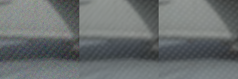
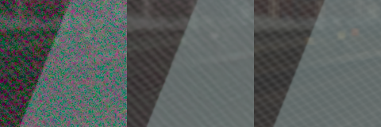

# Recovering weak fence crossings with checked Bayer harmonics

A phase-locked residual makes some fine crossings on the right of the GFX100S
train cab slightly clearer under both noise profiles. The left cab still has
faint, incomplete diagonal fragments. The overcast sky, building and foliage
match the preceding reconstruction pixel for pixel. On 27 held-out photo
backgrounds with exact synthetic targets, the added terms improve recovery of
crossing texture and second harmonics. Some controls admit small false responses.

[Scores, exclusions and checkpoint](results/query-checked-junctions-v1/publication.json) ·
[Executed sources, original attempts and receipts](results/query-checked-junctions-v1/evidence.tar.xz) ·
[Native crops and rendering provenance](images/query-checked-junctions-v1/manifest.json).

The [exterior-donor follow-up](query-donor-composition.md) combines the
right-cab reconstruction with a fallback for the left. The left crop
shows a faint lattice under both profiles. Most of the change comes
from the exterior frequency pair.

## From two directions to a crossing

The [exterior-phase fallback](query-exterior-witness.md) helps when only one
direction can be found inside a crop. The right cab already has two Bayer-supported
directions under both noise profiles. A fit at those two frequencies makes the
diagonals visible, while much of the signal that shapes the junctions stays soft.
The two measured phases suggest four additional bands, the two second harmonics
and the sum and difference of the fundamentals.

1. Start with Corpus 100k EMA
   `87b96f3c487b9edaf1c477742b6c38f2a82cc6b20a94716d51cc8cf46a17a760`
   and the wide curved reconstruction with its adjacent-frequency-checked
   exterior fallback. Use the existing measured pair when it is available.
   Retain candidate bands inside the native-green sampling limit and separated
   from the fundamentals and each other.
2. Estimate the fundamental phases and candidate signs on Bayer green group Q0.
   Score the fixed direction and sign in two reserved green groups, Q2 and Q3,
   accounting for the other bands, the low-frequency surface and any measured
   step. Each fundamental needs a pooled standardized score of 2.75 and positive
   support in both groups. Each added band needs 3.25 pooled and 0.9 in each group.
   The free-phase control uses the same checks with a phase fitted on Q0.
3. After admission, estimate signed amplitudes from Q1–Q3 in a 4×4 grid.
   Shrink weak or incoherent estimates, subtract the component already recovered
   by the wide reconstruction and cap each correction at 1.5 times its Q0
   amplitude. Add the residual with neutral display chroma and use the inherited
   gain of 0.631848. There is no extra training.

The context contribution here is the measured local lattice and its longer-range
phase fit. A semantic scene preview plays no part in this component. The method
can abstain when the scene lacks a reliable pair. It cannot infer a left-cab
lattice from the right-cab result.

## Exact-target controls

Nine photos each carry a planted crossing interaction, planted second harmonics
or only the two fundamentals. Per photo, two independently corrupted repeats
cover four input roles. The outside-only role retains both fundamentals inside
the query and puts the extra bands outside. Further controls contain one strong
direction or an exact-flat query. The source IDs are disjoint from the 90,692-photo
scene-training manifest and the recent comparison cohorts listed in the archive.
The comparison shares all Bayer inputs across arms and uses the same prior pair
and wide restoration. If the previous search abstains, the wide path can return
Corpus 100k directly.

| Photo group | Corpus 100k / wide / locked / free aligned response | Locked minus wide response, paired 95% interval | Corpus 100k / wide / locked / free increment RMS, DN16 |
| --- | ---: | ---: | ---: |
| Crossing interaction | 27.55% / 27.54% / 42.47% / 41.34% | +14.93 points [9.57, 20.27] | 178.56 / 181.36 / 180.00 / 180.09 |
| Second harmonics | 22.39% / 22.41% / 38.51% / 36.64% | +16.11 points [8.63, 23.37] | 188.64 / 192.49 / 190.58 / 190.86 |

Response is the projection of the present-minus-outside-only reconstruction
onto the exact additional signal over the central 128×128 pixels. The paired
bootstrap resamples photos, keeping both repeats together. Phase locking lowers
present-image exact RMS by 1.63 and 2.22 DN16 versus the preceding wide fit.
The unmodified 100k parent still has slightly lower increment RMS, while
recovering less of the target detail and having higher present-image RMS.
The locked and free-phase estimates improve similar amounts on this panel.
Their paired differences in aligned response include zero.

The locked rule admits 17/18 interaction and 13/18 harmonic present draws.
It admits 0/18 and 4/18 of the corresponding outside-only draws, adding
0 and 0.042 DN16 mean luma RMS respectively. In the pure-fundamental group,
3/18 present draws pass, adding 0.100 DN16 mean RMS, and one strong-only draw
passes, adding 0.002 DN16 mean RMS across that group. Exact-flat output matches
the wide fit on all 54 draws. These controls bound the observed false texture
for this panel. A photo-scale claim needs trial coverage beyond planted lattices.

An audit repeats five delivered examples byte for byte. At fixed candidate
geometry, altering Q2 and Q3 leaves the Q0 phase and discovery amplitudes
unchanged. The all-CFA noiseless coordinate test recovers the supplied-phase
correction within 0.00006 DN16 in the central region. Estimating the phase from
Q0 gives up to 4.61 DN16 maximum residual error in the locked test. The final
renderer uses a pseudoinverse for rank-deficient local step fits and registers
interpolation to the amplitude-grid centers. The first render attempt and logs
remain in the archive.

### Native exact-target crops

Each triplet shows the noisy Malvar view, phase-locked reconstruction and
exact synthetic target. Each panel is 160×160 bin4 pixels at 100%, at ROI
`[48,48,160,160]` in its 256×256 query. All share the same camera-to-display
transform within the board, an ISO6400 recipe with shot/read
`0.00128 / 0.0000065536`, capture exposure `0.33`, and display exposure ×2.
These are the first qualifying present fields in each category, selected for
showing the active correction. The scores include every field.

Crossing interaction, *At the Intrepid Museum 2023 223*, Mike Peel,
RGGB. Bin4 source box `[292,158,512,512]`. The dark beam shows clearer crossing
texture. Modulation is still too soft on the pale background.
[Photo attribution and CC BY-SA 4.0](https://commons.wikimedia.org/wiki/File:At_the_Intrepid_Museum_2023_223.jpg) ·
[All methods](images/query-checked-junctions-v1/exact/000-comparison.png) ·
[Outside-only](images/query-checked-junctions-v1/exact/000-outside.png) ·
[Flat](images/query-checked-junctions-v1/exact/000-quiet.png).

Second harmonics, *Tamworth railway station MMB 40 66XXX*, mattbuck,
BGGR. Bin4 source box `[400,4,512,512]`. The texture remains strongest on the
dark side of the edge. The light side still lacks some target modulation.
[Photo attribution and CC BY-SA 3.0](https://commons.wikimedia.org/wiki/File:Tamworth_railway_station_MMB_40_66XXX.jpg) ·
[All methods](images/query-checked-junctions-v1/exact/001-comparison.png) ·
[Outside-only](images/query-checked-junctions-v1/exact/001-outside.png) ·
[Flat](images/query-checked-junctions-v1/exact/001-quiet.png).

## Standing GFX100S comparisons

All eight final boards were inspected at native scale. On the right cab,
some crossings below the pale diagonal become slightly better defined. The
transferred noise profile also shows more of the pattern above that diagonal.
The right lattice stays uneven, with incomplete crossings and background
mottling. The left-cab fragments stay identical under both profiles. The
coarse fence retains both directions, with a small change at crossings.
No new obvious false color is visible. The standing ISO100 AHD and camera JPEGs
are independently captured references with different aperture, exposure
and moving subjects.

| Standing crop | Accepted locked bands, pooled score | Locked / free camera RGB change from preceding wide fit |
| --- | --- | ---: |
| Coarse fence | Second harmonics 47.43 and 24.16, difference 15.64 | 11.844 / 12.164 DN16 |
| Fine cab right, nominal | Second harmonic 4.85, difference 7.95 | 6.546 / 7.001 DN16 |
| Fine cab right, transferred | Second harmonic 6.48, difference 10.05 | 7.335 / 8.221 DN16 |
| Sky, building, foliage and both left-cab profiles | No admissible pair | 0 / 0 DN16 |

A 90° shift of the checked right-cab phases gives scores of 1.57 and 1.60
under the nominal profile and 2.80 and 1.18 under the transferred profile.
All four values fall below the admission threshold. Free phase additionally
admits the other second harmonic on the right. The two profiles weight the same
RAW capture. The score measures support for a nominated pattern in the measured
samples, while the visual references show how much detail still remains missing.

- Main DSCF3879 ISO6400 and DSCF3880 ISO100 AHD, nominal shot/read
  `0.00128 / 0.0000065536`, display ×4. Both comparison paths use the same
  `[176,176,160,160]` crop in each cached input.
  [Sky](images/query-checked-junctions-v1/standing/main-overcast-sky-main-overcast-sky.png) ·
  [building](images/query-checked-junctions-v1/standing/main-building-detail-main-building-detail.png) ·
  [foliage](images/query-checked-junctions-v1/standing/main-foliage-main-foliage.png) ·
  [coarse fence](images/query-checked-junctions-v1/standing/main-chain-link-fence-main-chain-link-fence.png).
- DSCF3842 ISO6400 and DSCF3835 ISO100 AHD with both camera JPEGs, display ×16.
  Cab ROIs in the cached input are `[206,229,160,160]` (left) and
  `[426,189,160,160]` (right). The transferred DSCF3879 shot/read is
  `0.001463577592 / 0.000001071570413`. Both profiles use the same coordinates.
  [Nominal left](images/query-checked-junctions-v1/standing/mesh-nominal-fine-green-mesh-left.png) ·
  [nominal right](images/query-checked-junctions-v1/standing/mesh-nominal-fine-green-mesh-right.png) ·
  [transferred left](images/query-checked-junctions-v1/standing/mesh-profile3879-fine-green-mesh-left.png) ·
  [transferred right](images/query-checked-junctions-v1/standing/mesh-profile3879-fine-green-mesh-right.png).

Training budget is zero. Exact-target numerics and both native GFX reviews
are complete. This inference component has no comparable 427-photo or
known/unseen camera evaluation.
