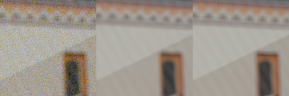
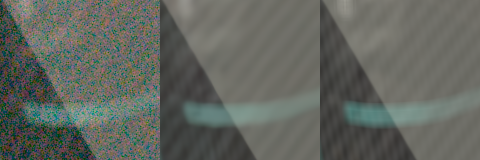

# Using coarse contours to pool weak Bayer detail

On eight ISO6400 photo fields with continuous weak texture across a
visible contrast transition, pooling along the contour raises near-edge
response by **0.60 percentage points** over circular pooling. The
paired interval spans zero. Where the true gaps occur independently of
the edge, the same fit raises spurious gap response by **0.14 points**.
The main limitation on one-sided occlusions is finding the correct
frequencies. The existing search finds no correct pair on any of
16 occluded draws.

[Results and sample-isolation checks](results/query-contour-support-v1/publication.json) ·
[Source, prediction bindings and logs](results/query-contour-support-v1/evidence.tar.xz) ·
[Native crops and provenance](images/query-contour-support-v1/manifest.json).

## Coarse guide and fixed fine geometry

The [local deficit check](query-phase-support.md) lost real detail when
given less local RAW. This comparison changes which measurements the
fit pools while keeping the base aperture area, frequency search,
external phase fits, stronger correction and Corpus 100k parent fixed.
This is a limited test of the scene-guided measurement aggregation
proposed in the [weak-detail review](weak-detail-literature-2026-11.md#4-compare-measurement-aggregation-with-wave-synthesis).

A normalized Gaussian smooths the mean of the two green planes on
Bayer quarters Q0 and Q1 over the surrounding RAW observation. It
uses a 5.6-native-pixel scale. A structure tensor measures gradients
at a 14-pixel scale. The tensor elongates the existing circular
amplitude aperture along the measured contour. The 90-degree
control reverses the orientation at the same elliptical area and
eccentricity. In areas with weak or inconsistent gradients, the
apertures approach a circle. The robust exterior phase and the weaker
frequency are provided by the [existing search](query-phase-curvature.md).
Both new apertures estimate amplitude on Q2/Q3. The final correction
continues to subtract the aligned response already in the parent.

The overall delivery scale stays at 0.631848. On 12 earlier
calibration fields the contour fit and circular fit have nearly
the same weaker-correction RMS, with the uniform strength-matching
factor 1.000686. The rotated fit's factor is 0.990785. On five
checked active draws, replacing Q2/Q3 throughout the context gives
the same guide. Replacing Q0/Q1 gives the same delivery at fixed
geometry, guide and full-input parent. The round aperture
recovers the original fit and CPU/CUDA differences are below
`7.0e-10` on those draws.

## Fresh ISO6400 photo fields

Twenty-four held-out bin4 photographs are disjoint from the scene
training manifest. Every field has two independent draws of the
present, outside-only, strong-only and exact-flat roles. The weaker
carrier stops at a visible edge in eight fields. It stays continuous
across a genuine contrast change in eight. A separate elliptical gap
is present in the last eight. Near-edge response measures the intact
pixels within 28 native pixels of the visible foreground boundary.
The table includes all draws. Spurious gap response is the absolute
projection of the present-minus-outside-only output onto the nominal
weak carrier where both clean targets agree.

| Method | Occluded near-edge response | Continuous near-edge response | Independent-gap intact response | Independent spurious gap response |
| --- | ---: | ---: | ---: | ---: |
| Corpus 100k | 19.845% | 20.067% | 26.680% | 0.778% |
| Wide circular fit | 19.833% | 30.254% | 44.305% | 1.548% |
| Along contours | 19.832% | 30.855% | 44.362% | 1.686% |
| Rotated control | 19.834% | 29.145% | 44.189% | 1.505% |
| Uniform strength match | 19.833% | 30.261% | 44.318% | 1.549% |

On continuous near-edge pixels the aligned fit gains **0.601 points**
over circular pooling (95% paired interval −0.039 to +1.504) and
**1.710 points** over the rotated control (+0.103 to +3.834).
On the lower-contrast side it recovers 21.027%, versus 20.656%
for the circular fit and 19.828% for the rotated fit.
In the unrelated gaps its extra spurious projection versus the
circular fit is **+0.138 points** (+0.062 to +0.211). Added gap
luma RMS rises 0.370 DN16. All automatic methods produce exactly
zero correction in the exact-flat roles.

The automatic search admits 19 of 48 present draws. In 18 of those,
both frequencies lie within three DFT bins of the true pair and the
chosen weaker direction agrees with the exact ordering. The sole
admitted occluded draw has an incorrect pair. A supplied-geometry
diagnostic forces the exact pair on the eight occluded fields,
including their null roles, while retaining measured phase
and amplitude. With circular pooling, intact response rises from
20.799% for the parent to 25.297%, and the aligned aperture reaches
25.282%. The supplied-geometry circular fit adds 4.347 DN16 RMS
to the exact-flat controls. Known geometry shows recoverable detail
and also illustrates why a usable model needs to establish that
the transferred direction is present in the query RAW.

### Testing nominations from one visible side

A follow-up screens observations rejected by the original search.
It finds one coarse edge from Q0, searches for two frequencies on
each of its sides, and chooses a single side and pair using Q0.
The search excludes a seven-pixel band around the fitted edge from
the confirmation regression, which retains an affine background
and the competing carrier. Q1 evaluates only the selected proposal.
It requires 3.25 standardized units of conditional gain per direction.

Of the 15 occluded draws rejected by the original search, 13 produce a
one-sided nomination and five of these contain both frequencies within
three DFT bins. None clears the Q1 check. With exact center frequencies
and the known supported side supplied as a diagnostic, the same planar
check accepts zero of 16 present draws on that side and one of 16 over
the whole query. The exact-geometry checks accept none of the 48
occluded null draws. The automatic screen also adds no accepted pair
across the full photo panel or the eight standing camera inputs.
The true-side check uses exact center frequencies with planar
geometry, whereas the earlier supplied-geometry delivery also uses
exact curvature. The two tests isolate different failure points.
[Frequency screen and exact-side diagnostic](results/query-contour-support-v1/surface-screen.json) ·
[Source and evaluated inputs](results/query-contour-support-v1/surface-screen.tar.xz).

### Native crops

Each triplet uses noisy Malvar, the contour-aligned output and exact
constructed target. Each cell is native 160×160 at
`[48,48,160,160]` within the centered 256-pixel query. Capture
exposure is 0.33, shot/read is `0.00128/6.5536e-6`, and display
uses fixed WB/matrix and exposure ×2. All outputs use Corpus 100k
EMA SHA256
`87b96f3c487b9edaf1c477742b6c38f2a82cc6b20a94716d51cc8cf46a17a760`.

Church facade by Vsatinet, CC BY-SA 4.0. Source box
`[358,150,512,512]`, RGGB, repeat 1. The edge is visible, with
more of the correct weak detail in the target.
[All methods](images/query-contour-support-v1/native/000-comparison.png) ·
[Source and license](https://commons.wikimedia.org/wiki/File:%D0%A1%D1%83%D0%B7%D0%B4%D0%B0%D0%BB%D1%8C_2025,_%D0%92%D0%BE%D1%81%D0%BA%D1%80%D0%B5%D1%81%D0%B5%D0%BD%D1%81%D0%BA%D0%B0%D1%8F_%D1%86%D0%B5%D1%80%D0%BA%D0%BE%D0%B2%D1%8C_01.jpg).

Ortlieb bag by Matti Blume, CC BY-SA 4.0. Source box
`[100,272,512,512]`, GBRG, repeat 0. The blue-green feature
survives. The weak component remains faint in both regions.
[All methods](images/query-contour-support-v1/native/007-comparison.png) ·
[Source and license](<https://commons.wikimedia.org/wiki/File:Ortlieb_Atrack,_OutDoor_2018,_Friedrichshafen_(1X7A9931)_(cropped).jpg>).

## Standing GFX100S comparisons

The measured contour adjustment changes the standing native views
by at most **0.069 DN16** camera-RGB RMS relative to the wide fit.
The fine right cab retains two faint families with incomplete
crossings, and the stronger coarse fence remains visible.
The smooth sky, soft building detail, foliage and both left-cab
ROIs reproduce Corpus 100k. No new color bands or crossings were
visible in the contour variants. ISO100 AHD renders and camera JPEGs
are independent qualitative references. The input, noise profile,
native coordinates and exposure are identical across matched panels.

- DSCF3879 ISO6400 versus DSCF3880 ISO100 AHD, display exposure ×4.
  [Sky](images/query-contour-support-v1/standing/main-overcast-sky-main-overcast-sky.png) ·
  [Building](images/query-contour-support-v1/standing/main-building-detail-main-building-detail.png) ·
  [Foliage](images/query-contour-support-v1/standing/main-foliage-main-foliage.png) ·
  [Coarse fence](images/query-contour-support-v1/standing/main-chain-link-fence-main-chain-link-fence.png).
- DSCF3842 ISO6400 versus DSCF3835 ISO100 AHD and both camera JPEGs,
  display exposure ×16.
  [Left, nominal](images/query-contour-support-v1/standing/mesh-nominal-fine-green-mesh-left.png) ·
  [Right, nominal](images/query-contour-support-v1/standing/mesh-nominal-fine-green-mesh-right.png) ·
  [Left, fixed DSCF3879 prior](images/query-contour-support-v1/standing/mesh-profile3879-fine-green-mesh-left.png) ·
  [Right, fixed DSCF3879 prior](images/query-contour-support-v1/standing/mesh-profile3879-fine-green-mesh-right.png).

No comparable full427 or measured-camera-panel score is available
for this inference study.
