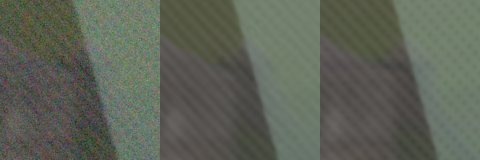
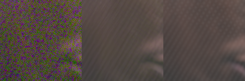

# Checking the shape of weak wires before restoring higher harmonics

Restricting the exterior donor correction to measured bands lowers
exact-target error on three active ISO6400 mesh draws. It also softens
genuinely narrow wires and softens the standing left-cab lattice. Reserved
Bayer samples distinguish the two profile types in a separate conditional
test. This supports checking shape before deciding how much high-frequency
detail to restore.

[Checkpoint, scores and verification](results/query-donor-bandlimit-v1/publication.json) ·
[Executed sources and original receipts](results/query-donor-bandlimit-v1/evidence.tar.xz) ·
[Native image bindings](images/query-donor-bandlimit-v1/manifest.json).

## Measuring which bands the RAW supports

The [exterior-donor fallback](query-donor-composition.md) uses two measured
directions and a narrow ribbon profile. The ribbon carries harmonics beyond
the two fundamental frequencies. This experiment isolates those fundamentals
from the existing donor correction by demodulating each frequency, smoothing
its complex envelope with a 10-native-pixel Gaussian, then modulating it back.
It retains the existing support footprint with additional attenuation near
abrupt changes in the original correction. A second arm adds back the
separately checked higher bands, subtracting the parent's existing contribution
at those bands. No frequency search or gain threshold changes.

The analytic check uses two carriers with phase offsets and a varying
envelope. Adding an unsupported second harmonic, a difference band and
an offset increases its unitless error to 0.6995 RMS. The isolation returns
0.0186 RMS error against the selected fundamentals. Small envelope smoothing
remains even in this exact test. The information retained in the
Gaussian is therefore part of the intervention.

## Exact-target results and the cost of restricting shape

These are replays of the same input and exact target pixels. The photographic
panel covers all 24 present draws and their outside-only, strong-only and flat
controls. Three present draws from two backgrounds activate the donor
fallback. The narrow-wire replay uses the previously retained 12 draws,
three of which activate, all under ISO400. Means in the table are for the
active draws. The unmodified outputs are still included in the source tables.

| Exact target, active draws | Method | Aligned weak response | Increment RMS | Exact present-image RMS |
| --- | --- | ---: | ---: | ---: |
| Soft crossing patterns, ISO6400 | Earlier exterior and checked bands | 35.90% | 112.416 DN16 | 97.566 DN16 |
| Soft crossing patterns, ISO6400 | Earlier correction at equal mean aligned response | 33.72% | 111.891 DN16 | 97.221 DN16 |
| Soft crossing patterns, ISO6400 | Isolated fundamentals plus checked bands | 33.72% | 108.362 DN16 | 93.220 DN16 |
| Narrow occluded wires, ISO400 | Earlier exterior fit | 76.75% | 21.892 DN16 | 69.764 DN16 |
| Narrow occluded wires, ISO400 | Isolated fundamentals plus checked bands | 50.19% | 23.880 DN16 | 70.829 DN16 |

The equal-response diagnostic scales the earlier correction by 0.9001 using
the exact targets from those active draws. Filtering still lowers increment
RMS by 3.53 DN16 at that matched projection. Across all 24 photo draws,
increment RMS changes from 150.078 to 149.571 DN16. The exact-flat and
outside-only outputs retain their existing pixels. The wire cohort has
no active ISO6400 draws, so it cannot verify a high-noise gain for narrow wires.

A proposed shape rule retains the original ribbon when at least one
phase-locked second harmonic of either fundamental passes the existing
reserved green-sample test. Sum and difference bands are still available as
corrections. They do not establish a narrow individual wire. The rule routes
all three active soft-pattern draws to the restricted arm and all three
active narrow-wire replays to the preceding ribbon. This is a development
reduction on retained outputs. A larger end-to-end routing evaluation remains
open. [Numeric replay and equal-response arithmetic](results/query-donor-bandlimit-v1/publication.json).

### Conditional test on new sensor draws

Sixteen photo backgrounds are separate from the soft-pattern replay.
Known center frequencies are supplied to isolate the shape decision.
A narrow periodic Gaussian and a two-sinusoid case share identical
fundamental strengths. Another case adds a crossing interaction while
keeping the individual direction profiles sinusoidal. The flat query is
constant. The four roles have independent sensor draws at each of two
noise levels. Eight backgrounds also have a step.

| Noise | Narrow profiles retained | Smooth profiles accepted as narrow | Crossing-only profiles accepted as narrow | Flats accepted as narrow |
| --- | ---: | ---: | ---: | ---: |
| ISO400 | 16/16 | 1/16 | 0/16 | 0/16 |
| ISO6400 | 15/16 | 1/16 | 0/16 | 0/16 |

Both fundamentals pass in 15/16 high-noise narrow fields. All 15 of
those pass the second-harmonic rule. The conditional test supplies geometry
and compares a finite width range. It measures shape evidence at the
candidate frequencies.

### Native exact-target crops

Each triplet shows noisy Malvar, isolated fundamentals plus checked bands,
and exact GT. The two photo crops use Corpus 100k EMA
`87b96f3c487b9edaf1c477742b6c38f2a82cc6b20a94716d51cc8cf46a17a760`,
native 160×160 bin4 pixels at `[48,48,160,160]` in the 256 query, capture
exposure `0.33`, ISO6400 shot/read `0.00128/0.0000065536`, and display
exposure ×2. The camera matrix and white balance are fixed within each board.

BGGR source 1, Ezarate, repeat 1, source box `[500,264,512,512]`. Both directions
remain visible, with softer crossing modulation than in the exact target.
[Source photo and CC BY-SA 4.0](https://commons.wikimedia.org/wiki/File:MonumentoFunerarioPedroLuro-MDP-ago2016.jpg) ·
[All variants](images/query-donor-bandlimit-v1/exact/photo-001-1-comparison.png).

GRBG source 10, Rama, repeat 0, source box `[244,220,512,512]`. The restricted
fit looks smoother and some fine crossings remain missing.
[Source photo and CC BY-SA 2.0 France](https://commons.wikimedia.org/wiki/File:Saadiq-IMG_6267.jpg) ·
[All variants](images/query-donor-bandlimit-v1/exact/photo-010-0-comparison.png).

The narrow-wire g110 controls use the spatial 2k EMA with context
disabled, SHA256 `97fd551bd0ae0b7aa97c67e1f6e8b513b722f70d5ad8b8814a96586b934eafac`,
GRBG, draw 0, native ROI `[80,80,160,160]` in a 320-pixel field, ADC16
black fraction 0.03, identity WB/matrix, display ×1 and shared contrast ×8.
Shot/read is `8e-5/2.56e-8` at ISO400 and `0.00128/6.5536e-6` at ISO6400.
[ISO400 triplet](images/query-donor-bandlimit-v1/exact/iso400-occluded-g110-r0-triplet.png) ·
[ISO400 methods](images/query-donor-bandlimit-v1/exact/iso400-occluded-g110-r0-comparison.png) ·
[ISO6400 triplet](images/query-donor-bandlimit-v1/exact/iso6400-occluded-g110-r0-triplet.png) ·
[ISO6400 methods](images/query-donor-bandlimit-v1/exact/iso6400-occluded-g110-r0-comparison.png).

## Standing GFX100S comparisons

The two left crops retain faint diagonals, with softer crossings.
Camera RGB change above the base falls from 11.120 to 6.460 DN16
nominal and from 9.918 to 5.848 DN16 transferred. At equal correction RMS,
the restricted bands look a little softer than reducing the earlier
ribbon's gain alone. Neither board resolves the finer crossings visible
in the independent references. The right-cab lattice, overcast sky,
coarse fence, foliage and building retain the preceding pixels. All
eight standing boards and the two extra strength controls were viewed.

Both camera families use the Corpus 100k checkpoint above. Main DSCF3879
ISO6400 and DSCF3880 ISO100 AHD use ROI `[176,176,160,160]` in each cached
input, nominal shot/read `0.00128/0.0000065536` and display ×4.
[Sky](images/query-donor-bandlimit-v1/standing/main-overcast-sky-main-overcast-sky.png) ·
[Building](images/query-donor-bandlimit-v1/standing/main-building-detail-main-building-detail.png) ·
[Foliage](images/query-donor-bandlimit-v1/standing/main-foliage-main-foliage.png) ·
[Coarse fence](images/query-donor-bandlimit-v1/standing/main-chain-link-fence-main-chain-link-fence.png).

Cab DSCF3842 ISO6400 and DSCF3835 ISO100 AHD use display ×16 and cached
ROIs `[206,229,160,160]` left and `[426,189,160,160]` right. The transferred
shot/read is `0.001463577592/0.000001071570413`. Both profiles share
the same RAW. Both camera JPEGs appear in the main cab boards. The ISO100
AHD and JPEG are qualitative references with different aperture, exposure
and subject motion.
[Nominal left](images/query-donor-bandlimit-v1/standing/mesh-nominal-fine-green-mesh-left.png) ·
[Nominal right](images/query-donor-bandlimit-v1/standing/mesh-nominal-fine-green-mesh-right.png) ·
[Transferred left](images/query-donor-bandlimit-v1/standing/mesh-profile3879-fine-green-mesh-left.png) ·
[Transferred right](images/query-donor-bandlimit-v1/standing/mesh-profile3879-fine-green-mesh-right.png) ·
[Equal RMS, nominal left](images/query-donor-bandlimit-v1/equal-strength/mesh-nominal-fine-green-mesh-left.png) ·
[Equal RMS, transferred left](images/query-donor-bandlimit-v1/equal-strength/mesh-profile3879-fine-green-mesh-left.png).

This is a scoped inference comparison with zero training updates. Numerical
and native reviews are complete. No comparable full427 or measured-camera
panel is reported for this component.
