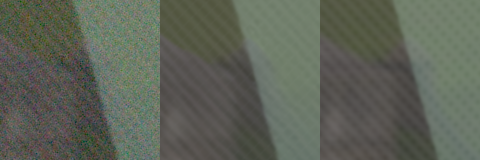
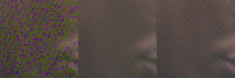

# Using exterior Bayer measurements to recover the left cab lattice

Two exterior regions of the noisy train scene supply a frequency pair that
the original crop search misses on the left cab. The combined reconstruction
makes a faint lattice visible there under both noise profiles and preserves
the earlier right-cab reconstruction. The left lattice is still too faint and
regular in places. A checked difference band adds only a small visible change
above the exterior fit. On a controlled exact-target panel, matching surrounds
enable three additional recoveries and rotated surrounds enable none.

[Machine evidence and checkpoint](results/query-donor-composition-v1/publication.json) ·
[Executed sources and archived attempts](results/query-donor-composition-v1/evidence.tar.xz) ·
[Native board bindings](images/query-donor-composition-v1/manifest.json).

The [wire-shape follow-up](query-donor-bandlimit.md) restores only the measured
fundamentals and checked bands. This lowers error on the active soft-pattern
replays and loses some true sharp wire detail. Reserved second harmonics
support the narrow profile in most new tests with supplied geometry.

## How the surroundings enter the reconstruction

The reconstruction starts with Corpus 100k EMA
`87b96f3c487b9edaf1c477742b6c38f2a82cc6b20a94716d51cc8cf46a17a760`.
The [existing checked-band path](query-checked-junctions.md) handles crops
where the local search has recovered both frequencies. For the remaining
crops, the [exterior-donor method](local-mesh-stability.md) searches disjoint
RAW windows beyond a 32-pixel margin. It supplies a pair only when at least
two exterior windows support that pair. It carries the frequencies into the
query and fits the phases on local green samples.

The fallback also requires that two reserved green groups confirm both
fundamentals. It estimates the harmonic frequencies on Q0, with a maximum
refinement of 0.0055 cycles per pixel per axis around the exterior seed.
The existing 13-placement fit checks and restores the two wire profiles.
The checked harmonic is fit above that result using the previous study's
thresholds and gain of 0.631848. Subtracting the band already present in the
donor-restored parent limits duplicate correction. Brightness and texture
elsewhere provide a reason to search. The local Bayer measurements still
have to support the proposed frequencies and phases.

The left-cab exterior estimate is approximately `(0.1181, 0.0723)` and
`(0.0907, −0.0732)` cycles per native pixel. Both refinements remain close
to that estimate. Perturbing Q2 and Q3 on the two standing left cases
preserves the exterior nomination, Q0 phase, refined frequencies, and
amplitudes used for discovery. The two noise profiles use the same capture.

## What the controlled exterior changes

The panel uses twelve photo backgrounds with new targets and ISO6400 draws.
Two sources are new to this series and ten are reused from the checked
harmonics study with different crop draws, geometry and corruption. All are
outside the full-epoch scene-training manifest. Each photo has two repeats,
with continuous mesh, a contrast step or a local gap. Every repeat also
has outside-only, strong-only and exact-flat query roles. The exterior
frequencies have stronger modulation so they can be estimated from donor
windows.

The intervention rotates both exterior frequencies by 0.59 radians and
replaces only the RAW and variance beyond the 32-pixel margin. The central
320×320 parent input and all query checks inside it use identical samples.
The neural parent is evaluated once on those inputs. Both arms use the same
native target. The bound capture files retain the masks and sensor draws,
with fingerprints for both exteriors in the archive.

| Restoration | Aligned weak response | Whole-core increment RMS | Exact present-image RMS |
| --- | ---: | ---: | ---: |
| Corpus 100k EMA | 21.76% | 152.448 DN16 | 139.617 DN16 |
| Local search and checked bands | 32.78% | 150.026 DN16 | 133.087 DN16 |
| With matching exterior fit | 35.24% | 150.115 DN16 | 132.868 DN16 |
| With matching exterior and checked bands | 35.50% | 150.078 DN16 | 132.824 DN16 |
| With rotated exterior and checked bands | 32.78% | 150.026 DN16 | 133.087 DN16 |

Response measures the present-minus-outside-only recovery aligned with the
exact local increment in the central 128×128 pixels. Matching exterior
context adds **2.73 percentage points** to the local path, with a paired
photo-bootstrap 95% interval of [0, 6.71]. Whole-core increment RMS changes
by +0.052 DN16 [−0.568, +0.724]. Where the target has full support, increment
RMS falls from 155.885 to 155.495 DN16. The small aggregate changes reflect
two backgrounds. The local path finds a pair in 15 of 24 present draws. The
matching exterior fit delivers on 3 of the other 9, all in the contrast-step
group. The additional harmonic changes one of those three draws.

Every rotated output is byte-identical to its local-path result. All 72
outside-only, strong-only and flat draws remain pixel-identical to the
local path under both exteriors. None of the local-gap draws receives a new
correction. This panel therefore tests rejection of false proposals under the
specified intervention. It supplies little evidence about preserving genuine
gaps when the fallback activates.

### Native exact-target crops

Each triplet shows noisy Malvar, matching exterior plus checked bands and
exact synthetic GT. The panels are 160×160 bin4 pixels at 100%, ROI
`[48,48,160,160]` in the native 256×256 query. The ISO6400 shot/read is
`0.00128 / 0.0000065536`, with capture exposure `0.33` and display ×2.
The white balance and camera-to-display matrix are shared within each
comparison. Both selected cases use the first present repeat for that field
on which the exterior fallback delivers.

*Monumento Funerario Pedro Luro*, Ezarate, source 1, BGGR, repeat 1,
source box `[500,264,512,512]`. A second direction is faintly visible over
the edge. The target has much stronger pattern on its lighter side.
[Photo attribution and CC BY-SA 4.0](https://commons.wikimedia.org/wiki/File:MonumentoFunerarioPedroLuro-MDP-ago2016.jpg) ·
[Five methods and target](images/query-donor-composition-v1/exact/001-matching.png) ·
[Outside-only](images/query-donor-composition-v1/exact/001-outside-only.png) ·
[Flat](images/query-donor-composition-v1/exact/001-quiet.png).

*Saadiq-IMG 6267*, Rama, source 10, GRBG, repeat 0,
source box `[244,220,512,512]`. The exterior fit strengthens a faint
second direction. The target still has finer crossing modulation.
[Photo attribution and CC BY-SA 2.0 France](https://commons.wikimedia.org/wiki/File:Saadiq-IMG_6267.jpg) ·
[Five methods and target](images/query-donor-composition-v1/exact/010-matching.png) ·
[Outside-only](images/query-donor-composition-v1/exact/010-outside-only.png) ·
[Flat](images/query-donor-composition-v1/exact/010-quiet.png) ·
[Repeat 1 where the band is active](images/query-donor-composition-v1/exact/010-repeat1-bands.png).

## Standing GFX100S comparisons

All eight native boards were viewed. The exterior fit makes faint diamonds
visible to the left of the green post, especially below the near-horizontal
wire. Adding the checked band makes little visible difference above the
exterior fit. The right-cab view keeps its previous reconstruction. It still
has uneven crossings and mottled paint. The coarse fence, sky, building and
foliage also match the preceding checked-band output pixel for pixel.
The building's finest cables and some leaves remain soft.

| Fine cab left | Fundamental support, pooled scores | Difference band score / 90° phase control | Exterior RGB change | Additional checked-band RGB change |
| --- | ---: | ---: | ---: | ---: |
| Nominal | 9.46 / 8.75 | 4.85 / −2.47 | 11.042 DN16 | 1.294 DN16 |
| Transferred | 11.49 / 10.96 | 5.88 / −3.12 | 9.756 DN16 | 1.752 DN16 |

The larger exterior-fit change reproduces the earlier Corpus 100k donor
result on these left crops. The new contribution is the combined route for
both sides and a narrowly supported additional band in the left crop. Both
real profiles use the same source RAW. The ISO100 AHD and camera JPEG
references are independent captures with different aperture, exposure and
possible subject motion. They show substantially clearer crossings.

- Main DSCF3879 ISO6400 with DSCF3880 ISO100 AHD, nominal shot/read
  `0.00128 / 0.0000065536`, display ×4. All native crops use
  `[176,176,160,160]` in their cached input.
  [Sky](images/query-donor-composition-v1/standing/main-overcast-sky-main-overcast-sky.png) ·
  [building](images/query-donor-composition-v1/standing/main-building-detail-main-building-detail.png) ·
  [foliage](images/query-donor-composition-v1/standing/main-foliage-main-foliage.png) ·
  [coarse fence](images/query-donor-composition-v1/standing/main-chain-link-fence-main-chain-link-fence.png).
- Fine mesh DSCF3842 ISO6400 with DSCF3835 ISO100 AHD and both camera JPEGs,
  display ×16. Cached native ROIs are `[206,229,160,160]` left and
  `[426,189,160,160]` right. The transferred shot/read is
  `0.001463577592 / 0.000001071570413`.
  [Nominal left](images/query-donor-composition-v1/standing/mesh-nominal-fine-green-mesh-left.png) ·
  [nominal right](images/query-donor-composition-v1/standing/mesh-nominal-fine-green-mesh-right.png) ·
  [transferred left](images/query-donor-composition-v1/standing/mesh-profile3879-fine-green-mesh-left.png) ·
  [transferred right](images/query-donor-composition-v1/standing/mesh-profile3879-fine-green-mesh-right.png).

This is a scoped inference component with zero training updates.
Exact-target measurements and native review are complete. The comparison
has no 427-photo or known/unseen camera scores.
