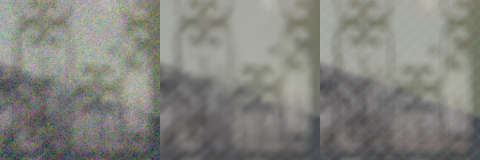
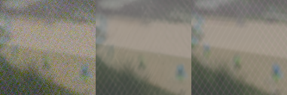

# Recovering wire colour with nearby RAW frequencies

An exterior-frequency fallback raises aligned chroma response from **31.80% to 35.52%** on 16 fresh ISO6400 coloured wire targets. Independent intact chroma-increment RMS falls from **179.44 to 176.60 DN16**. The correction leaves luminance effectively fixed. All eight standing GFX crops reproduce the preceding output, including the smooth overcast sky and incomplete cab crossings. The fallback remains experimental.

[Results and checkpoint](results/query-exterior-colour-v1/publication.json) · [Frozen sources and evidence](results/query-exterior-colour-v1/evidence.tar.xz) · [Native crop provenance](images/query-exterior-colour-v1/manifest.json).

## Using exterior context when green-only delivery abstains

The preceding directional route finds an exterior frequency pair for several missed coloured wires, then rejects the local green fundamentals or the overlap fit. Passing those measured frequencies directly to the reserved-colour check captures all three high-noise misses that also pass with supplied frequencies in the earlier replay. Exterior annulus refinement recovers the same three. Local green-only frequency refinement loses one of the two recoverable ISO400 cases. The final policy uses the original exterior pair.

The destination RAW still supplies the phase. The existing check uses Q0 and Q1 to nominate the colour direction and Q2 and Q3 to confirm it. The new local delivery separately demodulates both groups along the fixed phase on actual Bayer sites. Its 19-pixel Gaussian support keeps the positive lower estimate after subtracting 1.25 estimated local standard deviations from each group. The local scale is relative to the globally detected chroma, fades toward the query edge and is bounded by the measured green amplitude. The correction uses 0.65 gain in the scene-linear luminance null space. Across both panels its maximum luminance change is below 0.0011 DN16. This path uses the Corpus 100k EMA `87b96f3c487b9edaf1c477742b6c38f2a82cc6b20a94716d51cc8cf46a17a760`, the directional band fit, shared gap check and preceding signed Bayer colour. [Prior colour check and supplied-frequency diagnostic](query-signed-colour.md).

## Exact-target evidence

The 24 fresh bin4 images come from the validation split of the canonical manifest. They are outside the fixed 427-photo panel, the recent controlled pools and the 90,692-photo training set. Each uses the same analytical family as the earlier study, with new photos, camera settings, wire geometry and independent noise draws. The exact targets contain synthetic wires over photographic fields. The rotated control substitutes the exterior while keeping the neural mosaic and halo identical.

| ISO6400, 16 coloured fields | Aligned chroma | Intact increment RMS | Present chroma RMS |
| --- | ---: | ---: | ---: |
| Preceding colour check | 31.80% | 179.44 DN16 | 164.46 DN16 |
| Exterior-frequency fallback | 35.52% | 176.60 DN16 | 163.01 DN16 |

The five applied ISO6400 edits improve the panel response by **3.72 points [0.89, 7.07]** and lower intact error by **2.84 DN16 [0.67, 5.43]**, with intervals resampled by photo ID. Two additional fields improve at ISO400, increasing response from 54.77% to 57.17%. The 24-photo older replay also gains 1.81 points at ISO6400, with a paired interval touching zero. The replay verifies all 48 preceding confirmed image arrays exactly.

All neutral-present, rotated, strong-only and outside-only controls keep the previous pixels in both sets. All ISO6400 exact-flat core pixels also match. Three ISO400 flat-core controls receive small colour edits, with up to **0.94 DN16 RMS and 11.57 DN16 peak** in the fresh set. The exact-flat fixture still has supported texture outside the central flat square. The Gaussian localization also adds mean **0.68 DN16** inside the fresh true ISO6400 gaps. These limits matter when applying the fallback near interruptions.

## Native exact-target comparisons

Each 160×160 cell uses query ROI `[48,48,160,160]`, unchanged native pixels, ADC16 with black 0.03 and fixed exposure ×2. The ISO6400 noise is shot/read `0.00128/6.5536e-6` at capture exposure 0.33. Each triplet shows noisy Malvar, the exterior-frequency fallback and exact constructed GT.

**Lisbon iron door**, Jules Verne Times Two, CC BY-SA 4.0, source box `[146,12,512,512]`, GRBG. The green tint recovers slightly along the diagonals. The actual crossings remain much softer than GT. Intact chroma error falls from 224.24 to 210.18 DN16. [Source](https://commons.wikimedia.org/wiki/File:Framed_iron_door,_Pra%C3%A7a_de_Londres,_Lisbon,_Portugal_julesvernex2.jpg) · [Full comparison](images/query-exterior-colour-v1/exact/fresh-010-iso6400-comparison.png).

**Salt Lake City**, Another Believer, CC BY-SA 4.0, source box `[456,156,512,512]`, RGGB. Lower diagonal colour is slightly clearer beside the gap, with fewer visible crossings than the exact target. Intact chroma error falls from 189.28 to 176.09 DN16. [Source](https://commons.wikimedia.org/wiki/File:Salt_Lake_City,_Utah_(2021)_-_179.jpg) · [Full comparison](images/query-exterior-colour-v1/exact/fresh-020-iso6400-comparison.png).

## Standing GFX100S comparisons

All eight native comparisons were viewed. The exterior finds no pair in the sky. Building and foliage propose pairs that fail chroma confirmation. The coarse fence and all cab crops already use a luminance geometry path and bypass the fallback. The sky remains smooth. The coarse crossings are coherent, thin building cables and foliage stay soft, and the cab still shows incomplete crossings and background mottle.

Main DSCF3879 uses shot/read `0.00128/6.5536e-6` and display ×4. DSCF3842 cab uses ×16, with the nominal and transferred `0.0014635775921166604/1.0715704128646712e-6` profiles. Independent ISO100 AHD and camera JPEGs are qualitative references with different exposure, aperture and moving subjects. All coordinates and checkpoint bindings are in the manifest.

[Overcast sky](images/query-exterior-colour-v1/standing/main-overcast-sky-main-overcast-sky.png) · [Building](images/query-exterior-colour-v1/standing/main-building-detail-main-building-detail.png) · [Foliage](images/query-exterior-colour-v1/standing/main-foliage-main-foliage.png) · [Coarse fence](images/query-exterior-colour-v1/standing/main-chain-link-fence-main-chain-link-fence.png).

| Cab profile | Native comparison |
| --- | --- |
| Nominal | [Left](images/query-exterior-colour-v1/standing/mesh-nominal-fine-green-mesh-left.png) · [Right](images/query-exterior-colour-v1/standing/mesh-nominal-fine-green-mesh-right.png) |
| Transferred | [Left](images/query-exterior-colour-v1/standing/mesh-profile3879-fine-green-mesh-left.png) · [Right](images/query-exterior-colour-v1/standing/mesh-profile3879-fine-green-mesh-right.png) |

This fixed-weight component study has no fixed427 or measured-camera scores. [Comparable performance history](performance-history.md).
