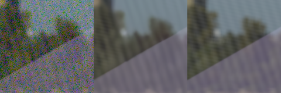
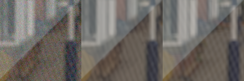
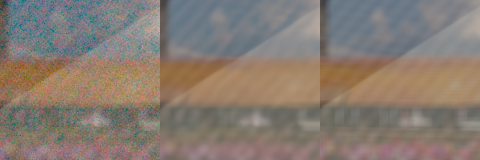
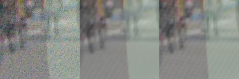

# Finding bent weak texture outside the query and checking it inside

On 12 new ISO6400 photo fields where a weaker texture stops at a visible
edge, the checked bent-phase fallback raises intact weak response from
**39.87% to 50.32%** above the existing wide fit. Fine-increment error
falls by **3.75 DN16**. The fallback adds zero texture to the exact-flat
controls and matches the wide output in all eight standing GFX views.
Unrelated gaps retain slightly more spurious weak projection. The new
checks also admit two false proposals on strong-only controls.

[Scores, checkpoint and independent arithmetic audit](results/query-exterior-witness-v1/publication.json) ·
[Executed sources and score archive](results/query-exterior-witness-v1/evidence.tar.xz) ·
[Native crops and provenance](images/query-exterior-witness-v1/manifest.json).

## What phase transport changes

The [earlier one-sided search](query-contour-support.md#testing-nominations-from-one-visible-side)
found plausible frequencies in five occluded draws and failed its held
test on all five. This experiment asks separately whether the exterior
can locate a useful phase and whether the query has enough Bayer
measurements to verify it.

1. A coarse step comes from the Q0 green samples. Exterior tests omit
   the query and a surrounding margin. The original tile method finds
   peaks in disjoint tiles. The band-limited and bent variants also
   omit samples near the fitted step.
2. The bent method searches an exterior ring starting 140 native pixels
   from the query center along either axis. It demodulates mean-green
   samples at 12 orientations and seven curvature values, and ranks
   peaks over five radial bands. The shortlisted pair is refined on
   native green samples in one exterior split, allowing sub-bin centers
   and quadratic tangent phase. The paired exterior split checks the
   refined predictions. The ring shortlist sees both exterior splits.
3. The query test keeps the proposed shape and phase fixed. It compares
   a signed harmonic predictor with an affine background and the other
   carrier. It evaluates each side of a detected step on Q1 alone or
   on Q1–Q3 pooled. Both directions must reach 3.25 standardized units.
   The query noise proxy and step geometry come from Q0. No neural
   output enters these witness tests.
4. The two additional checks are a minimum of three coherent exterior
   quadrants and, separately, a comparison against radial offsets of
   ±0.016 cycles per pixel. The adjacent-frequency check requires the
   weak peak's signed score to beat the larger freely phased sideband
   score by one standardized unit and by a factor of 1.2.
5. The fallback runs where the existing search supplies no pair.
   Q2/Q3 fit the weaker component's local amplitude on the transported
   phase axis. The lift subtracts the response already in the neural
   parent and stays on the witnessed side of the step. Delivery uses
   the earlier scale 0.631848 and shares samples with pooled validation.

Changing the entire query leaves the exterior geometry and complex
coefficients identical when the Q0 edge is held fixed. Changing
Q1–Q3 leaves the Q0 guide, witness regions and variance identical in
four audited fields. The weighted projection agrees with a direct
least-squares reference, and CPU and CUDA delivery agree within
`2.33e-10` at fixed proposals and parent.

## Detection and restoration on held-out photos

The 24 unused bin4 photos are disjoint from the scene training manifest
and earlier comparison sets. Twelve contain one-sided occlusions, six
contain continuous changes in contrast, and six contain unrelated
elliptical gaps. Each has two independent draws of the present,
outside-only, stronger-only and exact-flat roles. The older 24-photo
contour set is a separate development replay. The adjacent-frequency
and quadrant comparisons were added after inspecting the less
constrained candidates. Their results on these photos are follow-up
evidence. A second evaluation freezes the existing algorithm on 36
additional photos, including 18 occlusions. [Completed replication](#prespecified-36-photo-replication).

With exact geometry and measured exterior phase, a single quarter
detects 13 of 16 occluded draws on the older set. Three quarters
detect 16 of 16. On the new occluded fields the corresponding
counts are 19 of 24 and 24 of 24. The new set adds six pooled passes
across the outside-only and stronger-only controls under known
geometry, versus two with one quarter. Exact-flat controls have no
passes. More measurements help when the phase is coherent and can
also verify structured residuals from an imperfect background.

The bent search locates both true frequencies within three 256-pixel
DFT bins in 20 of 24 occluded draws. The existing route confirms
nine correct pairs. Pooled bent predictions supply 14 new accepted
draws, 11 with both true frequencies and the correct weaker direction.
The adjacent-frequency check retains those 11 and rejects the
other three. Across all 48 outside-only draws it admits zero new
candidates. It adds two admissions across all 48 stronger-only draws.
The unguarded pooled test adds 15 in those same stronger-only roles.
The quadrant check admits eight.

| Method | Occluded intact response | Occluded increment RMS, DN16 | Occluded added gap RMS, DN16 | Independent-gap spurious response |
| --- | ---: | ---: | ---: | ---: |
| Corpus 100k | 33.685% | 162.342 | 0.000 | 2.965% |
| Wide curved backup | 39.866% | 160.307 | 6.644 | 3.360% |
| Exterior tile bank, pooled | 41.234% | 159.906 | 6.735 | 3.360% |
| Bent phase, quarter | 47.961% | 157.401 | 7.333 | 3.376% |
| Bent phase, pooled | 50.307% | 156.588 | 7.334 | 3.548% |
| Bent phase, quadrant check | 49.395% | 157.121 | 6.977 | 3.548% |
| Bent phase, adjacent-frequency check | 50.318% | 156.553 | 6.717 | 3.527% |

The adjacent-frequency check gains **10.45 percentage points** over
the wide fit on occluded fields (95% paired interval +5.21 to +16.13).
Intact error drops **3.755 DN16** (−6.837 to −1.287). Added gap RMS
rises 0.073 DN16 (0 to +0.216), while spurious projection in those
gaps changes by −0.002 points (−0.005 to 0). In gaps unrelated to
the visible edge, spurious projection rises 0.167 points
(−0.096 to +0.553) and added gap RMS rises 1.840 DN16
(+0.231 to +3.820). Continuous-field response rises 6.12 points,
with an interval from 0 to +12.50. The fallback is most reliable
where the visible edge actually coincides with the occlusion.

### Native crops

The first two newly admitted occluded fields are shown at native
160×160 in `[48,48,160,160]` within the 256-pixel query.
Columns show noisy Malvar, the adjacent-frequency fallback and exact
constructed GT. Both use shot/read `0.00128/6.5536e-6`,
capture exposure 0.33, common WB/matrix and display exposure ×2.
The Corpus 100k EMA SHA256 is
`87b96f3c487b9edaf1c477742b6c38f2a82cc6b20a94716d51cc8cf46a17a760`.

Marcin Białek, CC BY-SA 3.0, photo box `[146,0,512,512]`,
RGGB, repeat 0. The faint weak pattern emerges on the upper side of
the simulated boundary and is still more distinct in the target.
[Matched methods](images/query-exterior-witness-v1/exact/000-contrast.png) ·
[Source and license](https://commons.wikimedia.org/wiki/File:Praski_brzeg_Wis%C5%82y_2011.jpg).

mattbuck, CC BY-SA 3.0, photo box `[44,102,512,512]`,
RGGB, repeat 0. The texture on the supported side gains faint
crossings. Both fits preserve the broad diagonal boundary.
[Matched methods](images/query-exterior-witness-v1/exact/004-contrast.png) ·
[Source and license](https://commons.wikimedia.org/wiki/File:Cattal_railway_station_MMB_01.jpg).

## Standing GFX100S comparisons

The unguarded pooled bent fit changes the building crop by 1.329 DN16
camera-RGB RMS, adding faint stripe modulation. Its held weak score
is 3.97. The neighboring-frequency scores are 10.04 and 6.50.
The adjacent-frequency check rejects that proposal and matches
the wide fit across all eight native crops. The sky stays smooth
and the main fence retains both coarse directions. The right cab
retains the wide fit's faint lattice and incomplete crossings. Both
left cab views remain at the parent. The ISO100 AHD images and
camera JPEGs are independent qualitative references.

- DSCF3879 ISO6400 and DSCF3880 ISO100 AHD, display exposure ×4.
  [Sky](images/query-exterior-witness-v1/standing/main-overcast-sky-main-overcast-sky.png) ·
  [Building](images/query-exterior-witness-v1/standing/main-building-detail-main-building-detail.png) ·
  [Foliage](images/query-exterior-witness-v1/standing/main-foliage-main-foliage.png) ·
  [Coarse fence](images/query-exterior-witness-v1/standing/main-chain-link-fence-main-chain-link-fence.png).
- DSCF3842 ISO6400 and DSCF3835 ISO100 AHD with both camera JPEGs,
  display exposure ×16.
  [Left, nominal](images/query-exterior-witness-v1/standing/mesh-nominal-fine-green-mesh-left.png) ·
  [Right, nominal](images/query-exterior-witness-v1/standing/mesh-nominal-fine-green-mesh-right.png) ·
  [Left, fixed DSCF3879 prior](images/query-exterior-witness-v1/standing/mesh-profile3879-fine-green-mesh-left.png) ·
  [Right, fixed DSCF3879 prior](images/query-exterior-witness-v1/standing/mesh-profile3879-fine-green-mesh-right.png).

This inference-only study has no comparable full427 or measured-camera
panel score. The exterior context used here is an available native RAW
neighborhood. The concurrent scene training tests the whole-image
preview separately. [Matched scene training](scene-full-epoch.md).

## Prespecified 36-photo replication

The same thresholds, weights and Corpus 100k EMA were frozen before
running 36 additional disjoint photos. There are 18 occluded fields,
nine continuous fields and nine unrelated gaps, each with two
independent redraws per role. This evaluates the neighboring-frequency
policy above with the same ISO6400 capture and display settings.

| Replica group | Wide weak response | Checked weak response | Response gain, 95% paired interval | Change in increment RMS, DN16 |
| --- | ---: | ---: | ---: | ---: |
| 18 occluded fields | 34.21% | 43.77% | +9.55 points [+5.05, +14.47] | −2.49 [−4.14, −1.12] |
| Nine continuous fields | 30.51% | 34.23% | +3.72 points [+0.75, +7.81] | −0.30 [−0.67, −0.05] |
| Nine unrelated gaps | 32.80% | 44.25% | +11.45 points [+6.14, +16.69] | −3.59 [−6.11, −1.47] |

The checked fit admits 18 new occluded draws with correct frequency
pairs and weaker-direction identity. It also admits three additional
outside-only draws and two stronger-only draws over the full panel.
All exact-flat outputs match the parent. In the true occlusions,
spurious gap projection rises 0.034 points (−0.020 to +0.115) and
added gap RMS rises 0.623 DN16 (+0.059 to +1.475). For unrelated gaps,
added luma RMS rises **3.955 DN16** (+1.562 to +6.895), total gap
error rises 0.249 DN16 (+0.019 to +0.599), and spurious projection
rises 0.253 points (−0.105 to +0.654). The gain in intact recovery
replicates. Distinguishing an unrelated gap from continuous texture
remains unresolved.

[Prespecified protocol](results/query-exterior-witness-v1/replication-preregistered.json) ·
[Completed replication and native provenance](results/query-exterior-witness-v1/replication-publication.json) ·
[Executed replication source](results/query-exterior-witness-v1/replication-evidence.tar.xz).

Ikiwaner, CC BY-SA 3.0. Source `[326,40,512,512]`, RGGB, repeat 1.
Faint perpendicular detail appears on the supported side and is
more visible in the exact target.
[Matched methods](images/query-exterior-witness-v1/replication/000-comparison.png) ·
[Source and license](https://commons.wikimedia.org/wiki/File:Luzern_Kapellbruecke.jpg).

GT1976, CC BY-SA 4.0. Source `[238,214,512,512]`, RGGB, repeat 0.
The weaker direction is clearer near the middle of the visible side,
with softer crossings than the target.
[Matched methods](images/query-exterior-witness-v1/replication/004-comparison.png) ·
[Source and license](<https://commons.wikimedia.org/wiki/File:2018-07-15_(312)_Wachauer_Radtage_at_Donaubr%C3%BCcke_Melk.jpg>).
