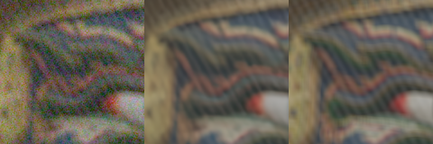
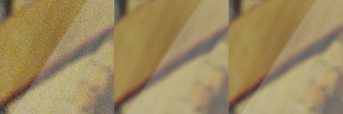

# Stabilizing Bayer fits across nearby crop placements

Keeping Bayer groups fixed in sensor coordinates improves the consistency
of the added right-cab lattice as the fit window moves. Agreeing on a
frequency pair before pooling the fits brings the worst shifted cosine
with the center correction to **0.948 and 0.951** under the two noise
profiles. Moving the sample groups with the window gave **0.613 and
0.466**. The pooled output retains the visible right-cab diagonals and
leaves the standing sky and both left crops unchanged. On 16 fresh
constructed photo fields, average weak-detail recovery is nearly identical
to the single-crop fit.

[Score and alignment receipt](results/query-frequency-consensus-v1/publication.json) ·
[Source, selections and audit archive](results/query-frequency-consensus-v1/evidence.tar.xz) ·
[Native crops and provenance](images/query-frequency-consensus-v1/manifest.json).

## Fixed samples and shared frequencies

The [reserved Bayer fit](query-bayer-reserve.md) assigns complete Bayer
cells to four groups. Two groups nominate and test a pair of frequencies.
The other two fit the localized correction. This study moves the 256-pixel
fit to the center, ±8 native pixels on each axis, and ±16 pixels along
each diagonal. The same physical Bayer cells retain their assignments
across every overlap, so a site used for delivery in one crop never
enters frequency selection in another.

- **Single query** uses the center fit and original Bayer assignment.
- **Anchored median** independently selects each placement's pair, then
  takes the signed median of all nine registered corrections. A rejected
  placement contributes zero.
- **Consensus pair** requires five placements to agree on the pair to
  within two center-query DFT bins. It retests both median frequencies
  on the center reservation and fits the center crop.
- **Consensus pair median** uses that same confirmed pair in all nine fits
  and takes their signed median.
- **Exterior shortlist** and **shortlist consensus** add a band-stratified
  list of exterior nominations to the center or consensus selection.
  Every exterior tile is outside the union of the nine queries. Up to
  three nominations per band survive the two-tile prominence test,
  and the same local conditional check still applies.

All methods use one registered frozen parent. Median methods do up to
nine fits per crop. Consensus alone tests nine candidate sets and fits
one correction. Replacing the entire delivery half across the combined
query area preserves all nominations in the audited fresh fields.
Overlapping placements reuse sensor data. Their agreement measures
placement stability on these observations.

## Fresh exact-target fields

The test uses 16 unused bin4 validation photographs at ISO6400. The
32 present draws include straight and slowly curved carriers, with
eight photo fields per geometry. Each has two independent redraws
of a present, outside-only, strong-only and exact-flat role.
Twelve earlier calibration fields set the scales using the previous
added gap and flat RMS limits, 9.031 and 3.503 DN16. Every fresh image
is outside the 90,692-image full-epoch training manifest.

| Fresh ISO6400 method | Intact response | Intact increment RMS, DN16 | Added gap RMS, DN16 | Spurious gap response |
| --- | ---: | ---: | ---: | ---: |
| Corpus 100k | 32.92% | 188.686 | 0.000 | 6.30% |
| Single query | 37.61% | 187.508 | 8.002 | 6.21% |
| Anchored median | 37.50% | 187.406 | 7.433 | 6.22% |
| Consensus pair | 37.59% | 187.423 | 7.531 | 6.19% |
| Consensus pair median | 37.61% | 187.398 | 7.639 | 6.20% |
| Exterior shortlist | 38.72% | 187.025 | 8.624 | 6.44% |
| Shortlist consensus | 38.85% | 186.961 | 8.460 | 6.43% |

All 32 held-out flat draws reproduce the parent in every arm. The
anchored median lowers added gap RMS by **0.570 DN16**
(95% paired bootstrap interval −1.580 to −0.032) and lowers intact
response by 0.111 percentage points. Added gap RMS includes any
legitimate change to the strong direction still present in the gap.
The consensus pair median changes intact response by **+0.006 points**
(−0.157 to +0.211) and intact error by **−0.110 DN16**
(−0.321 to +0.044). The display shows no clear additional crossings
over the single-query fit.

The exterior shortlist nominates a pair in 16 of 32 present draws,
versus 12 for the single query. The mean improvement is concentrated
in straight patterns, where their response is 44.94% versus 42.06%.
For the curved fields the corresponding values are 32.49% and 33.15%.
The shortlist raises average spurious gap response. These subgroups
have eight photo fields each.

### Native exact-target examples

The two triplets show noisy Malvar, the consensus pair median and exact
constructed target. Each cell is 160×160 native pixels at
`[48,48,160,160]` in the central query. Both show redraw 0 at shot/read
`.00128/6.5536e-6`, with sensor exposure 0.33, the same WB/matrix,
display exposure ×2, and clipped sRGB. The parent is Corpus 100k EMA
`87b96f3c487b9edaf1c477742b6c38f2a82cc6b20a94716d51cc8cf46a17a760`.

[All stripe methods](images/query-frequency-consensus-v1/exact/000-present-all.png) ·
[Outside-only stripe control](images/query-frequency-consensus-v1/exact/000-outside-only-all.png) ·
[Exact-flat control](images/query-frequency-consensus-v1/exact/000-quiet-query-all.png).

[All curved methods](images/query-frequency-consensus-v1/exact/003-present-all.png) ·
[Outside-only curved control](images/query-frequency-consensus-v1/exact/003-outside-only-all.png) ·
[Exact-flat control](images/query-frequency-consensus-v1/exact/003-quiet-query-all.png).

## Standing GFX100S comparisons

Each right-cab correction is measured on the identical fixed 160-pixel
ROI and parent. With the same correction scale across placements, the
table gives the smallest cosine over the eight noncentral placements
and the aligned amplitude of the nine-view median.

| Right-cab fit | Worst nominal cosine | Worst transferred cosine | Median aligned amplitude, nominal / transferred |
| --- | ---: | ---: | ---: |
| Moving Bayer groups | 0.613 | 0.466 | 80.0% / 72.4% |
| Anchored groups, local frequencies | 0.926 | 0.914 | 96.6% / 96.6% |
| Anchored groups, consensus frequencies | 0.948 | 0.951 | 97.4% / 97.2% |

Both diagonal families remain visible in the right crop after pooling.
Some crossings are still soft, locally absent or overly regular.
The wider exterior shortlist does not qualify a pair on the standing
left views. All left outputs, the sky, foliage and building match
Corpus 100k. The coarse fence retains both families. All eight
boards were viewed at the original crop scale.

[Sky](images/query-frequency-consensus-v1/standing/main-overcast-sky-main-overcast-sky.png) ·
[Building](images/query-frequency-consensus-v1/standing/main-building-detail-main-building-detail.png) ·
[Foliage](images/query-frequency-consensus-v1/standing/main-foliage-main-foliage.png) ·
[Coarse fence](images/query-frequency-consensus-v1/standing/main-chain-link-fence-main-chain-link-fence.png).

| Cab noise conditioning | Left | Right |
| --- | --- | --- |
| Nominal `.00128/6.5536e-6` | [Comparison](images/query-frequency-consensus-v1/standing/mesh-nominal-fine-green-mesh-left.png) | [Comparison](images/query-frequency-consensus-v1/standing/mesh-nominal-fine-green-mesh-right.png) |
| Transferred `.0014635775921166604/1.0715704128646712e-6` | [Comparison](images/query-frequency-consensus-v1/standing/mesh-profile3879-fine-green-mesh-left.png) | [Comparison](images/query-frequency-consensus-v1/standing/mesh-profile3879-fine-green-mesh-right.png) |

DSCF3879 uses exposure ×4 and the independent DSCF3880 ISO100 AHD
reference. DSCF3842 uses exposure ×16 with DSCF3835 ISO100 AHD and both
camera JPEGs. These are qualitative comparisons with different
capture settings. This inference study has no new trained weights
or fixed full427 and known/unseen camera PSNR scores.
