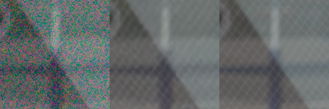
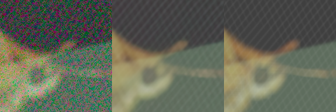

# Using neighboring Bayer measurements to locate weak-wire gaps

Checking both sides of a possible gap and refining its position between grid points gives no consistent improvement over the shared-waveform check. On 24 additional ISO6400 photo backgrounds, all three localization variants and the shared baseline cut six of twelve true gaps and one of twelve continuous controls. At matched gap leakage, off-grid shoulders retain essentially the same intact response as uniformly weakening the shared edit. All eight standing GFX outputs reproduce the previous fit pixel for pixel.

[Scores and provenance](results/query-gap-shoulders-v1/publication.json) · [Frozen drivers and evidence](results/query-gap-shoulders-v1/evidence.tar.xz) · [Reviewed native image manifest](images/query-gap-shoulders-v1/manifest.json).

## Discovery and reserved evidence

The reconstruction combines the Corpus 100k EMA parent (`87b96f3c487b9edaf1c477742b6c38f2a82cc6b20a94716d51cc8cf46a17a760`), per-direction exterior Bayer donor and shared weak waveform. Q0 and Q1 use the donor's measured frequencies and fit the same signed waveform and background as in the preceding check. The two shoulder measurements each compare the phase-locked weak carrier just inside a possible break with the carrier just outside it. Search ranks the same hard deficit evidence plus a 0.55 weight on the weaker shoulder and a 0.15 weight on the stronger shoulder. It considers shapes within two standardized units of the best initial amplitude nomination.

The off-grid shoulder arm searches again near that nomination, within six pixels of its position and dimensions and ten degrees of its angle. The off-grid amplitude control uses the same local bank around the original amplitude answer. Both reserve Q2 and Q3 for one fixed footprint. The pooled threshold remains 3.25 with at least 0.85 in each fold. The accepted taper modifies only the existing weak-band donor lift. No weights were trained. [Shared waveform](query-shared-gap.md) · [Exterior donor shape](query-shape-routing.md).

## Additional held-out photos and earlier replays

The additional 24 Wikimedia bin4 photos are disjoint from the recent donor/gap photo studies and the 90,692-source scene training manifest. They previously appeared in a separate repeat-noise evaluation. The frozen set contains six translated, rotated ellipses, six strips, six continuous dips and six nonzero contrast steps. Every fixture uses a 256-pixel native Bayer query, 32-pixel neural halo, independent draws for both-wire, outside-only, strong-only and quiet roles, and a sealed mismatched surround. All strong-only, quiet, outside-only and rotated results equal the directional donor output. The 72 earlier replays include the prior additional high-noise panel and the earlier shape panel at ISO400 and ISO6400.

| ISO6400, 12 new true gaps | Added gap RMS, DN16 | Total gap error, DN16 | Intact weak response | Cuts in gaps / continuous |
| --- | ---: | ---: | ---: | ---: |
| Corpus 100k EMA | 0.00 | 162.36 | 31.92% | 0 / 0 |
| Directional donor | 55.85 | 155.10 | 61.28% | 0 / 0 |
| Shared waveform | 48.91 | 152.18 | 60.13% | 6 / 1 |
| Coarse shoulders | 48.83 | 152.21 | 60.01% | 6 / 1 |
| Off-grid shoulders | 49.69 | 152.48 | 60.37% | 6 / 1 |
| Off-grid amplitude | 49.29 | 152.44 | 60.04% | 6 / 1 |

With off-grid shoulders, the mean changes versus the shared check are +0.78 DN16 [−1.22, +3.76] for added texture and +0.24 percentage points [−0.44, +1.04] for intact response. Resampling uses whole photo IDs. A uniform 0.789 multiplier on the original shared edit matches the off-grid arm's leakage and retains **60.374% versus 60.372%** intact response, with 3.63 versus 3.80 DN16 of change to intact sites. The shared check retains the quantitative tradeoff. The one false cut is the same smooth dip for all arms. Its change lies outside the intact measurement mask.

On the immediately preceding high-noise panel, the new arms avoid the original continuous cut and cut four to six true gaps versus seven for the earlier fit. They leave 2.86–6.34 DN16 more added gap texture. On the earlier ISO400 shape replay, both shoulder arms cut two continuous fields where the earlier shared check cuts none. Changes on the earlier ISO6400 shape replay are less than 0.03 DN16 in added gap RMS. These results give no stable advantage to the wider shape search.

### What limits the check

The noiseless off-grid example improves measured footprint overlap from 0.727 to 0.853 under both refinement arms. Changing only Q2 and Q3 leaves nomination fixed and changes the confirmation scores. Pixels outside the selected footprint stay identical. In the 10 new gaps that reach the donor stage, the known-footprint diagnostic admits the same six as the automatic shared check. The true contours of the remaining four fail the fixed green evidence test. This differs from the preceding panel, where providing the true footprint raised admissions from seven to nine of ten. Both discovery and the amount of available independent evidence can limit restoration.

Red and blue provide a diagnostic for that missing evidence. The check fits signed coefficients per Bayer plane using Q0 and Q1 and scores the fixed green footprint on independent Q2 and Q3. For two additional true ellipses, adding red and blue helps confirm the known footprint. Neither passes when assessed at the earlier automatic nomination. Letting supported red and blue bands also nominate the footprint keeps the same six true accepts and rejects the continuous dip in the new panel. The earlier panel gains one true strip and one false continuous accept. These are score-only replays. The rendered comparison uses green confirmation throughout.

## Native exact-target comparisons

Both triplets show noisy Malvar, off-grid shoulders and exact constructed GT. Each cell is 160×160 query pixels at `[48,48,160,160]`. ISO6400 shot/read are `0.00128/6.5536e-6`, capture exposure 0.33, black fraction 0.03 and display exposure ×2. All methods use the same camera white balance, color matrix and display transform. The two examples show the largest observed leakage improvement and regression of the off-grid shoulder arm on this panel.

**Bedminster railway station MMB 26**, mattbuck, CC BY-SA 3.0. Source box `[4,356,512,512]`, RGGB. The area beside the pale vertical feature looks slightly smoother, and the softer lattice around it remains visible. Added gap RMS falls from 33.02 to 28.52 DN16. [Source](https://commons.wikimedia.org/wiki/File:Bedminster_railway_station_MMB_26.jpg) · [All methods](images/query-gap-shoulders-v1/exact/020-iso6400-comparison.png) · [Quiet control](images/query-gap-shoulders-v1/exact/020-iso6400-quiet.png).

**Bush Hopper**, Sandipoutsider, CC BY-SA 4.0. Source box `[284,98,512,512]`, RGGB. Faint regular modulation remains near the diagonal color boundary. The original shared check cuts more near the interruption. Added gap RMS rises from 59.13 to 74.34 DN16. [Source](https://commons.wikimedia.org/wiki/File:Close_wing_Basking_of_Ampittia_dioscorides_(Fabricius,_1793)_-_Bush_Hopper_(Male)_WLB_DSC_9116b.jpg) · [All methods](images/query-gap-shoulders-v1/exact/016-iso6400-comparison.png) · [Quiet control](images/query-gap-shoulders-v1/exact/016-iso6400-quiet.png).

## Standing GFX100S comparisons

All eight camera boards were reviewed. The sky remains smooth, and both coarse fence directions retain their previous contrast. Fine foliage margins and brackets remain soft. On the cab, both profiles preserve the preceding weak diagonal structure, with uneven crossings and mottling. The independent ISO100 AHD and camera JPEGs are qualitative comparisons with differences in aperture, exposure and moving subjects.

DSCF3879 uses shot/read `0.00128/6.5536e-6` and display ×4. DSCF3842 uses display ×16 and either that noise prior or the transferred `0.0014635775921166604/1.0715704128646712e-6` prior. The manifest binds the same native coordinates, camera data and transforms for all arms.

[Overcast sky](images/query-gap-shoulders-v1/standing/main-overcast-sky-main-overcast-sky.png) · [Building](images/query-gap-shoulders-v1/standing/main-building-detail-main-building-detail.png) · [Foliage](images/query-gap-shoulders-v1/standing/main-foliage-main-foliage.png) · [Coarse fence](images/query-gap-shoulders-v1/standing/main-chain-link-fence-main-chain-link-fence.png).

| Cab profile | Native comparisons |
| --- | --- |
| Nominal | [Left](images/query-gap-shoulders-v1/standing/mesh-nominal-fine-green-mesh-left.png) · [Right](images/query-gap-shoulders-v1/standing/mesh-nominal-fine-green-mesh-right.png) |
| Transferred | [Left](images/query-gap-shoulders-v1/standing/mesh-profile3879-fine-green-mesh-left.png) · [Right](images/query-gap-shoulders-v1/standing/mesh-profile3879-fine-green-mesh-right.png) |

The archival log preserves the initial script failures and corrected reruns. The numerical and actual native reviews are complete. This scoped inference comparison has no full427 or measured-camera PSNR score. [Comparable performance history](performance-history.md).
