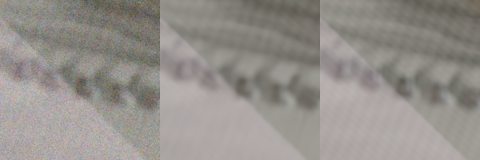
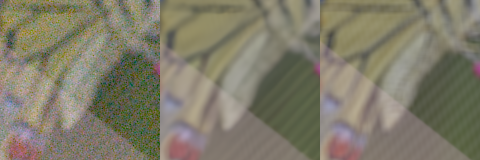

# Using a third Bayer quarter for local weak-detail reconstruction

Three-quarter amplitude fitting cuts the exterior fallback's added
texture in unrelated gaps from **2.267 to 1.315 DN16 RMS** on 12 new
ISO6400 photo fields, at matched calibration strength. Intact weak
response is 43.46% versus 43.28%. The interval spans small losses and
gains. Coherent false response inside those gaps falls by **0.155
percentage points**. Direct searches for a gap in the same fields
find none that clears the held check.

[Scores, checkpoint and independent audit](results/query-local-gap-v1/publication.json) ·
[Source and evidence archive](results/query-local-gap-v1/evidence.tar.xz) ·
[Native comparisons and provenance](images/query-local-gap-v1/manifest.json).

## Local estimate at fixed exterior geometry

The [replicated exterior-phase path](query-exterior-witness.md) provides
the carrier geometry, phase, weaker-direction identity and permitted
side of the measured edge. The existing fallback fits amplitude on
Q2 and Q3, using a Gaussian of scale 9 pixels with a 30-pixel cutoff.
It subtracts the contribution already measured in the Corpus 100k parent.

The wide alternative adds Q1 to the same local aperture. It uses
the mean positive cross-product and corresponding variance floor
across the three disjoint fold pairs. It inverse-variance weights
the signed amplitudes and parent projections. The compact alternative
uses the same rule with scale `sqrt(54)` pixels and a 25-pixel cutoff.
The third alternative uses two quarters in that compact aperture.
All methods preserve the existing validated region and the
stronger-direction correction. The gate already reads Q1–Q3,
so the new delivery shares an additional sample group with validation.

The earlier 36-photo replica fixes the strength multipliers.
They match mean intact RMS of the extra weak correction above the
wide backup, using **1.046** for three-quarter wide, **1.167** for
three-quarter compact, and **1.063** for two-quarter compact.
Strength is calibrated once and reused for all held-out photos.
Replaying the noise-free wave fits on all four Bayer patterns
reconstructs the correct amplitude within `1.87e-9` linear units.
In four active examples, CPU and CUDA agree within `2.33e-10`.
Replacing Q0 leaves the aperture outputs identical at fixed parent
and measured geometry.

## Shifted gaps and continuous photo controls

The 30 new bin4 photos are disjoint from training and the preceding
panels. Twelve include translated interruptions of variable length,
six have a smooth nonzero dip, six have a sharp nonzero contrast
change, and six have true loss at a visible edge. Each field has
two independent ISO6400 draws of the present, outside-only,
stronger-only and exact-flat roles.

| Unrelated gaps, ISO6400 | Intact weak response | Intact increment RMS, DN16 | Spurious gap response | Fallback-added gap RMS, DN16 |
| --- | ---: | ---: | ---: | ---: |
| Wide curved backup | 36.950% | 186.468 | 2.271% | 0.000 |
| Exterior phase, two-quarter wide | 43.280% | 184.738 | 2.520% | 2.267 |
| Three-quarter wide, matched | 43.460% | 184.614 | 2.365% | 1.315 |
| Three-quarter compact, matched | 42.804% | 184.818 | 2.365% | 1.391 |
| Two-quarter compact, matched | 42.736% | 184.900 | 2.537% | 2.526 |

The three-quarter wide fit lowers fallback-added gap RMS by **0.952
DN16** (95% paired interval −1.750 to −0.315) and spurious gap
projection by 0.155 points (−0.326 to −0.025). Relative to the
two-quarter wide fallback, intact weak response changes by
+0.181 points (−0.378 to +0.775). Total gap error changes by
−0.026 DN16 (−0.077 to +0.027). The compact three-quarter fit retains
less intact detail at nearly the same gap response. With the
three-quarter wide fit, increment error on smooth dips falls by
0.183 DN16 (−0.348 to −0.042). Weak response on edge-occluded fields
changes by −0.206 points (−0.982 to +0.363). All exact-flat outputs
match the parent.

On the disjoint earlier 24-photo exterior phase replay, the same
fixed wide fit raises occluded response by 1.74 points
(+0.31 to +3.40), with increment error −0.530 DN16
(−1.069 to −0.061). On its six unrelated-gap fields, fallback-added
gap RMS falls 0.621 DN16 (−1.783 to +0.036) and total gap error
falls 0.044 DN16 (−0.100 to −0.008).
[Replay records](results/query-local-gap-v1/publication.json).

### Direct footprint searches

The direct searches test a translated disk or ellipse on the
transported phase against a continuing affine-amplitude competitor.
Q0 selects a footprint and Q1–Q3 test its signed deficit. A second
path uses Q0/Q1 to propose a weighted mixture of nearby footprints
and Q2/Q3 to check it. Both also test versions that project the
proposed interruption away from a same-center smooth dip.
Changing the held Bayer samples preserves nomination in the
four audited views.

None of the seven eligible unrelated-gap draws clears any automatic
footprint check. Supplying the true footprint would clear the
ordinary deficit cutoff on three draws and the dip-projected cutoff
on zero. Each automatic version admits a spurious deficit in the
same stronger-only control. The half-field, dip-projected variant
also cuts one continuous field. These outcomes indicate poor
localization and limited discrimination from smooth amplitude changes
at the tested noise level.

### Native crops

The first accepted exterior fallback on an unrelated gap and the
first on a continuous dip are shown at native 160×160. Each
triplet shows noisy Malvar, the strength-matched three-quarter
wide fit and exact constructed target. The ROI is
`[48,48,160,160]` within the 256-pixel query. Both use shot/read
`0.00128/6.5536e-6`, capture exposure 0.33, fixed WB/matrix and
display exposure ×2. The Corpus 100k EMA SHA256 is
`87b96f3c487b9edaf1c477742b6c38f2a82cc6b20a94716d51cc8cf46a17a760`.

HridoyKundu, CC BY-SA 4.0, source box `[104,316,512,512]`, GRBG,
repeat 1. The fine pattern remains softer than the exact target.
[Full comparison](images/query-local-gap-v1/exact/010-comparison.png) ·
[Source and license](<https://commons.wikimedia.org/wiki/File:Goja_-_Bengali's_all_time_favorite_food_(%E0%A6%AC%E0%A6%BE%E0%A6%99%E0%A7%8D%E0%A6%97%E0%A6%BE%E0%A6%B2%E0%A6%BF%E0%A6%B0_%E0%A6%85%E0%A6%A8%E0%A7%8D%E0%A6%AF%E0%A6%A4%E0%A6%AE_%E0%A6%B8%E0%A6%AC%E0%A6%A5%E0%A7%87%E0%A6%95%E0%A7%87_%E0%A6%AA%E0%A7%8D%E0%A6%B0%E0%A6%BF%E0%A6%AF%E0%A6%BC_%E0%A6%96%E0%A6%BE%E0%A6%AC%E0%A6%BE%E0%A6%B0_-_%E0%A6%97%E0%A6%9C%E0%A6%BE).jpg>).

Charles J. Sharp, CC BY-SA 4.0, source box `[150,30,512,512]`, GRBG,
repeat 0. The true continuous pattern is still clearer in the target.
[Full comparison](images/query-local-gap-v1/exact/006-comparison.png) ·
[Source and license](<https://commons.wikimedia.org/wiki/File:Old_World_swallowtail_(Papilio_machaon_gorganus)_underside_Italy.jpg>).

## Standing GFX100S comparisons

All eight standing crops retain the prior checked output. The fallback
has no new admitted pair on these observations. The sky is smooth,
both coarse fence directions remain visible, and the faint right-cab
crossings remain soft. Small leaf edges and thin building cables remain
soft. The AHD and camera JPEG references use separate captures.

- DSCF3879 ISO6400 and DSCF3880 ISO100, display exposure ×4.
  [Sky](images/query-local-gap-v1/standing/main-overcast-sky-main-overcast-sky.png) ·
  [Building](images/query-local-gap-v1/standing/main-building-detail-main-building-detail.png) ·
  [Foliage](images/query-local-gap-v1/standing/main-foliage-main-foliage.png) ·
  [Coarse fence](images/query-local-gap-v1/standing/main-chain-link-fence-main-chain-link-fence.png).
- DSCF3842 ISO6400 and DSCF3835 ISO100, display exposure ×16.
  [Left, nominal](images/query-local-gap-v1/standing/mesh-nominal-fine-green-mesh-left.png) ·
  [Right, nominal](images/query-local-gap-v1/standing/mesh-nominal-fine-green-mesh-right.png) ·
  [Left, transferred](images/query-local-gap-v1/standing/mesh-profile3879-fine-green-mesh-left.png) ·
  [Right, transferred](images/query-local-gap-v1/standing/mesh-profile3879-fine-green-mesh-right.png).

This inference-only study has no full427 or measured-camera panel score.
