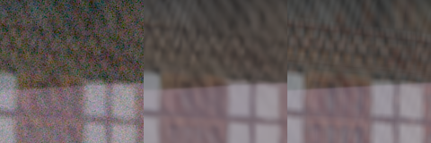
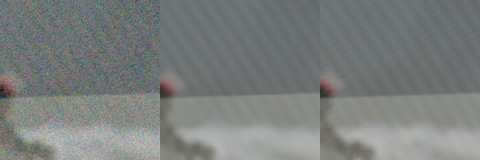

# Checking whether a weak Bayer pattern bends

A reserved-Bayer curvature fit raises recovery on ten bent-pattern
photo fields from **34.09% to 34.75%** over the previous planar
fit. The mean spurious gap projection changes from **3.35% to
3.38%**, with an interval spanning zero. A separate backup search
recovers more of the bent pattern when planar consensus misses it.
That backup also adds more structure inside gaps. The standing GFX
captures support small shifts in the right-cab frequencies and no
accepted curvature. Both right-cab directions remain visible, with
soft and incomplete intersections.

[Numeric results and sample-isolation audit](results/query-phase-curvature-v1/publication.json) ·
[Source, phase selections and scoring archive](results/query-phase-curvature-v1/evidence.tar.xz) ·
[Native crops and provenance](images/query-phase-curvature-v1/manifest.json).

The [local support follow-up](query-phase-support.md) separates true gaps
from continuous contrast changes on a new photo panel. The compact fit
loses intact detail, and the deficit check tracks uniform attenuation at
matched correction strength.

## Fit geometry before estimating delivery

The [sensor-anchored consensus](query-frequency-consensus.md) supplies the
same two frequency seeds to all checked paths. The planar control passes
the seeds to the original local amplitude fit. The second path allows
sub-bin center-frequency shifts. The curved path additionally allows
a quadratic phase term along each carrier's tangent. The native phase
in cycles is `f · x + k (t · x)² / 2`, where `f` is the center frequency,
`t` is its unit tangent and `k` is the curvature. Each fit stage limits
frequency-coordinate changes to 0.0055 cycles per pixel and limits
curvature to ±0.000085 cycles per pixel squared.

The first Bayer quarter estimates a smooth background and variance
and takes four bounded, damped Gauss–Newton updates to the joint green
fit. A second quarter compares fixed predictions. Each proposed
change must gain at least 1.5 standardized units over the previous
geometry and retain a conditional gain of 2.75 for both carriers.
Rejected changes fall back to the confirmed simpler geometry.
The second quarter also participates in the original seed confirmation,
so these gains are empirical. The last two quarters supply the actual
phase and amplitude fits at fixed geometry, with the same 30-pixel local
support and subtraction of aligned signal already in Corpus 100k.

Replacing either half of the RAW and variance leaves the other part's
operations byte-identical in six active examples. This check holds
the neural parent fixed during delivery. Its original input includes
every Bayer group. Double-precision local fits agree between CPU and
CUDA within `4.66e-10` in the six checked lifts.

## Exact-target test

Twenty unused bin4 photographs lie outside the full-epoch training
manifest. Ten have straight carrier pairs. The other ten have
opposite-signed bends along the two tangents, with the weaker family
interrupted by a band or elliptical gap. Each field has two independent
ISO6400 draws of the present, outside-only, strong-only and exact-flat
roles. Twelve previously frozen photo fields supply the existing
9.031 and 3.503 DN16 calibration caps for added gap and flat luma.
The exact-geometry controls receive the true center frequencies for
both directions and, in one arm, the true curvature. Those controls
use the same RAW amplitude fit.

| Bent fields, ISO6400 | Intact weak response | Intact increment RMS, DN16 | Added gap RMS, DN16 | Spurious gap response |
| --- | ---: | ---: | ---: | ---: |
| Corpus 100k | 28.27% | 184.931 | 0.000 | 3.10% |
| Consensus planar | 34.09% | 183.107 | 8.456 | 3.35% |
| Refined center | 33.95% | 183.189 | 8.181 | 3.36% |
| Checked curvature | 34.75% | 182.902 | 8.473 | 3.38% |
| Exact centers, planar | 36.93% | 182.099 | 10.304 | 3.75% |
| Exact centers and curvature | 37.61% | 181.858 | 10.466 | 4.04% |

Checked curvature gains **0.66 percentage points** over consensus
planar on the bent fields (95% paired bootstrap interval **+0.13 to
+1.30**). The added gap RMS changes by +0.017 DN16 (−0.447 to +0.453).
Against refined centers, curvature gains **0.80 points** (+0.22 to +1.49)
and lowers intact increment RMS by **0.286 DN16** (−0.524 to −0.090).
Spurious gap projection changes by +0.02 points (−0.12 to +0.15).

The initial consensus admits 10 of 20 bent present draws and 6 of 20
straight present draws. Curvature passes in nine of the bent draws and
none of the straight present draws. For the nine bent draws whose
proposals match both known directions within three DFT bins, the
phase-only coherence of the weak direction with its exact target
rises from 0.697 after recentering to 0.897 after the curvature check.
The selection itself used only noisy RAW. Frequency recentering on its
own slightly reduces intact response on straight fields at calibrated
strength. All 40 fresh exact-flat draws retain the parent for every
checked path.

### Finding pairs missed by planar consensus

The backup is a follow-up on the same held-out acquisitions. When no
initial pair qualifies, the first Bayer quarter reconsiders up to four
pairs from its own spectral bank, ranked by fitted residual. It selects
a refined planar pair and a curved pair using that quarter. The other
reserve quarter requires both directions to pass the same conditional
gain. Curvature must also beat its own recentered planar fit by two
standardized units. Delivery still uses the remaining two quarters and
the same calibration photos.

| Bent fields, ISO6400 | Intact response | Intact increment RMS, DN16 | Added gap RMS, DN16 | Spurious gap response |
| --- | ---: | ---: | ---: | ---: |
| Checked curvature | 34.75% | 182.902 | 8.473 | 3.38% |
| Planar backup | 33.52% | 183.506 | 13.704 | 3.37% |
| Curved backup | 38.77% | 181.453 | 17.682 | 4.02% |

The curved backup finds a new curved pair in **8 of 10** bent
present draws that lacked consensus, versus zero of the 14 straight
present draws that lacked consensus. It also admits two curved
outside-only and three curved strong-only draws. Compared with
the planar backup it gains **5.24 points** of bent response
(+1.13 to +10.74). The gain versus checked curvature without backup
is 4.02 points (−0.18 to +9.76). Added gap RMS rises **9.21 DN16**
(+1.79 to +18.67) versus checked curvature. That measure includes
changes to the stronger family, which is present in the gap.
The total absolute error inside the exact gap is 140.282 versus
141.380 DN16 (paired difference −1.10, interval −3.50 to +0.38).
The projected false weak component rises from 3.38% to 4.02%.
All 40 exact flats still return the parent.

### Native exact-target examples

Columns show noisy Malvar, the specified restoration and exact
constructed target at 160×160 native pixels. Each uses
`[48,48,160,160]` within the 256-pixel query, redraw 0, the same
WB/matrix, shot/read `.00128/6.5536e-6`, simulated exposure 0.33,
display exposure ×2 and clipped sRGB. The parent is Corpus 100k EMA
`87b96f3c487b9edaf1c477742b6c38f2a82cc6b20a94716d51cc8cf46a17a760`.

[All source 1 methods](images/query-phase-curvature-v1/exact/001-present-all.png) ·
[Outside-only control](images/query-phase-curvature-v1/exact/001-outside-only-all.png) ·
[Exact-flat control](images/query-phase-curvature-v1/exact/001-quiet-query-all.png).

[All source 3 methods](images/query-phase-curvature-v1/exact/003-present-all.png) ·
[Outside-only control](images/query-phase-curvature-v1/exact/003-outside-only-all.png) ·
[Exact-flat control](images/query-phase-curvature-v1/exact/003-quiet-query-all.png).

The [source 7 backup triplet](images/query-phase-curvature-v1/fallback/007-present-triplet.png)
and [source 11 backup triplet](images/query-phase-curvature-v1/fallback/011-present-triplet.png)
show the first two backup acceptances by source order. The second
direction starts to show, with the exact target still sharper.
[Source 7 methods](images/query-phase-curvature-v1/fallback/007-present-all.png) ·
[Source 11 methods](images/query-phase-curvature-v1/fallback/011-present-all.png).

## Standing GFX100S comparisons

No standing crop accepts curvature. Recentered right-cab frequencies
predict both of the unused Bayer subsets better at both priors.
The standardized gains are 2.13 and 2.55 nominal, and 3.38 and 3.58
transferred. These are fixed-spectrum predictions from the first
quarter with no reference input. With a common delivery scale, the
recentered fit changes the visible right lattice only slightly.
The crossed fit remains soft in places. The backup returns the
corresponding original fit exactly in all eight crops.

The main sky, building, foliage and both left cab crops keep the
parent pixels. Both directions in the coarse fence stay visible and
the fine building cables and leaves remain soft. All eight boards
were viewed.

[Sky](images/query-phase-curvature-v1/standing/main-overcast-sky-main-overcast-sky.png) ·
[Building](images/query-phase-curvature-v1/standing/main-building-detail-main-building-detail.png) ·
[Foliage](images/query-phase-curvature-v1/standing/main-foliage-main-foliage.png) ·
[Coarse fence](images/query-phase-curvature-v1/standing/main-chain-link-fence-main-chain-link-fence.png).

| Cab conditioning | Left | Right |
| --- | --- | --- |
| Nominal `.00128/6.5536e-6` | [Comparison](images/query-phase-curvature-v1/standing/mesh-nominal-fine-green-mesh-left.png) | [Comparison](images/query-phase-curvature-v1/standing/mesh-nominal-fine-green-mesh-right.png) |
| Transferred `.0014635775921166604/1.0715704128646712e-6` | [Comparison](images/query-phase-curvature-v1/standing/mesh-profile3879-fine-green-mesh-left.png) | [Comparison](images/query-phase-curvature-v1/standing/mesh-profile3879-fine-green-mesh-right.png) |

DSCF3879 uses display exposure ×4 and the independent DSCF3880 AHD
reference. DSCF3842 uses ×16, the independent DSCF3835 ISO100 AHD
and both camera JPEGs. The references differ in capture settings and
serve as qualitative comparisons. This scoped inference experiment
has no newly trained weights or full427 and known/unseen PSNR scores.
