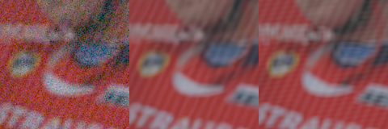
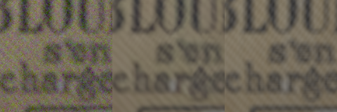

# Can local RAW tell a weak crossing from a gap?

On 24 new ISO6400 photo fields, a smaller local fit lost real weak
structure. A gentler deficit check preserved more of that structure,
but reduced false gap projection by only **0.004 percentage points**
relative to the wide curved backup. Uniformly reducing the weaker
correction by the same amount achieved essentially the same result.
The real sky stays smooth in all checked paths. The right cab still
has soft, uneven crossings.

[Numeric results and independent audit](results/query-phase-support-v1/publication.json) ·
[Frozen inputs, scores and source archive](results/query-phase-support-v1/evidence.tar.xz) ·
[Native crops and capture provenance](images/query-phase-support-v1/manifest.json).

The [scene-contour follow-up](query-contour-support.md) rotates the
amplitude aperture using coarse RAW. It gives a small continuous-edge
gain and increases coherent response inside independent gaps.

## Same phase and stronger correction

The [whole-image context review](weak-detail-global-context-production-review-2026-11-16.md)
proposes using the rest of the photograph to guide restoration and
requiring RAW support for fine changes. This replay tests one part of
that design. A search informed by surrounding RAW proposes the two
carrier geometries using the existing [curved backup](query-phase-curvature.md#finding-pairs-missed-by-planar-consensus).
The energy of the two fixed-geometry fits on Bayer quarter Q0 decides
which is weaker. All compared corrections use Corpus 100k EMA and the
same stronger-direction contribution. The wide fit uses the original
30-pixel aperture. Two variants change weaker amplitude alone.

- The compact fit applies the existing amplitude estimate to a 13-pixel
  aperture, with Gaussian scale 5.5 pixels and the same exterior phase.
- The deficit check estimates the component in phase with the exterior
  forecast in a 13-pixel core and a disjoint 13–30 pixel ring. Both
  delivery quarters must show a positive ring estimate and an inner
  deficit. Its soft threshold combines the deficits normalized by
  their projected variance. When the check activates, the measured
  core-to-ring ratio controls attenuation.

All corrections use the previously fitted global scale 0.631848.
Two controls shrink the entire weak correction by 0.889234 or
0.988064. These factors match the mean intact weak-correction RMS
of the compact and deficit variants on the 12 older calibration
fields. The wide fit reproduces the archived correction on those
12 fields within `4e-8`. On six fresh active draws, replacing Q2/Q3
leaves the Q0 weaker-direction choice identical at fixed geometry.
Replacing Q0/Q1 leaves delivery identical at fixed parent and geometry.
CPU and CUDA agree within `9.32e-10` in those lifts.

## Exact-target results

The 24 native bin4 photographs are disjoint from the 90,692-photo
scene training manifest and the preceding experiments' source sets.
Twelve have a real gap in the weaker carrier, including six with gap
radius at most 17 pixels. Twelve keep a continuous weak carrier.
Six of the continuous fields include a real 0.48-to-1 contrast change.
Each field has two independent noise draws. The four roles include both
carriers present, weak carrier outside the query only, stronger
carrier alone, and an exact-flat query. The contrast-change subset
uses the original exterior carrier amplitude in the outside-only role.
Its center is exact absence. Of 48 present draws, the search admits
33. The proposed centers match both true directions within three
256-pixel DFT bins in 27, and the Q0 fit identifies the weaker carrier
in all 27 of those draws. The tables include every draw.

| Method | Gapped intact weak response | Continuous weak response | Added gap luma RMS, DN16 | Spurious gap projection |
| --- | ---: | ---: | ---: | ---: |
| Corpus 100k | 27.139% | 32.921% | 0.000 | 2.540% |
| Wide curved backup | 34.980% | 45.152% | 8.797 | 2.961% |
| Compact fit | 32.413% | 40.591% | 9.460 | 3.142% |
| Uniform compact control | 34.111% | 43.797% | 8.610 | 2.900% |
| Deficit check | 34.885% | 44.943% | 8.777 | 2.958% |
| Uniform deficit control | 34.886% | 45.006% | 8.776 | 2.955% |

The compact fit loses **2.57 points** on intact parts of gapped fields
and **4.56 points** on continuous fields. Added gap RMS rises by
0.663 DN16 with a 95% paired interval of −0.032 to +1.613. The deficit
check loses 0.095 intact points on gapped fields (−0.221 to −0.013) and
reduces added gap RMS by 0.020 DN16 (−0.044 to −0.002). Against uniform
attenuation with matched calibration strength, the deficit check changes
gap projection by **+0.003 points** (−0.007 to +0.015) and changes added
gap RMS by **+0.001 DN16** (−0.019 to +0.019). On the six real contrast
transitions, it recovers 33.784% versus 33.849% for the wide fit.
All corrections add zero signal in the exact-flat roles.

These results favor the wider amplitude fit in this noise regime.
Local waveform evidence is useful for checking a proposed direction,
as in the [reserved Bayer tests](query-bayer-reserve.md). Here the
amplitude measured inside a small neighborhood is too weak to reliably
distinguish missing wire from contrast modulation. The two support
checks provide no selective gap benefit at matched correction strength.

### Native exact-target crops

Each triplet is noisy Malvar, deficit-check restoration, and exact
constructed target. Both use the first independent repeat of the
present role, a native `[48,48,160,160]` ROI inside the centered
256-pixel query, capture exposure 0.33, ISO6400 shot/read
`0.00128/6.5536e-6`, shared WB/matrix and display exposure ×2.
The Corpus 100k EMA checkpoint SHA256 is
`87b96f3c487b9edaf1c477742b6c38f2a82cc6b20a94716d51cc8cf46a17a760`.

Steffen Prößdorf, CC BY-SA 4.0, native scene box `[274,22,512,512]`, RGGB. The
strong direction survives. The faint crossings away from the gap are
clearer in the exact target. [Source photo and license](https://commons.wikimedia.org/wiki/File:2023-01-27_Wintersport,_Rodeln,_51th_FIL_World_Championships-Oberhof_1DX_1597_by_Stepro.jpg) ·
[Native method comparison](images/query-phase-support-v1/exact/000-present-all.png).

Eusebius, CC BY 3.0, native scene box `[0,296,512,512]`, GBRG. The lettering stays
visible while one fine family is faint throughout the denoised crop.
[Source photo and license](https://commons.wikimedia.org/wiki/File:Grenoble_-_le_Blount.jpg) ·
[Native method comparison](images/query-phase-support-v1/exact/007-present-all.png).

## Standing GFX100S comparisons

The deficit check changes a standing crop by at most **0.172 DN16**
camera-RGB RMS relative to the wide fit. The compact fit changes the
right cab by 6.009 and 4.980 DN16 under the two noise profiles. It
produces less even weak crossings in parts of the right crop.
The wide fit and the deficit check look effectively alike there.
Both recover visible structure in two directions, with clearer
diamonds in the references. Both left crops, the overcast sky,
foliage and building return the parent exactly. The foliage and some
building detail stay soft. The main chain-link crop retains both
coarse directions; the deficit check has little visible effect.

- DSCF3879 ISO6400 at exposure ×4 versus DSCF3880 ISO100 AHD.
  [Sky](images/query-phase-support-v1/standing/main-overcast-sky-main-overcast-sky.png) ·
  [Building](images/query-phase-support-v1/standing/main-building-detail-main-building-detail.png) ·
  [Foliage](images/query-phase-support-v1/standing/main-foliage-main-foliage.png) ·
  [Coarse fence](images/query-phase-support-v1/standing/main-chain-link-fence-main-chain-link-fence.png).
- DSCF3842 ISO6400 at exposure ×16 versus DSCF3835 ISO100 AHD, with both
  camera JPEGs in each board.
  [Left, nominal](images/query-phase-support-v1/standing/mesh-nominal-fine-green-mesh-left.png) ·
  [Right, nominal](images/query-phase-support-v1/standing/mesh-nominal-fine-green-mesh-right.png) ·
  [Left, fixed DSCF3879 prior](images/query-phase-support-v1/standing/mesh-profile3879-fine-green-mesh-left.png) ·
  [Right, fixed DSCF3879 prior](images/query-phase-support-v1/standing/mesh-profile3879-fine-green-mesh-right.png).

The lower-ISO exposures and camera JPEGs are independent qualitative
references. Native boxes, fixed noise profiles, display settings, parent
and reference bindings accompany all eight boards. This scoped replay
has no comparable full427 or measured-camera-panel score.
[Native provenance](images/query-phase-support-v1/manifest.json).
