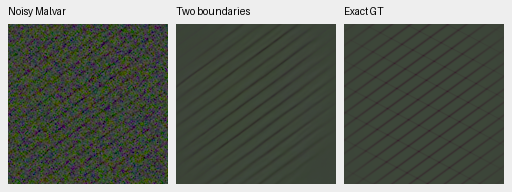
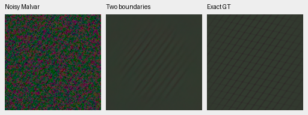

# Testing the RAW query for weak wire beside rail boundaries

The [whole-frame window search](scene-window-donors.md) improved
candidate selection, with little additional faint-wire response at
the parent's quiet error. This replay keeps those guides fixed and
changes the validation and background models inside the query. It
also checks fixed-bracket guides and exact nominal center frequencies
to separate missed nominations from losses during query delivery.

The [phase-averaging follow-up](surface-phase-aggregation.md) reuses
the two-boundary nuisance and the wave gate to limit which local
measurement estimates reach the output.

## Disjoint evidence and the delivery comparison

The predictive score compares the held-out errors of a fixed wave
prediction and its conditional null. If `d` is the difference of the
two predictions, it is equivalent to a whitened correlation with
`d` minus half the whitened norm of `d`. An amplitude fitted on one
fold therefore sets the size of the penalty on the other fold.

The matched score uses the correlation alone. The orthogonal score
first removes the projection of the whitened profile onto the null
design on the validation coordinates. That design includes the affine
background, edge steps and the competing carrier. The geometry, shape
and variance come from the fit on the other fold. The validation
coordinates determine the contrast, while held-out RAW determines its
scalar value. The test removes leakage from nuisance columns in the
modeled span. Systematic structures outside that span can still look
like repeatable detail.

All three scores require positive evidence in both folds. They use
the same per-color eight-knot profiles, discovery reliability, local
window, gate and all-site weighted delivery. The weights and fitted
correction depend on the scores. The parent enters the delivery stage
after both scores are available. Thresholds are 2 at ISO400, 1 at
ISO6400, and 2 for both standing camera profiles. A replay evaluates
one stricter threshold for each setting.

The background follow-up compares a refined single step with up to
two parallel steps on the same discovery samples. Both search the
full offset range on discovery green. A two-boundary fit pays the
same fixed residual-energy penalty used in the
[donor study](localized-donor-validation.md). It enters both the full
and null query fits, including the final all-site refit. The same-side
camera eligibility still comes from the shared initial single edge so
that only the nuisance columns change.

The exact-target observations reuse sources 88–95 across both noise
profiles and all four Bayer patterns. Each source has independent
no-wire, strong-only and two-family RAW roles. Exact-center guides use
only the nominal direction and spacing in all three roles. They
provide a diagnostic of guide availability and do not specify the
target's phase, amplitude or spatial support.

## Matched score results

With the original single-edge background and the same full-frame
guides, replacing predictive error reduction with either matched
score raises ISO400 quiet RMS from **2.451** to about **2.94 DN16**
at the original correction scale. Matching the original quiet level
reduces the orthogonal arm's scale from 0.822 to 0.140. Its weak-wire
response falls from **4.80% to 1.77%** and increment RMS rises from
11.1801 to 11.1949 DN16. The unprojected matched score reaches
1.76% response under the same limit.

This persists when detection is supplied. With fixed brackets, the
predictive and orthogonal scores deliver **9.02%** and **2.28%**
at matched quiet error. With exact nominal centers, they deliver
**9.10%** and **2.30%**. The latter gain from supplied centers is
small relative to the fixed-bracket result on these data. Phase,
spatial support and amplitude estimation still depend on the noisy
query. The orthogonal score brings ISO6400 increment error somewhat
closer to V143 at the cost of weaker or unchanged response.

## Forced-guide rail and edge controls

The 36 exact null scenes use six geometries per scene type and
noise level. They area-integrate flat, single-step and rail-band
targets, then apply independent Poisson/read noise and 16-bit ADC
rounding. Every input receives a proposed periodic carrier normal
to the edge and one perpendicular carrier. The exact clean target
is used as the fixed delivery parent, so these scores measure
added structure in an otherwise correct image. The scorer sees
only the RAW and the assigned guide.

The table pools both profiles, with 12 scenes per row. Each cell
gives changed crops and aggregate added RMS in DN16 on native
160×160 crops. The stricter gate is one unit above the original.

| Exact structure | Refined single step | Two boundaries | Two boundaries, orthogonal | Two boundaries, stricter predictive |
| --- | ---: | ---: | ---: | ---: |
| Flat | 2/12 · 0.077 | 2/12 · 0.077 | 3/12 · 0.169 | 0/12 · 0.000 |
| Single step | 8/12 · 1.331 | 7/12 · 0.460 | 8/12 · 0.624 | 3/12 · 0.167 |
| Rail | 12/12 · 7.291 | 11/12 · 0.789 | 12/12 · 1.095 | 9/12 · 0.426 |

The two-boundary predictive fit reduces aggregate rail error by
**89%** and peak absolute error from **45.57 to 13.58 DN16**.
Its stricter gate lowers aggregate rail error further. The output
still contains nonzero corrections on many deliberately misleading
guides. These numbers measure query delivery with every guide
enabled, separate from the earlier donor-only rejection rates.

## Weak-wire response with both boundary models

For each guide and profile, the refined single-step predictive arm
sets the quiet RMS ceiling. Methods can use the original correction
scale or a smaller scale to stay within that ceiling. The following
uses the original gate for each profile.

| Guides and noise | Quiet ceiling (DN16) | Refined single step | Two boundaries | Increment RMS, step to two boundaries (DN16) |
| --- | ---: | ---: | ---: | ---: |
| Full-frame, ISO400 | 2.45107 | 4.798% | 4.801% | 11.18011 to 11.18019 |
| Exact center, ISO400 | 2.44786 | 8.996% | 9.005% | 11.15717 to 11.15730 |
| Full-frame, ISO6400 | 7.59569 | 0.660% | 0.661% | 25.43798 to 25.43795 |
| Exact center, ISO6400 | 7.60068 | 0.937% | 0.942% | 25.43881 to 25.43879 |

At the stricter ISO400 gate, the two-boundary full-frame arm reaches
**2.93%** weak response at 2.43652 DN16 quiet RMS. V143 alone reaches
**0.89%** at 2.43489 DN16. At ISO6400 all methods recover less than
1% of the weak increment. The two-boundary fit addresses a nuisance
error with roughly unchanged faint response on the positive panel.

The native triplets show noisy Malvar, the two-boundary predictive
result with discovered full-frame guides, and exact GT. Both use
native crop `[176,176,160,160]`, shot/read `8e-5 / 2.56e-8`,
16-bit ADC, exposure ×2 and contrast ×5. The V143 EMA checkpoint is
`96d146d017c54196288c585f8b7eddcf030e8a235061049c31e985b9380b7ce4`.
Both use fixed correction scale 0.82212 and gate 2. The stronger
diagonals remain visible and most faint crossings remain missing.

[Source 88 full comparison](images/query-rail-background-v1/iso400-source88-RGGB-comparison.png) ·
[Source 89 full comparison](images/query-rail-background-v1/iso400-source89-BGGR-comparison.png).

## Native GFX100S review

With the same deliberately retained spectral guides on the building,
the two-boundary fit drops the correction from **31.55 to 3.92 DN16
RMS** over V120 and visibly suppresses the purple/green bands.
The full-frame guide arm remains bit-exact V120 for the building,
overcast sky and foliage. Its coarse-fence correction is 8.99 DN16
RMS, with the existing crossings retained and no convincing new
detail. With full-frame guides all four cab crops now match V120.
The separately retained spectral correction in the transferred
right crop also returns to V120. Fine crossings remain missing.

All cells are native 160×160 fixed ROIs. The parent is V120 EMA,
SHA256 `a9d9b6b4f974e24a6b11e5e740aab32314233a7f53c056cf37c7d2aac1c589fb`.
The main scene uses exposure ×4 and the cab ×16. Nominal shot/read
is `0.00128 / 6.5536e-6`, and transferred cab conditioning is
`0.0014635775921166604 / 1.0715704128646712e-6`.
The DSCF3880 and DSCF3835 ISO100 AHD images and the two cab JPEGs
are independent qualitative references.

| RAW and profile | Native comparisons |
| --- | --- |
| DSCF3879 nominal | [Sky](images/query-rail-background-v1/main-overcast-sky.png) · [Building](images/query-rail-background-v1/main-building-detail.png) · [Foliage](images/query-rail-background-v1/main-foliage.png) · [Coarse fence](images/query-rail-background-v1/main-chain-link-fence.png) |
| DSCF3842 nominal | [Left](images/query-rail-background-v1/mesh-nominal-left.png) · [Right](images/query-rail-background-v1/mesh-nominal-right.png) |
| DSCF3842 transferred | [Left](images/query-rail-background-v1/mesh-profile3879-left.png) · [Right](images/query-rail-background-v1/mesh-profile3879-right.png) |

Ten comparison boards and two triplets were viewed at native
crop resolution. CPU collection took 149.26 seconds for the score
replay and 195.61 seconds for the background replay. The second
stage verifies 408 retained arrays bit for bit. Both stages use
archived neural predictions. This component study adds no training
or standard full427 and known/unseen PSNR measurements.

[Native crop manifest](images/query-rail-background-v1/manifest.json) ·
[Metrics and null counts](results/query-rail-background-v1/summary.json) ·
[Publication hashes](results/query-rail-background-v1/publication.json) ·
[Frozen receipts and scripts](results/query-rail-background-v1/evidence.tar.gz).
