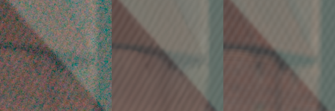
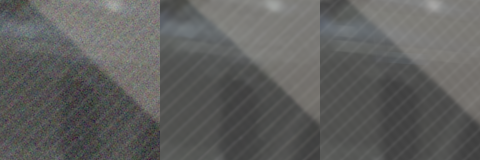

# Choosing the shape of each weak wire from measured Bayer bands

Keeping a narrow ribbon for both directions can add fine detail to the
wrong wire. On six ISO6400 photo fields containing one narrow and one
smooth direction, checking shape separately lowers the measured error
at the weak direction's second harmonic from **11.43 to 0.65 DN16**.
With the earlier correction scaled to equal mean weak response, that
error is still 11.08 DN16. The per-direction fit also lowers average
increment error. It gives up part of the genuine high-frequency signal
when both directions are narrow.

[Scores, native bindings and checkpoint](results/query-shape-routing-v1/publication.json) ·
[Frozen drivers and full scores](results/query-shape-routing-v1/evidence.tar.xz) ·
[Reviewed native images](images/query-shape-routing-v1/manifest.json).

A [shared Bayer gap check](query-shared-gap.md) tests the remaining spill
on additional ellipse and strip targets and preserves all eight standing crops.

## Automatic frequencies and separate shape checks

The [conditional shape study](query-donor-bandlimit.md) supplied exact
frequencies to the test. This comparison starts with the same automatic
exterior nomination as the [combined donor path](query-donor-composition.md).
At least two nearby, disjoint exterior tiles must support a pair. The native
query uses Q0 to refine frequencies and phases. Disjoint groups Q2 and Q3
score the fixed fundamentals and any added bands. The older 13-placement
donor check must also admit a correction. These rules and the delivery gain
remain fixed.

All arms use the same Corpus 100k EMA,
`87b96f3c487b9edaf1c477742b6c38f2a82cc6b20a94716d51cc8cf46a17a760`.
The neural input is a 320×320 crop with a 32-pixel halo around the 256×256
Bayer query. The matching and rotated exteriors are byte-identical across
that neural input and the native query. The exact-target experiment tests
the automatic exterior crop path directly. The standing comparison applies
the shape policies where the earlier combined path uses the exterior
fallback.

- **Ribbon** delivers the earlier exterior and checked-band correction.
- **Restricted bands** retains the two measured fundamentals and adds any
  checked higher bands from the RAW.
- **Whole-query shape gate** keeps the ribbon when either direction has a
  verified second harmonic. Otherwise it uses the restricted bands.
- **Per-direction gate** preserves the original donor's second-harmonic
  contribution only in the confirmed direction. It retains the component
  with the checked sign and phase, caps amplitude at 1.5 times the Q0 estimate
  and uses the same local support map. The final RAW refit accounts for
  this contribution before adding the remaining accepted residuals.

A noiseless check of the last branch recovers 0.00599999 of a supported
0.006 camera-green term. It leaves less than 0.00000009 of the other
direction's equal-strength harmonic and rejects the opposite phase
in the central region. The exact target enters the evaluation only.

## Exact-target photo panel

Twenty-four freely licensed photo backgrounds are disjoint from the
preceding donor-shape and harmonic panels and excluded from the ongoing
90,692-photo training manifest. They previously appeared in a separate
repeat-denoising evaluation. The new crop positions, waveforms and sensor
draws are fixed before reconstruction. Six backgrounds each cover broad
sinusoidal wires, two narrow wires, mixed narrow and broad wires, and a
narrow rear direction interrupted by a local gap. Every background is
captured at ISO400 and ISO6400, with independent present, outside-only,
strong-only and exact-flat roles. The exterior context additionally has
a 0.57-radian rotated control beyond the 32-pixel halo.

The matching exterior path delivers on **22/24 ISO400** and **18/24
ISO6400** present roles. Among these active cases, the largest frequency
error in either direction has a median of 0.00058 and 0.00054 cycles per
native pixel, respectively. Every rotated output and every outside-only,
strong-only and flat control equals its neural parent. The legacy
overlap check still rejects a few control candidates that pass the
individual fundamental checks.

| ISO6400, 24 photo backgrounds | Aligned weak response | Weak-increment RMS | Exact present-image RMS |
| --- | ---: | ---: | ---: |
| Corpus 100k EMA | 27.60% | 185.536 DN16 | 171.432 DN16 |
| Ribbon | 51.40% | 191.773 DN16 | 162.235 DN16 |
| Restricted bands | 47.33% | 185.318 DN16 | 160.241 DN16 |
| Whole-query gate | 51.28% | 191.254 DN16 | 161.763 DN16 |
| Per-direction gate | 48.49% | 185.981 DN16 | 159.313 DN16 |

Compared with the whole-query gate, per-direction fitting lowers mean
ISO6400 increment RMS by 5.273 DN16 [2.903, 7.959] and present-image RMS
by 2.450 DN16 [0.489, 4.636]. The intervals resample photo IDs.
Aligned response falls by 2.793 points [1.358, 4.444]. The restricted
arm has slightly lower increment RMS overall, with weaker recovery
and higher present-image error than per-direction fitting.

| ISO6400 profile | Measured quantity | Whole-query gate | Per-direction gate |
| --- | --- | ---: | ---: |
| Broad, both directions sinusoidal | Weak second-harmonic error | 0.424 DN16 | 0.424 DN16 |
| Narrow, both directions narrow | Weak second-harmonic error | 21.950 DN16 | 29.193 DN16 |
| Mixed, strong narrow and weak smooth | Weak second-harmonic error | 11.431 DN16 | 0.651 DN16 |
| Interrupted, exact gap in the rear wire | Added gap RMS | 51.931 DN16 | 42.552 DN16 |

The second-harmonic error is measured by fitting the residual on the
true weak second harmonic after accounting for the other major bands
and smooth background. In the mixed group, all admitted second terms
match the narrow strong direction, across both noise settings. Keeping
the whole ribbon extends that shape choice to the other direction.
At equal mean weak response, weak second-harmonic error remains
**11.075 → 0.651 DN16** at ISO6400. The equal-response control scales
the whole-query correction by 0.9677 using the targets, as a retrospective
diagnostic. ISO400 gives **4.965 → 1.032 DN16** at equal response.
The ISO6400 interrupted group still shows substantial texture inside
the exact gap. Neither policy uses a gap detector.

### Native exact-target crops

The triplets show noisy Malvar, per-direction gate and the exact target.
Both are native 160×160, ROI `[48,48,160,160]` in the 256×256 query.
They use shot/read `0.00128/0.0000065536`, capture exposure `0.33`,
display exposure ×2, and fixed white balance and color transform.
The complete comparison strips run in order from noisy, Corpus 100k,
ribbon, restricted bands, whole-query gate and per-direction gate to exact GT.

Broad source 4, *Gdańsk, Żuraw (WLZ14)* by 1bumer, RGGB, source box
`[162,68,512,512]`. The second direction is faint, especially behind
the colored edge. The exact target still has greater crossing modulation.
[Photo and CC BY-SA 3.0 Poland](https://commons.wikimedia.org/wiki/File:Gda%C5%84sk,_%C5%BBuraw_(WLZ14).JPG) ·
[All methods](images/query-shape-routing-v1/exact/004-iso6400-comparison.png) ·
[Outside-only](images/query-shape-routing-v1/exact/004-iso6400-absent.png) ·
[Flat](images/query-shape-routing-v1/exact/004-iso6400-quiet.png) ·
[Rotated surroundings](images/query-shape-routing-v1/exact/004-iso6400-wrong.png).

Mixed source 2, *Daihatsu K-Open* by TTTNIS, GRBG, source box
`[228,102,512,512]`. The narrow strong wires remain distinct. The
weaker direction looks smoother with per-direction filtering.
[Photo and CC0](https://commons.wikimedia.org/wiki/File:Daihatsu_K-Open.jpg) ·
[All methods](images/query-shape-routing-v1/exact/002-iso6400-comparison.png) ·
[Outside-only](images/query-shape-routing-v1/exact/002-iso6400-absent.png) ·
[Flat](images/query-shape-routing-v1/exact/002-iso6400-quiet.png) ·
[Rotated surroundings](images/query-shape-routing-v1/exact/002-iso6400-wrong.png).

The narrow and interrupted controls use the same exposure, noise and
native ROI. Narrow source 1 is BGGR, source box `[192,200,512,512]`.
Interrupted source 3 is GBRG, source box `[286,76,512,512]`. The narrow
comparison shows clearer fine profiles in the earlier ribbon. The
interrupted comparison still shows weak traces through the true gap.
[Photo by Gzen92, CC BY-SA 4.0](https://commons.wikimedia.org/wiki/File:Fleur_(Prunus)_(5).jpg) ·
[Narrow comparison](images/query-shape-routing-v1/exact/001-iso6400-comparison.png) ·
[Photo by Ildar Sagdejev, CC BY-SA 4.0](https://commons.wikimedia.org/wiki/File:2011-02-11_Infiniti_at_Carlisle.jpg) ·
[Interrupted comparison](images/query-shape-routing-v1/exact/003-iso6400-comparison.png).

## Standing GFX100S comparisons

All eight boards were viewed at native scale. Neither left-cab profile
supports a phase-locked second harmonic. Both gates select the restricted
fit, matching its pixels exactly. Compared with the earlier ribbon,
the fine crossings appear softer under both profiles. Some faint diagonal
repeats remain visible below the near-horizontal wire. The two right
outputs retain the previously checked lattice, with incomplete crossings.
The broad main fence stays legible. The overcast sky is smooth and retains
the preceding pixels. Fine building cables and leaf margins remain soft.

Main DSCF3879 ISO6400 with independent DSCF3880 ISO100 AHD uses shot/read
`0.00128/6.5536e-6`, display ×4 and cached ROI `[176,176,160,160]`.
[Sky](images/query-shape-routing-v1/standing/main-overcast-sky-main-overcast-sky.png) ·
[Building](images/query-shape-routing-v1/standing/main-building-detail-main-building-detail.png) ·
[Foliage](images/query-shape-routing-v1/standing/main-foliage-main-foliage.png) ·
[Coarse fence](images/query-shape-routing-v1/standing/main-chain-link-fence-main-chain-link-fence.png).

Cab DSCF3842 ISO6400 with DSCF3835 ISO100 AHD and both camera JPEGs
uses display ×16 and cached ROIs `[206,229,160,160]` left and
`[426,189,160,160]` right. The same RAW is evaluated at the nominal
and transferred `0.0014635775921166604/1.0715704128646712e-6` profiles.
The separate aperture, exposure and subject motion make the ISO100
AHD and camera JPEG qualitative references.
[Nominal left](images/query-shape-routing-v1/standing/mesh-nominal-fine-green-mesh-left.png) ·
[Nominal right](images/query-shape-routing-v1/standing/mesh-nominal-fine-green-mesh-right.png) ·
[Transferred left](images/query-shape-routing-v1/standing/mesh-profile3879-fine-green-mesh-left.png) ·
[Transferred right](images/query-shape-routing-v1/standing/mesh-profile3879-fine-green-mesh-right.png).

Numerical and native reviews are complete for this inference component.
It uses zero training updates. Comparable 427-photo and known/unseen
camera scores are unavailable for this component.
