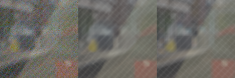
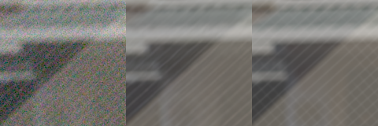

# Checking for missing wire with a shared Bayer waveform

On 24 additional held-out photo backgrounds at ISO6400, a local Bayer gap check reduces the weak texture added inside true gaps from **57.77 to 48.64 DN16 RMS** over the [per-direction donor fit](query-shape-routing.md). Total gap error also falls. Nearby intact weak-wire recovery drops from **64.13% to 61.14%** and one continuous contrast dip triggers a cut. The older ISO6400 replay shows little change. All eight standing GFX crops equal the preceding output pixel for pixel.

[Publication receipt](results/query-shared-gap-v1/publication.json) · [Frozen drivers and scores](results/query-shared-gap-v1/evidence.tar.xz) · [Reviewed images and provenance](images/query-shared-gap-v1/manifest.json).

## Candidate and independent check

The donor path keeps the two measured frequencies only where adjacent exterior RAW and the native reserved bands already support them. The new check runs only on an admitted donor path. Q0 identifies the weaker fundamental by amplitude. Q0 and Q1 fit a shared prediction for that direction, with supported second harmonics and sum or difference bands involving it. A component must show consistent coefficients across the two discovery folds above the fixed noise bound. The fit also includes background, a step with per-side amplitudes, the other carrier and local trends.

Discovery selects one local deficit from a fixed bank of 600 ellipses and 180 strips. Q2 and Q3 then test the same footprint and waveform. The pooled score must exceed 3.25 and each fold must exceed 0.85. An approved fit removes a tapered fraction of the existing donor lift in the matched weak bands, capped at 0.85. A comparison uses only the weak fundamental. A second comparison also requires evidence for the sharp footprint after accounting for a smooth dip with the same center and extent. All branches share the Corpus 100k EMA parent, SHA256 `87b96f3c487b9edaf1c477742b6c38f2a82cc6b20a94716d51cc8cf46a17a760`. This is an inference study with no weight updates.

## Additional photo panel and earlier replay

The additional Wikimedia bin4 backgrounds are disjoint from the preceding shape and junction studies and the 90,692-source scene training pool. They were previously used in a separate repeat-denoising evaluation. The fixed panel gives six backgrounds each a translated, rotated ellipse, strip, continuous nonzero contrast dip or nonzero contrast step. The query is 256 native pixels with a 32-pixel halo. Each background has independent two-wire, strong-only, flat and outside-only captures plus an orientation-changed exterior. The earlier 24 backgrounds replay both ISO400 and ISO6400. Sources, crop/noise identities, admissions and complete paired scores are in the archive.

| ISO6400, 12 additional true gaps | Added gap RMS, DN16 | Total gap error, DN16 | Intact weak response |
| --- | ---: | ---: | ---: |
| Corpus 100k EMA | 0.00 | 163.31 | 37.17% |
| Directional donor | 57.77 | 158.04 | 64.13% |
| Fundamental check | 53.12 | 156.23 | 61.83% |
| Shared waveform check | 48.64 | 154.41 | 61.14% |
| Shared plus sharp check | 54.38 | 156.97 | 62.10% |

For the shared check versus the directional fit, the mean reduction is **9.13 DN16 [3.37, 16.50]** for added gap RMS and **3.62 DN16 [1.18, 6.70]** for total gap error, with a **2.99-point [0.97, 5.42]** decline in intact response. The intervals are paired across backgrounds. Added RMS measures the correction above Corpus 100k in the gap. Total error measures distance to exact GT there. The strong-band projection changes 0.035 DN16 on intact sites. Ellipse added RMS falls 58.28 → 45.51 DN16 and strip added RMS falls 57.27 → 51.76 DN16. Of the twelve gaps, ten enter the existing donor route. The fundamental, shared and sharp checks cut six, seven and four gaps respectively. The shared and sharp checks both cut the same continuous dip. The fundamental check cuts zero continuous cases. No arm cuts a contrast step. Flat, strong-only, outside-only and rotated controls reproduce the upstream output exactly.

Across the six earlier gaps at ISO6400, the directional, shared and fundamental results add 42.55, 42.44 and 41.24 DN16 respectively. At ISO400, the shared result lowers the directional result's added gap RMS from 11.93 to 10.31 DN16. These replays show that the size of the benefit depends on the geometry panel.

### Locating the boundary

Giving the reserved-RAW scorer the known footprint raises fundamental admissions from six to seven of the ten active additional gaps. Shared admissions rise from seven to nine. Median footprint overlap is 0.385 for the fundamental and 0.454 for the shared hypothesis over nonempty automatic nominations. No known-footprint output enters the comparisons. A noiseless test recovers the correct bank entry. Perturbing the reserved folds changes the scores while leaving nomination and spectral selection fixed. Outside-mask edit pixels stay identical.

An exploratory replay separately audits a smaller core and its outer rim. At 49.03 DN16 of added gap RMS on the additional backgrounds, the rim check retains 61.68% intact response versus 61.35% for a uniform reduction of the original shared edit. Total gap error rises slightly from 154.54 to 154.60 DN16. The earlier ISO6400 replay has more intact-wire change with the rim check at matched leakage. This boundary result is a numerical replay on the same cohorts.

A second replay puts the candidate's smooth and hard spatial masks into the discovery background fit, matching the reserved scorer. Ranking by pooled evidence cuts five of the twelve additional gaps and one continuous case. Ranking by the weaker discovery fold cuts four gaps and zero continuous cases. Added gap RMS rises from 48.64 to 51.04 and 53.97 DN16, respectively. At the same added gap RMS, uniformly weakening the original shared edit retains more intact response than either reranking on the additional ISO6400 panel. The earlier high-noise replay changes little. [Replay scores](results/query-shared-gap-v1/nomination-replay.json) · [Frozen driver](results/query-shared-gap-v1/nomination-replay.tar.xz).

## Native exact-target comparisons

Every cell is 160×160 original query pixels at `[48,48,160,160]`. Both triplets show noisy Malvar, shared gap check above Corpus 100k and exact constructed GT. They use ISO6400 shot/read `0.00128/6.5536e-6`, capture exposure 0.33 and display exposure ×2, with shared white balance and color transform. The archive preserves the initial fresh-routing log and its receipt recovery. The recovery verified the 24 completed prediction files after the final receipt write hit an outdated driver path.

**Additional ellipse**. *Ravenscourt Park tube station MMB 11 1973 Stock*, mattbuck, CC BY-SA 4.0. Source box `[400,52,512,512]`, RGGB. Repeated diagonal contrast softens around the center, while the exact target still shows a clearer break. [Source](https://commons.wikimedia.org/wiki/File:Ravenscourt_Park_tube_station_MMB_11_1973_Stock.jpg) · [All methods](images/query-shared-gap-v1/exact/020-iso6400-comparison.png) · [Quiet control](images/query-shared-gap-v1/exact/020-iso6400-quiet.png).

**Earlier interrupted wire**. *Couple selfie stick Konigssluis Amsterdam 2016-09-13-6621*, Slaunger, CC BY-SA 4.0. Source box `[142,58,512,512]`, GBRG. The visible change is small. A faint diagonal remains around the interruption. [Source](https://commons.wikimedia.org/wiki/File:Couple_selfie_stick_Konigssluis_Amsterdam_2016-09-13-6621.jpg) · [All methods](images/query-shared-gap-v1/exact/011-iso6400-comparison.png) · [Quiet control](images/query-shared-gap-v1/exact/011-iso6400-quiet.png).

## Standing GFX100S comparisons

All eight native boards were reviewed. The earlier donor gate nominates an exterior proposal only on the left cab, and the gap check leaves both of those views intact. The DSCF3879 sky remains smooth, coarse-fence crossings remain visible, and leaf and building detail stay soft. Fine DSCF3842 cab crossings remain incomplete on both sides. The native boards include the independent ISO100 AHD references and both camera JPEGs for the cab. The references are qualitative because aperture, exposure time and moving subjects differ.

The DSCF3879 views use shot/read `0.00128/6.5536e-6`, display ×4. DSCF3842 uses display ×16 and either that noise prior or the transferred `0.0014635775921166604/1.0715704128646712e-6` prior. Coordinates, Bayer inputs and display transforms are bound in the [native manifest](images/query-shared-gap-v1/manifest.json).

[Overcast sky](images/query-shared-gap-v1/standing/main-overcast-sky-main-overcast-sky.png) · [Building](images/query-shared-gap-v1/standing/main-building-detail-main-building-detail.png) · [Foliage](images/query-shared-gap-v1/standing/main-foliage-main-foliage.png) · [Coarse fence](images/query-shared-gap-v1/standing/main-chain-link-fence-main-chain-link-fence.png).

| Cab profile | Native comparisons |
| --- | --- |
| Nominal | [Left](images/query-shared-gap-v1/standing/mesh-nominal-fine-green-mesh-left.png) · [Right](images/query-shared-gap-v1/standing/mesh-nominal-fine-green-mesh-right.png) |
| Transferred | [Left](images/query-shared-gap-v1/standing/mesh-profile3879-fine-green-mesh-left.png) · [Right](images/query-shared-gap-v1/standing/mesh-profile3879-fine-green-mesh-right.png) |

The exact photo scores and both native GFX reviews are complete. This scope has no comparable full427 or measured-camera PSNR score. [Performance history](performance-history.md).
